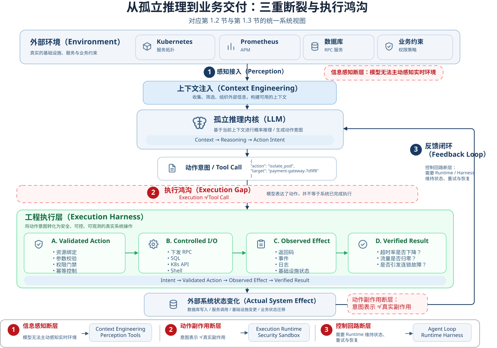
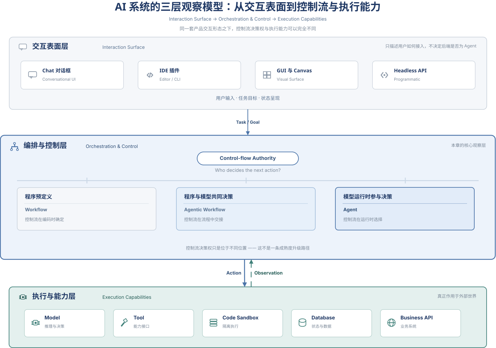
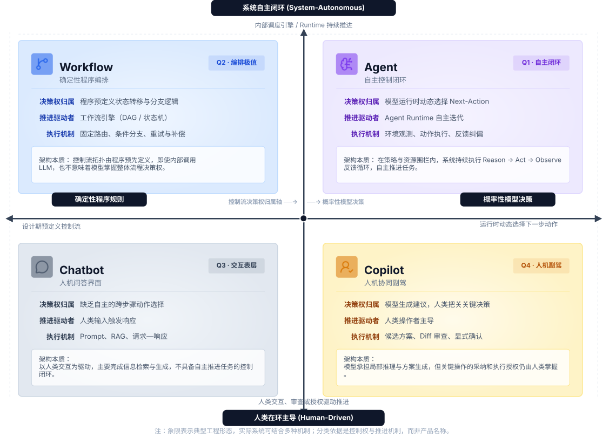
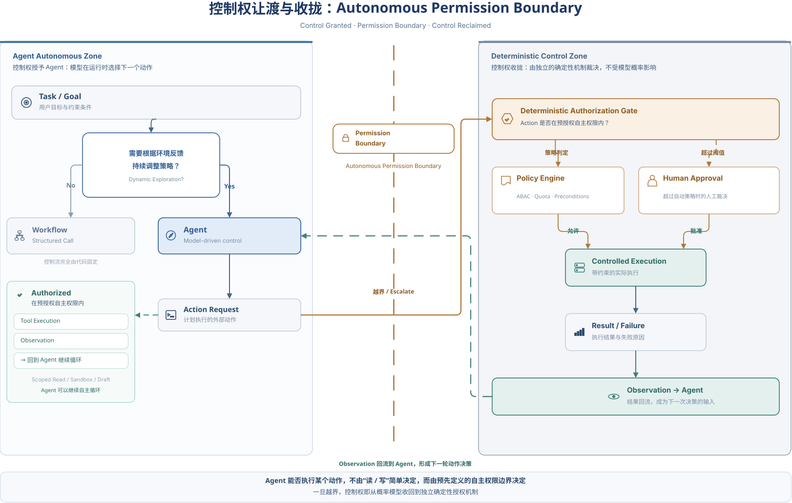
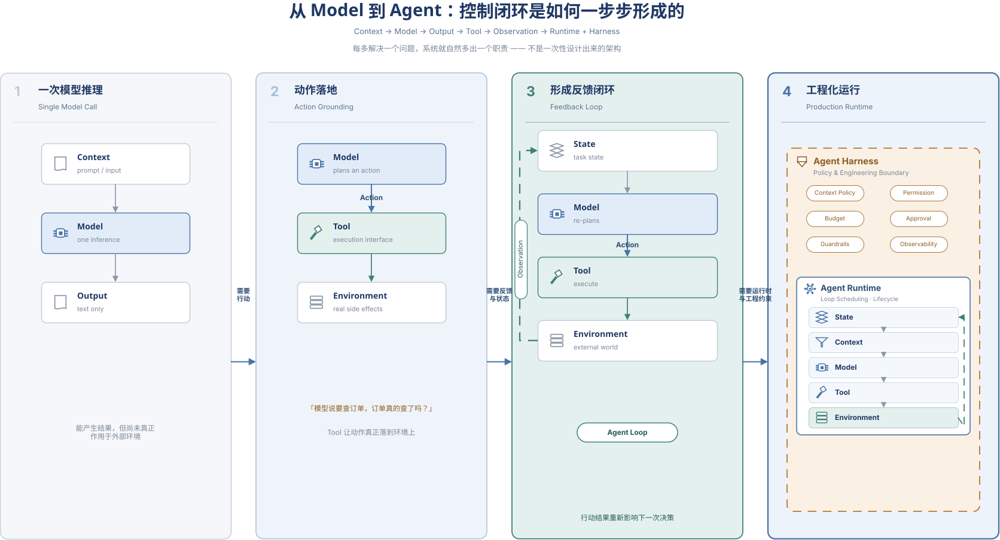
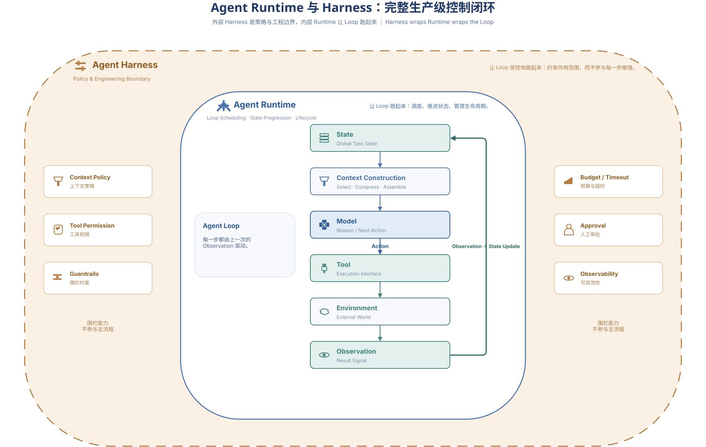
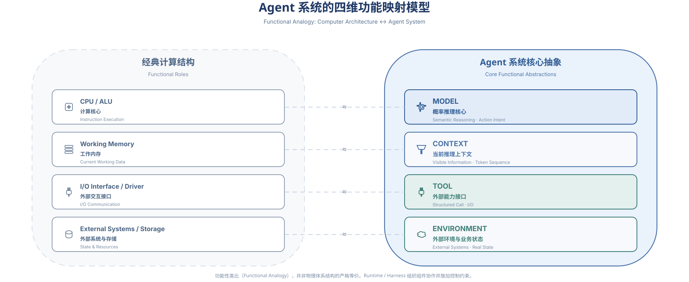
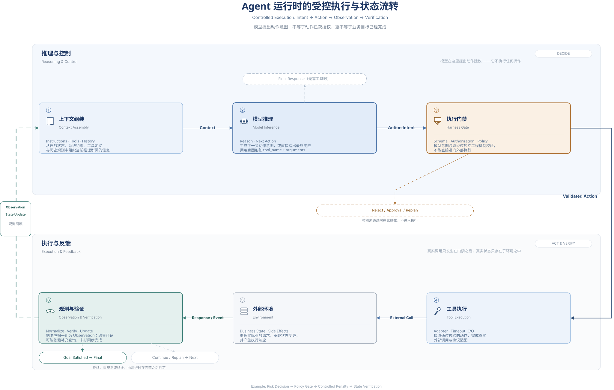
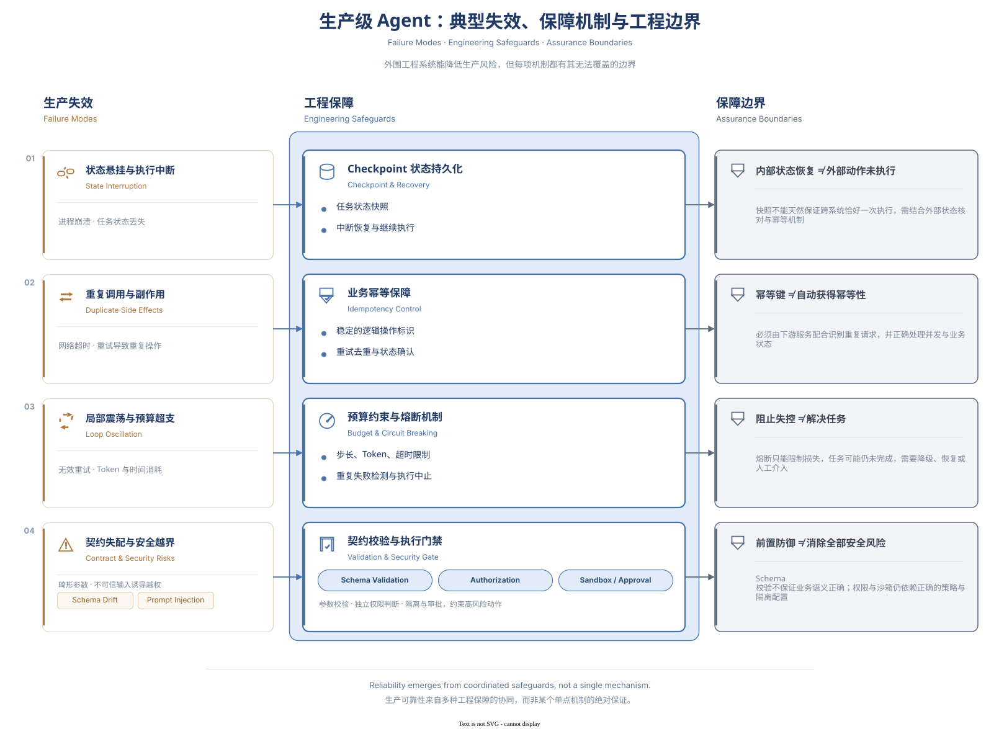

# 第1章 从 LLM 到 Agent：现代 Agent 的系统模型

**本章核心脉络与阅读导览**

剖析 Agent 系统模型，并不需要堆砌繁杂的框架新名词，而是一场由工程矛盾自然逼出的系统论推导。本章将沿着一条环环相扣的系统演进脉络展开：

1. **现实断层（Why · 为什么需要系统底座？）**：从经典软件确定性逻辑的边界切入，剖析孤立推理内核在感知、执行与控制上的三重断裂，确立 $\text{Execution} \ne \text{Tool Call}$ 的核心交付鸿沟。
2. **控制权转移（Who · 决策权究竟归谁？）**：穿透交互界面与产品包装，通过“决策权归属 $\times$ 推进主导者”二维解耦框架界定系统形态，确立 $\text{Action Selection} \ne \text{Execution Authorization}$ 的权限分离基石。
 3. **系统模型与时序（What · 最小完备实体是什么？）**：从单次模型调用的六个工程矛盾自然推导核心组件，借用冯·诺依曼架构建立心智模型，并通过 IM 风控多轮纠偏实战呈现受控落地时序。
 4. **核心循环动力学（How · 动态自愈闭环如何运转？）**：解析“将异常反馈降级为决策输入”的离散控制节拍，严格定义主观终止、业务收敛与刚性熔断三类终态，通过 40 行极简内核与数据库字段漂移实战透视自愈本质。
 5. **生产支撑防线（Where · 真实环境的工程边界在哪里？）**：直面生产环境的 5 类典型系统失效，透视支撑系统层（Harness）在幂等、快照、预算与沙箱中的物理边界，建立全书工程方法论。

## 1. 现实断层：确定性逻辑的边界与执行鸿沟

### 1.1 确定性逻辑的边界与计算范式演进

半个世纪以来，现代软件工程的核心方法论始终建立在**确定性控制逻辑**之上。从过程式程序中的条件分支，到有限状态机、控制流图（Control Flow Graph），再到关系型数据库的 ACID 事务与复杂的分布式工作流，经典软件系统都遵循一个共同原则：**由工程师预先定义系统的控制规则，由计算机严格按照规则完成状态转移。**

从抽象形式化视角审视，经典计算过程可严格抽象为一个确定性状态转移函数：

$$
(S_t, I_t) \xrightarrow{\quad f \quad} (S_{t+1}, O_t)
$$

系统在当前全局状态 $S_t$ 下接收外部输入 $I_t$，经由预设的控制逻辑 $f$，确定性地迁移至新状态 $S_{t+1}$，并产生外部输出 $O_t$。

**在这套范式中，决定系统如何流转状态的全部转移规则 $f$，在设计期或编译期就必须被显式锁定。**

> 这里的“确定性”，并不假设物理世界是静态或平稳的，也不意味着所有可能状态都必须被逐一枚举，相反，高可用系统设计中充斥着网络瞬时超时、并发数据竞争、机器宕机与不可控的异常输入。**确定性的真正本质在于：决定系统如何解析输入、如何判定分支跳转，以及在遭遇异常时如何回滚或降级的控制逻辑 $f$，原则上必须由工程师在设计期或编译期显式编码锁定。**
>
> 从关系型数据库的预写日志（WAL）与两阶段提交，到微服务编排中的 Saga 事务补偿与有限状态机，整套经典体系的核心优势在于**高可测试性、行为可预期与严格的形式化验证**。无论系统拓扑多么庞大，其控制流在宏观上始终遵循一条铁律：**人类工程师负责定义状态转移规则，计算设备机械的执行转移规则。**

然而，当这套体系直面开放现实世界中的非结构化意图与高度模糊的需求时，工程穷举的边际成本开始呈现指数级暴增。现实业务并非由标准结构体（Struct）组成，而是充斥着模糊的自然语言、突发异常的物理环境以及动态演变的业务策略。传统的工程妥协方案是编写成千上万行复杂的正则表达式与层层嵌套的 `if-else` 分支，但最终系统仍不可避免地滑向软件熵增的深渊：代码越来越脆弱，边界维护成本超越了业务本身的价值。

这构成了经典软件范式的**第一道工程边界**：

**确定性程序极其擅长在封闭边界内执行已被形式化描述的逻辑，却极难依靠有限的显式规则，覆盖一个开放、动态且无法在设计期被充分结构化的问题空间。**

为了突破这一边界，计算范式经历了由浅入深的演进：

首先，统计机器学习与深度学习的发展，部分松动了系统对人工显式规则的依赖。工程师不再需要手写几何特征来识别目标，或是编写海量过滤规则来计算反欺诈分值，而是通过损失函数与反向传播，在高维隐空间中拟合复杂的映射关系。

而在规则极其清晰的封闭受限环境（如围棋棋盘或物理模拟引擎）中，强化学习（RL）更进一步证明：系统能够在给定的状态与动作空间内，通过与环境的高频试错，自主探索出超越人类经验的复杂决策策略。

然而，这类范式并没有真正改变软件工程的控制权边界。

无论是图像分类模型输出类别概率、风控模型输出风险评分，还是强化学习在预设的动作列表里挑选操作，它们都有一个共同的前提：**问题的输入格式、输出语义以及系统能够采取的动作，依然全部由工程师在离线阶段用代码严格框死。**

AlphaGo 哪怕探索出超越人类的棋路，它的决策也只能映射为棋盘上固定坐标的落子，它无法理解棋盘之外的任何现实逻辑，更无法根据当前局势动态调用搜索引擎或跨系统接口。它们本质上依然是高度特化的“专用型计算算子”，**缺少面向开放业务环境的复杂意图理解、长程上下文推导与跨系统的动态工具协同能力**。

大语言模型（LLM）的出现，改变了这一格局。

基于 Transformer 架构与海量多样性语料预训练的大语言模型，使自然语言与非结构化语义首次成为一种通用的计算界面。**非结构化输入的解析、上下文关联与多跳逻辑推导，第一次无需下游预先编写特定的解析代码，而是直接由模型在运行时（Runtime）动态完成。**

在过去，系统无法直接理解非结构化的业务意图，必须依赖人类工程师在事前将业务诉求（例如一次线上服务故障排查）拆解并序列化为严格参数化的静态结构体：

```json
{
  "action": "INSPECT_SERVICE_METRICS",
  "service_id": "payment-core",
  "time_window_minutes": 15,
  "metrics": ["upstream_timeout_rate", "risk_intercept_rate"],
  "route_failover_enabled": true
}
```

而在现代大语言模型的语义空间中，系统可以直接输入原始的自然语言、实时日志片段与监控趋势。模型能够在运行时解析出业务上下文中的核心实体，推导出依赖顺序，并提出合理的排查步骤。软件系统的能力边界，由此从“执行预定义的确定性规则”，跨越到了“在开放语境中推导决策”。

但这仅仅解决了复杂问题交付的前半段。

模型在运行时能够理解“应该排查支付链路”，推断出需要比对指标与日志，甚至生成语法正确的查询语句。

然而，**在一次前向传播（Forward Pass）的自回归计算中推导出“应该做什么”，与在物理生产环境中“把事情做完”之间，存在着根本性的系统断裂。**

大语言模型输出的物理本质仅仅是一组文本 Token。它不会自行转化为网络套接字（Socket）上的物理 I/O，无法主动感知集群的实时健康度，更不具备维系跨请求任务状态与事务补偿的能力。软件系统的能力边界跨越了“语义理解与推理”之后，**第二道工程边界**随之浮现：

> **从非结构化语义的自回归推导演算，到物理环境中的受控状态变更，中间横亘着一道无法仅靠堆叠参数量或优化提示词跨越的执行鸿沟（Execution Gap）。**

LLM 提供了运行时的理解与决策算力，却无法自发成为一个持续运转的业务系统。要理解孤立模型为何无法独自跨越这道鸿沟，必须将观察粒度下沉到单次模型调用的计算边界。

### 1.2 孤立推理内核的三重系统断裂

在给定上下文序列 $X$ 的条件下，模型逐步计算后续 Token 的条件概率分布，并通过解码策略生成输出序列：

$$
P_\theta(y \mid X) = \prod_{t=1}^{T} P_\theta(y_t \mid X, y_{< t})
$$

$$
y \sim P_\theta(\cdot \mid X)
$$

> 其中，$X$ 表示本次推理输入的完整上下文，$y_t$ 表示第 $t$ 个输出 Token，$y_{< t}$ 表示此前生成的 Token 序列，$\theta$ 表示模型参数。
>
> 这一计算过程的核心在于：模型能够基于已有上下文推导并生成新的语义序列，但序列生成机制本身并不包含外部环境访问、物理副作用执行或跨请求任务状态管理的能力。

无论上层接口采用常规请求响应、流式传输（Streaming）还是全双工长连接，一次孤立的模型推理在业务语义上仍然只是一次计算过程：**它本身不具备对外部业务系统产生受控副作用的能力，也不天然拥有跨任务持续存在的业务生命周期。**

模型参数在推理结束后不会因本次业务交互而自动产生持久化变更；所谓的会话上下文、任务历史与长期状态，在物理上全部依托于外围系统的存储管理与重新注入。

为了看清这种孤立推理内核与现实生产环境的本质冲突，我们推演一个典型的分布式 SRE 故障排查场景：

> **运维指令**：“排查过去 15 分钟内支付核心网关超时率突增的异常节点，拉取错误堆栈并比对慢查询，隔离故障实例，并向应急指挥群发送处置摘要。”

面对这一复杂的工业级任务，若仅仅依赖单体模型进行处理，无论底层模型的推理能力多么强大，整个交付链路也会在物理世界中遭遇三重结构性断裂：

#### 1.2.1 感知断层：静态推理上下文与动态环境状态的割裂

单独运行的模型对外部环境本质上是**被动且静态**的。在缺乏外部探针与动态数据注入的前提下：

- 模型参数承载的是训练与后训练阶段形成的参数化知识，本身无法自动反映当前生产环境中的实时状态；
- 单体模型既无法自行读取 Git 仓库中最新提交的 Java 业务代码与 Spring Boot 配置，也无法主动获取 Maven 构建失败的日志、JUnit 测试报告，更无法直接感知线上 JVM 的线程状态、异常堆栈以及分布式调用链路中的实时异常。

模型不具备面向物理环境的**主动数据摄取通道（Active Data Ingestion Channel）**。在没有外围系统为其主动采集并拼装上下文之前，模型所做的一切逻辑推演，都只能建立在当前上下文所提供的有限信息边界之内。

> **系统收敛指向**：这一信息真空，要求系统架构必须引入 **上下文工程（Context Engineering）** 与 **感知类工具契约（Perception Tools）**，将环境状态主动捕获并注入至模型的瞬时上下文中。

#### 1.2.2 执行断层：动作意图与真实系统执行的割裂（Decision $\ne$ Execution）

在软件系统中，真正改变外部业务状态，最终都需要落实为某种可执行的副作用（Side Effects）——调用系统接口、发送网络数据包、写入持久化存储或变更基础设施资源。

大语言模型直接生成的产物，其本质仅仅是 Token 序列或由特定 Schema 编码出的结构化数据（如 JSON 格式的 Tool Call 请求）：

```JSON
{
  "action": "isolate_gateway_instance",
  "target_pod": "payment-gateway-7d9f8-x2k9l",
  "drain_timeout_seconds": 30
}
```

**动作的表示（Representation of Action），绝不等于动作本身。**

模型输出的命令文本或结构化数据，本身无法自行转化为对外部系统的真实调用。它无法自行建立与 Kubernetes API Server 的受认证连接并提交资源变更请求，更无法直接向数据库集群下发连接终止或故障处置指令。模型仅仅完成了“判断应该做什么”的决策阶段，而“把动作落地到真实系统”的执行链条完全处于断开状态。

> **系统收敛指向**：这一执行断裂，要求外围系统引入 受控工具执行层（Tool Execution Layer），负责承接模型的动作意图，完成参数校验、权限鉴权与协议适配，并通过工具适配器向外部系统发起真实 I/O；对于代码执行、Shell 操作等高风险能力，还需要引入 安全沙箱（Sandbox） 等隔离与约束机制。

#### 1.2.3 控制断层：单次推理与持续反馈闭环的割裂

在真实的分布式生产环境中，业务执行从来不是线性的理想路径，而是充斥着瞬时扰动与环境故障：

- 查询监控接口可能遭遇网络抖动引发的超时（HTTP 504 Gateway Timeout）；
- 执行节点隔离时，运维凭证可能因过期导致认证失败（401 Unauthorized），或因策略变更遭遇授权拒绝（403 Forbidden）；
- 执行排查时，可能因目标实例连接池耗尽而直接拒绝建立握手。

对于一次孤立的模型推理而言，一旦本轮生成结束，其推理生命周期即告终止。后续发生的网络异常、权限错误或执行结果，除非由外部系统重新封装进上下文并触发下一轮推理，否则单体模型完全无法继续感知。

单体模型缺乏“执行动作 $\to$ 观察环境反馈 $\to$ 捕获运行时异常 $\to$ 调整决策”的持续闭环能力。

> **系统收敛指向**：这一控制真空，要求外围系统引入具备任务状态管理能力的 Agent Runtime，负责驱动执行循环（Agent Loop）、推进并持久化任务状态，以及在异常与超时后恢复执行；权限围栏、资源预算与可观测性等生产级保障，则由外围工程约束机制（Harness）承接。

#### 1.2.4 小结：从三重断裂到系统能力的推导

从系统能力边界来看，这三重断裂分别对应三个无法由孤立模型推理自行完成的过程：

- **感知**断层：模型无法主动获取外部环境的实时状态，推理只能建立在已提供的上下文之上。
- **执行**断层：模型生成的动作意图不等于真实操作，物理副作用必须由外部执行机制承接。
- **控制**断层：单次推理无法自行维系跨请求的任务生命周期，执行反馈必须通过外围运行时重新进入决策过程。

三者分别限定了模型对外部环境的信息获取能力、动作执行能力与持续反馈控制能力，共同构成从孤立推理内核到完整 Agent 系统的结构性鸿沟。

单体模型（Model）的能力上限，仅局限于单向的静态映射：

$$
\text{Context} \xrightarrow{\quad \text{Reasoning} \quad} \text{Action Intent}
$$

而对于需要持续与外部环境交互的自主业务任务，其执行过程可以抽象为一个不断获取反馈并调整动作的离散控制闭环：

$$
\text{Observe} \xrightarrow{\quad \text{Reason} \quad} \text{Act} \xrightarrow{\quad \text{Observe} \quad} \text{Reason} \xrightarrow{\quad \text{Act} \quad} \cdots
$$

将两者进行结构比对，单体模型向真实系统的跨越，存在着三个不可或缺的核心缺失项：

$$
\boxed{\text{感知接入 (Perception)}} \qquad \boxed{\text{动作落地 (Execution)}} \qquad \boxed{\text{反馈闭环 (Feedback Loop)}}
$$

即：

$$
\text{Model} \rightarrow \begin{cases} \text{缺感知} \\ \text{缺执行} \\ \text{缺反馈} \end{cases} \rightarrow \text{Context / Execution / Runtime}
$$

在系统架构层面，这三大缺口精准收敛到了外围系统的核心工程组件中：


| **结构性断裂**     | **核心缺口**              | **工程架构承接组件**                                         |
| ------------------ | ------------------------- | ------------------------------------------------------------ |
| **信息感知断层**   | 感知接入（Perception）    | **Context Engineering & Perception Tools**（环境状态摄取与上下文注入） |
| **动作副作用断层** | 动作落地（Execution）     | **Execution Runtime & Security Sandbox**（参数校验、协议适配与副作用下发） |
| **控制回路断层**   | 反馈闭环（Feedback Loop） | **Agent Loop & Runtime Harness**（生命周期状态机、异常回灌与容错编排） |

**架构定论**：**从系统工程视角看，大语言模型更适合被视为一种“概率推理协处理器”，而非具备完整感知、执行与生命周期管理能力的独立业务进程。**

它拥有极高密度的非结构化语义解析与规划算力，却天生缺少感知外设、执行驱动与反馈闭环机制。将大语言模型转化为生产级 Agent 的工程本质，并非试图去改变模型底层的自回归机理，而是在其外层构建一套具备确定性契约的工程底座，弥合从**语义决策**到**系统执行**之间的工程断裂。

### 1.3 从文本推理到业务交付：执行鸿沟的本质

在 1.2 节中，我们从单次模型推理的计算边界出发，揭示了感知、执行与控制三个层面的结构性断裂。通过引入工具调用（Tool Calling / Function Calling）机制，模型得以将语义决策编码为结构化动作请求，由外围系统承接并执行真实的环境操作。

**然而，打通模型与外部系统之间的 I/O 通道，绝不等于完成了从动作意图到业务结果的受控交付。**

在分布式工程视阈下，以下三个事件处于完全不同的系统边界之中：

1. **推理边界**：模型在前向传播中成功采样出一组符合格式的 Tool Call Token；
2. **网络边界**：RPC 执行器成功向依赖的外部微服务发出网络数据包并收到 HTTP 200；
3. **业务边界**：目标分布式集群的状态机发生合法转移，并最终收敛至业务预期的不变量状态。

这三者之间**既不存在天然的因果必然性，也不存在原子事务保障**。许多初学者常犯的架构错觉，是将 Tool Calling 误当成了 Agent 的物理落地。但工程真相是：

$$
\boxed{\text{Execution} \neq \text{Tool Call}}
$$

> **Tool Calling 仅仅是模型在文本生成空间内对动作意图的“序列化语法表达”，它从未解决真实物理系统如何抵御并发冲突、如何验证业务状态以及如何保障最终一致性的核心交付难题。**

从模型输出结构化意图，到分布式系统达成可验证的业务真值，中间横亘着由并发竞争、网络分区与异步一致性构成的系统深渊。我们将这种从**意图表达（Intent）跨越到可验证业务结果（Verified Result）之间的系统断裂，正式定义为执行鸿沟（Execution Gap）。**

下图完整刻画了从单体孤立推理到外部系统交付的全局视图，贯通了解构 1.2 节的三重断裂与 1.3 节的受控执行链路：



为了跨越执行鸿沟，生产级 Agent 绝不能充当盲目的 API 透明转发器，必须在架构层面构筑一条由四个严密阶段构成的控制链条：

$$
\boxed{\text{Intent (动作意图)} \;\longrightarrow\; \text{Validated Action (受控动作)} \;\longrightarrow\; \text{Observed Effect (环境观测)} \;\longrightarrow\; \text{Verified Result (结果真值)}}
$$

以典型的分布式电商场景——**“取消超时未支付订单并释放预占库存”**为例，我们能够清晰透视这四个阶段背后的工程分界：

#### 1.3.1 意图表示（Intent）：模型“想做什么”

模型在生成过程中产生结构化的动作意图：

```json
{
  "action": "cancel_expired_order",
  "order_id": "ORD_1002"
}
```

这一结构化请求仅仅表达了模型希望执行的业务动作，并不代表订单状态已经发生改变。

模型无法仅凭这段输出确认订单是否真实存在、当前是否仍处于 `WAIT_PAY` 状态，也无法确定订单是否已经发生并发支付，更不能自行证明当前调用主体具备取消权限。

**动作意图的生成，只完成了从语义决策到机器可解析指令的转换，而尚未跨越真实业务系统的执行边界。**

#### 1.3.2 受控动作（Validated Action）：系统“允许它做什么”并受控分发

在真实业务系统中，模型生成的动作意图不能直接等同于一条合法的业务指令。系统必须在物理 I/O 发生前后施加两层明确解耦的确定性约束：

- **第一层：Agent 执行门禁（Harness Gate）**：在调用发起前，校验工具契约参数合法性、调用方身份与权限边界。若涉及批量操作或越权高危行为，门禁负责阻断或触发人工审批。虽然门禁可通过前置只读查询预检业务状态（如订单是否处于 `WAIT_PAY`），但该快照在并发场景下瞬时失效，仅作为调用前置过滤。
- **第二层：业务服务最终裁决（Domain Service Boundary）**：真正的合法性裁决必然由承载业务状态机的订单服务在自身事务内完成。订单服务利用数据库排他锁、版本号（Optimistic Lock）或条件更新（`UPDATE ... WHERE status = 'WAIT_PAY'`），处理取消动作与用户并发支付的绝对竞争。

同时，执行层须为该逻辑动作分配唯一的业务幂等标识（Idempotency Key）。在网络抖动重试或节点崩溃恢复时，下游订单与库存服务依据该标识落实去重，杜绝重复取消与重复回补。

**模型提出转移意图，Agent 门禁收敛调用授权，而业务系统最终在事务内裁决状态转移是否合法。**

#### 1.3.3 观察效果（Observed Effect）：外部系统“实际发生了什么”

通过前置校验后，执行器调用订单服务的取消接口。然而在典型的微服务架构中，**接口调用成功，绝不意味着跨服务业务操作已经达成最终一致。**

假设订单服务接口返回 `HTTP 202 Accepted`，这仅仅表明取消请求已被受理，而跨服务的完整异步链路仍在运转：
- 订单服务的本地事务是否已成功提交 `WAIT_PAY → CANCELLED`？
- 联动释放库存的领域事件是否已通过本地消息表（Outbox）可靠投递至 Kafka？下游库存服务是否已消费并完成真实库存回补？

这里清晰界定了分布式系统中的边界：**调用响应成功、局部事务提交与跨服务最终一致，属于完全不同的状态层级。** 工具返回的状态码只是单次 RPC 的物理响应，而非业务世界的最终真值。超时或报错同样只是一次通信观测，绝不能在结果未知时盲目重发写请求。

#### 1.3.4 结果验证（Verified Result）：业务目标是否真正闭环

结果验证不能停留在接口返回码，而必须验证**跨服务执行链路是否真正收敛到了符合业务不变量的最终状态**。

针对订单取消任务，Runtime 需根据预设的完成条件完成关键不变量核验：
- **订单终态确认**：订单服务中该订单当前实体状态确实为 `CANCELLED`；
- **库存预占解除**：库存服务对应的预占记录已变更为 `RELEASED`，可售库存已正确回增；
- **异步处理容忍**：若下游事件仍在处理，任务状态应维持 `PENDING` 并等待回执或轮询，而非武断判定为失败。

传统工作流同样具备状态断言与 Saga 补偿机制。**Agent 引入的核心增量在于：当验证未通过（如订单已取消但库存释放事件积压失败）时，系统能将这一结构化负向事实作为新的 Observation 回灌至模型上下文，驱动其在安全围栏内动态决策是等待重试、调用诊断工具排查，还是降级转人工工单。**

由此，Agent 的反馈闭环才真正从“工具调用完成”延伸到了“业务结果可验证”，实现从概率决策到受控业务交付的完整跨越。

> **关键收获**：
>
> 到这里，我们彻底拆解了第一个核心命题：**为什么大模型本身无法直接成为业务系统**。我们看清了自回归前向计算与物理生产之间的执行鸿沟，并确立了全书的第一条铁律 —— **$\text{Execution} \neq \text{Tool Call}$**。工具调用仅仅是动作意图的语法序列化，跨服务的最终一致性必须由外围确定性体系来闭环。

然而，这一论断随即引出了一个更深层次的架构疑问：**既然传统工作流（Workflow）同样能够调用外部 API、捕获异常甚至执行 Saga 补偿事务，为什么我们不直接沿用确定性的程序编排，反而需要 Agent？究竟是什么特征从底层将 Agent 与经典系统彻底区分开来？**

答案不在于外接了多少工具，而在于**系统在运行时将控制流中下一步动作（Next-Action）的决策权，究竟让渡给了谁**。

## 2. 控制权转移：从交互表面到运行时的系统边界

### 2.1穿透交互表面：AI 系统的三层观察模型

在大语言模型系统中，**Agent 并不是一个拥有完全统一边界的术语**。有些体系将带有工具调用、自动化编排或多步骤执行能力的应用统称为 Agentic System；也有体系基于图拓扑严格区分 Workflow 与 Agent。但仅凭是否接入大模型、能否调用外部 API，都无法触碰系统的本质特征。

区分传统自动化与 Agent 的核心界线在于：**模型是否真正获得了运行时控制流的动态决策权。** 

传统程序依赖工程师在离线期穷举分支逻辑，环境反馈一旦超出规则集即宣告中断；而 Agent 将非结构化反馈转化为决策输入，允许模型在授权边界内动态决定下一步动作。要透视这一系统本质，我们需要剥离框架表象，从计算机最基础的控制与执行层次切入。

如果任务路径主要由预定义程序驱动，模型只是其中承担理解、生成或判断的一个算子，那么它更接近 AI Workflow；如果模型能够基于当前目标与状态选择下一步 Action，并在获得工具或环境返回的 Observation 后继续调整、重试或终止任务，那么模型已经开始参与运行时的控制流决策，这也是本文讨论 Agent 时采用的核心判断标准。

因此，要理解 Chatbot、Workflow、Copilot 与 Agent 之间的边界，与其纠结产品名称或是否“用了工具”，不如回到软件系统最基本的问题：**谁决定下一步执行什么，以及执行结果如何影响后续决策。**

在系统架构层面，一个现代 AI 系统并非铁板一块，而是由三个不同但相互关联的观察层次构成：



**交互表面层（Interaction Surface）**：定义系统与用户的交互触点与接入协议（如 Chat 对话框、IDE 插件、GUI 画布或无界面 API）。该层主要负责接收用户输入、注入任务目标，并向外呈现系统的流式响应、中间执行状态与审批卡片。**交互表面只是一种产品形态，绝不代表后端控制逻辑的复杂度。** 一个极简的聊天窗口背后完全可以运行一个高自主度的多步骤 Agent；反之，一个布满节点和分支的可视化画布，其底层可能只是一个完全由确定性代码驱动的 Workflow。

**编排与控制层（Orchestration & Control）**：定义系统的核心调度与控制流机制。其核心标尺是控制流决策权（Control-flow Authority）的让渡程度——即决定“下一步执行什么动作（Next-Action Selection）”、何时分支、何时重试以及何时停止的主导权归属：

- **Workflow（程序预定义）**：状态转移与路由规则主要由程序逻辑显式锁定，模型仅作为局部算子参与数据解析或生成；

- **Agentic Workflow（程序与模型共同决策）**：外层骨架保持确定性阶段划分与流程围栏，但在局部关键节点嵌入具备自主探索闭环的 Agent 子系统；

- **Agent（模型运行时参与决策）**：系统在既定目标下让渡动态控制权，由模型在授权的动作空间内，根据当前状态动态参与后续动作的选择。

  该层负责向下派发具体的动作指令（Action），并将底层返回的结果重新捕获为环境观测（Observation），驱动下一次状态推演。

**执行与能力层（Execution Capabilities）**：定义系统可调用的实际能力与外部资源，兼具**推理算子**与**物理操作接口**的双重属性。它不仅包含负责语义解析与策略假设的模型推理（Model），也包含用于操作环境的具体工具（Tool）、代码执行沙箱（Code Sandbox），以及承载实际数据状态的外部环境（Database、业务 API）。该层接收编排层下发的 Action 并完成真实环境调用，再将执行结果以环境观测（Observation）的形式回传给编排层，形成完整的控制闭环。

### 2.2 概念正交解耦：Chatbot、Workflow、Copilot 与 Agent

行业讨论中充斥着 Chatbot、Workflow、Copilot 与 Agent 的名词争论。穿透这些概念包装的关键，在于认识到它们**描述的并非同一维度的系统属性，彼此之间完全可以正交解耦与分层组合**：

- **Chatbot 主要描述交互形态（Interaction Surface）**：无论底层是一个单轮检索、一条固定流水线，还是自主循环的 Agent，都可以通过对话气泡进行交互；
- **Copilot 主要描述人机协作范式（Collaboration Paradigm）**：核心特征在于人类掌握最终决策与执行的主导权（Human-in-the-Loop），模型提供辅助提案；
- **Workflow 与 Agent 描述底层控制流机制（Control Mechanism）**：关乎状态转移规则究竟是由代码静态锁定，还是在运行时由模型动态参与决策。

当聚焦到底层控制机制时，可以通过两个核心工程维度对常见形态进行清晰解构：
1. **控制流决策权归属**：决定“下一步执行什么操作”的主导权，是在设计期由代码显式锁死，还是在运行时让渡给模型？
2. **任务推进驱动主体**：驱动状态机持续向前步进的动力，是人类用户的逐轮输入，还是系统运行时的自主闭环？

四类典型形态的架构边界与核心工程实现对比如下：


| **系统形态**       | **核心描述维度** | **控制流决策权 (Next-Action)**                     | **循环推进主导者** | **核心失效防御机制**                               |
| :----------------- | :--------------- | :------------------------------------------------- | :----------------- | :------------------------------------------------- |
| **问答式 Chatbot** | 交互界面形态     | **用户显式驱动**（单轮/多轮提示词触发）            | 人类用户           | 提示词注入防御、输出安全合规审计                   |
| **Workflow**       | 程序控制编排     | **确定性代码规则**（状态转移拓扑设计期锁死）       | 编排引擎进程       | 分布式事务补偿（Saga）、死信队列、固定分支重试     |
| **Copilot**        | 人机协作范式     | **人机协同决策**（模型生成候选方案，人类把关裁决） | 人类操作者         | 审批门禁（Approval Gate）、差异比对（Diff Review） |
| **Agent**          | 运行时控制闭环   | **模型在授权动作空间内动态决策**                   | Agent Runtime      | 步长预算熔断、动态权限隔离、状态机快照恢复         |

同一个聊天界面（Chatbot）内部既可以运行一段确定性审批流，也可以挂载一个全自动排障 Agent；而一个供工程师使用的 Copilot 插件，其底层局部子任务（如测试用例自动生成与修复）同样可以委托给一个自主 Agent 闭环执行。

**判定一个系统是否具备 Agent 核心特征，唯一标准在于观察运行时：系统是否将非结构化环境反馈重新转化为决策上下文，并由模型在授权边界内动态决定下一步动作。**



> **架构图透视**：上图的二维工程坐标系旨在**解耦控制机制**，而非建立非黑即白的分类壁垒。在实际工业界落地中，它们通常是分层组合的：一个面向用户的 IDE 插件可以是 Copilot 协作形态，其底层通过 Chatbot 界面接收需求，而在后台调度一个具备动态决策能力的 Agent 闭环排查 Bug，排查完毕后再调用一段确定性的 Workflow 执行代码编译与门禁发布。

#### 2.2.1 工具调用（Tool Use）不等于 Agent

在模型请求参数中声明几个工具，并不意味着构建了一个 Agent。

如果系统的运行模式是：用户提出问题 $\rightarrow$ 模型产出单次工具调用 $\rightarrow$ 系统执行工具并将结果直接拼装成文本返回，这仍然只是一次**工具增强推理（Tool-augmented Inference）**。

只有当工具返回的环境观测被重新纳入系统的 State，且模型能够基于更新后的上下文自主决定**是继续探索、调用下一项工具、调整参数重试，还是结束任务**时，系统才真正具备了 Agent Loop 的特征。**工具调用是 Agent 的常见能力，但绝非 Agent 的充分条件。**

#### 2.2.2 Workflow 的核心在于规则显式定义，而非结构是否为 DAG

Workflow 的核心特质不是图的具体拓扑形态，而是**流程中允许发生哪些状态转移，主要由预定义程序规则表达**。它可以包含循环、重试、并发等待甚至人工审批任务。

即便 Workflow 的某个节点内部使用了大模型（例如利用模型从非结构化报错信息中提取结构化字段），允许出现哪些分支状态、程序如何根据模型输出进行路由转向，依然由工程师编写的代码逻辑显式锁定。

#### 2.2.3 Copilot 描述的是人机协作关系，而非底层实现技术

Copilot 与 Agent 的核心差异不在于“是否有物理的人参与”，而在于**由谁来主导任务的推进循环（Who drives the loop）**：

* **Copilot 强调协作主导权**：人是任务推进的主导者与节奏控制者。人类明确目标、触发局部生成、审查并决定是否接纳方案；
* **Agent 强调系统主导推进**：系统在既定目标和策略围栏内，能够自主循环执行多步探索并持续推进状态。人类更多退居为监督者、策略制定者与关键门禁审批人。

在工程实践中，两者完全可以融合：**一个面向用户的 Copilot 产品，其内部特定子任务完全可以由一个 Agent Runtime 驱动执行。**

### 2.3 权限边界收拢：动作决策权与执行授权权的分离

自主性是一项带有显著系统代价的工程特性，绝非衡量系统先进性的唯一指标。

传统软件工程通常通过显式控制逻辑和工程约束压缩运行时不确定性。当系统将部分控制流决策权让渡给具有概率特质的模型时，系统的状态空间、隐蔽失败模式与验证成本会显著扩大：

* **路径预测难度增加**：在连续的多步决策链中，前序步骤微小的语义偏差可能在后续工具反馈中被放大，导致探索路径偏离预期；
* **资源消耗难以静态预估**：与固定步长的 Workflow 相比，自主探索任务的调用轮数与耗时更难由静态规则预先测算，必须依赖 Runtime 显式施加预算上界（如最大迭代轮数 `max_turns`、总体 Token 配额、全局超时及工具调用频次限制）；
* **攻击面与信任边界扩大**：当模型能够读取不可信外部内容并调用工具时，Prompt Injection、越权调用以及不可信数据污染上下文的风险随之增加，因此必须强化数据访问边界与执行门禁。

#### 2.3.1 自主执行权限边界（Autonomous Permission Boundary）

在安全与风控架构中，一个常见的误区是将“只读操作”等同于“低风险、可完全自主执行”。事实上，只读操作仅代表**不直接修改外部系统状态**，并不代表低风险：读取生产数据库核心用户表、检索密钥配置中心或导出内部代码仓库，其保密性破坏（Confidentiality Loss）与合规风险，往往远高于修改一条可回滚的业务配置。

因此，架构师不应简单依据“读还是写”来划分系统，而必须构建一个多维度的**自主执行权限边界（Autonomous Permission Boundary）**。系统基于以下维度综合评估模型产出的 Action Request：

* **数据敏感度**：操作是否涉及 PII、商业机密、内部凭据或合规隔离数据；
* **环境写入副作用**：操作是否产生持久化状态变更、资金划拨、对外通信或基础设施变动；
* **操作可逆性**：发生错误或异常时，环境是否支持平滑的自动化回滚与补偿；
* **外部暴露面**：生成内容或数据流是否会越过内网边界投递给不受信主体。

基于这一模型，控制权流转与治理逻辑收敛为如下清晰的判定链路：



这里需要进一步区分两类不同的系统控制权：动作决策权（Decision Authority）与执行授权权（Execution Authority）。

前者决定系统下一步尝试执行什么动作，可以在受限范围内交由模型动态选择；后者决定该动作是否允许对真实环境产生副作用，必须由独立于模型推理结果的确定性授权机制进行裁决。

$$
\boxed{\mathbf{Action\;Selection \neq Execution\;Authorization}}
$$

> **动作意图的选择权（Action Selection），绝不天然等同于物理副作用的执行授权（Execution Authorization）。**
> 前者决定系统“尝试去探索什么”，在受控动作空间内可交由概率模型自主推导；后者决定该动作“是否被系统允许落地”，必须由独立于模型推理结果的确定性规则、IAM 权限及风险策略实施刚性裁决。成熟的 Agent 系统绝非无节制地向模型让渡执行权，而是在赋予其探索弹性的同时，通过外围门禁将真实环境的控制权坚决收拢。

当模型提出的 Action Request 触及自主执行权限边界时，系统并不需要剥夺模型全部后续决策能力，而是由**确定性授权门禁（Deterministic Authorization Gate）**对当前动作实施校验、拒绝或挂起。

####  2.3.2 工业场景边界推演：订单售后诊断与退款受控执行

以电商系统中的异常订单售后处理为例：用户提交退款申请，要求系统核对订单履约状态、支付流水与历史退款记录，并在符合条件时完成退款。

在这一场景中，Agent 可以承担跨服务的信息聚合与动态决策，但涉及资金流转的真实操作必须受到独立的确定性业务约束。

**1. 受限诊断域：模型获得动态决策权**

系统首先向 Agent 授予限定范围内的只读工具访问权限。模型可根据当前任务，自主查询订单状态、支付交易流水、履约记录与历史售后工单，动态选择需要进一步核实的数据，并结合不同系统返回的信息判断退款条件是否满足。

但即便在只读阶段，Agent 的访问范围仍受到订单归属、字段脱敏和数据权限约束，不能因为操作不涉及写入，就默认允许其读取全部支付流水或用户敏感信息。

**2. 资金执行域：动作决策与执行授权分离**

当模型判断订单满足退款条件并生成 `refund_order(orderId, amount, reason)` 动作请求时，该意图不能直接转化为支付系统的资金操作。

涉及资金划拨的高危动作，必须严格区分两层责任边界：

- **Agent 执行门禁（Harness）**：负责参数强类型 Schema 审查、调用凭据鉴权、单笔/单日资金限额核验及风险等级计算。对于超出全自动授权额度的操作，刚性挂起并流转至人工审批（Human-in-the-Loop）；若不符合策略则阻断调用并向模型返回明确错误原因。
- **支付与售后业务服务**：持有真实账本的业务中台，仍须在自身事务内验证订单真实状态、历史退款流水及实际可退余额，并通过数据库行锁与服务端防重表，防止并发退款或网络重发导致重复资金划拨。前置查询与人工审批绝不能替代执行时的本地事务校验。

对于同一笔逻辑退款，Runtime 在重试与崩溃恢复时必须沿用稳定的业务幂等标识，由支付中台最终保障资金副作用的唯一性。

**模型提出退款建议，Agent 门禁实施权限围栏与额度风控，业务微服务最终在事务内担保账实一致性。**

如果动作被拒绝，模型可以根据返回的明确原因调整后续处理方案，但不能通过更换工具、拆分退款金额或修改调用参数来绕过授权边界。

**这里的核心区别在于：模型负责判断退款是否值得发起，而独立的业务系统负责裁决退款是否允许执行。**

成熟的 Agent 系统并不是让概率模型取代已有的订单状态机、支付事务与权限控制，而是将模型的动态决策能力嵌入这些确定性工程机制之中，在获得适应性的同时保留业务系统的安全边界。

**架构定论：**

Agent 的工程本质，是对运行时控制流决策权的动态分配：在开放的问题空间中，将部分 Next-Action 决策权让渡给模型以获取动态适应能力；而当动作超出预先授予的自主执行权限边界时，系统则通过独立的确定性策略、权限或审批机制将控制权坚决收回。架构设计的核心职责，正是精确划定这一让渡与收拢的边界。

> **关键收获**：
>
> 到这里，我们解决了第二个核心命题：**究竟什么才是真正的 Agent**。我们穿透了界面和商业名词的包装，确立了系统的控制权分水岭：**区分传统编排与 Agent 的唯一标尺，是运行时 Next-Action 的选择权由谁主导**；同时确立了系统安全的核心基石 —— **$\text{Action Selection} \neq \text{Execution Authorization}$**。

然而，明确了权力分配模型，只是完成了控制论层面的逻辑推导。**如果要把这样一套控制逻辑在物理机上真正跑起来，系统底层究竟需要哪些不可或缺的软件实体？** 既然不能依赖黑盒框架堆砌新名词，我们不妨抛弃所有现成的封装，从单次模型推理的最底层物理事实出发，用连环的工程矛盾自然推导出支撑 Agent 运转的最小完备架构。

## 3. 系统模型：支撑 Agent 运转的最小完备集与状态流转

在 Agent 概念兴起的早期，开发框架层出不穷。Chain、AgentExecutor、Memory、ToolNode 等层层包裹的抽象黑盒，在降低入门门槛的同时，也遮蔽了系统底层的物理真相。当生产环境遭遇延迟飙升、超时雪崩、并发写冲突与状态漂移时，缺乏底层视角将导致调优无从下手。

剖析 Agent 系统模型，并不需要堆砌繁杂的新名词。回归软件工程本身，我们抛开框架语法糖，仅观察大模型自身的一次纯粹推理过程，通过六个不可回避的工程矛盾自然推导出系统的完整骨架。

### 3.1 架构必然性：从单次模型调用推导最小完备集

仅观察大语言模型自身的一次纯粹推理过程：

$$
C_t \xrightarrow{\quad \text{Model} \quad} R_t
$$

> 这里讨论模型自身的计算边界：$C_t$ 代表输入上下文的 Token 序列，$R_t$ 代表本次推理产出的响应内容。$R_t$ 可以是一段普通文本，也可以是一个要求调用外部接口的结构化动作请求（Action Request）。

沿着这一计算过程，支撑系统运转的核心组件由六个工程矛盾自然逼出：



**1. 模型输出“查询订单 1002”，订单真的被查询了吗？**  
并没有。模型自身只负责生成文本或请求结构，不具备直接改变外部物理状态或访问外部存储的能力。系统必须引入专门的操作接口——**工具（Tool）**，由 Tool 去与真实的被操作对象——**环境（Environment**，如订单数据库、外部 API 或容器集群）交互，将模型意图转化为物理执行。

**2. 工具执行完毕返回了 `status = SHIPPED`，模型知道了吗？**  
不知道。单次前向推理结束后，模型对物理世界的执行结果一无所知。执行结果必须被重新捕获并转化为新的环境**观测（Observation）**，作为输入实体重新送回系统。

至此，系统形成了最基本的调用反馈闭环：

$$
\text{Model} \xrightarrow{\text{Action}} \text{Tool} \xrightarrow{\text{Execute}} \text{Environment} \xrightarrow{\text{Observation}} \text{System}
$$

**3. 执行到第三步时，系统怎么知道第一步发生过什么？**  
模型推理本身是无状态的（Stateless），不会跨请求持久维护任务进展。如果系统没有专门的存储机制，模型在后续步骤面对的就只剩孤立的碎片。因此，系统必须维护一个包含当前目标、执行历史、观测缓存与中间变量的载体，即**状态（State）**。对于长生命周期任务，State 还必须支持持久化存储与异常恢复。

**4. 系统记住了全部状态，是否意味着模型下一轮应该把所有 State 都读一遍？**  
显然不是。一个复杂任务的整体 State 可能极为庞大——包括完整的目标树、过去几十次工具调用的详细日志、全局权限列表与长篇快照。如果每一轮推理都无差别地将全部 State 灌给模型，不仅会迅速击穿上下文窗口、带来极高的 Token 成本，还会因无关信息过多而引发“中间迷失”（Lost in the Middle）。

因此，系统在发起下一次模型推理前，必须从当前的 State 中**挑选、压缩并组织**出与本轮决策直接相关的必要信息，并结合系统指令与工具定义完成动态装配。这个在特定时刻实际喂给模型的输入，才是**上下文（Context）**：

$$
\mathbf{State \neq Context}
$$

> **架构定论**：**State 是系统在全局“记住了什么”，而 Context 是模型在这一轮推理中“实际看到了什么”。** Context 是当前任务状态面向单次模型推理的**受限视图（Restricted View）**。

至此，一个完整的单轮控制流在逻辑上得以收敛：

$$
S_t \xrightarrow{\text{Context Assembly}} C_t \xrightarrow{\text{Model}} A_t \xrightarrow{\text{Tool / Environment}} O_{t+1} \xrightarrow{\text{State Mutation}} S_{t+1}
$$

**5. 这些步骤不会自发运转，谁负责让这个闭环跑起来？**  
谁来触发模型调用？谁负责将 Action 派发给具体的 Tool？谁负责捕获 Observation 并写回 State？谁来根据策略生成下一轮 Context？谁来判断任务是否达成并终止流程？谁来处理网络超时与重试？  
负责实际驱动这一控制闭环运转的底层引擎，就是 **Agent Runtime**。Runtime 的核心职责是**调度与状态推进**。

**6. Runtime 能让循环跑起来，但如何防止它在生产环境中失控？**  
如果仅有 Runtime，系统在物理上可以无限调用工具、耗尽 Token 预算、甚至在受污染的上下文中执行不可逆的高危操作。一个可交付生产的系统，必须具备“系统约束能力”。  
围绕 Runtime 构筑的工程防御与治理层，称为 **Agent Harness**。如果说 **Runtime 解决的是“如何让控制闭环运转起来”**，那么 **Harness 解决的则是“如何让控制闭环安全、受控且可观测地运转下去”**（提供上下文策略、工具权限网关、安全护栏、预算熔断与全链路可观测性底座）。



需要说明的是，Runtime 与 Harness 是**逻辑职责的划分**，并不要求二者在物理部署或代码实现上完全独立。

### 3.2 体系结构映射与核心要素解构

在 3.1 节确立的组件基础上，为了建立直观心智模型，我们可以借用经典计算机体系结构（冯·诺依曼模型）建立功能性映射：




| Agent 核心要素  | 经典体系功能类比       | 运行时承担的核心系统职责                       | 关键工程关注点                                        |
| :-------------- | :--------------------- | :--------------------------------------------- | :---------------------------------------------------- |
| **Model**       | **CPU / ALU 运算单元** | 消费上下文 Token 序列，推导下一步动作意图      | 指令遵循稳定性、结构化输出可靠性、长程目标一致性      |
| **Context**     | **当前寻址工作内存**   | 承载单次决策可见的受限信息，供模型直接计算     | 上下文窗口限制、信息密度治理、防“中间迷失”与注入防御  |
| **Tool**        | **I/O 总线与外设驱动** | 暴露结构化契约，将意图转换为物理网络调用       | 强类型 Schema、自描述语义元数据、执行适配器与超时熔断 |
| **Environment** | **外部存储与物理世界** | 承载真实业务状态（DB、微服务、OS），接受副作用 | 客观性、状态机流转规律、操作不可逆性与事后补偿        |

> **特别说明**：此处的映射是一种用于建立系统直觉的功能性类比，而非硬件层面的严格等价。Model、Context、Tool 与 Environment 构成了系统的**静态功能蓝图**；而在 3.1 节确立的 State、Runtime 与 Harness 则构成了驱动其运转的**动态运行时支撑**。下面我们逐一剖析这四类静态要素在工业级落地中的工程设计要求。

#### 3.2.1 Model（推理模型）

模型是 Agent 的决策计算单元。在工业级系统设计中，我们应当像对待外部 RPC 协处理器一样审视 Model。除基础的语义理解能力外，架构设计重点关注其四项关键工程特性：

- **指令遵循稳定性（Instruction Following）**：面对复杂的系统指令与边界约束，能否稳定保持行为边界，不随意越权或省略关键执行原则。
- **结构化输出可靠性（Structured Output）**：能否可靠输出符合模式定义（如 JSON Schema）的结构化字段，而非自由发挥的自然语言，这是将意图转化为机器调用的前提。
- **长程目标一致性（Goal Retention）**：在经历多轮工具交互与长链路状态流转时，能否持续锚定原始任务目标，避免发生“目标漂移”（Goal Drift）。
- **反馈驱动的纠错能力（Error Awareness）**：当工具执行返回异常或错误堆栈时，能否根据反馈调整推导路径，而非机械性地重复相同错误。

> **技术澄清**：在微服务架构视角下，大模型的 API 调用是无状态的（Stateless），上下文全靠外部请求显式注入。但这并不意味着模型内部没有任何计算状态——在单次推理的前向传播过程中，模型底层依赖激活值与推理引擎的 KV Cache 来加速逐 Token 的自回归生成。系统架构师需要清晰区分**应用层的无状态通信**与**引擎底层的加速状态**。

#### 3.2.2 Context（上下文空间）

Context 是模型在特定决策时刻实际接收到的上下文输入，它并不等价于系统持有的完整 State，而是由外围运行时根据当前任务目标、工具能力、历史轨迹与上下文策略动态构建的受限信息视图（Restricted Information View）。

需要特别区分的是：Context 表示模型当前能够访问的信息，并不意味着其中所有内容都具有相同的可信度与指令权限。 用户输入、数据库查询结果、网页内容及工具返回值，都可能包含过时、错误甚至恶意构造的数据。即便这些内容已经进入模型上下文，也不能因此获得系统级指令的权威性。

因此，上下文工程不仅需要解决信息筛选与 Token 预算问题，还必须明确不同信息来源的信任边界，避免不可信外部内容通过 Prompt Injection 等方式干扰模型决策或诱导越权工具调用。

$$
\text{Context}_t = \big[ \text{System Prompt}, \; \text{Tool Schemas}, \; \text{Working Memory}, \; \text{History Trajectory}_{1:t-1} \big]
$$

- **System Prompt**：全局不变的安全边界、角色定位与行为规范。
- **Tool Schemas**：当前步骤允许调用的工具接口签名及其语义定义。
- **Working Memory**：会话级别的任务状态、提取的关键变量与约束。
- **History Trajectory**：由 `(Action, Observation)` 构成的多轮历史执行轨迹。

管理 Context 的本质是在**信息充分性**与注意力预算（Attention Budget）之间寻找平衡。

上下文不是越长越好：过长的上下文不仅会导致端到端延迟（TTFT，首字时间）和 Token 成本线性增加，还会触发大模型的“中间迷失”（Lost in the Middle）现象——模型对输入两端的信息敏感，而夹杂在中间的历史细节容易被注意力机制边缘化。因此，Context 治理的核心工程任务是合理组织信息密度，进行动态截断、轨迹摘要与关键事实提取。

#### 3.2.3 Tool / Action Space（动作空间）

工具定义了 Agent 与客观世界发生交互的能力边界。工业级系统中，一个生产可用的工具并非简单的函数引用，而必须是一个包含完整自描述元数据的**结构化契约体**：

- **契约签名（Schema Contract）**：使用强类型定义（如 JSON Schema）明确入参和出参的字段命名、类型约束、必填项与取值范围，杜绝模糊不清的自由文本传递。
- **语义描述（Semantic Docstring）**：向模型清晰解释该工具的**业务用途**、**适用前置条件**以及可能产生的**副作用**。这构成了模型决定“何时调用”的依据。
- **执行适配器（Execution Adapter）**：封装底层的真实网络调用（HTTP Client、gRPC、数据库连接池），内置连接超时控制、熔断降级与异常捕获逻辑。

#### 3.2.4 Environment（外部环境）

环境是系统客观状态的最终载体。在纯软件场景下，环境就是 Agent 所访问的业务数据库、Kubernetes 集群、第三方 SaaS API 或文件系统。它具有三个核心特征：

- **客观性**：环境不以模型的意志为转移。模型即使给出了逻辑自洽的 SQL，如果违反了数据库的外键约束，环境依然会返回明确的报错。
- **状态机属性**：环境拥有自身的状态流转规律。数据会被其他并发系统修改，资源会被定时清理，服务也可能发生网络中断。
- **不可逆副作用**：许多物理操作（如发送扣款请求、执行数据删除、向外发送邮件通知）具有不可逆性。一旦触发，就无法仅靠在模型端“撤销推理”来恢复，必须依赖严格的执行前防御或事后补偿机制。

### 3.3 运行态时序：受控执行的六阶段流转与实战

Model、Context、Tool 与 Environment 构成了 Agent 系统的静态结构。然而，使这四类要素打破沉寂、产生动态业务生命周期的，是底层状态机在时序上的离散推进。   

区别于 1.3 节侧重业务语义交付的视角，本节从**系统级数据流与调度拓扑**出发，剖析一次完整的单步状态流转时序。   

#### 3.3.1 单步流转的六阶段数据流拓扑

在完整的生命周期中，一次受控调用的内部数据流在时序上严格划分为六个连续阶段：



1. **Context 组装（Context Assembly）**：Runtime 从持久化存储中读取全局任务状态 $S_t$，Harness 依据上下文窗口配额与安全隔离策略，裁剪并组装出本轮决策所需的局部工作切片 $C_t$（包括不可变系统指令、当前启用的 Tool Schemas、工作变量及近期执行轨迹）。   
2. **模型推理（Inference Pass）**：Model 消费 $C_t$，经过自回归前向计算，推导当前最合理的下一步操作，输出强类型的结构化调用意图 $A_t$（如 JSON 格式的 Tool Call）。   
3. **拦截与前置校验（Gatekeeping & Validation）**：Harness 在物理 I/O 发生前强制介入。串行执行 Schema 强类型检验、IAM 鉴权与动作权限校验；针对产生副作用的写操作，生成并固化业务幂等标识（Idempotency Key），单次调用则分配唯一的链路跟踪 Trace ID。违例请求直接在物理 I/O 前被阻断并生成拒绝观测。
4. **物理调用与驱动（I/O Dispatching）**：校验合规的动作交由 Tool 执行适配器，建立物理网络连接发起外部 I/O，并严格施加超时（Timeout）、并发连接池与熔断限制。   
5. **环境响应与状态转移（Environment Processing）**：外部数据库、微服务或基础设施处理请求。只读查询返回数据报文而不改变环境；写操作则由目标系统在自身事务与业务约束内完成状态转移，并向执行适配器返回响应实体或错误堆栈。
6. **观测捕获与状态推进（Observation Ingestion & State Mutation）**：Runtime 捕获原始响应，经过脱敏与规范化后包装为环境观测 $O_{t+1}$，将其写入任务状态日志，推进系统状态跃迁至 $S_{t+1}$，并触发 Checkpoint 持久化，为下一轮循环装配输入。   

#### 3.3.2 工业场景推演：IM 违规引流排查与账号受控风控处置 (Industrial Scenario Walkthrough)

为了直观透视上述六阶段数据流如何跨越多轮调用形成业务闭环，我们以即时通讯（IM）与账号风控中极具代表性的“批量群发兼职引流黑产”排查为例展开推演：

风控系统检测到异常流量波峰：账号 `u_952701` 在过去 3 分钟内向 20 个活跃群聊高频发送带有隐蔽变体微信号的兼职引流消息。安全处置 Agent 介入执行排障与止血。

**第 1 轮：获取证据与上下文规范化**
* **Context 装配**：Runtime 载入安全策略红线（“自动化处置最高仅允许执行‘临时禁言’与‘撤回近 15 分钟消息’；‘永久封号’属于不可逆高危操作，必须转人工审批工单”），注入可用工具契约（`get_recent_messages`、`apply_account_penalty`、`revoke_group_messages`）及违规账号基础信息。
* **推理与执行**：模型生成意图，调用 `get_recent_messages(user_id="u_952701", limit=10)`。
* **反馈捕获**：Tool 适配器拉取到消息样本及 OCR 识别出的变体联系方式。Runtime 清洗脱敏后将结果写入全局 State，推进状态机进入下一轮。

**第 2 轮：越权意图拦截与异常事实回灌**
* **模型冒进推理**：模型结合证据，主观判断该账号为恶意营销黑产号，生成高危处罚动作：
  ```json
  {
    "tool": "apply_account_penalty",
    "parameters": {
      "user_id": "u_952701",
      "penalty_type": "PERMANENT_BAN",
      "reason": "批量发送兼职引流广告"
    }
  }
	```

- **确定性门禁拦截**：动作未触达底层物理 I/O 即被 Harness 刚性阻断。安全策略判定 `PERMANENT_BAN` 超出当前 Agent 的自主处置权限，门禁直接拒绝执行，同时在后台生成待人工审批的风控工单（Ticket #88219）

- **拒绝事实回灌（核心节点）：系统并没有替模型直接篡改意图，而是把门禁拦截结果作为客观事实回填**：

  ```
  {"status": "REJECTED", "code": "PERMISSION_DENIED", "message": "PERMANENT_BAN 超出自主处置权限，工单已流转人工；当前授权仅允许执行 MUTE_24H 临时禁言及撤回近 15 分钟消息"}
  ```

**第 3 轮：依据反馈动态纠偏与受控执行**

- **自愈纠偏推理**：模型消费了被拦截的新事实，理解了权限边界，动态修正策略，拆分为两个合规的止血动作：
  1. `apply_account_penalty(user_id="u_952701", penalty_type="MUTE_24H")`
  2. `revoke_group_messages(user_id="u_952701", time_window_minutes=15)`
- **受控落地**：Harness 校验参数通过，生成稳定的业务幂等标识；账号中台将用户写入禁言名单，IM 网关向 20 个群下发撤回信令并强制中断 WebSocket 连接。

**后续阶段：真实环境的多维状态验真** 网关返回 HTTP 200 仅代表撤回信令已进入队列。为防止离线重连与信令丢包，Runtime 发起轻量验真只读查询：确认长连接网关节点中该 Session 已清空，且消息缓存中目标消息已被打上 `is_revoked: true` 标记。 验真成功后，模型输出执行摘要，关闭当前的 Run Loop。

**架构定论**：

这个微观过程清晰揭示了生产级架构的精髓：**模型负责在开放空间中提炼意图并根据反馈动态修正假设；门禁负责在 I/O 边界前拦截越权意图；下游业务服务在事务内保证状态最终一致性。三者相互制衡，概率决策才得以安全运行于确定性系统之中。**

> **关键收获**：
>
> 到这里，我们完成了第三个核心命题：**Agent 系统到底由什么组成**。我们不仅通过六个工程矛盾自然逼出了组件的最小完备集，建立了冯·诺依曼心智映射，更确立了数据层面的第三条铁律 —— **$\mathbf{State \neq Context}$**（Context 永远是全局 State 面向单次推理的受限投影）；同时通过 IM 风控案例看清了一次受控落地的六阶段流转拓扑。

至此，静态组件与单步调用的受控时序已经清晰。然而，生产环境的真实任务绝非单次交互即可闭环。面对未预期的服务降级、数据库语法报错或环境扰动，系统如何在长达数十步的离散交互中，依靠多轮环境反馈完成自我纠偏与任务收敛？这需要我们进一步下沉到 Agent Loop 的核心动力学之中。


## 4. 核心循环动力学：反馈驱动的离散决策与终态收敛

### 4.1 从单步受控到持续推进闭环

在传统的软件工程中，系统应对异常主要依赖离线预判的故障树：通过硬编码分支、Saga 补偿或重试策略处理已知错误；一旦遇到数据语义漂移或未预期的非结构化异常，静态程序往往因无法解析而直接中断崩溃。

Agent 引入的核心跃迁，在控制论视角下体现为**离散步进的反馈控制**：系统将非结构化异常**从“中断信号”降级为“决策输入”**。系统在离散步长 $t$ 上标准化为三段式的执行节律：

$$
\boxed{\text{Reason (语义推理)}} \;\longrightarrow\; \boxed{\text{Act (受控执行)}} \;\longrightarrow\; \boxed{\text{Observe (捕获反馈)}} \;\longrightarrow\; \text{驱动状态机推进}
$$

- **Reason**：模型基于本轮装配的工作切片，推导当前最合理的动作意图或提出终止建议；
- **Act**：Runtime 依据 Harness 策略进行合规拦截，通过适配器向外部环境发起物理 I/O；
- **Observe**：系统捕获外部环境返回的物理响应（无论是业务数据、HTTP 4xx/5xx 还是数据库报错堆栈），经脱敏和规范化后沉淀为系统认可的环境事实，写入任务状态机。

### 4.2 循环终态的工程语义：意图终止、业务收敛与刚性熔断

在控制循环的工程落地中，反馈能够为模型提供探索的新依据，但**反馈闭环绝不天然保证任务能够自发收敛**。架构师必须在状态机层面严格区分三类性质完全不同的终止语义，严禁将模型的“主观意图放弃”误判为“业务成功”，或将“防御熔断”混同于“正常完成”：

```text
              ┌─── [模型输出空 tool_calls] ──────> 1. 主观意图终止 (Intent Termination)
              │                                      (需校验业务不变量，不可轻信)
Agent Loop ───┼─── [业务状态机验证通过] ──────────> 2. 业务目标收敛 (Invariant Convergence)
              │                                      (真正的端到端交付闭环)
              └─── [触发 max_steps / 超时 / 越权] ─> 3. 防御性刚性熔断 (Defensive Abort)
                                                     (进入降级、挂起或人工介入)
```

1. **主观意图终止（Subjective Intent Termination）**：  
   模型在 Reason 阶段判定无需继续调用工具，主动停止生成 `tool_calls`，输出自然语言文本答复。  
   *工程警示*：这仅仅代表模型**主观认为**任务已结束。在实际生产中，模型极易因上下文窗口注意力稀释、陷入思维死胡同或触发安全拒答而提前放弃。**意图终止绝不等于业务目标闭环**。

2. **业务目标收敛（Objective Invariant Convergence）**：  
   任务不仅停止了工具调用，而且外部环境的业务状态机通过了系统预设的完成条件核验（即 1.3.4 节定义的 Verified Result）。  
   *工程本质*：例如订单状态确已流转为 `CANCELLED` 且库存已释放。只有通过了确定性断言的终态，Runtime 才允许宣告任务交付成功。

3. **防御性刚性熔断（Defensive Abort / Exhaustion）**：  
   循环推进并未自然收敛，而是强行触碰了 Harness 施加的物理安全护栏——达到全局最大迭代步长（`max_steps`）、Token 消耗配额耗尽、总任务超时或连续触发安全门禁拦截。  
   *工程本质*：熔断是一种兜底止损机制，任务此时处于未完成或异常状态。Runtime 必须持久化现场快照（Checkpoint），阻止新动作下发，并触发报警将任务转入人工工单或受控补偿流程。

### 4.3 极简系统内核实现（Minimal Kernel）

为了穿透上层框架的封装迷雾，我们用一段约 40 行、无重型依赖的 Python 教学代码，呈现 Agent 控制循环的核心骨架：

```python
import json

def agent_loop(model_client, environment, max_steps=5):
    """
    Agent 极简驱动循环（教学实现）
    注意：本示例为展示循环骨架，将全局 State 与 Context 简化为一个向后追加的 messages 列表
    """
    messages = [
        {"role": "system", "content": "You are a database repair agent."},
        {"role": "user", "content": "Diagnose query error and fetch active users."}
    ]

    for step in range(max_steps):
        # 1. REASON: 驱动模型进行当前步长的意图推导
        response = model_client.chat_completion(
            messages=messages,
            tools=environment.get_tool_schemas()
        )
        messages.append(response.message)

        # 终止判断：模型判定无需调用工具（意图终止）
        # 注意：此处仅代表模型主观认为任务结束，不等于业务目标已获验证
        if not response.message.get("tool_calls"):
            return response.message.get("content")

        # 2. ACT & 3. OBSERVE: 拦截意图，驱动执行并捕获反馈
        for tool_call in response.message["tool_calls"]:
            call_id = tool_call["id"]
            func_name = tool_call["function"]["name"]

            try:
                # 教学代码简化：生产环境在此处必须执行严格的 Schema 校验与权限审查
                args = json.loads(tool_call["function"]["arguments"])
                raw_observation = environment.execute(name=func_name, arguments=args)
                observation_content = json.dumps(raw_observation)
            except Exception as e:
                # 异常作为 Observation 回填：将外部失败转化为模型可理解的新事实
                observation_content = json.dumps({
                    "status": "ERROR",
                    "error_message": str(e)
                })

            # 将环境观测写回消息序列，为下一轮循环提供输入
            messages.append({
                "role": "tool",
                "tool_call_id": call_id,
                "content": observation_content
            })

    raise TimeoutError("Agent exceeded step budget without reaching termination.")

```

这段 40 行的极简代码清晰勾勒出了 Agent 控制循环的逻辑骨架。但在资深架构师眼中，该教学实现为了极简性，几乎省略了一切能够支撑生产可用性的**工程生命线**。如果直接将此类逻辑搬上生产，系统将在高并发和不可信输入面前迅速崩溃：

1. **状态存储与决策视图的混淆（State-Context Collapse）**：代码极其粗暴地用一个线性追加的 `messages` 列表同时承担了全局状态（State）与单轮推理输入（Context）。在真实生产中，十几轮工具调用产生的原始报文足以击穿上下文窗口并引发昂贵的 Token 计费；生产系统必须在此处插入显式的 `Context = Harness.assemble_view(State)` 投影管道与记忆淘汰策略；
2. **前置防御真空与反序列化陷阱**：代码中的 `json.loads()` 仅仅完成了字符到字典的基础转换，完全缺失强类型 Schema 校验、字段边界值阻断、IAM 凭证鉴权与防注入扫描；
3. **意图终止与业务成功的逻辑漂移**：代码判断 `not tool_calls` 便直接 `return` 宣告成功。但在现实世界中，模型极易因 Prompt 遗忘、陷入幻觉或触发安全风控而提前输出空调用，将“模型单方面放弃”误判为“业务目标闭环”是致命的生产反模式；
4. **异常穿透与不可逆重试灾难**：代码直接捕获所有 `Exception` 并将原始 `str(e)` 格式化回填。在微服务环境中，这不仅会向低信任的上下文泄露敏感的数据库内网拓扑与凭证，更致命的是：对于超时的写操作，未经验证的重新调用将直接引发重复扣款、超额发券等重大资损事故。


### 4.4 异常驱动的动态纠偏机制

为了观察这种反馈机制如何发挥作用，我们来看一个后端研发非常熟悉的微观场景：

**Step 1 (Reason $\to$ Act)**：Agent 收到任务后，生成一条业务 SQL 试图查询活跃用户：

```sql
SELECT user_id, last_login_time FROM users WHERE status = 1 LIMIT 10;

```

**Step 2 (Observe)**：数据库驱动执行报错，返回字段缺失异常：

```json
{"code": 1054, "sql_state": "42S22", "message": "Unknown column 'last_login_time' in 'field list'"}

```

**对比分析**：


* **传统硬编码脚本**：除非开发人员提前预料到了字段名可能漂移，并在代码里硬编码了 `catch (UnknownColumnException e) { ... }` 的重试策略，否则该异常将直接中断执行链条；
* **Agent 反馈闭环**：该错误作为 Observation 被装配进下一轮 Context。模型在第二轮获得了新事实：“`users` 表中不存在 `last_login_time` 列”。在允许的工具边界内，模型动态提出了下一步探索意图：


```sql
SHOW COLUMNS FROM users;

```

**Step 3 (Observe $\to$ Convergence)**：环境返回完整的列定义列表。模型从中识别出实际的字段名为 `latest_login_at`，进而修正 SQL，拉取数据成功，结束任务。

这个案例展现了 Agent 循环的真正价值：**它赋予了系统利用环境反馈进行探索与自我调整的弹性**。

然而，我们同样必须对这种机制保持清醒：反馈闭环并不保证系统一定能够“自愈”。模型完全可能误判报错信息、陷入反复尝试的死循环，或者在错误的排查方向上越走越远。这种不确定性，正是系统必须设立硬性步长限制（`max_steps`）的原因。

**架构定论**
区分固定脚本与自主 Agent 的核心界线，在于**系统是否允许模型依据环境反馈动态调整下一步决策路径**。
没有反馈捕获的单次调用只是静态映射；而能够把执行结果与异常转化为后续决策依据的离散循环，才赋予了系统在未知与微小扰动环境中持续推进任务的可能。

> **关键收获**：
> 到这里，我们完成了第四个核心命题：**系统如何依靠反馈持续推进并动态纠偏**。我们理解了将异常从“中断信号”降级为“决策输入”的本质，掌握了 Reason $\to$ Act $\to$ Observe 的离散推进节拍，看清了 40 行极简内核背后的四大生产陷阱（State-Context Collapse、反序列化漏洞、逻辑漂移、重试灾难），并严格锁定了三类终态判定。

极简内核与数据库字段漂移案例呈现了动态纠偏的自愈魅力。然而，教学内核与工业级可用之间横亘着一道工程深渊。当单机脚本面对高并发网络抖动、异步分布式事务不一致与不可信外部注入时，系统需要构筑怎样的确定性工程护栏？我们必须将目光投向工程师的真正主战场——支撑系统层（Harness）。

## 5. 工程师的真正战场：支撑系统层（Harness）的工程边界



### 5.1 走出本地玩具：生产环境的五类典型失效

在单机测试或 Demo 环境中，Agent 往往表现良好：几条精心设计的 Prompt、理想的测试输入，模型即可顺利跑完全程。然而，一旦将该逻辑推向承受并发流量、依赖复杂上下游的真实生产环境，系统会迅速暴露出脆弱的一面：

1. **结构化输出契约违例（Output Contract Violations）**：大模型本质上是概率采样引擎。在复杂的长上下文或大 JSON 输出时，模型可能偶发性地遗漏字段、颠倒类型，直接击穿下游强类型的微服务契约；
2. **幂等缺失与重复副作用（Side Effect Hazards）**：在分布式网络中，调用超时极为常见。若 Agent 发起的操作具备写副作用（如转账、发券、发消息），因超时收到网络异常后盲目重试，极易造成不可逆的资损与状态污染；
3. **循环震荡与预算失控（Loop Oscillation & Budget Exhaustion）**：当遭遇未曾预期的业务报错时，模型可能陷入局部思维怪圈——反反复复微调某个无关参数并频繁发起无效重试，在短时间内耗尽调用预算并阻塞线程；
4. **状态悬挂与中断丢失（State Volatility）**：生产中的复杂任务可能持续数分钟。在此期间，宿主容器可能发生扩缩容调度、OOM 或网络中断。如果任务执行状态仅仅存放在单机内存中，一旦进程崩溃，现场全盘丢失；
5. **间接注入与权限穿透（Prompt Injection）**：当 Agent 检索外部网页、工单或第三方 API 返回的非受信数据时，恶意输入可能携带隐式指令，诱导模型突破原定的系统边界，发起未授权操作。

### 5.2 生产级防御工程：五道保障机制的物理边界

面对上述系统失效，将系统的可用性寄托于“底层大模型参数规模继续扩大”在工程方法论上是极其危险的。**模型提供的是处理非结构化语义的自适应弹性，而工业级软件工程交付索求的是明确、可验证的完成条件与受控的失败边界。**

#### 5.2.1 结构化输出约束与工具契约校验

- 工程机制：在模型输出转化为物理 I/O 之前，执行层依据 Harness 策略进行多重防御：通过强类型 Schema 检查字段结构与取值范围，校验调用主体 RBAC 权限与资源归属边界。门禁对业务状态的预检仅作为前置过滤；目标业务服务仍必须在自身事务内执行最终鉴权与并发控制。违例请求必须在物理 I/O 发生前被坚决拦截，并将结构化错误反哺给 Runtime 供后续纠偏。
- 工程边界：结构化输出合法，不代表动作在业务语义上正确。 即便模型输出完全符合 JSON Schema，仍可能生成一个金额合法但超过实际可退余额的退款请求，或选择一个存在但不属于当前用户的订单 ID。因此，Schema 校验只能保证接口契约的结构正确性，业务合法性与权限约束仍必须由独立的确定性机制裁决。

#### 5.2.2 任务快照持久化（Checkpointing）及其一致性边界

* **工程机制**：Agent Runtime 负责维护任务状态机，并在关键执行边界将任务进度、动作执行记录及必要的恢复上下文持久化至可靠存储。Harness 则提供存储访问控制、运行审计及恢复策略等外围保障，使任务在宿主进程重启或迁移后，能够依据持久化状态恢复执行。
* **工程边界**：**快照只能恢复内部状态，不能天然解决跨系统的分布式一致性。** 假设 Agent 调用外部支付接口成功，但在写入本地快照之前容器挂掉，恢复后的系统仍可能重演该动作。因此，快照恢复必须与外部接口的幂等机制深度绑定，仅靠 Harness 本身无法凭空实现“恰好一次”的端到端执行。

#### 5.2.3 工具调用的业务幂等防线

* **工程机制**：对于具有持久化副作用的工具调用，执行层必须为每一个逻辑业务动作分配稳定的操作标识（Logical Operation ID），并将其作为幂等键或幂等键的组成部分。该标识必须在动作重试、任务恢复与消息重投过程中保持不变，同时确保不同逻辑操作不会错误复用相同的幂等身份。

  下游服务必须将幂等记录与实际业务状态变更纳入可靠的一致性控制机制，例如在同一数据库事务中完成去重判断与业务写入，才能有效防止重复执行造成的副作用。

* **工程边界**：**客户端注入幂等键不等于业务自动具备幂等性。** 幂等是一个端到端的契约。如果下游微服务没有针对该键建立防重表或状态机锁，网络层面的重发依然会酿成重复写入事故。

#### 5.2.4 刚性预算与主动熔断

* **工程机制**：为每个任务设定不可逾越的物理步长上限（Step Budget）、Token 消耗配额与执行超时时间；同时引入针对工具调用频率的断路器（Circuit Breaker），监测到连续异常立即熔断。

* **工程边界**：预算熔断能保底系统不至于被死循环拖垮，但它是一种“兜底止损”手段，而非“解决问题”的手段。熔断发生后，任务依然处于未完成状态，需要优雅的降级机制或转人工处理。

  **更需要警惕的是，停止 Agent Loop 并不等于撤销已经下发的外部操作。** 当任务触发预算限制或全局超时时，部分异步工具调用可能仍在下游执行。因此，Runtime 除了阻止新的动作下发，还需要记录在途操作的执行状态，通过结果查询、异步回执或超时对账确认实际结果，必要时执行受控补偿，避免将执行结果未知的操作直接判定为失败。

#### 5.2.5 最小权限沙箱与高危门禁

* **工程机制**：为工具执行环境划定最小权限边界（网络白名单、只读存储、沙箱环境）；对于强破坏性动作（如数据删除、大额资金流动），阻断自动化执行，挂起状态并引入人工审批（Human-in-the-Loop）。

* **工程边界**：安全策略不能完全依赖模型自主判断。必须在代码层建立刚性的策略拦截规则，确保即使模型被恶意 Prompt Injection 诱导，物理执行层也能坚决拦截越权指令。

  **尤其需要明确：数据进入模型上下文，并不意味着其获得了系统指令的可信等级。** 来自网页、数据库记录、工单内容或第三方 API 的 Observation，本质上仍属于低信任输入。执行授权必须由独立的确定性门禁，依据真实调用主体、资源权限与业务策略进行裁决，不能因为模型从外部内容中读取到所谓的“授权指令”，就允许其扩大权限或绕过既定安全边界。

### 5.3 全书架构脉络与设计定调

理解了核心抽象、执行循环与支撑系统的工程边界，也就拥有了一份俯瞰生产级 Agent 系统的架构图谱。本书后续的深入剖析，正是围绕着如何驾驭这套系统逐层展开：

* **核心能力层（第 2～5 章）**：从大模型底层的概率机制与局限性出发，拆解工作内存的构建（Context Engineering）、长期记忆与外部知识索引（Knowledge & Memory），以及强类型工具与安全沙箱的规范化设计；
* **编排与可靠性（第 6～8 章）**：跨越简单的线性循环，探讨复杂推理编排、图状态机、长任务生命周期管理，以及面向真实轨迹的可靠性评测体系；
* **企业级落地与演进（第 9～11 章）**：探讨大规模并发治理的平台工程、多智能体协同协议（Multi-Agent），以及从运行日志中沉淀知识、反哺系统持续进化的工程闭环。

**架构定论**

Agent 系统的生产成功率，并非单一取决于大模型的参数规模，而是**推理内核、上下文设计、工具契约与外围工程保障体系协同作用的结果**。

Agent 工程学的本质，是在承认模型具有不确定性的前提下，运用确定性、高容错的现代分布式软件工程体系去规范它、保护它，最终将非结构化的语义推理安全地转化为可交付的业务价值。
