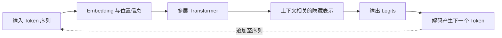
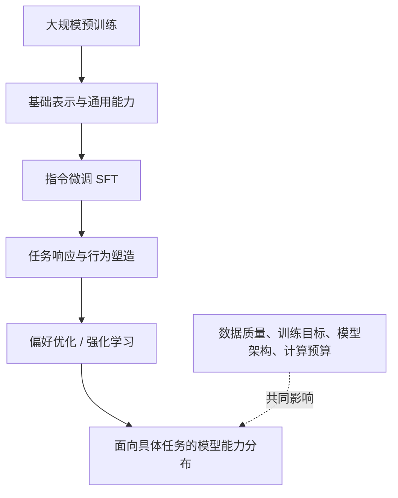
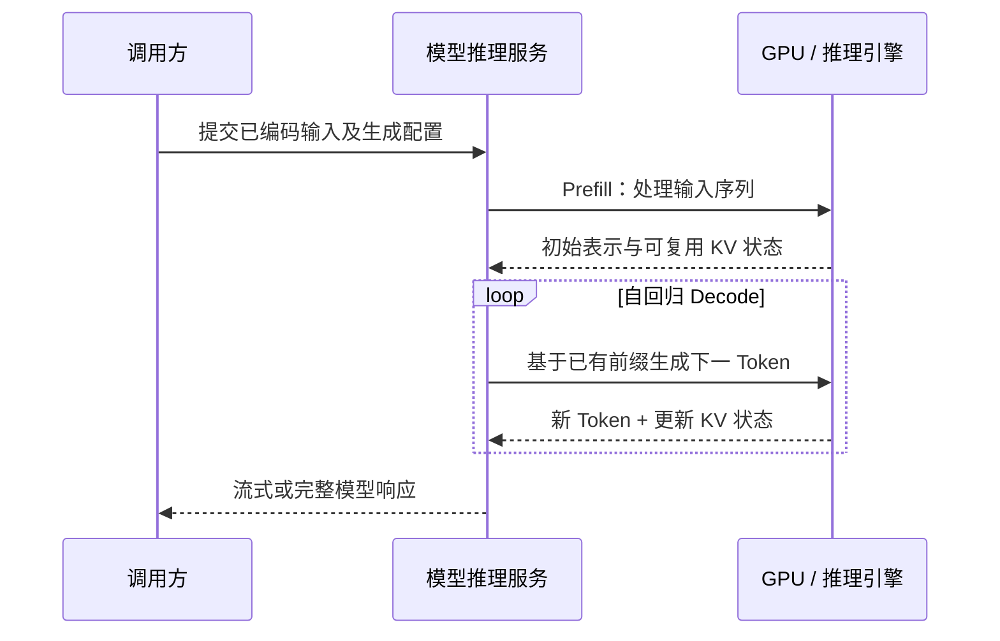
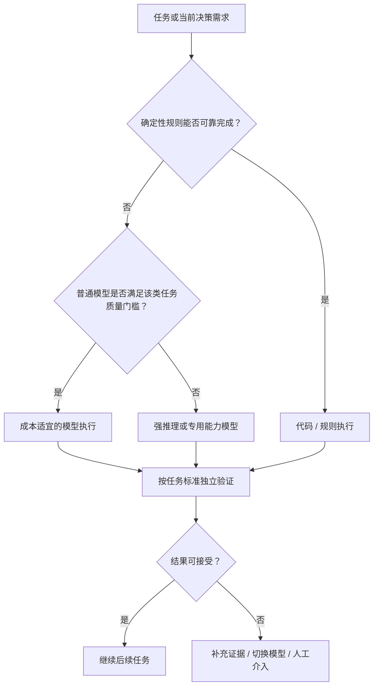

# 第2章 理解 LLM：Agent 的模型基础与能力边界

**本章核心脉络与阅读导览**

第一章已经从执行鸿沟、控制权分配与反馈闭环出发，建立了 Agent 的系统模型：**Model 在给定 Context 的条件下形成候选决策，Runtime 推进任务状态，Tool 与 Environment 承接外部交互，Harness 对运行过程施加确定性约束。**

然而，在这套架构中，还有一个没有被真正打开的黑盒：**Model 究竟是一种怎样的计算单元？**

我们已经知道，它不是能够独立持有业务状态、操作数据库和管理事务的应用进程。但另一个问题同样重要：一个以预测后续 Token 为基本训练目标的概率模型，为什么能够理解业务指令、分析错误堆栈、推导解决步骤，甚至在多个工具之间选择下一步行动？如果这些能力确实存在，为什么它又会产生逻辑自洽但事实错误的结论，为什么长上下文和复杂推理会迅速抬高成本，为什么能力更强、单次调用更贵的模型，反而可能在完整任务上更经济？

要回答这些问题，不能停留于“Transformer 很强大”或“模型在海量数据上学习过”。我们需要把 Model 还原为可分析的计算过程，再从计算过程推导能力、代价与边界。

本章沿着六个相互依赖的命题展开：

1. **计算本质（How it computes）**：从神经网络、Token 与 Embedding 出发，穿透 Transformer 的上下文计算，理解自回归生成的物理过程。
2. **能力来源（How it learns）**：从预训练到指令微调、偏好优化与强化学习，解释模型为什么能够从序列建模扩展到通用任务处理。
3. **决策接口（How it acts as a model）**：理解 Reasoning、Structured Output 和 Tool Calling 如何把模型能力表现为可供 Agent 系统消费的决策结果。
4. **计算代价（What it costs）**：通过 Context Window、Prefill、Decode 与 KV Cache，认识模型计算的时间、显存和有效信息容量边界。
5. **可靠性边界（Where it fails）**：区分知识缺失、事实性错误、推理偏差和多步骤误差传播，理解概率输出为什么不能直接当作可信业务决策。
6. **工程选型（How to choose）**：把前述原理汇聚为一套任务导向的模型能力、质量、延迟与成本评估方法。

为避免概念重复，本章采用统一的工程背景作为观察对象：**支付网关最近 15 分钟超时率异常升高，系统希望模型根据日志摘要、监控指标和只读工具定义，判断下一步最值得核查的事实。** 这一案例只用于观察模型的计算与决策，不重新展开第一章已经论证过的工具执行、业务授权和 Agent Loop。

本章的目标不是培养大模型训练工程师，而是让后端工程师与系统架构师获得一种更稳定的能力：**知道模型能够做什么、为什么能够做、何时可能做错，以及由此应该怎样设计系统。**

---

## 2.1 计算本质：从离散 Token 到概率生成

第一章将一次模型推理抽象为：

$$
C_t \xrightarrow{\quad \mathrm{Model}\quad} R_t
$$

其中，$C_t$ 是系统本轮组装出的上下文，$R_t$ 是模型输出的回答或动作意图。这个抽象对于理解 Agent 的系统结构已经足够；但要分析模型的真实能力边界，还必须进一步追问：**从 $C_t$ 到 $R_t$ 的过程中，机器实际计算了什么？**

### 2.1.1 从显式规则到参数化表示：神经网络如何学习复杂映射

考虑一个看似简单的业务问题：用户输入“支付一直转圈，钱可能扣了，但是订单还没成功”，系统需要识别其意图，并确定应该核查支付流水、订单状态还是回调通知。

在传统程序中，工程师可以写出关键词规则、正则表达式或显式分类器。但当输入变成“扣款成功后订单仍待支付”“微信支付弹窗消失了”“回调可能丢了”等千变万化的表达时，单纯依靠静态规则将不断增加维护成本。

神经网络采取了另一种方法：不要求工程师为每一种表达预先写出分支，而是以一个包含大量可学习参数的函数 $f_\theta$ 对输入建立映射：

$$
\mathbf{h}=f_\theta(\mathbf{x})
$$

这里，$\mathbf{x}$ 是数值化输入，$\mathbf{h}$ 是网络计算得到的内部表示，$\theta$ 则是一组通过训练得到的参数。典型神经网络由线性变换与非线性操作组成。以一层简单网络为例：

$$
\mathbf{h}=\sigma(W\mathbf{x}+\mathbf{b})
$$

$W$ 和 $\mathbf{b}$ 不是由工程师为某个业务问题逐项填写的“知识表”，而是模型在训练数据和优化目标的共同作用下形成的数值参数。多层网络反复组合这样的计算，可以表达远比单一线性关系复杂的映射。

训练阶段，模型根据样本计算预测结果与目标之间的损失，利用梯度等信息更新参数；推理阶段，通常固定已训练好的参数，用新的输入计算输出。二者必须严格区分：**推理时模型根据上下文做出新的判断，并不意味着它在每次请求后都自动修改了模型权重。**

还需要澄清一个容易混淆的边界。参数化计算并不意味着模型的执行是不确定的。对于固定的权重、输入、数值实现和确定性计算过程，同一神经网络可以输出相同的数值结果。大模型之所以在应用层呈现概率性，一方面来自它对候选 Token 概率分布的建模及解码策略，另一方面来自复杂生成行为对输入变化与实现环境的敏感性。这与第一章讨论的“确定性权限门禁”属于不同层次。

**我们至此得到第一层事实：模型的行为主要受其参数化映射与当前输入共同决定，而不是依靠程序在设计期穷举所有业务分支。**

但是，神经网络只消费数值。用户的自然语言、SQL 片段、Java 异常堆栈，究竟怎样转化为神经网络可以计算的输入？

### 2.1.2 Token 与 Embedding：自然语言如何进入模型计算空间

对人类而言，“支付网关超时率升高”是一条完整的中文语义；对于常见的大语言模型而言，它首先是一段需要编码的符号序列。

**Tokenization（分词或词元化）**负责将原始内容切分为词表中的若干 Token，并映射为 Token ID。Token 不必等同于一个汉字或英文单词；它可能对应一个单词、一个词的一部分、某个标点、若干字符，也可能是模型协议中的特殊标记。不同 Tokenizer 对同一段文字的切分结果并不一定相同。

以示意性输入为例：

```text
用户：检查 payment-gateway 的 HTTP 504，关联最近 15 分钟的发布记录。
```

Tokenizer 可能将 `payment-gateway`、`HTTP`、`504`、中文片段和标点切分为不同粒度的 Token。**具体切分必须以目标模型的 Tokenizer 为准，不能根据字符数直接推断 Token 数。** 代码、路径、随机 ID、日志时间戳和非自然语言字符往往会体现出与普通叙述文本不同的 Token 使用效率。

Token ID 只是一种离散编号，本身不构成神经网络可以直接利用的丰富语义表示。因此，模型还会通过嵌入矩阵，将每个 Token ID 映射为连续向量：

$$
\mathbf{e}_i=E[x_i],\qquad E\in\mathbb{R}^{|V|\times d}
$$

其中，$x_i$ 是第 $i$ 个 Token 的 ID，$|V|$ 是词表规模，$d$ 是隐藏表示的维度，$E$ 是可训练的 Embedding 矩阵。

这一步实现了从**离散符号空间**到**连续向量空间**的转换。语义相近的表达可能在训练形成的表示空间中展现出一定关联，但不能简单理解为“每个词都有一个固定含义坐标”，因为最终的上下文表示还会经过后续 Transformer 层反复更新。

此外，序列中每个 Token 的位置同样重要。“订单已支付，库存未释放”与“库存已释放，订单未支付”即使包含近似的词汇集合，其业务含义也完全不同。Transformer 因此需要注入或利用位置信息；位置编码、旋转位置嵌入（RoPE）等方案都在解决序列顺序如何进入计算的问题，具体实现因模型架构而异。

至此，一段非结构化请求已经转化为模型可以操作的向量序列：

$$
X=(x_1,x_2,\ldots,x_n)
\xrightarrow{\mathrm{Embedding/Position}}
H_0\in\mathbb{R}^{n\times d}
$$

然而，**把每个 Token 转换成向量，只解决了表示问题，还没有解决上下文关联问题。** 如果模型看到 `timeout=504`，如何知道它对应支付网关，而不是另一段无关日志？如果前面出现“不是数据库故障”，后面如何保留这个否定约束？

这需要进入 Transformer 的核心机制。

### 2.1.3 Transformer 与 Attention：模型如何建立上下文中的信息关联

考虑两段日志：

```text
10:02 payment-gateway: downstream request timeout, status=504
10:03 inventory-service: retry completed, status=200
```

如果用户问“支付网关的异常是什么”，模型需要把 `504` 与第一行服务名关联，而不是仅仅因为第二行也出现了状态码就混淆对象。

对于以 Transformer 为基础的语言模型，**Self-Attention（自注意力）**提供了序列内部信息交互的重要机制。一个位置的表示，不再仅由该位置的 Token 决定，而可以结合允许访问的其他位置的表示动态更新。

给定某一层的输入矩阵 $H$，模型通过学习得到的映射矩阵构建 Query、Key 和 Value：

$$
Q=HW_Q,\qquad K=HW_K,\qquad V=HW_V
$$

可以用一种工程直觉理解它们：

- **Query**：当前 Token 位置在这一注意力头中希望匹配什么信息；
- **Key**：各个可访问位置提供的匹配特征；
- **Value**：匹配之后参与聚合的信息表示。

对一个注意力头，核心运算为：

$$
\operatorname{Attention}(Q,K,V)
=\operatorname{softmax}\left(\frac{QK^\top}{\sqrt{d_k}}+M\right)V
$$

其中，$d_k$ 是 Key 的维度，$M$ 表示可选的注意力掩码。在用于自回归生成的因果语言模型中，掩码会禁止当前位置直接访问未来位置，以满足只依据已知前缀预测后续 Token 的训练与生成约束。

这个公式反映了三个连续动作：首先通过 $QK^\top$ 计算位置间的匹配分数；再通过 Softmax 将其转换为归一化权重；最后用这些权重对 Value 进行加权聚合。

但这里必须避免一种过度拟人化解释：**注意力权重并不是一个可直接读取的“模型思考原因表”**。真实模型具有多个注意力头、多个网络层，以及前馈网络（Feed-Forward Network）、残差连接、归一化等其他计算结构。不同层会逐步构造更复杂的上下文相关表示，而不是某个注意力头直接完成整段逻辑推理。

多头注意力（Multi-Head Attention）允许模型在不同表示子空间中并行学习不同类型的关联；层级堆叠则使局部词法关系、较长距离依赖和复杂模式能够在多次变换中相互作用。现代模型可能采用不同的注意力头组织、位置编码和稀疏化方案，但这一基本计算逻辑仍是理解主流 Transformer LLM 的重要起点。



**图 2-1 从离散 Token 到自回归输出的模型计算链条（概念示意）**

这一机制解释了一个关键问题：为什么相同的 Token 出现在不同上下文中，会参与形成不同的后续预测。上下文不只是被“存进去”，而是通过模型内部的信息交互参与每一层表示计算。

不过，Transformer 构造了上下文表示以后，还没有直接给出最终回答。模型还需要从内部表示形成一个具体的输出序列。

### 2.1.4 自回归生成与解码：模型如何产生最终输出

对于典型的 Decoder-only 自回归语言模型，给定输入前缀 $X$，模型并不是先在一个独立的“事实引擎”中算出完整答案，再一次性把答案打印出来。

它首先根据当前位置的隐藏状态计算词表中每个候选 Token 的分数（Logits）$z_i$，经 Softmax 形成条件概率分布：

$$
P_\theta(y_t=i\mid X,y_{<t})
=\frac{\exp(z_i)}{\sum_{j\in V}\exp(z_j)}
$$

随后，解码器选择一个 Token，将它追加到已有序列中，再基于更新后的序列计算下一步。对生成序列 $Y=(y_1,\ldots,y_T)$，其联合条件概率可以分解为：

$$
P_\theta(Y\mid X)
=\prod_{t=1}^{T}P_\theta(y_t\mid X,y_{<t})
$$

这一公式在第一章出现过，这里不再重复推导它的概率论基础，而需要看清它产生的工程事实：**长回答并不是模型的一次原子输出，而是连续多步条件生成的结果。**

即使已经得到概率分布，生成结果仍取决于解码策略：

| 解码方式 | 核心机制 | 典型权衡 |
| --- | --- | --- |
| Greedy | 每一步选择当前概率最高的 Token | 行为相对稳定，但可能陷入局部次优序列 |
| Temperature | 调整分布的尖锐程度 | 改变采样多样性，不直接改善事实正确性 |
| Top-p | 从累计概率达到阈值的候选集合中采样 | 在输出多样性与候选范围之间取舍 |
| 受约束解码 | 限制当前允许输出的 Token | 可改善语法或 Schema 合规性，但不自动保证语义正确 |

较低 Temperature 或 Greedy 解码可以减少采样层面的随机性，但**低随机性不等于高事实正确率**。一个模型完全可能在固定输入下稳定地产生同一个错误答案；此外，底层并行计算、服务实现和 API 配置还可能影响可复现程度，因此不能把 `temperature=0` 当作跨环境完全相同输出的业务承诺。

至此，我们终于可以把第一章中的抽象 Model 拆解为一条具体计算链：

$$
\boxed{\mathrm{Text}\to\mathrm{Tokens}\to\mathrm{Embeddings}
\to\mathrm{Transformer}\to\mathrm{Logits}\to\mathrm{Decoding}}
$$

**架构定论：** 大语言模型首先是一种对序列条件分布进行建模并据此生成输出的计算系统。它能够产生高度合理的语义结果，但生成结果的概率高，并不意味着其已经通过独立的事实验证。

$$
\boxed{\text{Token Prediction}\neq\text{Truth Verification}}
$$

> **关键收获：** 我们完成了本章第一个命题：**模型究竟如何计算。** 神经网络建立参数化映射，Token 与 Embedding 将符号送入数值空间，Transformer 构造上下文相关的表示，自回归解码逐步生成输出。模型的语义表现有真实的计算基础，但这一过程并未内建一个对业务世界进行独立验真的机制。

然而，这条计算链仍留下一个更难的问题：如果训练目标主要是预测 Token，模型为什么会表现出编程、数学推理、任务理解和工具使用等远超文本补全的能力？答案必须从模型能力的形成过程寻找。

---

## 2.2 能力来源：从语言建模到指令遵循与推理能力

一条能够计算概率分布的网络，并不天然具备排查支付故障的能力。它需要先通过训练形成参数，再通过不同训练阶段获得更适合交互和任务求解的行为。

理解这一过程，需要严格区分三个时间尺度：**训练阶段改变参数；推理阶段使用参数；系统运行阶段负责获取本次任务所需的外部事实。** 它们可以协同，却不应该被混为一谈。

### 2.2.1 预训练：为什么预测下一个 Token 能够形成通用能力

假设模型接受过大量包含代码、技术文档、问题求解过程和自然语言的训练数据。为了降低预测后续 Token 的错误，它不能只记住少量固定词组，还需要在统计意义上学习语言结构、实体关系、代码模式、常见操作顺序以及某些可迁移的问题求解规律。

以因果语言模型为例，预训练常用的目标是最小化负对数似然损失：

$$
\mathcal{L}_{\mathrm{pretrain}}(\theta)
=-\sum_{t=1}^{T}\log P_\theta(x_t\mid x_{<t})
$$

训练数据中出现过 `NullPointerException`、`CompletableFuture`、`HTTP 504`、`Dubbo timeout` 等片段，并不等于模型内部存在一个可以直接查询的 Java 错误码数据库。更合理的理解是：为了在广泛上下文中完成预测，模型逐渐形成了有关语法、代码结构、错误模式与技术语义的参数化表示。

这也解释了一个看似反常的现象：**没有为某个具体任务编写规则的模型，也可能通过自然语言描述或少量示例完成该任务。** 随着训练规模、数据组成和优化条件变化，部分模型表现出跨任务迁移、上下文示例学习和复杂问题求解能力；但这些能力依赖具体训练过程，既不是必然出现的，也不能从参数规模直接推出可靠的能力等级。

更重要的是，语言建模目标与真实世界事实之间并不存在严格的等价关系。

例如，一份训练文档包含错误的线上故障归因，如果其文字与上下文模式高度一致，预测目标本身并不会告诉模型“这一段事实是错误的”。训练目标优化的是对训练分布的建模，而不是对所有输出提供外部事实证明。

因此，**预测任务可以成为学习大量通用结构与能力的训练信号，却不是业务真实性或推理正确性的充分保证。**

训练研究也早已证明，训练数据规模和计算预算不能与参数量割裂来看。大模型不是“参数越多就天然越强”，模型规模、训练 Token 数、数据质量与训练策略共同决定最终表现。[2]

### 2.2.2 指令微调（SFT）：模型如何从文本续写转向任务响应

仅经过预训练的模型可能知道大量 Java 和分布式系统知识，但面对如下输入：

```text
请只输出下一步最值得执行的只读诊断动作，并解释其证据基础。
```

它未必会按照用户期望完成任务。因为“能够预测某类文本”和“能够可靠服从一段操作指令”是两种不同的行为要求。

**监督式微调（Supervised Fine-Tuning，SFT）**通过指令、上下文与期望响应的训练样例，进一步优化模型对任务指令的响应方式。例如，同样的故障背景，训练样例可以强调：先区分事实与假设；没有证据时明确说出不确定性；需要外部事实时给出查询建议；输出符合约定结构。

这里，模型并没有获得对真实数据库的访问权，而是学会了在给定条件下更倾向于生成某类响应。

预训练与 SFT 可以从职责上简化为：

| 阶段 | 主要解决的问题 | 不能直接保证的事情 |
| --- | --- | --- |
| 预训练 | 建立广泛的语言、知识和问题模式表示 | 稳定遵循特定用户意图与格式 |
| SFT | 塑造按指令响应、交互和格式遵循的行为 | 事实绝对正确、业务规则绝对合规 |

这一划分是便于理解的工程抽象，并不意味着两阶段的能力贡献完全不重叠。预训练中也可能出现指令形式数据，后训练同样可能影响知识使用和问题求解能力。

典型研究显示，经过指令与人类反馈优化的较小模型，可以在特定人类偏好评价中超过参数更多、但没有经过相同对齐过程的基础模型。它提示我们：**参数规模不是人类交互质量的唯一决定因素。**[3]

### 2.2.3 偏好优化与强化学习：模型行为如何进一步被塑造

SFT 能让模型学习“一个好答案大致长什么样”，却仍存在明显限制。同一问题通常有多个可接受的回答，而且人类往往更容易比较两个答案的好坏，而不是为每种任务写出唯一标准答案。

这引出了偏好优化。模型可以根据人类标注、AI 评审或可验证任务结果获得质量信号，再通过不同优化方法调整其输出分布。

需要区分三个经常被混用的概念：

- **RLHF**（Reinforcement Learning from Human Feedback）：以人类反馈为来源构造偏好或奖励信号，并通过强化学习优化模型行为；
- **RLAIF**（Reinforcement Learning from AI Feedback）：将部分反馈来源替换为 AI 评审，其效果取决于评审质量与偏置；
- **DPO**（Direct Preference Optimization）：利用偏好样本直接优化策略的一类方法，在特定形式下无需显式训练独立奖励模型后再执行传统 RL 流程。[4]

还存在基于可验证结果的强化学习路径。例如数学问题的答案、代码执行测试的通过情况，在一些条件下能够提供比纯主观偏好更明确的奖励信号。这类训练推动了模型在复杂推理任务中的能力改善；相关研究亦报告了反思、验证和策略调整等行为模式的出现。[5]

但这里要特别警惕一种因果误读：**模型因为奖励机制表现得更像在认真推理，并不等于它的每一步推断已经得到验证。** 奖励函数只是可度量的训练信号，可能不完整，也可能被模型以未预期方式利用。通过后训练获得的较强推理表现，应当依靠独立任务结果衡量，而不是仅依据输出的推理文字判断。

至此，模型能力的形成可以概括为：



**图 2-2 模型能力的形成路径（逻辑简化图，并非所有模型都采用完全相同的训练流水线）**

值得强调的是，实际模型训练可能存在多阶段混合、反复迭代、蒸馏或其他优化路径。这里的结构用于理解各类训练信号的职责，而不是规定所有模型必须遵循同一生产配方。

### 2.2.4 能力、知识与行为：区分模型权重、运行时上下文和外部事实

回到支付故障诊断任务，模型可能知道：HTTP 504 通常涉及网关或代理未能及时获得上游响应；线程池饱和、依赖服务变慢、连接池耗尽、网络抖动等都可能导致类似现象。

但是，如果用户问：

> “昨晚 22:10 支付服务超时率为什么突然增长？”

模型的参数化知识并不包含这次事故现场的实时线程转储、发布记录和链路追踪。它最多能够形成若干诊断假设，而不能仅凭一般知识断定发生了什么。

为了建立清晰边界，必须区分三类信息：

| 信息来源 | 含义 | 支撑什么 | 不等于什么 |
| --- | --- | --- | --- |
| **模型权重（Parameters）** | 训练后形成的参数化表示和行为倾向 | 通用语义、知识与问题求解能力 | 最新、完备、可审计的实时事实库 |
| **推理上下文（Context）** | 本轮请求实际提供的指令、事实及历史片段 | 对当前任务进行条件化判断 | 自动永久修改模型参数 |
| **外部环境事实（Environment Evidence）** | 数据库、监控、业务接口等提供的当前观测 | 形成有时间与来源依据的事实基础 | 自动保证模型能够正确解读事实 |

模型可以根据当前日志片段给出精确分析，下一次如果没有再次提供同一信息，模型就未必能够继续利用它。上一章已经说明，系统层面的 State 由外围 Runtime 维护，当前 Context 只是 State 在单次推理上的受限投影。**临时向模型提供证据，不等于模型发生了持久学习。**

训练阶段决定了模型具备怎样的能力分布；推理阶段的 Context 决定这些能力在本轮任务中可以利用哪些信息。这个区别将直接影响后续上下文工程、Memory 与外部工具设计，但具体如何检索、更新、组织和持久化信息，不在本节展开。

**架构定论：** 预训练、后训练与运行时上下文共同影响模型表现，却承担不同职责。不能用提示词代替模型欠缺的基础能力，也不能寄希望于模型的参数化知识自动覆盖实时环境事实。

> **关键收获：** 我们完成了第二个命题：**模型的能力从何而来。** 预训练建立参数化表示与部分通用能力，后训练进一步塑造指令遵循、行为偏好和问题求解表现；实时业务任务则必须基于当前上下文与外部证据展开。模型“知道怎样排查”和系统“已经掌握这次事故的事实”不是同一回事。

然而，拥有知识和问题求解能力，并不意味着这些能力已经具备能够被 Agent Runtime 消费的接口形式。下一步必须回答：**模型如何把内部推理转化为明确的下一步选择？**

---

## 2.3 决策接口：模型如何完成推理与结构化行动选择

在第一章的 Agent 架构中，模型最关键的作用不是写出漂亮的自然语言，而是在给定目标和当前观测的条件下，**形成对下一步动作的候选判断**。

这一过程至少涉及三个可区分的能力：解决多步骤问题的 Reasoning，将输出组织成机器可解析结果的 Structured Output，以及在工具集合中选择行动的 Tool Calling。

### 2.3.1 Reasoning：从直接生成到多步骤问题求解

考虑这样一个运维判断：

> “支付服务超时率升高，但数据库 CPU 正常，最近一次发布与异常发生时间接近。应该立刻认定是发布导致的吗？”

直接匹配常见模式很容易给出一个貌似合理的答案：“最近发布引入了问题，建议回滚。”但更成熟的诊断需要区分证据与假设：数据库 CPU 正常不能排除慢查询、锁等待与连接池问题；发布时间接近只构成相关性；需要进一步对比变更实例与未变更实例的延迟分布、异常栈和依赖调用指标。

这个例子体现了**多步骤问题求解**与简单模式续写之间的区别。前者需要综合约束、构造中间假设、处理相互冲突的事实，并根据目标决定哪些证据更有区分度。

Chain-of-Thought（CoT）提示研究表明，在部分问题及模型条件下，提供中间推理示例有助于提高复杂任务表现。[6] 随着后训练与推理时计算策略的发展，一些模型也可以在生成最终回答前进行额外的内部推理计算。但应严格区分：

1. **Reasoning Ability（推理能力）**：模型在问题求解任务上表现出的实际能力；
2. **Reasoning Process（推理时计算）**：模型为形成答案执行的中间计算过程，其实现和可见性因模型而异；
3. **Reasoning Trace（推理文本或摘要）**：模型能够提供给外部的文字说明，并不必然完整或忠实地反映内部因果过程。

研究已发现，一些模型生成的 CoT 解释可能遗漏影响最终答案的重要因素，甚至在受到偏置信号影响时为错误结论提供貌似合理的解释。[7] 所以，不能因为回答中出现“首先、其次、因此”便判断模型已经完成了可靠推理。

**对系统工程而言，推理能力应通过可验证任务结果来定义，而不应通过中间解释的篇幅来定义。**

此外，复杂推理并非免费。更长的推理过程可能增加输出 Token、计算时间及整体延迟；如果任务本身只需直接提取一个确定字段，追加大量推理未必带来收益，甚至可能引入不必要的猜测。模型何时需要更强的思考能力、何时应当直接使用确定性代码，这些取舍后面会进入模型选型。

### 2.3.2 Structured Output：概率生成如何形成机器可消费的结构

假设模型已经判断下一步应查询发布记录。对于人类而言，“先查最近的发布”是一句可理解的建议；但对于 Agent Runtime，它仍然缺少可供机器稳定解析的接口结构。

一个更适合系统消费的结果可能是：

```json
{
  "decision": "REQUEST_TOOL",
  "tool_name": "query_deployments",
  "arguments": {
    "service": "payment-gateway",
    "lookback_minutes": 30
  },
  "rationale": "需要核对异常发生前后的版本变更与实例差异"
}
```

这里的重点不是 JSON 语法本身，而是**从开放文本空间到受约束的机器接口空间的转换**。

普通 Prompt 中写一句“请严格输出 JSON”，只是影响模型的输出偏好。若模型服务提供受约束解码（Constrained Decoding）或严格的结构化输出能力，则可以根据支持的 Schema 在生成过程中限制不合法的 Token 序列，从而提高语法与类型符合性。相反，只启用一般 JSON Mode 通常只能保证输出符合 JSON 语法，不能替代具体字段约束。[8]

然而，即便结构满足 Schema，业务语义仍然可能错误。

```json
{
  "decision": "REQUEST_TOOL",
  "tool_name": "query_deployments",
  "arguments": {
    "service": "inventory-service",
    "lookback_minutes": 30
  }
}
```

这个结果在字段结构上完全合法，却查询了错误的服务。如果模型还把 `lookback_minutes` 填成一个允许范围内但无法覆盖故障发生时刻的数值，Schema 也未必能够指出其与任务目标不一致。

由此必须区分三个验证层级：**可解析性、结构合规性、语义正确性**。前两个层级可以通过确定性解析与约束大幅改善，第三个层级则依赖上下文理解、任务证据和后续评测，不会因为使用 JSON Schema 而自动成立。

### 2.3.3 Tool Calling：模型如何生成可执行的动作意图

Structured Output 解决了结果如何被系统识别的问题，但系统还需要知道模型如何在多个工具之间做出选择。

假设本次推理提供三项只读工具：

```json
[
  {
    "name": "query_deployments",
    "description": "查询指定服务在时间窗口内的发布记录",
    "parameters": {
      "service": "string",
      "lookback_minutes": "integer"
    }
  },
  {
    "name": "query_traces",
    "description": "查询指定服务的分布式调用链与错误类型",
    "parameters": {
      "service": "string",
      "time_range": "string"
    }
  },
  {
    "name": "query_jvm_metrics",
    "description": "查询指定服务的 JVM 线程、堆和 GC 指标",
    "parameters": {
      "service": "string",
      "time_range": "string"
    }
  }
]
```

以上仅是教学用工具元数据示意，并非某家 API 的完整 Schema。真实接口中的工具定义通常还需要类型、字段约束、必填列表和协议支持的其他配置。

模型面对工具定义时，需解决至少三项判断：

**第一，是否需要工具。** 如果用户只问“HTTP 504 是什么含义”，模型可能仅凭已有知识回答；如果用户问“昨晚 payment-gateway 的异常根因是什么”，仅凭参数知识无法获得实时事实，通常需要获取外部观测。

**第二，应该选择哪个工具。** 若现有证据显示错误集中发生在服务扩容后的某段时间，查询调用链与实例指标可能比先查发布记录更合适。工具名称、描述、参数结构、当前目标和历史观测共同影响模型的候选选择。

**第三，应该生成哪些参数。** 选择正确工具后，还可能发生服务名引用错误、时间窗口错误、字段遗漏或参数单位混淆。这些问题属于模型的工具使用能力，而非工具执行器是否成功运行。

不同模型和提供商可能通过专门的工具调用消息、协议标记或结构化通道输出动作请求。它们在计算基础上仍与序列建模密切相关，但工程实现并不都等同于“从普通回答正文中提取一段 JSON”。模型服务还可能提供并行工具调用、强制工具选择或拒绝调用等能力，其适用条件需要以具体 API 契约为准。

因此，评价 Tool Calling 不能只看模型能否生成一个看起来正确的函数名。还需要区分：**调用时机是否恰当、工具选择是否正确、参数是否正确、何时应该拒绝或不调用工具。** BFCL 等研究工作正是在不同任务条件下系统评估这些能力，而非仅检查字符串是否满足语法。[9]

最重要的是，与第一章保持明确分工：

$$
\boxed{\underbrace{\text{Model: Action Selection}}_{\text{动作意图}}
\quad\neq\quad
\underbrace{\text{Runtime/Tool: Execution}}_{\text{实际执行}}}
$$

本节只解释模型如何形成动作候选。工具真正访问哪个系统、调用主体拥有什么权限、执行结果是否达到业务目标，仍由第一章定义的 Runtime、Harness 和业务边界承接。

**架构定论：** Reasoning 决定模型如何处理复杂问题，Structured Output 决定结果能否被机器稳定识别，Tool Calling 决定模型能否将判断转换为恰当的动作候选。三者彼此关联，却不能相互替代。一个能够稳定输出 JSON 的模型，可能仍然选错工具；一个善于解释问题的模型，也可能无法可靠生成正确参数。

> **关键收获：** 我们完成了第三个命题：**模型能力如何进入 Agent 决策接口。** 模型不仅生成普通文本，还可以根据当前任务提出结构化的下一步行动。但**结构合法不等于语义正确，动作选择不等于物理执行**。这是在模型层理解第一章“执行鸿沟”的必要补充，而不是重新定义执行鸿沟。

然而，推理、结构化输出和工具选择都消耗模型计算资源。一次上下文可能容纳成千上万 Token，一次复杂任务可能连续生成大量推理内容。如果计算在物理上受到限制，Agent 又该怎样理解模型的真实容量与成本？

---

## 2.4 计算代价：上下文窗口、推理过程与 KV Cache

在第一章中，Context 被定义为全局 State 面向本轮推理的受限视图。直到这里，它主要还是一个逻辑概念：系统挑选信息，模型依据这些信息形成判断。

但从推理引擎的视角看，Context 并非可以无限扩展的抽象容器。每向模型增加一段日志、一组工具描述或一次历史交互，最终都会落到具体的 Token、张量计算、显存占用与处理时间上。**系统可以在业务层保存无限增长的任务历史，不代表模型能在一次计算中以同样的代价读完这些历史。**

为了看清这条边界，我们仍然沿用支付网关故障诊断案例。最初，模型只需要分析十几行日志；随着调查深入，输入逐渐包含 30 分钟监控、数千条错误堆栈、多个微服务的调用链、发布记录、数据库慢查询和工具 Schema。即使这些信息全部与“支付超时”有关，模型也并不一定能够无成本、无损地处理。

### 2.4.1 Context Window：模型一次推理能够处理多少信息

首先需要区分三个容易混淆的量：

1. **模型支持的最大上下文容量（Context Window）**：模型及其服务配置允许处理的序列长度上限；
2. **本轮实际输入长度（Input Tokens）**：本次请求中被序列化进入模型的系统指令、历史消息、工具定义、用户输入及其他内容所占用的 Token；
3. **本轮生成长度（Output Tokens）**：模型最终生成的回答、工具参数，及某些推理模型可能消耗或计费的额外推理 Token。

对于采用输入、输出共享总序列预算的典型接口，可以将约束近似表达为：

$$
T_{\mathrm{input}}+T_{\mathrm{output}}\leq W
$$

其中，$W$ 是允许使用的总窗口长度。**这只是理解预算关系的简化表达，不是所有 API 的统一计费或限额协议。** 一些模型服务会为最大输入长度、最大输出长度与总窗口设置不同的独立限制；有些推理 Token 还会使用独立的统计口径。因此，具体实现必须以模型服务提供的限制和使用量字段为准。

将本轮输入进一步拆解，可得到：

$$
T_{\mathrm{input}}=
T_{\mathrm{system}}+
T_{\mathrm{tool}}+
T_{\mathrm{task}}+
T_{\mathrm{history}}+
T_{\mathrm{evidence}}+
T_{\mathrm{protocol}}
$$

这里，$T_{\mathrm{protocol}}$ 表示角色标记、消息边界及其他协议编码的额外开销。这一表达式的意义并不在于每个模型的消息序列化方式都完全相同，而在于揭示一个工程事实：**工具列表、历史对话、环境证据与最终回答共同竞争有限的模型输入输出预算。**

例如，假设某次请求的总预算为 32K Token，已注入的系统指令与工具定义占用 4K，故障日志与历史交互占用 25K，那么即使任务真正需要的最终回答只有几百 Token，系统能够为额外证据与后续生成保留的余量也已经很小。这里的 32K、4K、25K 只是教学数字，不对应任何具体模型的当前规格。

再看另一种更隐蔽的情况。某模型对外宣称支持很长的 Context Window，但实际任务在第 10 次工具查询后才收到决定性证据。模型下一轮能否获取这段证据，除了依赖窗口容量，还取决于上层系统是否将它正确序列化到本轮输入中；即使成功注入，也不保证模型能准确识别其重要性。

因此，**Context Window 解决的是“最多允许放进多少信息”，而不是“模型能否可靠利用其中全部信息”。** 后一个问题暂时留待 2.4.4 节讨论。

至此，窗口上限已经明确。但工程师还需要理解：为什么同样使用 20K Token，长输入与长输出对响应时间的影响并不相同？

### 2.4.2 Prefill 与 Decode：一次推理为何具有不同的计算阶段

考虑两次模型请求：

- **请求 A**：输入 20K Token 的故障日志，仅生成 100 Token 的结论；
- **请求 B**：输入 1K Token 的任务说明，却需要生成 5K Token 的分析报告。

两次请求都存在 Token 开销，但它们的性能瓶颈很可能不同。要理解差异，必须拆开推理引擎的两个主要阶段。

**第一阶段：Prefill（提示词处理）**。

模型先处理已经给定的输入序列，将其送入各层 Transformer，构造上下文相关的表示，并为可复用的注意力计算准备必要状态。由于这部分输入在调用开始时已经全部已知，推理引擎通常可以利用矩阵计算的并行能力处理多个输入位置；长输入会增加这一阶段的工作量、显存占用和首 Token 等待时间。

**第二阶段：Decode（自回归生成）**。

在已有上下文的基础上，模型生成下一个 Token；生成后将新 Token 作为已知前缀的一部分，再计算下一个位置。对于常见的严格自回归解码，一次生成的后续位置依赖先前位置，因此输出过程存在无法完全消除的序列依赖。推理引擎可以通过连续批处理、缓存、推测解码等手段优化吞吐或部分延迟，但不能把一个依赖前缀的自回归过程简单当作一次无依赖的批量输出。



**图 2-3 一次模型推理的 Prefill 与 Decode 阶段（概念时序）**

由此，我们可以更精确地理解常见性能指标：

| 指标 | 描述的主要现象 | 容易混淆的地方 |
| --- | --- | --- |
| **TTFT（Time to First Token）** | 从发起请求到收到第一个输出 Token 的时间 | 不只包括 Prefill，还可能包含网络传输、排队和首步解码 |
| **TPOT（Time per Output Token）** | 连续生成阶段平均每个输出 Token 的耗时 | 受并发、输出长度、缓存实现、批调度等影响 |
| **Tokens/s（输出吞吐）** | 单位时间内模型生成的输出 Token 数 | 单请求生成速率与整个服务集群的聚合吞吐不是一个量 |
| **E2E Latency（端到端延迟）** | 从请求发出到完整结果返回的总耗时 | 可能包括客户端、网络、队列、模型计算和服务端封装 |

为了便于分析，可将总延迟写成概念模型：

$$
T_{\mathrm{e2e}}
\approx T_{\mathrm{network}}+T_{\mathrm{queue}}+
T_{\mathrm{prefill}}+T_{\mathrm{decode}}+T_{\mathrm{overhead}}
$$

这并不是要断言各阶段在所有服务中都严格串行。有些系统可以在不同请求之间并行或重叠工作。它的用途只是提醒工程师：**同样是“模型慢”，长输入导致的首字延迟、长输出导致的生成延迟，以及高并发造成的排队，实际上可能是三个不同的问题。**

一个很实际的例子是：如果支付诊断 Agent 每一步都把前十轮的全部日志原样追加到输入，那么即使本轮只想让模型输出一个工具参数，Prefill 阶段也可能越来越重。反过来，如果要求模型每一轮都写出几千 Token 的详细分析，Decode 阶段则会持续占据时间与计算预算。

到这里，仍然存在一个疑问：既然第 $t+1$ 个 Token 必须看到前面已经生成的 Token，是否意味着模型每次都要把完整历史从第一层开始重新计算？

理论上可以这样实现，但成本会非常高。工业级推理引擎的一个基础优化，就是 **KV Cache**。

### 2.4.3 KV Cache：为什么模型需要缓存历史计算结果

回到 2.1.3 节的 Attention 公式。对于自回归模型，当新的 Token 被生成时，它需要与此前能够访问的 Token 建立注意力关联。

如果每生成一个 Token，就对全部历史前缀重新进行相同的 K、V 投影与层内计算，会出现大量重复工作。对于典型的因果注意力，在固定权重、确定前缀与相应位置编码条件下，前面位置的 Key、Value 表示可以重复使用。于是，推理引擎将这些表示保存在 **KV Cache** 中，后续生成步骤仅为新加入的位置计算并追加相应状态，再通过当前 Query 访问缓存中的历史 Key、Value。[10]

简化后的增量计算可以写为：

$$
\mathrm{Attention}_t
=\mathrm{softmax}\!\left(\frac{q_tK_{\le t}^{\top}}{\sqrt{d_k}}+m_t\right)V_{\le t}
$$

此时 $K_{\le t}$ 与 $V_{\le t}$ 包含已经计算并保留的历史状态。模型并不是“只看新 Token 而忽略过去”，而是**不必每次都从头重算可以复用的历史表示**。

这里值得深入一个真正的工程问题：**KV Cache 为什么会成为长上下文与高并发推理的显存瓶颈？**

对于采用全量 KV 缓存的常见注意力结构，可以用以下近似公式估算单个请求的缓存大小：

$$
\boxed{
M_{\mathrm{KV}}
\approx 2\times L\times H_{\mathrm{kv}}\times D_{\mathrm{head}}
\times N\times B
}
$$

其中：

- $L$：Transformer 层数；
- $H_{\mathrm{kv}}$：每层需要缓存的 KV Head 数量；
- $D_{\mathrm{head}}$：每个 Head 的维度；
- $N$：当前序列长度（含输入和已生成部分）；
- $B$：每个缓存元素占用的字节数；
- 系数 $2$：分别缓存 Key 和 Value。

这里没有把权重、激活值、算子工作区、内存分配碎片和服务端调度开销计入，也没有覆盖滑动窗口、分层局部注意力、量化缓存或跨请求共享等优化。**它是模型结构已知时的一阶容量估算工具，不是部署显存需求的完整公式。**

假设一个教学模型具备：

- $L=32$ 层；
- $H_{\mathrm{kv}}=8$ 个 KV Head；
- $D_{\mathrm{head}}=128$；
- 当前序列长度 $N=32\,768$ Token；
- 每元素占 2 字节（如 FP16/BF16 的常见存储宽度）。

则：

$$
\begin{aligned}
M_{\mathrm{KV}}
&\approx 2\times32\times8\times128\times32768\times2\\
&=4\,294\,967\,296\ \mathrm{Bytes}\\
&\approx 4\ \mathrm{GiB}
\end{aligned}
$$

**也就是说，仅这一个请求的 KV Cache，理论估算就可以达到约 4 GiB。** 如果十个具有同样长度的请求同时驻留在显存里，不考虑任何共享与优化，KV 缓存理论占用就可能接近 40 GiB。与此同时，模型权重和其他工作区仍然需要显存。

这里自然解释了一个生产现象：**模型权重能够放进显存，不意味着该推理服务就能以很高并发稳定处理超长上下文。** 模型参数量、上下文长度和并发量，是三个不同的容量维度。

这一公式还揭示了为何一些现代架构使用 GQA（Grouped-Query Attention）或 MQA（Multi-Query Attention）：通过减少需要分别存储的 KV Head 数量，可以降低缓存需求。PagedAttention 一类内存管理技术则着力改善 KV Cache 的分配和利用效率；其他优化可能将缓存量化、换出至 CPU，或在适当场景下复用公共前缀。[11]

然而，**缓存复用始终有条件**。

如果多轮模型请求的输入前缀发生变化，或请求跨越了不共享缓存的服务实例，之前的缓存未必能被直接复用。所谓 Prefix Caching，通常要求满足相应模型、Tokenizer、前缀内容、缓存隔离与服务实现条件。业务开发者不能因为两次请求“看起来讲的是同一件事”，就假定推理引擎必然命中缓存。

更需要防止一种概念偷换：

$$
\boxed{\text{KV Cache}\neq\text{Agent Memory}}
$$

KV Cache 主要是**模型内部的推理计算加速状态**，服务于具体序列的注意力计算；Agent Memory 则是业务级、跨轮次乃至跨任务的信息保存与利用机制。前者通常受到显存、缓存生命周期和输入一致性的限制，后者涉及知识组织、持久化、检索与更新。KV Cache 可以被系统保存或复用，但这种能力本身不会自动为模型创造可检索、可治理的长期业务记忆。

这也与第一章的边界一致：**应用层的无状态模型 API、推理引擎内部的缓存状态、Runtime 持久维护的任务 State，是三个不同的系统层级。**

### 2.4.4 长上下文的效率悖论：能放进去，不等于能有效利用

到这里，我们已经解释了 Context Window 的容量限制、推理时延的阶段性，以及 KV Cache 的显存代价。然而，一个看似合理的架构设想仍然值得质疑：

> 如果技术上已经能够支持足够长的窗口，为什么不把完整任务历史、所有日志和整个知识库都交给模型，让它自行找出有用的信息？

这一方案首先会遭遇计算与成本问题，但真正棘手的未必是“能不能放下”，而是**“放进去以后，模型还能不能正确找到并利用关键证据”**。

想象下面这个实验：我们将同一条决定性证据——“异常只发生在刚扩容的实例中，未扩容实例的超时率保持正常”——分别放在三份等长故障材料的开头、中间与结尾，其他干扰日志保持一致。然后要求模型判断优先核查什么。

如果三种位置下模型的结论出现明显差异，就说明它利用输入信息的能力并不只受“窗口是否装得下”影响，还受信息位置、冗余、任务结构与模型本身长上下文能力的影响。

*Lost in the Middle* 等研究在特定问答与检索任务中观察到：一些模型对位于长输入开头或末尾的证据利用更好，对中间位置的关键证据利用较差。[12] 这是一项关于特定模型与任务的经验发现，不应泛化为“所有模型在任何长上下文任务中都会遗漏中间内容”。不同架构、训练方式与任务的表现可能差别很大。

因此，长上下文至少有两种不同的“有效”：

1. **计算意义上的有效**：输入长度被服务接受，模型能正常完成推理；
2. **任务意义上的有效**：关键证据真正影响了模型的正确判断，且在不同长度、位置与干扰条件下表现足够稳定。

我们可以把这一区分压缩为：

$$
\boxed{\text{Context Window}\neq\text{Effective Context}}
$$

这里的 Effective Context 不是一个所有厂商统一定义的固定 Token 数，而是对**具体模型在具体任务上能够可靠利用的信息范围**的工程描述。它必须通过任务实验而非产品规格表确定。

**架构定论：** 上下文长度不是一个单纯的软件字符串参数，而是一项同时受模型训练、计算复杂度、缓存容量与任务有效性约束的稀缺资源。一个模型声称支持 128K 或更长输入，只能说明它具备相应的技术容量或服务能力，不能单独证明模型在该长度下具备等比例的有效问题求解能力。

> **关键收获：** 我们完成了第四个命题：**模型为什么存在真实的物理成本与信息容量边界**。Context Window 限定输入输出预算，Prefill 与 Decode 决定不同阶段的延迟，KV Cache 通过复用降低重复计算、却引入随序列和并发增长的显存成本，而长上下文的实际效果还取决于模型能否利用关键证据。因而，容量、速度和有效性必须分别评估。

然而，即使一条任务请求没有超过窗口限制，推理引擎工作正常，模型也成功返回了 Schema 完全合法的结果，为什么系统仍然可能得到错误判断？仅仅解释计算成本，还不足以解释模型作为决策组件的可靠性边界。

---

## 2.5 可靠性边界：为什么流畅输出不等于可信决策

第一章已经证明，模型的动作意图必须通过独立执行与验证系统，才能转换为真实业务交付。现在，我们需要把观察视角收缩到模型自身：**一个没有发生技术异常的模型调用，为什么仍然可能得到错误的决策？**

这个问题不能只用“LLM 可能产生幻觉”来回答。因为在 Agent 系统中，至少有三种性质不同的失败：模型缺少当前事实；模型拿到了事实却推断错误；模型在多步骤执行中不断累积前面的偏差。如果把这几种失败都笼统归类为“模型不够聪明”，工程师便无法确定究竟该改善输入信息、换更强模型，还是增加独立验证。

### 2.5.1 知识边界：参数化知识为什么不能代表当前事实

回到支付网关场景。假设模型已经根据预训练知识掌握了以下事实：

- HTTP 504 通常表示网关或代理未能在限定时间内从上游获得有效响应；
- 数据库 CPU 正常并不能证明数据库调用链完全健康；
- Java 线程池、连接池、网络超时和下游排队都可能成为延迟异常来源。

这些一般知识可能相当有用，却不足以回答：**今天 10:02 的支付异常究竟由哪个组件触发？**

原因在于，业务现场的事实具有明确的时空、版本与权限范围。比如“payment-gateway 有 12 个实例”“在 10:01 刚完成一次扩容”“只有新扩容实例发生大量 504”，这些都属于本次事故的现场观测，不能指望模型从固定参数中自动读出。

还需要识别两种与“知识过时”不同的情况：

**第一，知识缺失。** 具体事故、内部系统结构和最新业务规则根本没有出现在模型训练数据中。模型在这一点上没有证据，而不是“忘记”了答案。

**第二，知识适用范围错误。** 模型可能熟悉通用的 HTTP、JVM 或数据库语义，却错误地把某个常见故障规律当作当前环境的确定事实。例如，在缺少服务拓扑和调用链时，直接把“支付网关的 504”解释为“数据库负载过高”。这不是完全不懂技术，而是把**一般模式当作现场事实**。

这两种失败提示了不同的边界：

$$
\text{General Knowledge}\;\not\Rightarrow\;\text{Current Evidence}
$$

模型可以借助参数化知识提出诊断假设，但当前事实需要来自具有明确来源和时间语义的证据。外部观测同样可能过时或错误，因此并不是“只要查过工具就可信”；工具返回需要结合其采集时间、采集范围与实际系统状态理解。

**这一节的边界仅在于说明事实从哪里来。** 外部知识如何检索、如何裁剪，以及如何避免不可信来源污染输入，将在后续 Context Engineering 和 Tool 章节中展开。

### 2.5.2 幻觉与推理错误：为什么形式自洽仍可能偏离事实

现在把问题推进一步。假设模型已经获得了如下观测：

```text
10:00 payment-gateway 发布新版本
10:02 网关 504 比例由 0.2% 上升至 8.1%
10:04 数据库 CPU 维持 35%，未见突增
10:05 部分节点线程池活跃线程数接近上限
```

模型回答：

> “可以确定是 10:00 的发布引入了线程泄漏，导致线程池饱和，回滚即可解决。”

这个答案读起来很合理：发布时间与故障时间接近，线程指标也异常。但仔细检查，输入中并没有足够证据证明“线程泄漏”，更没有证明“回滚一定有效”。某些线程池饱和可能来自下游耗时增加，发布也可能只是时间上相关的事件。

要正确分析这类错误，至少需要划分三个维度。

| 错误类型 | 典型表现 | 本质问题 |
| --- | --- | --- |
| **事实性错误** | 编造不存在的实例、日志、发布版本或业务规则 | 输出包含未被证据支持的事实陈述 |
| **推理性错误** | 把时间相关性当成因果性，把不充分证据推成确定结论 | 已有事实与结论之间的推断不成立 |
| **行动判断错误** | 选择错误查询对象、忽略关键限制条件，或在证据不足时过早停止调查 | 模型未正确将任务目标与证据转换为下一步选择 |

这些错误可以同时发生。例如模型先虚构“数据库负载已恢复”，然后据此推断“故障已经结束”，最终给出“无需继续排查”的动作建议。但它们的诊断方向并不相同：事实错误需要核查来源，推理错误需要检验推导关系，行动判断错误则需要依据任务要求和动作结果进行评估。

对于业务工程师，更危险的是将以下三件事视为同一回事：

1. 模型生成了一段**语言流畅、技术术语正确**的解释；
2. 模型的解释与现有证据**没有表面矛盾**；
3. 模型的结论已经得到**充分证据验证**。

实际上，前两者都不能推出第三者。

$$
\boxed{\text{Plausible Answer}\neq\text{Verified Fact}}
$$

类似问题还会出现在模型的自我检查上。如果要求模型“请再次检查刚才的结论”，它可能发现前一轮逻辑错误，也可能在相同证据和偏置下再次认可错误结论。前面 2.3.1 节已经说明，模型生成的推理文本并不必然忠实反映内部计算过程；因此，**同一个模型对自身输出的再次背书，不是独立于原结论的事实证明**。

这不意味着自我检查毫无价值，而是需要明确它的作用边界：它可能提高某些任务的结果质量，却不能替代有独立来源的证据、可执行断言或外部评价标准。

### 2.5.3 多步骤可靠性：为什么局部正确不等于整体成功

单次模型回答可能出错，在 Agent 系统里更麻烦的情形是：**一次没有被识别的错误，可能成为后续决策的输入条件。**

例如故障诊断包含五个逻辑步骤：识别异常服务、确定时间窗口、选择诊断工具、解释返回证据、输出最终判断。即便每个步骤单独测试时都“通常正确”，完整链路也并非天然可靠。

先做一个刻意简化的数学实验。假设一条固定链路共有 $n$ 个必须全部成功的步骤，每步正确率相同且为 $p$，并且成功事件相互独立，则整个链路全部成功的概率是：

$$
P(\text{全部成功})=p^n
$$

当 $p=0.95$、$n=10$ 时：

$$
P(\text{全部成功})=0.95^{10}\approx 59.9\%
$$

这意味着即便每一步都看起来有 95% 的成功率，在这个独立、全步骤必需成功的教学假设下，十步全部成功的概率也只有约 60%。它不是对真实 Agent 的统计预测，而是用于提醒我们：**局部高准确率不自动推出长链路高成功率。**

真实 Agent 系统甚至比这个简化模型复杂：

- 步骤之间往往**不独立**。前一步的错误会改变后一步看到的 Context，使后续失败概率升高；
- 不同步骤**并非等概率**。选择工具、解释报错和综合最终结论的难度可能明显不同；
- 实际路径**不是固定长度**。模型可能根据 Observation 动态增加查询、跳过某些阶段，或提前终止；
- 任务可能存在**可恢复的失败**。一次工具选择错误不必然导致全局失败，如果反馈足够明确，后续步骤可能纠偏；
- 任务也可能存在**不可弥补的错误**。模型如果错误地下达高风险动作，即使后续认识到错误，也无法靠修改回答撤销已发生的外部副作用。

因此，比 $p^n$ 更接近实际的分析方式，是把完整任务视为有状态的条件过程：

$$
P(\text{Task Success})
=\sum_{\tau\in\mathcal{T}_{\mathrm{success}}}P(\tau)
$$

其中，$\tau$ 表示一条可能的完整任务轨迹，$\mathcal{T}_{\mathrm{success}}$ 表示满足任务成功条件的轨迹集合。这个公式不要求每一步相互独立，也不要求轨迹长度固定；它强调：**最终成功是整个执行轨迹与任务完成条件共同定义的属性，不能由某一个局部指标代替。**

而在当前第二章，我们只需要得出有关 Model 的结论：评价模型时，不能只考察单轮问答准确率，必须关注模型在反复读取证据、选择动作、理解工具反馈和维持任务目标时的表现。至于如何构建完整的轨迹评测集、如何进行回归与线上观测，则留给后续评测章节。

**架构定论：** 模型可靠性既受到知识与证据边界限制，也受到概率生成、推理偏差及多步骤条件依赖影响。单次输出看起来可信、结构完全合法、甚至局部指标很高，都不能独立证明 Agent 的任务级成功。

> **关键收获：** 我们完成了第五个命题：**为什么模型即使正常运行仍可能产生错误判断**。通用知识不代表当前事实，语言自洽不代表证据充分，单步准确率不代表长链路成功率。对模型的评价必须从“它说得像不像对”转向“任务结果是否被外部标准证明正确”。

既然参数规模、长上下文、长推理过程、结构化输出都不能单独作为可靠性的充分条件，那么在真实的 Agent 项目中，工程师究竟应该怎样选择模型？

---

## 2.6 工程选型：从模型能力指标到 Agent 系统的真实收益

在模型选型讨论中，最容易出现的做法是把候选模型放到一张表里，对比参数规模、通用 Benchmark 分数、上下文长度、Token 单价与平均响应时间，然后选出一个看起来“综合最优”的模型。

这种方法并非完全没有价值，却容易遗漏最重要的一步：**模型并不是为了在排行榜上表现良好而部署的，而是为了在给定业务约束下，稳定完成某一类可定义的任务。**

模型是否适合 Agent，不能脱离任务类型、证据获取方式、动作接口与失败成本独立判断。第一章已经把 Agent 定义为受 Runtime 与 Harness 约束的持续决策系统。站在这个框架中，本章最后需要建立的，是面向任务的模型能力契约。

### 2.6.1 能力匹配：Agent 对模型的要求为什么不同于普通问答

先回到支付网关超时诊断：模型接收到故障摘要、监控数据和三个可用工具，必须判断下一步应该查询发布记录、调用链还是 JVM 指标。

如果我们只依据模型在通用问答中的得分选择它，会遇到至少三个问题：

**第一，通用知识正确不等于工具选择正确。** 模型完全可能准确解释 RPC 超时、线程池饱和和分布式追踪，却在当前上下文中选择一个与任务无关的工具，或者把正确的工具填入错误服务名。

**第二，推理题目正确不等于能够遵守系统约束。** 一个在数学或代码 Benchmark 中表现出色的模型，仍然可能忽略“只能进行只读诊断”“没有证据不得声明根因”等应用约束。

**第三，单轮回答质量不等于多轮任务的目标保持能力。** 模型能够正确响应一次提示词，不代表它在十轮工具返回、错误消息与上下文变化之后仍然能够正确理解最初的目标。

因此，Agent 场景至少需要把模型能力拆解成可独立观察的维度：

| 能力维度 | 核心评价问题 | 典型可观测指标（示例） |
| --- | --- | --- |
| **任务理解** | 是否正确识别目标、对象、时间与约束？ | 意图判断正确率、关键实体提取准确率 |
| **Reasoning** | 能否在不充分或相互冲突的证据下形成合理判断？ | 可验证问题通过率、事实与假设区分正确率 |
| **Structured Output** | 能否输出符合接口协议的机器结果？ | Schema 合规率、必填字段准确率 |
| **Tool Selection** | 何时调用、调用哪个工具、何时不应调用？ | 工具选择准确率、无调用场景正确拒绝率 |
| **Argument Generation** | 参数是否准确引用目标实体及业务范围？ | 参数精确匹配率、参数语义正确率 |
| **Context Utilization** | 能否利用长输入中的关键证据并忽略干扰？ | 证据召回与正确引用率、长上下文任务通过率 |
| **Instruction Following** | 是否稳定遵守角色、格式与任务限制？ | 约束违规率、边界拒绝正确率 |
| **Long-horizon Behavior** | 多轮交互后是否保持目标并能纠偏？ | 完整轨迹成功率、异常反馈后恢复率 |

需要强调，这张表列出的是**模型评价维度**，而不是一份可以直接用于任何业务的现成 Benchmark。每个指标都必须先定义样本集合、标准答案、允许的等价输出、采样设置与统计方式；工具参数的合理性甚至可能需要领域系统提供独立校验条件。

同一个任务也并不总是需要模型发挥全部能力：

- **固定格式日志清洗**：规则稳定时，代码解析器可能比模型更可靠、更低成本；若存在大量非标准文本，再考虑模型辅助提取。
- **一般故障知识问答**：以语义理解、事实性与回答质量为主，不一定需要工具调用。
- **运行时故障诊断**：需要正确分辨现场证据和通用知识，具备工具选择能力，并能在信息不充分时保留不确定性。
- **高风险业务处置建议**：需要更严格的证据质量、拒绝能力、约束遵循与独立验证，不能因模型分数高就扩大其物理操作权限。

最后一种情形尤其重要。我们不是通过“换一个更聪明的模型”解决执行授权问题；第一章已经严格区分了 Action Selection 与 Execution Authorization。模型的安全行为只是降低错误候选的概率，不能替代执行层的权限边界。

**模型选型的起点，不是候选模型清单，而是一份明确的任务能力契约：它允许模型看到什么、要求模型判断什么、怎样定义判断正确，以及何种错误不可接受。**

### 2.6.2 质量、成本与延迟：为什么便宜的模型未必便宜

常见的模型计费方式以输入 Token 和输出 Token 为基础，但对于 Agent 项目，只比较每百万 Token 的标价，会遗漏三类成本。

第一类是**一次推理请求的直接成本**。它由输入 Token、输出 Token、推理 Token（如果适用）、缓存折扣或其他服务计费项目共同决定。可以写成一个近似表达：

$$
C_{\mathrm{inference}}
\approx T_{\mathrm{in}}P_{\mathrm{in}}+
T_{\mathrm{out}}P_{\mathrm{out}}+
C_{\mathrm{additional}}
$$

其中，$P_{\mathrm{in}}$ 和 $P_{\mathrm{out}}$ 是按单 Token 折算的计费价格。若服务以每百万 Token 报价，需要先换算单位。$C_{\mathrm{additional}}$ 则容纳模型服务实际适用的其他费用，不能无依据地假定所有提供商都使用同一套计费规则。

第二类是**一次任务所需的多轮模型成本**。一个 Agent 任务可能要执行若干次推理，而不是只进行一次请求。对于有 $N$ 次模型调用的任务：

$$
C_{\mathrm{model,task}}=\sum_{i=1}^{N}C_{\mathrm{inference},i}
$$

需要注意，$N$ 可能受模型自身能力影响。如果某个模型经常选错工具或遗漏关键证据，Runtime 可能需要更多轮调用才能完成任务。于是，**模型单次调用更便宜，不等于完成同一任务需要更少的模型费用。**

第三类是**失败与恢复成本**。它包括额外工具调用、失败重试、结果验证、人工复核，以及错误判断可能导致的业务损失。对于支付等高风险业务，还必须把失败率与错误影响显式纳入决策，而不能仅做调用账单的横向比较。

我们可以将一次任务的直接运营成本简化为：

$$
\boxed{
C_{\mathrm{task}}=
C_{\mathrm{model}}+
C_{\mathrm{tool}}+
C_{\mathrm{retry/recovery}}+
C_{\mathrm{human}}
}
$$

这个公式用来建立核算边界，不意味着所有业务风险都可以准确货币化。严重合规违规、数据泄露或资金损失可能属于**不可被平均成本抵消的刚性约束**。

下面用一个假设实验解释“单次便宜不一定任务便宜”。

假设两个候选模型面对同一类故障诊断任务：

| 项目 | 模型 A：单次便宜 | 模型 B：单次较贵 |
| --- | ---: | ---: |
| 假设单次模型调用成本 | 0.005 元 | 0.020 元 |
| 完成一次成功诊断所需平均调用轮数 | 20 轮 | 4 轮 |
| 假设其他费用与补救成本 | 暂不计 | 暂不计 |
| 成功诊断的平均模型调用费用 | 0.100 元 | 0.080 元 |

**表 2-1 教学性成本对比：数值均为人为设定，不代表任何真实模型的价格或实测表现。**

这个例子说明：只要能力差异会改变任务调用轮数，单 Token 单价较高的模型仍可能具有更低的任务级推理成本。当然，如果实测模型 B 也需要 20 轮，这个结论便不再成立；不能用假想数据代替真实评测。

进一步考虑成功率，还可以定义一种条件性指标——**单位成功任务成本（Cost per Successful Task）**。在一组具有代表性的任务样本上，可以根据实际总支出和成功完成的任务数量计算：

$$
\mathrm{CPST}=
\frac{\sum_{j=1}^{M}C_{\mathrm{task},j}}
{\sum_{j=1}^{M}\mathbf{1}(\mathrm{success}_j)}
$$

这里分母是达到预先定义成功条件的任务数量。如果失败任务需要人工兜底，相关费用也应按相同的核算口径计入分子。指标的前提是存在真实可判定的任务成功条件，并且在比较候选模型时采用一致的任务样本和成本口径。

它不是唯一目标。对于有严格时效要求的系统，即便某模型的 CPST 更低，只要其 $P95$ 响应时间超过业务 SLA，仍可能不可用。对于高风险业务，即便模型的平均成本和完成率都很好，只要某种关键错误类型超过可接受阈值，也应该直接淘汰，而不是用其他成绩抵消。

因此，我建议把模型选型描述为一个**受约束的多目标优化问题**，而非简单加权求最高分：

$$
\begin{aligned}
\min_{m\in\mathcal{M}}\quad & \mathbb{E}[C_{\mathrm{task}}\mid m]\\
\mathrm{s.t.}\quad & P(\mathrm{Success}\mid m)\geq q_{\min}\\
& T_{P95}(m)\leq T_{\max}\\
& P(\mathrm{CriticalError}\mid m)\leq r_{\max}\\
& \mathrm{DataPolicy}(m)=\mathrm{Allowed}
\end{aligned}
$$

其中 $q_{\min}$、$T_{\max}$、$r_{\max}$ 与数据策略都来自具体业务，而非大模型领域通用常数。这里表达的是：**先保证质量、时效、风险和数据边界，再在可用模型中优化成本。**

至此，一个问题自然出现：既然不同任务对能力的要求不同，是否所有请求都必须交给同一个最强模型？

### 2.6.3 模型分层与选择策略：为什么一个 Agent 不一定需要一个万能模型

在很多工程系统里，计算资源并非平均分配给所有操作。数据库不会把每次主键查询都交给复杂的分布式分析引擎；网关也不会要求全部请求进入最昂贵的业务流程。Agent 的模型能力分配同样可以采用分层思路。

假设支付故障排查任务具有三类不同子工作：

**第一类：明确、可校验的局部处理。**

例如从日志中识别时间戳、服务名和 HTTP 状态码。如果字段和规则稳定，最好的选择可能是确定性解析程序；只有输入高度非结构化时，才需要考虑模型辅助。

**第二类：具备较明确上下文的语义判断。**

例如对一段有限的报错信息进行原因分类，或者从少量候选工具中选出下一项只读查询。较低成本的模型可能已经能够满足目标，只要它在对应任务上经过真实评测。

**第三类：需要综合不完整或冲突证据的复杂判断。**

例如多个服务同时出现异常、现有证据互相矛盾，模型需要提出最具区分力的后续检查假设。此时，更强的推理能力、更稳定的目标保持或更好的长上下文处理，可能值得付出额外成本。

这形成了一种由任务难度与风险驱动的能力分层：



**图 2-4 按任务能力与验证结果选择处理路径（概念示意）**

这个流程并不表示系统能够预先完美识别每个任务的难度。事实上，“哪个模型能够可靠处理当前任务”本身就可能存在不确定性。因而，模型分层必须建立在已有任务数据与评测结果上，而不是仅靠几个未经验证的规则关键词划分“简单问题”和“复杂问题”。

此外，**升级模型也不是唯一的纠错方法**。

如果模型当前缺少的是一次发布的真实时间，换一个参数规模更大的模型仍未必能够知道现场事实；此时更有价值的是获取正确证据。如果失败是因为结果结构不符合协议，受约束输出或确定性校验可能比升级推理能力更直接。如果失败来自复杂逻辑推断，则可能需要更强模型、不同的推理方式或独立验证。

这意味着当系统遇到错误时，至少应区分四种不同的改进方向：

| 主要问题 | 优先考虑的改进手段 |
| --- | --- |
| 缺少当前任务事实 | 获取或更新外部证据，而非单纯扩大参数规模 |
| 输出协议不稳定 | 结构化输出、受约束生成与确定性解析校验 |
| 复杂推断能力不足 | 更适合的推理模型、任务拆解或受控验证 |
| 响应成本与时延过高 | 降低无效输入输出、模型分层、复用合适的计算结果 |

当然，这里的“优先”只是问题分类原则，不代表某种方法一定在所有情况下生效。后续仍需通过任务评测确认。

最后，我建议架构师为每个正式接入的模型保留一份简洁的**模型能力契约（Model Capability Contract）**。它不是具体厂商的配置 Schema，而是一组工程判断所需的信息：

```yaml
model_profile: diagnostic-model-candidate
supported_tasks:
  - log_semantic_analysis
  - read_only_tool_selection
input_constraints:
  data_classification: internal_non_sensitive
  required_evidence: timestamped_observations
output_contract:
  type: structured_decision
  schema_version: v1
quality_gates:
  task_success_rate: measured_by_eval_suite
  tool_argument_accuracy: measured_by_eval_suite
  critical_error_rate: bounded_by_policy
performance_gates:
  p95_latency: bounded_by_sla
  cost_per_successful_task: measured_by_workload
fallback:
  on_insufficient_evidence: request_more_observation
  on_quality_gate_failure: escalate_or_manual_review
```

**这是一份表达模型能力要求的教学性配置，不是可以直接部署的完整生产配置。** 其中并没有伪造任何模型的具体指标，因为真正的指标必须由项目的评测集与服务环境产生。

选择模型时，也要防止一种新的架构幻觉：既然可以在多个模型之间切换，就以为一定能够自动提升可靠性。模型路由本身可能误判难度；多个模型可能共享相同知识缺陷；某些请求的数据分类也可能禁止发送给特定模型提供方。因此，分层架构必须有明确的数据访问边界、候选集合、验证指标和回退策略。模型网关、服务发现、配额控制和路由算法，属于后续 Platform Engineering 的专门讨论。

**架构定论：** 模型选型不是争论哪个模型在抽象意义上“最聪明”，而是在明确任务、质量门槛与风险约束后，寻找满足要求且具有合理任务级成本的能力组合。能力不足时应先判断瓶颈属于知识、推理、结构还是外部证据，再决定是否更换模型。

> **关键收获：** 我们完成了第六个命题：**如何将模型原理转化为工程选择。** 普通问答分数、上下文长度、单价和参数规模都只是模型的局部属性；真正的评价对象应当是明确任务中的成功率、关键错误率、延迟及完整交付成本。最优模型不是参数最多或价格最低的模型，而是在既定约束下使系统任务收益最优的模型能力组合。

---

## 本章总结：从概率生成引擎到受约束的决策组件

回顾本章，我们所做的并不是将 Token、Attention、SFT、RLHF、Tool Calling 与 KV Cache 排成一张知识清单，而是沿着同一条计算与工程因果链，逐层打开第一章留下的 Model 黑盒。

首先，大语言模型是一种以参数化序列建模为基础的计算系统。输入被转换为 Token 与向量表示，经 Transformer 构造上下文相关的隐藏状态，再通过自回归解码逐步生成输出。**模型输出的概率分布，是生成机制的一部分，不是对真实世界事实的独立证明。**

其次，模型的通用语义、知识与部分推理能力来自训练。预训练形成广泛的表示基础，指令微调与后训练进一步塑造任务响应与行为偏好；运行时的 Context 又决定了模型在本轮任务中可以利用哪些指令与事实。**模型有解决某类问题的能力，不代表模型持有这次任务所需要的全部事实。**

再次，Reasoning、Structured Output 与 Tool Calling 使模型能够以更加复杂、更加机器友好的形式输出候选决策。但这三种能力分别解决问题求解、接口表达和动作选择，不应被合并为一个笼统的“会调用工具”。即使动作结构完全正确，它是否具有业务意义，仍然需要验证。

随后，当这些能力被放进真实推理引擎，模型调用不再只是一个透明的 HTTP 接口。Context Window 限制可处理的序列，Prefill 和 Decode 形成不同的计算成本，KV Cache 通过缓存历史计算提高效率，却带来显存和并发约束。更长的输入容量，并不自动等于更强的有效信息利用能力。

最后，我们看到模型可靠性的三个边界：没有现场事实就不能凭空获得事实；有了事实也可能推理错误；单步高正确率也不能保证长链路成功。模型选型因此必须回到任务本身，以**完整任务成功、受控失败边界、性能和成本**构建能力契约。

贯穿这六个命题，可以收敛出一个统一的工程结论：

$$
\boxed{
\begin{gathered}
\text{Model Capability}
\;\text{is constrained by}\;\\
\text{Training}\; +\; \text{Context}\; +\; \text{Inference Compute}
\end{gathered}
}
$$

这是一个帮助理解系统约束的概念表达，并不是可直接用于计算模型能力的数学加法公式。它强调，模型表现不是一个固定不变的“智力分数”，而是训练形成的参数能力、当前任务实际可用信息，以及推理阶段可使用的计算资源共同作用的结果。

更适合系统工程师记住的，是三组相互衔接的认知边界：

$$
\boxed{\text{Token Prediction}\neq\text{Truth Verification}}
$$

$$
\boxed{\text{Context Window}\neq\text{Effective Context}}
$$

$$
\boxed{\text{Model Accuracy}\neq\text{Task Success Rate}}
$$

第一条避免把概率生成误认为事实担保；第二条避免把技术容量误认为有效认知；第三条避免把单轮模型指标误认为系统级业务交付。

**至此，第二章完成了对 Model 的解构。** 对 Agent 架构师而言，大模型既不是可以直接替代传统程序的全能业务进程，也不是只会机械补全文本的简单字符串函数。它是一类能够在开放语义空间中完成复杂映射、问题求解与动作候选生成，但又具有确定资源约束和非确定正确性边界的概率决策组件。

第一章回答了“为什么需要 Model 之外的系统”；第二章回答了“Model 究竟提供了什么能力，又受到什么限制”。这两部分共同把下一章的问题推到了台前：

> **既然模型决策质量不仅取决于其参数能力，也取决于本轮能够看到什么信息；既然窗口容量、注意力利用效果、信息可信度和推理成本都存在边界，那么 Agent Runtime 应当如何从庞大的全局 State、外部知识与历史轨迹中，挑选、组织和注入对当前决策真正有价值的 Context？**

这正是下一章 **Context Engineering（上下文工程）** 需要解决的核心问题：**如何用工程方法治理模型每一轮所见的信息，使有限的模型能力在复杂任务中持续发挥作用。**

---

## 参考研究与延伸阅读

> 以下资料用于支撑本章涉及的模型机制、训练范式、长上下文特性与工程评测观点。它们并不意味着所有模型或服务都采用完全相同的技术实现。部分公式、示例和业务分析为本文教学性抽象，不能当作原论文实测数据。

1. **Vaswani et al. (2017)**. [Attention Is All You Need](https://arxiv.org/abs/1706.03762). Transformer 的基础论文。
2. **Hoffmann et al. (2022)**. [Training Compute-Optimal Large Language Models](https://arxiv.org/abs/2203.15556). 模型规模、训练数据与计算预算的关系。
3. **Ouyang et al. (2022)**. [Training language models to follow instructions with human feedback](https://arxiv.org/abs/2203.02155). 指令微调与人类反馈的经典研究。
4. **Rafailov et al. (2023)**. [Direct Preference Optimization: Your Language Model is Secretly a Reward Model](https://arxiv.org/abs/2305.18290). 直接偏好优化。
5. **DeepSeek-AI et al. (2025)**. [DeepSeek-R1: Incentivizing Reasoning Capability in LLMs via Reinforcement Learning](https://arxiv.org/abs/2501.12948). 强化学习与推理能力训练的实例。
6. **Wei et al. (2022)**. [Chain-of-Thought Prompting Elicits Reasoning in Large Language Models](https://arxiv.org/abs/2201.11903). CoT 提示与复杂任务推理。
7. **Turpin et al. (2023)**. [Language Models Don't Always Say What They Think: Unfaithful Explanations in Chain-of-Thought Prompting](https://arxiv.org/abs/2305.04388). 推理解释忠实性的局限。
8. **OpenAI API Documentation**. [Structured model outputs](https://developers.openai.com/api/docs/guides/structured-outputs). 结构化输出及 Schema 约束的工程语义。
9. **Patil et al. (2025)**. [The Berkeley Function Calling Leaderboard (BFCL): From Tool Use to Agentic Evaluation of Large Language Models](https://proceedings.mlr.press/v267/patil25a.html). 工具使用与 Agentic 任务评测。
10. **Hugging Face Transformers Documentation**. [Cache strategies](https://huggingface.co/docs/transformers/main/en/kv_cache). 自回归生成与 KV Cache。
11. **Kwon et al. (2023)**. [Efficient Memory Management for Large Language Model Serving with PagedAttention](https://arxiv.org/abs/2309.06180). KV Cache 内存管理与服务吞吐。
12. **Liu et al. (2024)**. [Lost in the Middle: How Language Models Use Long Contexts](https://aclanthology.org/2024.tacl-1.9/). 长上下文中的证据位置与任务表现。
