# 第4章 Knowledge & Memory：从知识供给到经验演进

**本章核心脉络与阅读导览**

第 2 章解释了模型如何基于训练参数生成回答，第 3 章说明 Runtime 如何把当前任务、工具结果和必要材料组织成一次模型调用的输入。本章继续追问一个跨任务的问题：**当前任务结束后，哪些信息值得保留？下一次任务开始时，系统怎样找到它们，并判断它们仍然适用？**

以支付网关排障为例，模型可以解释 HTTP 504 的常见成因，却不知道企业当前的渠道配置和扩容规范。10 月的一次事故记录曾支持“新实例出口地址漏配了下游白名单”这一结论；11 月再次出现类似现象时，这条经验可以帮助确定检查顺序，但不能代替对新实例当前配置的查询。

这里有两种不同的信息来源：

- **Knowledge（外部知识）**：由业务系统、领域专家或资料负责人维护的领域知识，包括业务规范、技术文档、操作手册和经过审核的事故复盘等，为 Agent 提供模型参数之外的知识依据。
- **Memory（长期记忆）**：从历史交互、任务执行及反馈中沉淀的信息，包括用户偏好、历史案例、执行经验及其适用条件，使 Agent 能够利用过去的信息处理未来的任务。

Knowledge 与 Memory 具有相似的信息存储与检索形态，但二者在信息来源、写入机制、更新方式和采信依据上存在差异。向量检索能够发现语义相关的文档，却无法仅凭相似度判断其中的规范是否仍然有效；历史任务能够提供有价值的经验，却不能保证过去成立的结论在当前环境下依然成立。

因此，本章不仅关注如何检索知识和记忆，也关注这些信息如何产生、如何维护，以及如何在具体任务中发挥作用。

本章沿用问题式的章节导览：

1. **信息边界（What）**：模型参数、外部知识、长期记忆、实时观测、任务状态与上下文，在 Agent 系统中分别承担什么职责？
2. **知识获取与切片（Where）**：哪些外部资料适合通过 RAG 接入，原始文档如何转化为可检索、可理解、可追溯的知识单元？
3. **混合检索与重排（How）**：关键词检索、语义检索、元数据过滤与重排如何协同工作，如何衡量检索质量？
4. **知识治理（Which）**：如何管理知识的版本、时效性与访问权限，确保任务使用正确的知识？
5. **长期记忆（What to retain）**：哪些信息值得长期保留，如何从历史任务中提炼经验，并随着新的反馈持续修正？
6. **主动检索与质量闭环（When & How well）**：Agent 如何根据任务进展决定何时检索、检索什么，以及如何评估检索对任务执行的实际贡献？

本章以两次支付网关故障作为贯穿案例：10 月 22 日发生的历史故障涉及实例 inst-09、inst-10，11 月 5 日发生的当前故障涉及实例 inst-11。案例中的配置与指标均为教学设定。

## 1. 信息边界：参数先验、持久化知识与运行时证据

同一句话可能代表不同性质的信息。例如，“生产环境读超时是 3000ms”可能来自当前生效的规范、配置中心的一次查询，也可能只是某次对话中的推测。若不保留来源和时间，模型看到的都是一段文字，却无法知道它应被当作规则、现场事实还是待验证假设。

### 1.1 模型参数能做什么，外部数据又负责什么？

大语言模型通过预训练与后训练，将语言规律、领域知识及一定程度的推理能力编码到模型参数之中。这些能力构成了 Agent 理解任务、分析问题与生成解决方案的基础。

例如，当 Agent 收到 payment-gateway 的 HTTP 504 告警时，模型能够根据已有的技术知识，提出下游响应超时、连接池耗尽、线程池阻塞等可能的故障原因，并据此组织初步的排查思路。

然而，模型能够理解连接池的工作原理，并不意味着它知道当前支付网关的连接池配置；能够解释网络白名单的作用，也不意味着它知道某个生产实例的出口地址是否已获得下游渠道授权。

在实际的工程系统中，至少有以下四类信息需要通过模型参数之外的数据源获得：

1. **企业私有知识**：例如内部服务拓扑、业务规则、银行渠道协议及技术规范。
2. **动态变化的信息**：例如当前实例列表、配置参数、服务版本及实时运行状态。
3. **需要明确依据的信息**：例如某项生产操作所依据的审批记录、操作手册及生效中的业务规范。
4. **具有访问权限约束的信息**：例如不同用户、团队或租户所能够访问的业务数据与内部资料。

这些信息具有独立于模型的生命周期，需要支持查询、更新、版本管理和访问控制。

虽然微调也能够在一定程度上向模型引入领域知识，但其更新粒度、维护成本与可追溯性决定了它并不适合替代持续变化的外部数据源。同样，在常规推理过程中，模型参数不会因为 Agent 完成了一次任务而自动更新。

因此，Agent 系统需要在模型之外建立独立的信息管理机制：一方面获取完成任务所需的领域知识与当前事实，另一方面保留历史任务中具有长期价值的信息。

### 1.2 六类信息在 Agent 系统中的位置

从系统架构的角度看，Agent 在任务执行过程中涉及的信息并非处于同一层次。

模型参数提供基础认知能力，Knowledge 与 Memory 提供跨任务的信息支持，Observation 反映外部环境的实际状态，Task State 维护当前任务的执行进展，而 Context 则是上述外部信息经过组织后形成的模型输入。

| 信息类型                     | 主要来源                       | 核心职责                               | 更新机制                       |
| --- | --- | --- | --- |
| Model Parameters（模型参数） | 预训练与后训练                 | 提供语言理解、领域先验与推理能力       | 模型训练与版本发布             |
| Knowledge（外部知识）        | 业务系统、技术文档、领域规范   | 提供任务所需的外部知识与依据           | 随源数据或文档版本更新         |
| Memory（长期记忆）           | 历史交互、任务执行与反馈       | 提供跨任务复用的案例、经验与偏好       | 随信息沉淀、反馈与修正持续演进 |
| Observation（运行时观测）    | 监控、日志、链路追踪、配置查询 | 反映特定时间与范围内的外部状态         | 通过工具按需获取               |
| Task State（任务状态）       | Agent Runtime                  | 维护当前任务的进展、中间结论与待办事项 | 随任务执行动态更新             |
| Context（上下文）            | Context Compiler               | 为本轮模型调用提供必要的信息           | 每次模型调用前按需构建         |

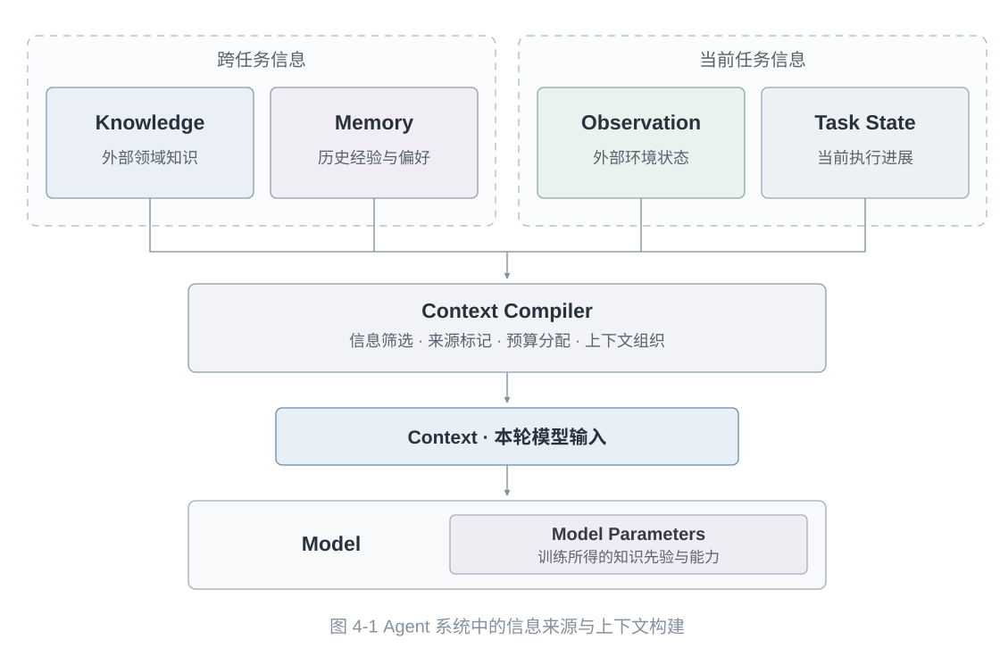


这里需要特别区分**信息的生命周期与信息的使用方式**。

Knowledge 与 Memory 具有独立于单次任务的生命周期，可以被不同任务持续访问和复用。Observation 与 Task State 主要服务于当前任务，虽然也可以持久化保存以支持审计、任务恢复或经验提炼，但持久化本身并不意味着它们已经成为长期记忆。

Context 则是面向一次模型调用构建的信息集合。它并不承担知识与记忆的长期维护职责，而是根据当前任务的目标、执行阶段及 Token 预算，选择并组织所需的信息。

由此可见，知识检索、记忆管理与上下文工程分别解决信息管理中的不同问题：知识检索负责发现相关信息，记忆管理负责历史信息的积累与演进，上下文工程负责将这些信息转化为当前模型调用所需的有效输入。

三者相互协作，但具有各自独立的职责。

### 1.3 Knowledge 与 Memory 的本质区别

从技术实现上看，Knowledge 与 Memory 可以采用相似的存储与检索机制。例如，二者都可以使用关系型数据库保存结构化信息，使用对象存储保存原始材料，使用全文索引与向量索引支持检索。

因此，存储介质和检索算法并不能构成二者的主要区别。

**Knowledge 与 Memory 的核心差异，在于信息是如何形成的、由谁维护，以及系统依据什么判断其有效性。**

Knowledge 通常来源于 Agent 之外已有的业务与知识体系，其有效性取决于源数据的权威性、版本及适用范围。Memory 则主要形成于 Agent 的历史交互与任务执行过程，其有效性需要结合原始记录、执行结果、用户确认及后续反馈进行判断。

| 对比维度 | Knowledge                            | Memory                                 |
| --- | --- | --- |
| 信息来源 | 业务系统、领域专家、规范与文档       | 历史交互、任务执行及反馈               |
| 信息形成 | 由外部知识体系提供                   | 从历史活动中记录与提炼                 |
| 维护主体 | 源系统或知识负责人                   | 记忆管理机制，必要时引入人工确认       |
| 采信依据 | 来源权威性、版本、生效状态及适用范围 | 原始证据、确认方式、执行结果及适用条件 |
| 演进方式 | 随源知识变更而更新                   | 随新的经验、反馈与反例不断修正         |

以支付网关故障排查为例，假设 Agent 获取了以下三类信息：

- **Knowledge**：当前生效的扩容手册规定，新实例接入生产流量前，需要确认实际出口地址已获得下游渠道授权。
- **Memory**：10 月 22 日的故障记录表明，inst-09、inst-10 的出口地址未加入下游渠道白名单，完成配置修复后，服务错误率恢复正常。
- **Observation**：11 月 5 日，监控显示新实例 inst-11 的错误率达到 45%，而存量实例的错误率仅为 0.01%。此时尚未查询 inst-11 的实际出口地址及下游渠道授权情况。

在这一场景中，Knowledge 提供了排查所依据的技术规范，Memory 提供了相似故障的历史经验，Observation 则反映了当前故障的实际表现。

历史经验可以帮助 Agent 提高白名单问题的排查优先级，但当前故障是否由相同原因引起，仍然需要通过配置查询与实际调用证据进行确认。

值得注意的是，Knowledge 与 Memory 并非完全割裂。同一份事故复盘既可以作为历史案例被记忆系统引用，也可以经过审核后纳入企业知识库，成为正式的领域资料。经过多次任务验证的执行经验，也可以进一步沉淀为标准操作规范。

这一过程体现了经验向知识的转化，但信息的权威性并不会因为被长期保存而自然提高，它仍然取决于相应的验证与审核机制。

### 1.4 为什么原始 History 不能直接充当 Memory？

在 Agent 系统中，History 与 Memory 是两个容易混淆的概念。

History 通常记录任务执行过程中发生的事件，包括用户输入、模型输出、工具调用、工具返回结果以及 Runtime 的状态变化。这些信息对于会话恢复、问题定位、行为审计和任务重放具有重要价值，也是长期记忆的重要原始材料。

对于短期会话，或者需要还原历史细节的任务，直接读取 History 是合理的。但随着任务数量与历史记录不断增长，仅依靠对原始历史的检索，将逐渐暴露出以下问题。

#### **1. 信息的有效状态难以判断**

任务执行过程本身包含大量探索性分析。在同一次故障排查中，Agent 可能先提出数据库连接异常的假设，随后通过监控查询排除这一可能性。

如果检索仅命中了早期的分析记录，已经被排除的假设便可能在新的任务中再次被当作有效参考。

原始记录保留了完整的分析过程，但其中不同信息的确认状态仍需要进一步识别。

#### **2. 信息分散，缺乏完整的语义结构**

一项具有复用价值的经验，往往分散在多轮交互与工具调用之中。

例如，一次故障的现象来自监控查询，根因来自配置检查，解决方案来自后续操作，修复效果则需要通过新的监控数据进行确认。

这些信息分别存在于不同的历史记录中。如果每次复用都需要重新检索并组织完整的历史过程，不仅会增加检索与上下文构建的成本，也可能因为部分信息缺失而影响模型对历史案例的理解。

#### **3. 信息缺乏持续演进的机制**

历史记录通常按照时间顺序追加，过去的信息不会因为新的信息出现而自动失效。

例如，用户的操作偏好发生变化，某项排障经验出现了反例，或者历史故障的根因在后续复盘中被重新认定。这些变化都可以被记录到 History 中，但系统仍然需要识别新旧信息之间的关系，并判断哪些内容更适合作为后续任务的参考。

因此，长期记忆不仅涉及信息的保存，还涉及信息的提炼、关联、更新与修正。

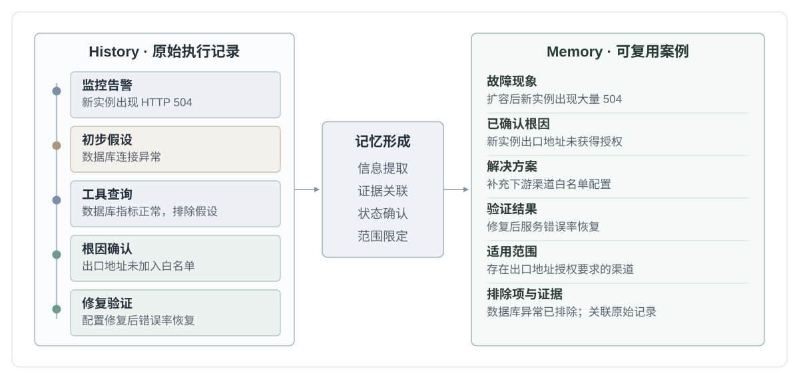

从系统设计的角度看，History 与 Memory 可以采用不同的数据组织方式：History 主要按照事件发生的顺序组织信息，Memory 则围绕案例、事实、偏好或经验等具有复用价值的信息进行组织，并保留与原始记录之间的关联。

这种组织方式使 Agent 在后续任务中既能够直接获取经过整理的信息，也能够在必要时回溯原始记录，重新检查相关结论的依据。

**History 关注过去发生了什么，Memory 关注过去发生的事情能够为未来的任务提供什么价值。**

## 2. 知识获取与切片工程：从原始文档到检索单元

企业知识通常以技术文档、业务规范、操作手册、接口说明等形式存在。这些资料主要面向人类阅读，其语义依赖于文档自身的组织结构：章节标题用于限定讨论对象，前文用于说明适用条件，表头用于解释字段含义，脚注则可能补充特殊情况与例外规则。

然而，在基于检索的知识获取过程中，系统通常不会将整篇文档交给模型，而是从中选择与当前任务相关的局部内容。当这些内容脱离原有文档结构时，其语义可能发生缺失，甚至产生与原文不同的解释。

因此，知识接入不仅是将非结构化文档转换为可检索的数据，更重要的是在转换过程中保留知识的语义完整性、适用条件与来源关系，使局部信息能够被模型正确理解和使用。

### **2.1 RAG 的基本原理与系统架构**

RAG（Retrieval-Augmented Generation，检索增强生成）是一种将外部信息检索与模型生成相结合的技术机制。其基本思想是在模型生成回答之前，根据当前任务从外部知识源中获取相关信息，并将其组织到模型输入中，从而增强模型处理特定领域问题的能力。

与直接依赖模型参数生成回答相比，RAG 使知识具有独立于模型参数的更新机制，系统可以通过维护外部知识源与检索索引，使模型获取新的领域知识，而无须重新训练模型。

#### **1. 在线知识检索链路**

假设用户提出以下问题：

> payment-gateway 扩容前需要检查什么？

一次典型的文档 RAG 请求可以划分为四个阶段：

1. **查询构建（Query Construction）**：根据用户问题及当前任务状态，提取服务名称、运行环境等检索条件，并结合用户身份确定可访问的知识范围。
2. **知识检索（Retrieval）**：从知识索引中召回相关文档片段，结合元数据过滤与相关性排序，筛选出适用于当前任务的候选资料。
3. **上下文构建（Context Construction）**：将用户问题、检索结果及必要的来源信息进行组织，形成模型本轮调用所需的上下文。
4. **增强生成（Augmented Generation）**：模型结合检索获得的资料进行理解、归纳与生成，应用层提供相应的来源引用；当现有资料不足以支持结论时，应保留这一不确定性。

例如，系统可能从《支付网关扩容手册》中检索到以下内容：

> 新实例接入流量前，应核对实际出口地址已被下游渠道授权。完成配置后，执行连通性验证并留存变更记录。

除正文之外，检索结果还应关联文档版本、章节位置、适用环境等元数据，用于后续的知识筛选、来源引用与原文追溯。

在这一过程中，模型依然负责理解问题、组织逻辑与生成回答，而检索系统负责提供完成任务所需的外部知识。

从第三章 Context Engineering 的视角来看，**RAG 是上下文的信息获取机制之一，而 Context Compiler 则负责将检索获得的候选知识转化为本轮模型调用的有效输入。**

#### **2. 离线知识构建链路**

在线检索能够获取什么样的知识，取决于外部资料如何被解析、组织和建立索引。

在典型的企业知识系统中，离线知识构建通常包括以下阶段：

1. **文档接入（Ingestion）**：从文档系统、对象存储或其他知识源获取原始资料，同步文档版本、所有者、适用范围及访问权限等信息。
2. **文档解析（Parsing）**：识别文档中的标题、段落、列表、表格与代码块，将其转换为可进一步处理的结构化内容，并保留原文位置。
3. **知识切片（Chunking）**：根据文档结构与语义边界，将长文档拆分为适合检索的知识单元，同时建立切片与原始文档之间的关联。
4. **索引构建（Indexing）**：为知识单元建立全文索引、向量索引及必要的元数据索引，为后续的关键词检索、语义检索与条件过滤提供支持。
5. **评估与发布（Evaluation & Publishing）**：通过代表性查询、权限样例及文档完整性检查验证索引质量，完成知识索引的发布或更新。


由此可见，RAG 并非单一的检索算法，而是由知识构建、信息检索与模型生成共同组成的系统机制。

离线链路决定知识如何进入系统，以及能够以何种粒度被检索；在线链路决定如何根据当前任务发现、筛选和使用这些知识。两条链路共同影响最终的知识获取质量。

#### **3. RAG、微调与实时工具查询的职责划分**

在 Agent 系统中，模型微调、RAG 与实时工具查询都能够增强模型处理领域任务的能力，但三者解决的是不同层面的问题。

| **机制**                   | **主要职责**                           | **信息更新方式**            | **典型应用场景**                       |
| -------------------------- | -------------------------------------- | --------------------------- | -------------------------------------- |
| 微调（Fine-tuning）        | 调整模型的任务行为、领域表达及输出能力 | 模型训练、评估与发布        | 意图分类、结构化输出、工具调用         |
| RAG                        | 为模型提供可独立维护的外部知识         | 文档更新、索引构建与发布    | 技术手册、业务规范、接口说明、事故复盘 |
| 实时工具查询（Tool Query） | 获取外部系统中的具体事实与当前状态     | 调用 API 或查询结构化数据源 | 监控指标、实例状态、配置参数、订单信息 |

**表 4-3 微调、RAG 与实时工具查询的职责划分**

以支付网关的超时配置为例，Agent 可以通过 RAG 获取超时参数的配置规范、调整原则与操作流程；而某一支付渠道当前实际生效的超时参数，则更适合通过配置中心提供的接口进行精确查询。

对于已经具备明确数据结构和查询接口的信息，将其转换为文本并进行相似度检索，通常会引入额外的信息转换与检索误差。

因此，Agent 应当根据信息本身的性质选择获取方式，而不是将所有外部信息统一纳入向量检索体系。

### **2.2 切片工程的核心问题：检索粒度与语义完整性**

Chunking（切片）是将长文档拆分为较小知识单元的过程，其目的在于提高知识检索的定位能力，并控制检索结果占用的上下文空间。

然而，切片粒度的选择存在两个相互制约的目标：

- **检索精度**：较小的切片通常能够更加集中地表达某个主题或知识点，有利于系统定位与查询直接相关的内容。
- **语义完整性**：较大的切片能够保留更加完整的背景、前置条件和逻辑关系，但也可能包含大量与当前任务无关的信息，降低检索的区分度并增加上下文开销。

因此，切片工程的核心问题并非寻找一个普遍适用的 Token 长度，而是在检索粒度与语义完整性之间取得合理的平衡。

以支付网关的一条线程池调整规范为例：

> 数据库连接池接近容量上限时，不应直接提高网关线程数。只有确认数据库仍有余量、请求主要等待在外部 HTTP 调用，并完成容量评估后，才考虑临时调整线程池上限。调整后应监控并准备回滚。

这段内容实际上包含四个相互关联的语义组成部分：

- **禁止条件**
  数据库连接池接近容量上限时，不应直接提高网关线程数。
- **前置条件**
  数据库仍有余量、请求主要等待外部 HTTP、完成容量评估。
- **操作动作**
  考虑临时调整线程池上限。
- **后续验证**
  持续监控并准备回滚。

如果采用固定长度切分，系统可能仅保留“临时调整线程池上限”这一操作动作，而丢失相应的禁止条件、前置条件和验证要求。

此时，切片虽然在文本层面仍然能够独立阅读，但已经无法完整表达原始规则的含义。

类似的问题也广泛存在于其他文档结构中。例如，表格中的数值依赖于表头、单位和适用范围；正文中的代词依赖于章节标题或前文定义；操作手册中的步骤则可能依赖于相邻段落中的限制条件。

这些问题说明，**文本边界并不等同于语义边界。**

对于操作规范、业务规则等具有明确约束关系的资料，切片及其交付内容应当尽可能保留操作对象、适用范围、前置条件、具体动作与验证要求之间的关联关系。对于表格，则需要保留必要的标题、列名、单位及相关说明。

知识切片的质量，最终取决于检索获得的信息能否准确表达原始知识，而不仅仅取决于切片长度是否符合预设范围。

### **2.3 切片策略与父子索引**


#### **1. 基于文档结构的切片**

在实际的知识工程中，文档本身的组织结构通常是确定切片边界的重要依据。

对于 Markdown、HTML 等具有明确结构标记的文档，可以利用标题层级、段落、列表、表格及代码块识别相对完整的知识单元。对于 PDF、扫描件或复杂 Word 文档，则需要通过文档解析恢复其阅读顺序、章节关系与表格结构。

例如，对于《支付网关扩容手册》，其原始文档可能具有如下组织结构：

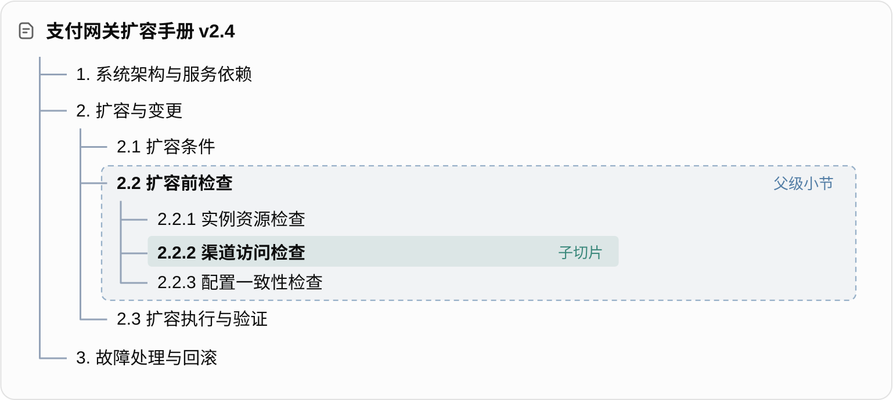

系统可以首先根据章节结构划分知识单元，例如将“渠道访问检查”作为一个相对独立的切片。当某个章节的内容超过预设长度时，再沿段落、列表或其他合理的语义边界进行二次拆分。

这种方式将文档结构作为主要切分依据，将长度限制作为辅助约束。相比直接按照固定字符数或 Token 数切分，它能够更好地保留原始文档中的层次关系与语义结构。

当然，文档结构本身并不总是与检索需求完全一致。对于内容复杂或结构不规范的资料，还可以结合语义切分、相邻片段重叠等方式进一步优化切片质量。

#### **2. 检索粒度与交付粒度的解耦**

传统的切片方式通常将同一个 Chunk 同时作为索引单元、检索结果与模型输入材料。

这种设计实现简单，但也意味着系统需要使用相同的信息粒度，同时满足检索精度与语义完整性两个目标。

Parent-Child（父子索引）提供了另一种组织方式：通过建立不同粒度知识单元之间的关联关系，将用于检索的知识单元与最终交付给模型的知识单元进行解耦。

其中：

- **Child Chunk（子切片）**：粒度较小，用于建立索引和执行相关性检索，提高知识定位的准确性。
- **Parent Chunk（父切片）**：粒度较大，保留更加完整的章节语义与上下文关系，在子切片命中后按需获取。

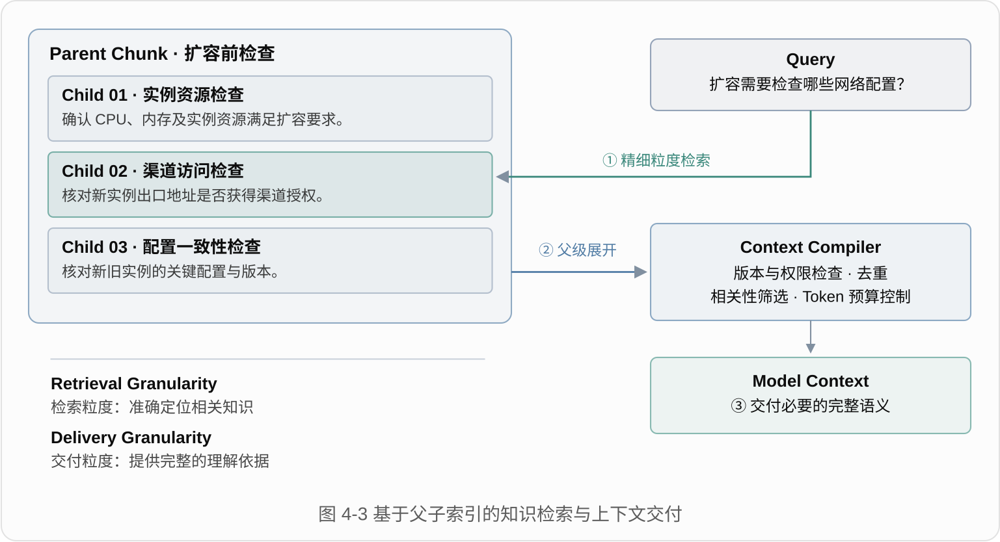

以支付网关扩容手册为例，系统可以通过较短的“渠道访问检查”子切片定位与出口地址授权相关的知识，再根据其 `parent_id` 获取完整的“扩容前检查”小节。

通过这种方式，系统既能够利用较小的知识单元实现精准检索，也能够在需要时恢复其原始语义环境。

父级内容的获取范围可以根据任务需求进一步调整。例如，当父级章节包含大量无关信息时，可以仅补充命中切片的相邻段落、上级标题及必要的前置条件。在展开过程中，还需要确保父子内容的版本一致性与访问权限，并对重复内容进行合并。

由此可见，**检索所使用的信息粒度与模型理解知识所需要的信息粒度并不一定相同。** 将二者解耦，是改善知识检索质量与上下文利用效率的一种重要设计思路。

#### **3. 检索单元的数据组织**

一个完整的检索单元不仅包含用于检索的文本，还需要记录其在原始知识体系中的位置与关联关系。

以支付网关扩容手册中的渠道访问检查为例，可以采用如下数据结构：

```yaml
chunk_id: CHK-PAY-EXPAND-01
parent_id: PAR-PAY-EXPAND
doc_id: DOC-PAY-RUNBOOK
version: v2.4

section_path:
  - 扩容与变更
  - 扩容前检查
  - 渠道访问检查

service: payment-gateway
environment: PRODUCTION
source_location: page 18, paragraph 3

source_text: |
  新实例接入流量前，应核对实际出口地址
  已被下游渠道授权。
  配置后执行连通性验证，并留存变更记录。

context_prefix: |
  支付网关扩容手册 v2.4。
  生产环境，扩容前检查，渠道访问检查。
```

从信息组织的角度看，这些字段承担着不同的职责：

| **信息组成** | **代表字段**                 | **主要用途**                           |
| ------------ | ---------------------------- | -------------------------------------- |
| 标识信息     | `chunk_id`、`doc_id`         | 唯一定位检索单元及所属文档             |
| 结构关系     | `parent_id`、`section_path`  | 恢复文档层次及上下文关系               |
| 领域元数据   | `service`、`environment`     | 支持领域范围与适用条件过滤             |
| 来源信息     | `version`、`source_location` | 支持版本管理、引用与原文追溯           |
| 原始内容     | `source_text`                | 提供知识正文与引用依据                 |
| 上下文补充   | `context_prefix`             | 补充切片背景，提高检索时的语义表达能力 |

其中，系统可以将 `context_prefix` 与 `source_text` 组合为实际参与全文索引或向量计算的文本，以补充原始切片在脱离文档结构后缺失的背景信息。

这种方式也体现了 Contextual Retrieval（上下文增强检索）的基本思想，即在索引构建阶段，为局部知识片段补充其在原始文档中的语义背景，从而改善检索质量。[7]

当补充内容由模型生成时，应将其与原始正文独立保存。前者用于增强知识的检索表达，后者用于提供可追溯的原文依据。

需要强调的是，索引中的知识表示可以根据检索需求进行增强，但其来源关系应始终保留。这样既能够支持更加灵活的检索策略，也能够使系统在必要时回到原始文档验证相关内容。

### **2.4 文档解析与切片质量评估**

文档解析与切片属于知识检索的上游环节，其质量直接影响后续召回、重排及模型生成。

例如，如果原始文档中的表头在解析过程中丢失，或者操作规范中的限制条件在切片过程中被拆分，即使后续检索系统准确地返回了相应片段，模型仍然可能无法获得正确的知识依据。

因此，知识系统需要对文档解析与切片质量建立独立的评估机制，而不能仅通过最终回答的准确率间接判断上游处理效果。

#### **1. 解析与切片的质量维度**

| **评估维度** | **核心问题**                         | **典型检查内容**                       |
| ------------ | ------------------------------------ | -------------------------------------- |
| 解析准确性   | 原始文档是否被正确转换               | 阅读顺序、标题层级、跨页表格、OCR 结果 |
| 语义完整性   | 知识单元及其关联内容能否完整表达原意 | 前置条件、禁止条件、操作步骤、验证要求 |
| 结构一致性   | 文档内部的组织关系是否得到保留       | 章节路径、父子关系、表格与正文关联     |
| 来源可追溯性 | 检索结果能否准确定位至原始资料       | 文档标识、版本、页码及段落位置         |
| 交付一致性   | 展开和组合后的知识是否仍然有效       | 父子版本一致性、权限校验及重复内容处理 |

#### **2. 基于代表性样本的回归评估**

在工程实践中，可以从实际知识库中选取具有代表性的文档与知识片段，构建固定的回归样本集，覆盖以下典型场景：

- 包含多级标题、跨段落引用与代词指代的技术文档。
- 包含合并单元格、跨页表格及复杂单位说明的结构化资料。
- 包含禁止条件、前置条件、例外规则和回滚要求的操作规范。
- 包含多个历史版本及不同访问权限的领域文档。

当文档解析器、切片策略或数据组织方式发生变化时，可以通过固定样本对比不同版本的处理结果，检查是否出现语义缺失、结构错误或来源关联异常。当 Embedding 模型发生变化时，则进一步通过固定查询集评估知识召回质量的变化。

对于生产操作手册、合规规范等具有较高准确性要求的资料，还可以针对关键知识片段引入人工评估，重点检查其语义与原始文档的一致性。

通过这种方式，系统能够将知识构建阶段的问题与后续检索、排序及生成阶段的问题进行区分，为知识系统的持续优化提供更加明确的依据。

## 3. 混合检索与重排：从候选到可用证据

完成文档解析与切片之后，原始知识已经被转换为具有相对完整语义、结构关系及来源信息的检索单元。接下来的问题是：如何根据当前任务，从大规模知识集合中找到真正有价值的信息？

用户对问题的描述方式与知识库中的表达方式往往并不一致。某些问题需要理解自然语言背后的语义，某些问题则依赖错误码、配置键等具有明确字面含义的标识符。单一检索机制通常难以同时满足这些需求。

例如，用户提出以下问题：

> 为什么 payment-gateway 新扩容的实例调用银行渠道一直超时？

假设系统已经从失败日志中获取错误码 `E-PAY-10243`，知识库中存在以下三份资料：

- A：《扩容前检查》，涉及新实例出口地址及下游渠道授权。
- B：《HTTP 504 常见原因》，介绍不同类型的网关超时问题。
- C：《错误码 E-PAY-10243》，解释特定银行渠道错误码的含义。

关键词检索能够通过错误码定位资料 C，语义检索则可能发现与扩容和超时相关的资料 A、B。而在这些候选资料中，哪些能够为当前任务提供直接的判断依据，还需要结合故障发生的环境、实例范围及其他已知条件进一步分析。

因此，企业知识检索通常采用多阶段架构，先通过不同的检索机制扩大候选覆盖范围，再通过融合、重排与上下文组织逐步收敛至当前任务所需的信息。

### **3.1 多阶段检索：召回与重排的职责划分**

在大规模信息检索系统中，检索效率与相关性判断的精细程度通常存在一定的权衡。

如果对知识库中的每一条文档都执行复杂的相关性计算，在线查询成本将随着知识规模增长。反之，如果仅依赖计算成本较低的匹配机制，又可能无法准确判断文档与复杂任务之间的关系。

因此，现代检索系统通常将这一过程划分为两个主要阶段：

| 阶段              | 核心目标               | 处理范围             | 主要特点                         |
| ----------------- | ---------------------- | -------------------- | -------------------------------- |
| Recall（召回）    | 尽可能覆盖相关知识     | 大规模知识集合       | 强调检索效率与候选覆盖率         |
| Reranking（重排） | 提升候选结果的排序质量 | 召回后的有限候选集合 | 强调查询与文档之间的细粒度相关性 |

**表 4-6 召回与重排的职责划分**

召回阶段负责从大规模知识集合中快速定位潜在相关的信息，重排阶段则针对有限的候选集合，进一步判断不同资料对当前任务的实际价值。

这种设计将全库检索与精细相关性计算进行解耦，使系统能够在可接受的计算成本下获得较好的检索效果。

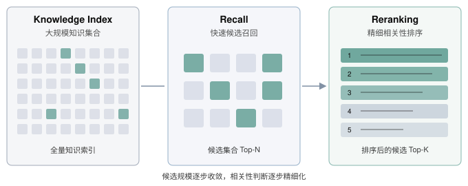

需要注意的是，召回与重排具有不同的能力边界。重排只能调整已经进入候选集合的文档，无法恢复召回阶段遗漏的信息。

同样，即使某份资料在重排阶段获得了较高的排名，其内容仍需要经过父级展开、去重与上下文预算分配，才能最终进入模型输入。

由此可见，一条完整的知识获取链路至少需要解决三个层面的问题：

1. 相关知识是否进入候选集合。
2. 更有价值的知识是否排在候选集合前列。
3. 排序后的知识是否以完整、适当的形式进入模型上下文。

这三个层面分别对应召回质量、排序质量与上下文交付质量，也是后续检索系统进行独立评估和问题定位的基础。

### **3.2 语义检索：基于向量空间的知识匹配**

#### **1. 文本语义的向量化表示**

传统关键词检索依赖查询与文档之间的词项匹配，但自然语言具有较强的表达多样性，相同的语义往往可以通过不同的词汇和句式进行描述。

例如：

| 信息来源 | 文本内容                           |
| -------- | ---------------------------------- |
| 用户查询 | 新机器一访问银行就卡住             |
| 技术手册 | 新增容器实例调用下游渠道发生读超时 |

两段文本在字面上的重合程度较低，但表达的是相近的技术问题。

Embedding 模型通过将文本映射到高维向量空间，使系统能够基于向量之间的距离或相似度进行语义匹配。DPR（Dense Passage Retrieval，稠密段落检索）是这一技术路线的代表性方法之一。[2]

假设查询为 \(q\)，文档切片为 \(d_i\)，则可以分别获得二者的向量表示：

$$
\mathbf{v}_q=E_q(q) \
$$

$$
\mathbf{v}_{d_i}=E_d(d_i)
$$

其中，\(E_q\) 与 \(E_d\) 分别表示查询与文档的编码过程，二者可以使用共享参数的编码器，也可以采用分别训练的编码器。

在采用余弦相似度的检索系统中，查询与文档之间的相似度可以表示为：

$$
\operatorname{sim}(q,d_i)= \frac{\mathbf{v}_q\cdot\mathbf{v}_{d_i}} {\|\mathbf{v}_q\|\|\mathbf{v}_{d_i}\|}
$$

系统根据相似度计算结果，从知识索引中获取与查询较为接近的文档片段。

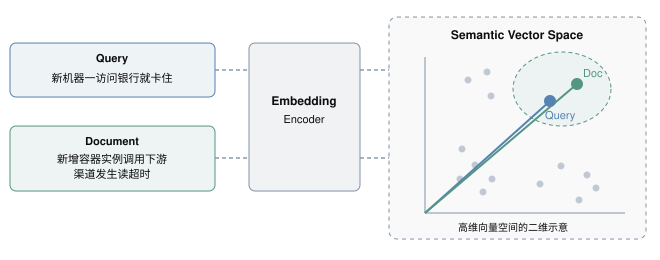

这种方式使系统能够突破词汇层面的限制，发现使用不同语言表达但具有相近语义的知识。

#### **2. 向量索引与编码一致性**

文档向量通常可以在离线知识构建阶段提前计算并写入向量索引。在线查询阶段只需要计算查询向量，再通过精确近邻搜索或近似最近邻搜索（Approximate Nearest Neighbor，ANN）获取候选结果。

将文档编码过程前移至离线阶段，是稠密检索能够支持大规模在线查询的重要原因。

在工程实现中，向量索引需要与其对应的编码配置保持一致，主要包括：

| 配置项               | 主要作用                   |
| -------------------- | -------------------------- |
| Embedding 模型及版本 | 决定文本的向量表示空间     |
| 查询与文档输入模板   | 决定参与编码的实际文本形式 |
| 向量维度             | 决定向量的数据结构         |
| 归一化方式           | 影响向量长度及相似度计算   |
| 距离度量             | 决定近邻关系的计算方式     |

不同 Embedding 模型生成的向量，即使具有相同的维度，也不意味着它们处于兼容的表示空间。

因此，当系统更换 Embedding 模型或关键编码配置时，需要重新验证查询与文档向量的一致性。对于不兼容的表示空间，应重新计算文档向量，并通过独立索引完成迁移。

#### **3. 语义相似性与信息有效性的区别**

语义检索擅长发现表达方式不同但主题相近的信息。然而，向量空间中的接近程度并不等同于业务含义上的一致性。

例如：

| 文本 A           | 文本 B           | 实际差异       |
| ---------------- | ---------------- | -------------- |
| E-PAY-10243      | E-PAY-10240      | 不同的错误标识 |
| 已配置渠道白名单 | 未配置渠道白名单 | 相反的配置状态 |
| 生产环境扩容规范 | 测试环境扩容规范 | 不同的适用范围 |

这些文本可能具有较高的语义相似度，但在实际任务中却不能相互替代。

Embedding 模型主要描述文本在特定表示空间中的语义关系，而错误码的一致性、环境匹配、访问权限及版本有效性等问题，具有更加明确的业务约束，需要通过精确匹配或结构化条件进行判断。

这也是语义检索需要与其他检索机制相结合的重要原因。

### **3.3 关键词检索：基于词项匹配的相关性计算**

与语义检索不同，关键词检索主要根据查询与文档之间的词项匹配关系计算相关性。

对于错误码、服务名称、配置键、类名及接口标识等具有明确字面含义的信息，词项匹配通常具有较好的区分能力。

BM25（Best Matching 25）是全文检索系统中具有代表性的相关性评分算法。[3]

其一种常见的评分形式为：

$$
operatorname{BM25}(q,d)= \sum_{t\in q} \operatorname{IDF}(t) \cdot \frac{f(t,d)(k_1+1)} {f(t,d)+k_1\left(1-b+b\frac{|d|}{\operatorname{avgdl}}\right)}
$$

其中：

| 参数                      | 含义                         |
| ------------------------- | ---------------------------- |
| \(f(t,d)\)                | 词项在文档中的出现频率       |
| \(\operatorname{IDF}(t)\) | 词项在文档集合中的逆文档频率 |
| \(\|d\|\)                 | 当前文档的长度               |
| \(\operatorname{avgdl}\)  | 文档集合的平均长度           |
| \(k_1\)                   | 控制词频饱和程度的参数       |
| \(b\)                     | 控制文档长度归一化程度的参数 |

从工程角度来看，BM25 的评分机制主要体现了三个方面。

#### **1. 词频饱和（Term Frequency Saturation）**

查询词在文档中的出现次数越多，通常意味着文档与查询具有更强的相关性。但随着出现次数增加，其评分贡献会逐渐趋于饱和。

BM25 的词频饱和机制（示例参数 k₁ = 1.2，文档长度等于平均长度）

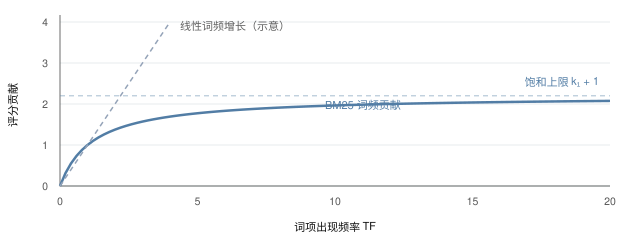


这一机制能够减少文档因重复出现相同词项而获得过高评分的情况。

#### **2. 逆文档频率（Inverse Document Frequency）**

不同词项在文档集合中的区分能力并不相同。

例如，“服务”“系统”“异常”等词汇可能出现在大量技术文档中，其区分能力相对有限；而 `E-PAY-10243`、`payment-gateway` 等特定标识通常能够更加准确地定位相关知识。

IDF 通过衡量词项在整个文档集合中的分布情况，使具有较强区分能力的词项获得更高的评分贡献。

#### **3. 文档长度归一化（Document Length Normalization）**

较长的文档通常包含更多词项，也更容易与查询产生字面匹配。

BM25 通过文档长度归一化机制，在一定程度上平衡不同长度文档之间的评分差异，使内容聚焦的小节能够与包含大量信息的长文档进行更合理的相关性比较。

需要区分的是，BM25 基于经过分析器处理后的词项进行匹配，并不等同于原始字符串的精确匹配。

对于错误码、配置键、版本号等标识符，搜索分析器的分词与规范化过程可能改变其原始形式。因此，在数据组织上，可以将自然语言正文与结构化标识符分别建立索引：

```yaml
content:
  type: text
  purpose: 全文检索

error_code:
  type: keyword
  purpose: 错误码精确匹配

service:
  type: keyword
  purpose: 服务范围过滤

version:
  type: keyword
  purpose: 版本识别
```

当任务明确要求查询某个错误码时，可以使用精确字段定位对应资料；当错误码仅作为故障分析中的一项线索时，则可以将其作为检索条件之一，与其他现象共同参与相关性计算。

由此可见，关键词检索与语义检索并非相互替代的技术路线。前者侧重词项及标识符的匹配，后者侧重自然语言的语义表达，二者具有较强的互补性。

### **3.4 混合检索：多路召回与候选融合**

Hybrid Retrieval（混合检索）通过组合不同的检索机制，提高系统对不同类型查询的覆盖能力。

在企业知识库中，较为常见的实现方式是并行执行全文检索与向量检索，再将两路结果进行去重、融合，并交给后续的排序机制。

#### **1. 多路召回**

继续使用支付网关故障案例，假设两种检索机制分别返回以下候选结果：

| 候选资料                | BM25 排名 | 向量检索排名 | 资料特征                 |
| ----------------------- | --------- | ------------ | ------------------------ |
| A：扩容前渠道访问检查   | 2         | 1            | 与扩容场景直接相关       |
| B：HTTP 504 通用说明    | —         | 2            | 提供一般性故障背景       |
| C：E-PAY-10243 错误码   | 1         | —            | 与日志标识精确相关       |
| D：测试环境旧版扩容手册 | 3         | 4            | 主题相关，但适用范围不符 |

仅使用 BM25，可能使系统过度集中于错误码；仅使用向量检索，则可能遗漏具有重要价值的错误码说明。

通过多路召回，系统能够同时保留扩容规范、通用故障知识及错误码资料，再结合当前任务的完整条件进行筛选。

其中，资料 D 不满足当前任务的环境与有效时间要求，因此不应进入最终候选集合。在实际实现中，这类确定性的准入条件应尽可能参与各路候选检索，而不是完全依赖召回后的过滤。

#### **2. 候选结果融合**

不同检索机制通常具有不同的评分体系。BM25 分数与向量相似度在取值范围、分布特征及业务含义上存在差异，因此不宜未经校准便直接进行分数相加。

一种常见的融合方法是 RRF（Reciprocal Rank Fusion，倒数排名融合）。RRF 不依赖原始相关性分数，而是根据文档在不同检索结果中的排名计算融合分数。

$$
\operatorname{RRF}(d)= \sum_{r\in R_d} \frac{1}{k+\operatorname{rank}_r(d)}
$$

其中：

- \(R_d\) 表示包含文档 \(d\) 的检索结果列表集合。
- \(\operatorname{rank}_r(d)\) 表示文档在第 \(r\) 路检索结果中的排名。
- \(k\) 为平滑参数，用于控制不同排名之间的贡献差异。

以符合准入条件的 A、B、C 三份资料为例，可以观察不同排名对融合结果的影响。

#### **3. 元数据过滤与候选准入**

混合检索并不意味着对所有相关资料进行无条件融合。

对于企业知识库，需要区分两类检索条件：

| 条件类型   | 典型字段                               | 处理原则                   |
| ---------- | -------------------------------------- | -------------------------- |
| 硬性约束   | 租户、访问权限、指定环境、规则生效时间 | 决定资料是否具备候选资格   |
| 可调整范围 | 服务名称、文档分类、故障标签           | 根据任务进展适当扩展或收缩 |
| 相关性特征 | 错误码、故障现象、自然语言描述         | 参与匹配、评分与排序       |

如果系统首先从全库获取有限的 Top-K 候选，再执行环境、时间及权限过滤，可能导致大量不符合条件的资料提前占据候选窗口，使真正有价值的信息无法被召回。

因此，在检索引擎支持的情况下，应尽可能将确定性的过滤条件纳入候选搜索过程。[15]

这一设计将资料的业务资格与语义相关性分开处理，使后续融合和排序建立在符合任务要求的信息集合之上。

### **3.5 重排机制：面向查询与候选的精细相关性计算**

通过多路召回与结果融合，系统已经获得一组潜在相关的知识。然而，候选文档之间仍然可能存在较大的信息价值差异。

例如，《HTTP 504 常见原因》与《扩容前渠道访问检查》都涉及网关超时，但如果当前任务已经明确故障只发生在新增实例，那么后者通常能够提供更具针对性的分析依据。

这种差异需要模型进一步理解查询中的限定条件，以及候选内容与这些条件之间的关系。

#### **1. Bi-Encoder 与 Cross-Encoder**

在向量检索中，查询与文档通常采用 Bi-Encoder（双编码器）方式分别编码：

$$
\mathbf{v}_q=E_q(q),\quad \mathbf{v}_d=E_d(d)
$$

随后通过向量相似度计算两者的相关程度。

Cross-Encoder（交叉编码器）则将查询与候选文档共同输入模型，直接计算二者之间的相关性分数：

$$
s(q,d)=F_\theta(q,d)
$$

由于查询与文档在同一次模型计算中进行交互，Cross-Encoder 能够对双方的词语关系、上下文条件及语义匹配程度进行更加细致的建模。

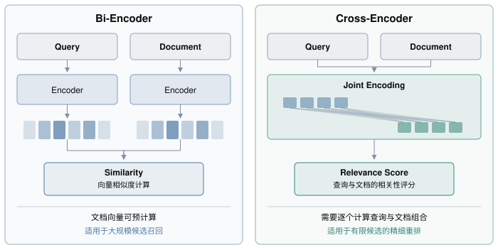

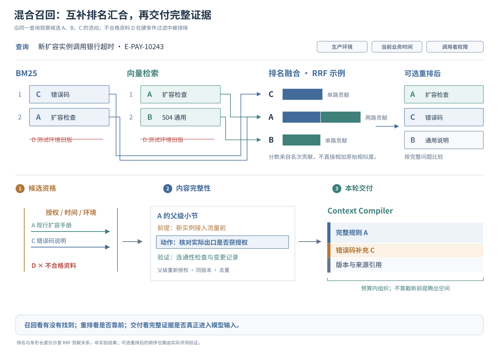

| 对比维度     | Bi-Encoder           | Cross-Encoder            |
| ------------ | -------------------- | ------------------------ |
| 编码方式     | 查询与文档分别编码   | 查询与文档联合编码       |
| 信息交互     | 在向量表示层进行比较 | 在模型计算过程中进行交互 |
| 文档编码     | 可以提前计算         | 通常需要结合当前查询计算 |
| 在线计算成本 | 相对较低             | 相对较高                 |
| 典型应用     | 大规模候选召回       | 有限候选的精细排序       |

**表 4-7 Bi-Encoder 与 Cross-Encoder 的机制差异**

因此，在多阶段检索架构中，Bi-Encoder 与 Cross-Encoder 通常承担不同职责：前者用于高效获取候选，后者用于提高候选的相关性排序质量。

#### **2. 重排与上下文交付**

重排阶段可以结合完整查询，对召回候选进行更加细致的分析。

在支付网关案例中，如果查询包含“新实例异常、存量实例正常、银行渠道读超时”等信息，重排模型便有机会识别出扩容配置检查相较于通用超时说明具有更高的任务相关性。

但重排后的结果仍然是候选知识，并不直接等同于模型最终接收的上下文。

系统还需要结合第二节讨论的父子索引机制，补充必要的上下文内容，并根据文档版本、访问权限、重复程度与 Token 预算完成最终交付。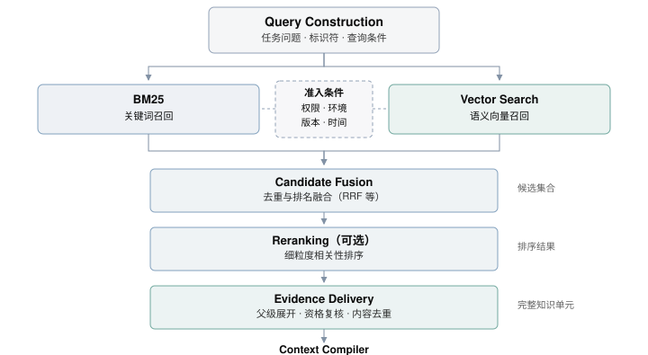

这一过程体现了多阶段检索架构的基本设计思想：通过计算成本相对较低的方式扩大候选覆盖范围，再将更加复杂的相关性计算集中于有限候选，最终根据上下文需求完成知识交付。

重排模型的选择、候选数量及相关性阈值，应结合实际查询集、延迟要求和任务效果进行评估。重排分数用于描述相关程度，其本身不代表知识的真实性、权威性或当前有效性。

### **3.6 检索质量的独立评估**

在 RAG 系统中，最终回答的质量同时受到知识构建、候选召回、相关性排序、上下文组织以及模型生成等多个环节的影响。

模型生成了正确答案，可能是因为检索提供了充分依据，也可能是模型依赖参数知识完成了回答；模型生成了错误答案，则可能是关键资料未被找到，也可能是已经获得的知识未被正确使用。

因此，仅依靠最终回答准确率难以判断检索系统自身的质量。企业知识系统需要建立独立的检索评估体系。

#### **1. 召回与排序指标**

信息检索领域常用的评估指标包括 Recall@K、Precision@K、MRR 和 nDCG@K

**Recall@K（召回率）**

Recall@K 用于衡量前 K 条检索结果覆盖了多少相关知识。

$$
operatorname{Recall@K}= \frac{|R_K\cap G|}{|G|}
$$

其中，\(R_K\) 表示前 K 条检索结果，\(G\) 表示评估集中标注的相关知识集合。

该指标主要反映检索系统对关键资料的覆盖能力。

**Precision@K（准确率）**

Precision@K 用于衡量前 K 个结果位置中相关知识所占的比例。

$$
\operatorname{Precision@K}= \frac{|R_K\cap G|}{K}
$$

该指标主要反映检索候选的相关程度与噪声水平。

当系统允许返回少于 K 条结果时，需要在评估协议中明确采用固定 K 作为分母，还是额外统计实际返回集合的准确率，以保证不同检索策略之间的可比性。

**MRR（Mean Reciprocal Rank，平均倒数排名）**

MRR 用于衡量每个查询中第一条相关结果的排序位置。

$$
operatorname{MRR}= \frac{1}{|Q|} \sum_{q\in Q} \frac{1}{\operatorname{rank}_q}
$$

其中，\(\operatorname{rank}_q\) 表示查询 \(q\) 中第一条相关结果的排名。如果查询没有命中相关结果，则其倒数排名记为 0。

例如，三个查询的第一条相关结果分别位于第 1 名、第 2 名和未命中，则：

$$
operatorname{MRR}= \frac{1+\frac12+0}{3}=0.5
$$

MRR 适用于关注首条有效结果的检索场景，但无法完整衡量需要多项知识共同支撑的复杂任务。

**nDCG@K（归一化折损累积增益）**

与简单的相关或不相关标注不同，nDCG 允许对不同候选设置不同的相关性等级，并对排序位置进行折损计算。

$$
operatorname{DCG@K}= \sum_{i=1}^{K} \frac{2^{rel_i}-1}{\log_2(i+1)} 
$$

$$
 \operatorname{nDCG@K}= \frac{\operatorname{DCG@K}} {\operatorname{IDCG@K}}
$$

其中，\(rel_i\) 表示第 \(i\) 个候选的相关性等级，IDCG 表示理想排序下的 DCG。当理想增益为零时，需要在评估协议中明确相应的处理方式。

在 Agent 知识检索中，可以将候选资料划分为不同的相关性等级，例如：

| 等级 | 含义                       |
| ---- | -------------------------- |
| 0    | 与当前任务无关             |
| 1    | 提供一般性背景信息         |
| 2    | 与当前任务直接相关         |
| 3    | 提供支持任务判断的关键依据 |

通过分级标注，系统能够进一步评估真正有价值的知识是否排在更靠前的位置。

#### **2. 从候选质量到证据交付质量**

传统检索指标主要关注候选集合及其排序结果，而 Agent 系统还需要关注知识是否最终进入模型上下文。

以前文的线程池调整规范为例，假设 Agent 最终给出的建议是提高网关线程池上限，但遗漏了数据库容量、外部 HTTP 等待及容量评估等前置条件。

进一步分析检索链路后发现：

1. 关键操作规范已经进入召回候选集合。
2. 重排结果将相关规范放在较高的位置。
3. 同一规程的多个重叠子切片占用了上下文预算。
4. 父级展开后的完整规范未被交付，模型最终只获得了包含操作动作的局部内容。

在这一场景中，继续提高召回数量或更换 Embedding 模型，并不能直接解决已经发生的知识缺失。

更有效的优化方向是调整上下文交付策略：根据文档、版本及原文范围合并重复片段，将操作动作与其必要前提作为完整的知识单元进行组织，并为关键知识分配足够的上下文预算。

由此可以将检索系统的质量评估进一步划分为以下层次：

| 评估层次   | 主要指标或检查内容                             |
| ---------- | ---------------------------------------------- |
| 候选召回   | Recall@K、关键资料覆盖率                       |
| 相关性排序 | Precision@K、MRR、nDCG@K                       |
| 知识交付   | 关键证据覆盖、语义完整性、重复率、来源可追溯性 |
| 系统性能   | P95 延迟、候选数量、重排成本、交付 Token 数量  |

**表 4-8 Agent 知识检索的分层质量评估**

评估集应覆盖自然语言表达、精确标识符、时间版本条件、权限限制及无答案查询等典型场景。相关知识的标注宜尽可能指向原始文档及具体证据范围，而不是完全绑定某次切片生成的 `chunk_id`。

这样，即使文档切片策略发生变化，系统仍然能够使用相同的查询与原文标注进行横向比较。

## **4. 企业级知识治理：时间、权限与索引一致性**

上一节讨论了如何通过混合召回与重排，从大规模知识集合中发现与当前任务相关的资料。然而，知识的相关性并不等同于其有效性。

一份历史版本的技术手册可能与当前问题高度相关，却已经不再适用于生产环境；一份当前生效的业务规范可能准确描述了所需信息，却超出了调用者的访问权限。

因此，企业知识系统除了具备信息检索能力，还需要建立独立的知识治理机制，负责管理知识的版本、生效时间、访问权限及索引一致性。

**相关性决定知识的使用优先级，治理规则决定知识的使用资格。**

### **4.1 知识版本与时间语义**

企业知识具有独立的生命周期。随着业务规则调整、系统架构演进及操作规范更新，同一知识对象可能存在多个历史版本。

以支付网关超时配置规范为例，假设其经历了以下变化：

| 时间        | 事件                             | 当时适用的规则   |
| ----------- | -------------------------------- | ---------------- |
| 10 月 22 日 | 历史故障发生                     | 旧版规范：5000ms |
| 10 月 25 日 | 发布 v3.0，规定 11 月 1 日起生效 | 旧版规范：5000ms |
| 11 月 1 日  | v3.0 正式生效                    | 新版规范：3000ms |
| 11 月 5 日  | 当前故障发生                     | 新版规范：3000ms |

如果知识系统仅按照文档的最后修改时间选择最新版本，那么在 10 月 28 日查询生产环境规范时，就可能提前使用尚未生效的 v3.0。而如果新版本直接覆盖原有知识，那么在 11 月复盘 10 月的历史故障时，又无法还原事故发生时实际适用的规则。

这两个问题的根源在于，知识的发布时间与业务生效时间具有不同的时间语义。

因此，知识系统通常需要维护以下时间信息：

- **Published Time（发布时间）**：知识版本正式发布的时间。
- **Effective Time（生效时间）**：知识在业务中的实际适用区间。
- **Ingestion Time（接入时间）**：知识版本进入检索系统的时间。

图 4-5 知识版本的发布时间、生效区间与查询时间

在进行知识检索时，系统可以通过 `as_of` 参数指定查询所对应的业务时间。对于当前故障排查，通常使用当前时间；对于历史事故复盘，则使用事故发生时的时间。

在具有较高审计要求的系统中，还可能需要进一步区分业务规则何时生效，以及系统何时实际获得该规则。例如，一份规范于 11 月 1 日生效，但直到 11 月 3 日才同步至知识库。

这种情况下，复盘 11 月 2 日的任务，既需要知道当时实际生效的规则，也需要知道 Agent 当时能够访问的知识。这正是双时态数据模型（Bitemporal Data Model）所解决的问题。[12]

通过对知识版本及时间语义的管理，系统可以同时支持当前业务查询、历史知识回溯与决策审计。

### **4.2 知识访问权限与检索边界**

在传统业务系统中，用户通常通过业务接口访问具有明确归属和权限约束的数据。引入 RAG 之后，知识的访问路径发生了变化：用户可以通过搜索索引、向量检索及模型生成间接获取原始资料中的信息。

如果权限校验仅存在于原始文档系统，而检索索引没有继承相应的授权关系，Agent 就可能通过新的读取路径访问原本不具备权限的内容。

因此，权限控制需要贯穿知识的完整读取链路。

| 读取阶段   | 权限控制要求                             |
| ---------- | ---------------------------------------- |
| 候选检索   | 根据用户身份、租户及资源权限限制候选范围 |
| 候选重排   | 确保传递给重排服务的资料具有相应授权     |
| 父级展开   | 检查展开后的文档内容是否仍在授权范围内   |
| 缓存读取   | 根据授权范围进行隔离，并处理权限变更     |
| 上下文交付 | 确保正文、标题及引用来源均具备访问资格   |

对于以源文档系统作为权限权威来源的知识库，可以将必要的资源归属及访问控制列表（ACL）同步至检索索引，使权限条件直接参与候选召回。[20]

当资源权限发生变更时，系统需要及时阻断相关内容的未授权访问，并更新索引与缓存。当授权状态无法确认时，应暂不返回相关资料。

从架构设计的角度来看，权限控制属于 Runtime 与知识服务的职责，应当在知识进入模型上下文之前完成，而不是依赖模型自行判断哪些内容可以使用。

### **4.3 索引一致性：知识库作为派生读模型**

企业知识系统通常包含两类数据：一类是由文档系统、业务系统及资料负责人维护的原始知识，另一类是根据原始资料构建的知识切片、全文索引、向量索引及缓存。

从数据架构的角度来看，前者是权威数据源（Source of Truth），后者则是面向检索场景构建的派生读模型（Derived Read Model）。

源知识与检索索引之间的数据关系

这一关系与传统业务系统中 MySQL 和 Elasticsearch 之间的关系较为相似：源系统负责业务数据的维护，搜索系统根据查询需求组织数据。

因此，源文档的更新并不意味着所有派生数据都已经同步完成。知识系统同样需要处理增量更新、索引重建、版本切换及数据一致性问题。

对于大规模索引重建，可以采用蓝绿索引发布机制：

1. 基于源文档构建独立的新索引版本。
2. 同步构建期间产生的增量变更。
3. 对检索质量、版本关系及访问权限进行回归验证。
4. 验证通过后切换线上读取入口，并保留必要的回滚能力。

索引版本还应关联解析器、切片策略及 Embedding 模型等技术配置，使系统能够在问题定位与版本迁移过程中还原对应的知识表示。

此外，普通内容更新与权限撤销、数据删除具有不同的一致性要求。后两者涉及资源是否仍然具备读取资格，因此需要优先阻断相关内容的访问，再清理切片、向量、全文索引及缓存等派生数据。索引回滚或备份恢复时，也需要避免已经撤权或删除的资源重新进入在线读取路径。

由此可见，企业知识库不仅是一个信息检索系统，也是一套需要持续维护的数据系统，其可靠性建立在源知识管理、版本控制、授权机制与索引一致性之上。


### **4.2 知识访问权限与检索边界**

在传统业务系统中，用户通常通过业务接口访问具有明确归属和权限约束的数据。引入 RAG 之后，知识的访问路径发生了变化：用户可以通过搜索索引、向量检索及模型生成间接获取原始资料中的信息。

如果权限校验仅存在于原始文档系统，而检索索引没有继承相应的授权关系，Agent 就可能通过新的读取路径访问原本不具备权限的内容。

因此，权限控制需要贯穿知识的完整读取链路。

| 读取阶段   | 权限控制要求                             |
| ---------- | ---------------------------------------- |
| 候选检索   | 根据用户身份、租户及资源权限限制候选范围 |
| 候选重排   | 确保传递给重排服务的资料具有相应授权     |
| 父级展开   | 检查展开后的文档内容是否仍在授权范围内   |
| 缓存读取   | 根据授权范围进行隔离，并处理权限变更     |
| 上下文交付 | 确保正文、标题及引用来源均具备访问资格   |

对于以源文档系统作为权限权威来源的知识库，可以将必要的资源归属及访问控制列表（ACL）同步至检索索引，使权限条件直接参与候选召回。[20]

当资源权限发生变更时，系统需要及时阻断相关内容的未授权访问，并更新索引与缓存。当授权状态无法确认时，应暂不返回相关资料。

从架构设计的角度来看，权限控制属于 Runtime 与知识服务的职责，应当在知识进入模型上下文之前完成，而不是依赖模型自行判断哪些内容可以使用。

### **4.3 索引一致性：知识库作为派生读模型**

企业知识系统通常包含两类数据：一类是由文档系统、业务系统及资料负责人维护的原始知识，另一类是根据原始资料构建的知识切片、全文索引、向量索引及缓存。

从数据架构的角度来看，前者是权威数据源（Source of Truth），后者则是面向检索场景构建的派生读模型（Derived Read Model）。

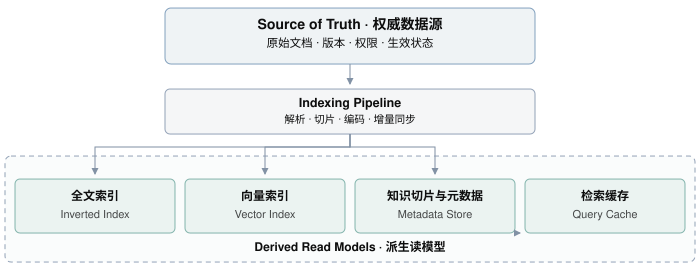

这一关系与传统业务系统中 MySQL 和 Elasticsearch 之间的关系较为相似：源系统负责业务数据的维护，搜索系统根据查询需求组织数据。

因此，源文档的更新并不意味着所有派生数据都已经同步完成。知识系统同样需要处理增量更新、索引重建、版本切换及数据一致性问题。

对于大规模索引重建，可以采用蓝绿索引发布机制：

1. 基于源文档构建独立的新索引版本。
2. 同步构建期间产生的增量变更。
3. 对检索质量、版本关系及访问权限进行回归验证。
4. 验证通过后切换线上读取入口，并保留必要的回滚能力。

索引版本还应关联解析器、切片策略及 Embedding 模型等技术配置，使系统能够在问题定位与版本迁移过程中还原对应的知识表示。

此外，普通内容更新与权限撤销、数据删除具有不同的一致性要求。后两者涉及资源是否仍然具备读取资格，因此需要优先阻断相关内容的访问，再清理切片、向量、全文索引及缓存等派生数据。索引回滚或备份恢复时，也需要避免已经撤权或删除的资源重新进入在线读取路径。

由此可见，企业知识库不仅是一个信息检索系统，也是一套需要持续维护的数据系统，其可靠性建立在源知识管理、版本控制、授权机制与索引一致性之上。

## **5. 长期记忆工程：从历史案例到经验演进**

Knowledge 使 Agent 能够获取模型参数之外的领域知识，而 Memory 则使 Agent 能够利用历史交互与任务执行过程中形成的信息。

对于持续运行的 Agent 系统，如果每次任务结束后都丢弃执行过程中产生的信息，那么下一次遇到类似问题时，系统仍然需要从头进行分析、检索与验证。

长期记忆的价值在于，使任务执行过程中形成的有效信息能够跨越单次任务的边界，并在未来的任务中发挥作用。

因此，**记忆工程的核心并非保存更多历史信息，而是从历史信息中形成能够改善未来任务的有效经验。**

### **5.1 记忆的形成：从具体案例到可复用经验**

在 Agent 的长期记忆设计中，可以根据信息的组织方式及抽象程度，将记忆划分为不同类型。

| 记忆类型                        | 核心内容                                 | 典型用途               |
| ------------------------------- | ---------------------------------------- | ---------------------- |
| Episodic Memory（情景记忆）     | 特定场景下发生的事件及其结果             | 历史案例检索、问题回顾 |
| Semantic Memory（语义记忆）     | 从历史交互与案例中形成的事实、知识和经验 | 跨任务判断、经验复用   |
| Procedural Memory（程序性记忆） | 相对稳定的操作流程与任务执行方法         | 任务规划、操作流程复用 |

这些记忆类型并不要求系统采用独立的存储基础设施，其主要区别在于信息的抽象程度及使用方式。

以支付网关故障为例，10 月 22 日的事故处理完成后，可以形成一条情景记忆：

> 扩容后，inst-09 与 inst-10 调用银行渠道时出现读超时，存量实例保持正常。配置查询发现，两个新增实例的实际出口地址未获得下游渠道授权，补充授权后服务错误率下降。

这一记录描述了特定事件的发生条件、配置差异、处置措施及执行结果，并可以关联原始监控数据与变更记录。

随着类似案例不断积累，系统可以进一步提取不同事件之间的共性，形成具有更广泛复用价值的语义经验：

> 当异常集中发生在新增实例，而存量实例保持正常时，可以优先比较新旧实例之间的配置差异、网络访问路径及出口地址授权情况。

相比原始事故记录，这条经验已经不再依赖具体的实例编号，而是提炼出了能够影响后续排查顺序的共性特征。

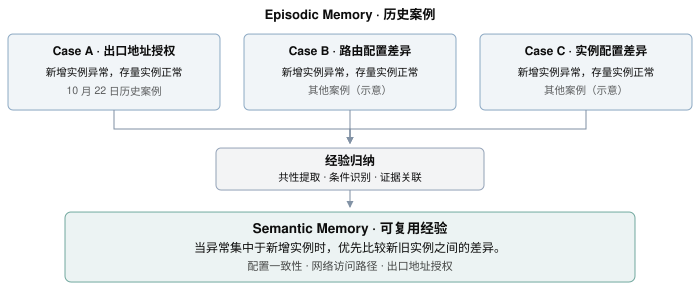

但并非所有经过验证的信息都值得长期保存。例如，inst-09 在事故发生时的具体出口 IP 可以作为历史证据，却不适合作为未来任务查询当前网络配置的数据来源。随着扩容、路由调整及网络迁移，这些信息可能发生变化，直接查询权威配置系统通常更加合理。

因此，记忆的信息筛选不仅需要考虑真实性，还需要考虑复用价值、信息稳定性及适用范围。

完整的工具日志可以保留在 History 中，特定时点的配置可以作为案例证据，而真正进入长期记忆的，应当是具有跨任务参考价值的事实、偏好、案例和经验。

### **5.2 记忆写入：信息提取与证据核验**

Agent 在任务执行过程中会不断产生新的观测、分析判断、操作记录与执行结果。这些信息具有不同的性质，也具有不同程度的确定性。

例如，在支付网关排障过程中，模型可能提出“新增实例的出口地址未获得下游渠道授权”这一假设。但在配置查询完成之前，它仍然属于待验证的判断。

如果系统直接将模型生成的分析内容写入长期记忆，那么一次未经验证的推测就可能在后续任务中被反复检索，逐渐形成错误经验的累积。

因此，长期记忆需要建立受控的写入机制，将信息提取、证据核验与记忆发布进行适当分离。

图 4-6 长期记忆的信息提取与受控写入

这里需要注意，核验应当针对具体陈述进行，而不是简单地为整份任务记录设置统一的确认状态。

以 11 月 5 日的当前故障为例，系统已经确认 inst-11 的错误率异常，但尚未获得出口地址与渠道授权信息。此时可以将任务中提取的信息组织为如下候选记忆：

```yaml
incident_id: INC-20261105-504
publication_status: PENDING_REVIEW

scope:
  service: payment-gateway
  environment: PRODUCTION
  instance: inst-11

observation:
  content: 新实例错误率为 45%，存量实例为 0.01%
  status: VERIFIED
  evidence: OBS-METRIC-20261105-01

assessment:
  content: 可能存在出口地址或渠道授权配置差异
  status: PENDING_VERIFICATION

outcome: null
```

其中，监控指标属于已经确认的观测事实，而配置差异仍然属于待验证的故障假设。即使后续配置查询发现了白名单漏配，也需要结合失败请求及处置结果，进一步判断它是否为当前故障的原因。

通过区分信息类型、核验状态与发布状态，系统能够保留任务执行过程中的中间信息，同时控制哪些内容可以作为长期经验参与后续任务。

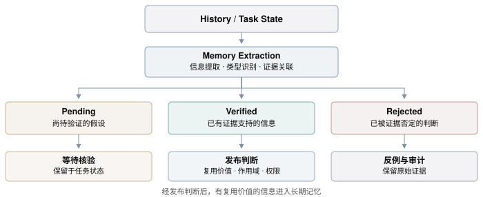

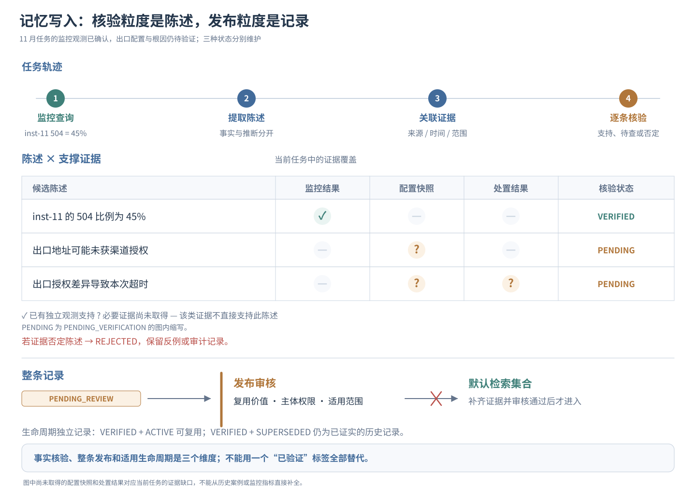

### **5.3 记忆检索：相关性与适用性**

Memory 的底层检索可以复用 Knowledge 中的全文检索、向量检索、混合召回与重排机制，但历史经验的复用还需要考虑一个更加突出的问题：**过去成立的经验，在当前环境下是否依然适用？**

例如，10 月的支付网关事故与 11 月的当前故障都表现为新增实例出现 HTTP 504。然而，如果两次事故之间发生了网络架构迁移、渠道接入方式调整或出口授权机制变更，那么历史案例的参考价值也会发生变化。

因此，长期记忆检索除了考虑语义相关性，还需要结合以下因素：

| 判断维度   | 主要作用                                 |
| ---------- | ---------------------------------------- |
| 作用范围   | 判断记忆是否属于当前用户、团队或业务场景 |
| 证据质量   | 优先使用具有观测依据及验证结果的历史信息 |
| 环境一致性 | 判断历史经验的适用条件是否仍然成立       |
| 时间与状态 | 识别已经失效、被取代或需要重新核验的记忆 |

部分记忆系统还会引入时间衰减机制，使较长时间未更新或未核验的记忆在排序中获得相对较低的权重。

但时间本身并不能决定信息的有效性。某些长期稳定的操作经验即使形成时间较早，仍然具有较高价值；某些刚刚写入的记忆虽然时间较新，却可能尚未得到充分验证。

因此，时间特征更适合作为记忆排序的辅助因素，而明确的权限、作用范围和生命周期状态则应通过确定性的规则进行处理。

### **5.4 记忆演进：更新、冲突与经验修正**

长期记忆并不是一个持续追加且永久有效的信息集合。随着用户偏好变化、业务环境演进及新案例积累，系统需要不断修正已有记忆。

不同类型的信息变化，需要采用不同的处理方式。

| 变化场景               | 处理方式                                 |
| ---------------------- | ---------------------------------------- |
| 当前任务与长期偏好不同 | 遵循当前指令，保留原有默认偏好           |
| 业务状态发生变化       | 建立新旧版本关系，保留适用时间           |
| 同一范围出现矛盾信息   | 关联双方证据，标记冲突并进一步核验       |
| 新案例修正原有经验     | 调整经验的适用条件，并关联支持案例与反例 |

其中，经验修正是 Agent 长期记忆中具有重要价值的一项能力。

例如，根据最初的事故案例，Agent 可能形成如下经验：

> 新增实例调用银行渠道超时时，优先检查出口地址授权。

随着更多案例积累，如果发现部分相似故障实际上由路由差异或实例配置不一致引起，那么原有经验便可以进一步修正为：

> 当故障集中发生于新增实例时，优先比较新旧实例之间的差异，包括网络路径、出口授权及关键配置。

这一过程并不是简单地使用新的结论覆盖旧结论，而是通过新的案例与反馈调整经验的抽象程度和适用范围。

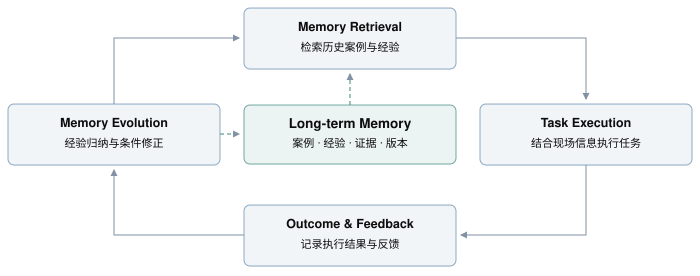

在工程实现中，可以通过记忆版本、来源引用及新旧记录之间的关联关系，保留经验的演进过程。对于多任务并发更新，还需要通过版本检查或条件写入，避免较早任务产生的结果覆盖已经更新的信息。

随着记忆规模不断增长，系统也可以将低频或不再适用的记录进行归档，使其退出默认检索范围，同时保留历史回溯能力。对于需要删除的记忆，则需要进一步清理相关摘要、索引及缓存，并重新检查依赖该记忆形成的归纳经验。

由此可见，长期记忆的演进不仅体现为信息数量的增长，更体现为信息组织质量、经验抽象程度及适用范围的持续改善。

## 6. Agentic RAG 与质量闭环：面向任务的信息获取

在传统 RAG 系统中，检索通常作为模型生成之前的一个固定环节：系统根据用户问题获取相关资料，再将检索结果与问题共同交给模型。

这种方式适合查询目标明确、所需信息相对集中的知识问答场景。然而，在复杂的 Agent 任务中，信息需求往往会随着任务执行而不断变化。

以生产故障排查为例，在任务开始时，系统可能只知道支付网关的错误率出现异常。经过监控查询之后，才能进一步确认异常集中于新增实例；获得扩容规范与历史案例之后，又可能需要继续查询实际网络路径和渠道授权配置。

在这一过程中，每一次信息获取都会改变系统对问题的理解，并影响后续的信息获取需求。

### 6.1 从固定检索到主动检索

Agentic RAG 的核心思想，是将信息检索纳入 Agent 的任务决策过程，使系统能够根据当前任务状态，动态决定何时检索、检索什么，以及采用何种信息获取方式。

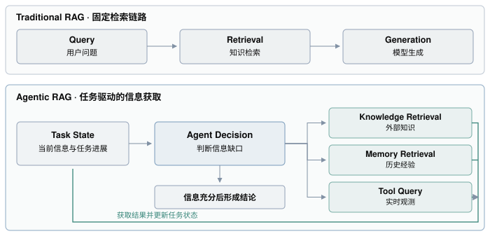

与传统的固定检索链路相比，Agentic RAG 更强调信息获取与任务状态之间的交互。模型可以根据已经获得的知识与观测结果，进一步判断当前任务还缺少哪些信息，并选择对应的获取方式。

例如，当缺少操作规范时，可以检索 Knowledge；当需要参考历史处置经验时，可以检索 Memory；当需要确认当前运行状态时，则可以调用外部工具。

因此，二者的主要差异并不在于检索次数，而在于**检索是否能够随着任务状态的变化动态调整，并参与任务决策过程。**

### **6.2 任务状态驱动的信息获取**

继续使用 11 月 5 日的支付网关故障案例，可以观察 Knowledge、Memory 与 Observation 如何在任务执行过程中相互协作。

| 任务阶段 | 信息获取方式                 | 任务状态变化                 |
| -------- | ---------------------------- | ---------------------------- |
| 初步分诊 | 分诊手册、监控指标           | 确认异常集中于 inst-11       |
| 定向检索 | 扩容规范、历史故障案例       | 形成优先排查方向             |
| 现场核验 | 日志、网络路径、渠道授权配置 | 核对实际配置及相关差异       |
| 形成结论 | 综合知识依据与现场证据       | 输出诊断结果或进一步查询计划 |

在初步分诊阶段，Agent 通过监控查询发现，新实例 inst-11 的错误率达到 45%，而存量实例的错误率仅为 0.01%。

这一观测使问题从一般性的网关超时，进一步收敛为新旧实例之间的差异分析。

随后，Agent 通过知识检索获得当前生效的扩容手册，通过记忆检索获得 10 月 22 日的历史事故案例。前者提供了新实例接入流量之前的配置检查标准，后者则提高了出口地址授权这一检查项的优先级。

此时，继续检索更多相似事故所能提供的价值已经相对有限。任务需要从知识获取转向现场核验，通过日志定位失败请求对应的渠道及目标地址，再查询实例的实际网络路径、源出口地址与当前授权配置。

这里需要区分请求的目标 IP 与实例实际使用的源出口 IP。前者描述请求发往哪个下游服务，后者才可能是下游渠道进行来源地址授权时所使用的判断依据。

通过这些信息之间的关联，Agent 可以进一步判断当前故障是否与历史案例具有相同的原因。

由此可见，Knowledge、Memory 与 Observation 并不是彼此独立的信息输入，而是在 Runtime 的组织下，随着任务状态变化交替参与决策。

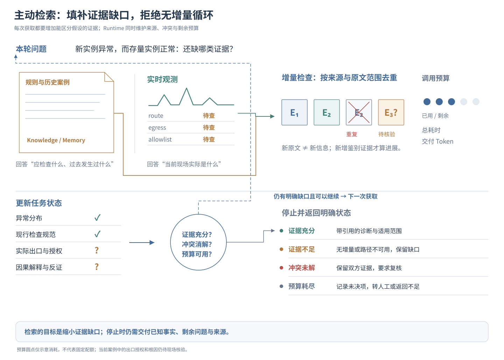

**图 4-7 按证据缺口推进的主动检索与停止状态**

### **6.3 主动检索的预算与停止条件**

将检索纳入 Agent 的任务循环之后，系统获得了更加灵活的信息获取能力，但同时也需要解决检索过程的收敛问题。

如果缺乏明确的控制机制，Agent 可能不断改写相似的查询，重复读取已经获取的知识，或者持续调用无法为当前判断提供实质性帮助的工具。

因此，主动检索通常需要考虑三个方面的约束：

1. **资源预算**：限制检索次数、工具调用次数、任务耗时及 Token 消耗，使信息获取过程具有明确的资源边界。
2. **信息增量**：判断新的检索结果是否补充了缺失信息、提供了新的判断依据，或者能够支持、修正已有假设。
3. **证据充分性**：判断当前信息是否已经能够支持阶段性结论，以及继续获取信息是否仍有必要。

例如，连续获取同一份文档的不同重叠切片，并不一定能够为当前任务提供新的信息；而一份能够区分两种故障假设的配置快照，即使内容很少，也可能具有较高的任务价值。

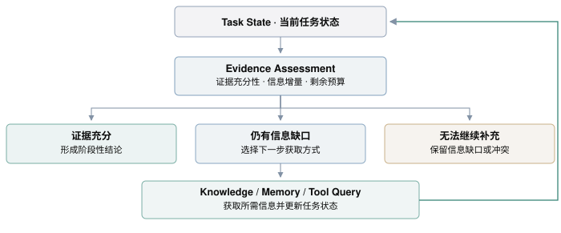

当现有信息能够支持当前任务目标时，系统可以结束检索并进入下一阶段；当仍存在关键的信息缺口，但已经达到资源预算或缺乏可用的数据源时，则可以输出阶段性结论，并明确尚未完成的核验事项。

主动检索的价值并不是使 Agent 执行更多的检索动作，而是使每一次信息获取都能够为任务推进提供实际价值。

### **6.4 知识与记忆系统的质量闭环**

前文分别讨论了文档解析、知识切片、混合检索、知识治理及长期记忆等机制。当这些机制组合为完整的信息获取链路之后，最终的任务质量将受到多个环节的共同影响。

一次错误的回答可能源于原始资料缺失，也可能源于候选召回失败、上下文交付不完整，或者模型对已有知识的理解出现偏差。

因此，知识与记忆系统需要具备分层的问题定位与质量评估能力。

| 系统环节   | 典型问题                       | 优化方向                   |
| ---------- | ------------------------------ | -------------------------- |
| 知识构建   | 原文缺失、解析错误、切片不完整 | 文档接入、解析及切片策略   |
| 知识检索   | 关键资料未召回或排序靠后       | 查询构建、混合检索与重排   |
| 知识治理   | 版本错误、权限不同步           | 时间语义、授权及索引一致性 |
| 记忆管理   | 错误经验沉淀、历史经验不适用   | 证据核验、作用域与经验修正 |
| 上下文交付 | 关键前提丢失、重复内容过多     | 父级展开、去重及预算分配   |
| 模型使用   | 正确资料已经交付，但结论错误   | 上下文表达与模型能力       |

例如，如果关键操作规范已经进入召回候选，但由于父级内容展开和上下文预算问题，模型最终只获得了不完整的操作步骤，那么优化方向应当集中于知识交付环节，而不是继续更换 Embedding 模型。

为了支持这类问题定位，系统可以通过 Retrieval Trace（检索轨迹）记录每次查询所使用的检索条件、索引版本、候选结果、排序变化及最终交付的知识单元，从而建立模型输出与原始资料之间的关联关系。

随着文档解析器、Embedding 模型及记忆管理策略不断演进，还可以通过固定查询集和代表性任务进行回归评估，验证系统变更对检索质量、任务效果、延迟及成本产生的影响。

从工程建设的角度来看，可以首先建立具有明确质量指标的知识检索基线，再根据实际失败样本逐步引入混合召回、重排、父子索引及主动检索等机制。

长期记忆也可以遵循相同的演进路径：首先保证历史案例具有完整的来源与核验状态，再逐步建立经验归纳、冲突处理与持续修正能力。

通过这种方式，系统复杂度的增长能够与实际问题建立对应关系，并通过持续评估验证各项机制所产生的实际价值。

## **7. 本章总结：从知识供给到经验演进**

第 3 章从模型单次调用的角度讨论了上下文工程，解释 Runtime 如何根据当前任务组织模型实际接收的信息。

本章则将信息管理的范围进一步扩展至跨任务、跨时间的维度，讨论外部知识如何进入系统，历史经验如何被长期保存，以及这些信息如何在未来的任务中被重新发现和使用。

从系统架构的角度来看，Knowledge 与 Memory 共同构成了 Agent 的跨任务信息体系，但二者承担不同的职责。

Knowledge 通过接入外部资料及业务知识，为 Agent 提供独立于模型参数的领域知识；Memory 则通过记录历史案例、执行结果及用户反馈，使 Agent 能够利用过去形成的信息改善未来的任务处理过程。

围绕这两类信息，系统需要建立完整的信息管理链路。如何让 Agent 安全取得现场数据，以及在证据充分时，把处置建议转成可授权、可重试、可验证的实际操作。

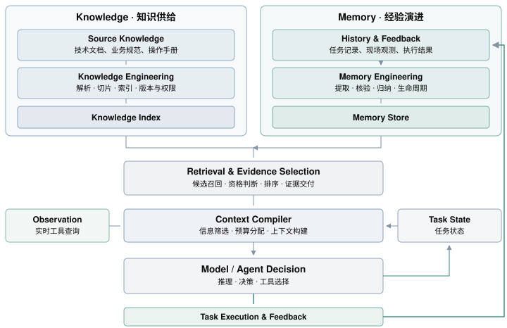

这一架构包含两条具有不同演进方式的信息链路：

- **知识供给链路**：将原始资料转化为可检索、可治理、可追溯的领域知识，并根据当前任务完成候选召回与证据交付。
- **经验演进链路**：将任务执行过程中的有效信息转化为长期记忆，并通过后续任务、用户反馈及新证据不断修正已有经验。

两条链路最终通过 Context Compiler 与当前任务状态建立联系，共同为模型提供完成任务所需的信息。

回到贯穿本章的支付网关故障案例，在完成监控分诊、扩容规范检索及历史案例查询之后，Agent 可以形成如下阶段性诊断结果。

在这一阶段，Agent 已经通过外部知识获得了分析依据，通过长期记忆缩小了调查范围，并通过实时观测确认了当前故障的主要特征。

不同类型的信息在任务中发挥了各自的作用：Knowledge 提供领域规则，Memory 提供历史参照，Observation 提供当前事实，而 Task State 则将这些信息组织为能够继续推进的任务状态。

随着后续工具查询获得新的现场证据，系统可以进一步验证当前判断，并将最终的执行结果重新纳入记忆演进过程。

由此可见，Knowledge & Memory 的核心价值，并不仅在于扩展模型能够访问的信息范围，更在于建立独立于模型参数的知识维护、经验积累与持续修正机制。

**Knowledge 使 Agent 能够利用已有的领域知识，Memory 使 Agent 能够积累过去的执行经验，而 Context Engineering 则使这些信息能够在恰当的时机参与当前任务的决策。**

至此，Agent 已经具备了理解任务、组织上下文、获取外部知识及复用历史经验的基本能力。

然而，信息获取与分析判断并不等同于实际的任务执行。Agent 还需要通过工具与外部环境建立连接，获取实时数据，并将模型形成的决策转化为具有明确权限、执行边界与结果反馈的实际操作。

下一章 Tools & Environment 将进一步讨论 Agent 如何与外部环境进行交互，以及如何构建可靠的工具执行体系。

## 8. 参考研究与延伸阅读

正文优先说明工程职责和适用边界。需要深入算法或产品参数时，可参考以下论文与官方文档；研究结果和默认配置仍应在目标数据上验证。

1. Lewis et al. (2020), [Retrieval-Augmented Generation for Knowledge-Intensive NLP Tasks](https://arxiv.org/abs/2005.11401). 检索与生成结合的代表性研究。
2. Karpukhin et al. (2020), [Dense Passage Retrieval for Open-Domain Question Answering](https://arxiv.org/abs/2004.04906). 稠密向量检索。
3. Robertson & Zaragoza (2009), [The Probabilistic Relevance Framework: BM25 and Beyond](https://doi.org/10.1561/1500000019). BM25 的统计基础。
4. Cormack et al. (2009), [Reciprocal Rank Fusion Outperforms Condorcet and Individual Rank Learning Methods](https://doi.org/10.1145/1571941.1572114). 排名融合方法及其实验。
5. Nogueira & Cho (2019), [Passage Re-ranking with BERT](https://arxiv.org/abs/1901.04085). 基于联合编码的段落重排。
6. Malkov & Yashunin (2016, revised 2018), [Efficient and Robust Approximate Nearest Neighbor Search Using Hierarchical Navigable Small World Graphs](https://arxiv.org/abs/1603.09320). HNSW 索引。
7. Anthropic Engineering (2024), [Introducing Contextual Retrieval](https://www.anthropic.com/news/contextual-retrieval). 检索切片上下文补充的实践与评测。
8. Tulving (2002), [Episodic Memory: From Mind to Brain](https://doi.org/10.1146/annurev.psych.53.100901.135114). 情景记忆概念背景，不是 Agent 存储规范。
9. Park et al. (2023), [Generative Agents: Interactive Simulacra of Human Behavior](https://arxiv.org/abs/2304.03442). 模拟 Agent 中的记忆检索与反思。
10. Packer et al. (2023), [MemGPT: Towards LLMs as Operating Systems](https://arxiv.org/abs/2310.08560). 有限上下文与外部记忆调度。
11. Asai et al. (2023), [Self-RAG: Learning to Retrieve, Generate, and Critique through Self-Reflection](https://arxiv.org/abs/2310.11511). 按需检索与证据评价的一种研究路径。
12. IBM Db2, [Bitemporal tables](https://www.ibm.com/docs/en/db2/11.5.x?topic=tables-bitemporal). 业务时间与系统记录时间。
13. Faiss, [Faiss indexes](https://github.com/facebookresearch/faiss/wiki/Faiss-indexes). 精确检索、HNSW、IVF 等索引的资源取舍。
14. Elasticsearch, [Term query](https://www.elastic.co/docs/reference/query-languages/query-dsl/query-dsl-term-query). 精确词项查询。
15. Azure AI Search, [Filters in vector queries](https://learn.microsoft.com/en-us/azure/search/vector-search-filters). 向量检索过滤的实现方式和影响。
16. Elasticsearch, [Reciprocal rank fusion](https://www.elastic.co/docs/reference/elasticsearch/rest-apis/reciprocal-rank-fusion). RRF 参数和结果融合。
17. Sentence Transformers, [Retrieve & Re-Rank](https://www.sbert.net/examples/sentence_transformer/applications/retrieve_rerank/README.html). 召回与 Cross-Encoder 重排。
18. FlagEmbedding, [Reranker examples](https://github.com/FlagOpen/FlagEmbedding/blob/master/examples/inference/reranker/README.md). 重排输入和分数解释。
19. Elasticsearch, [Ranking evaluation API](https://www.elastic.co/docs/reference/elasticsearch/rest-apis/search-rank-eval). Precision、Recall、MRR 与 nDCG 的评估接口。
20. Azure AI Search, [Security trimming](https://learn.microsoft.com/en-us/azure/search/search-security-trimming-for-azure-search). 按用户或组身份限制搜索结果的实现参考。
