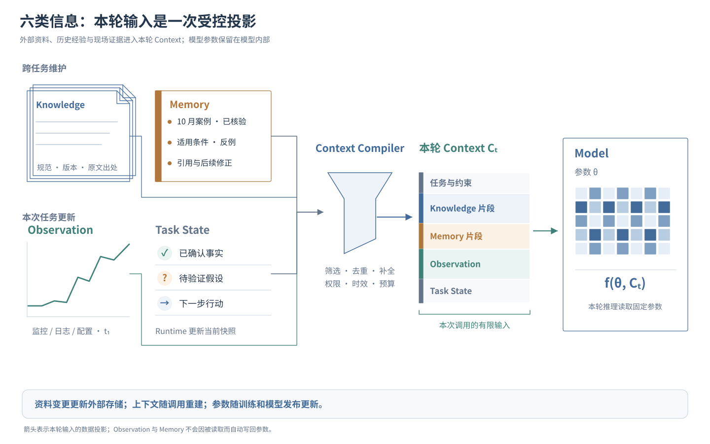
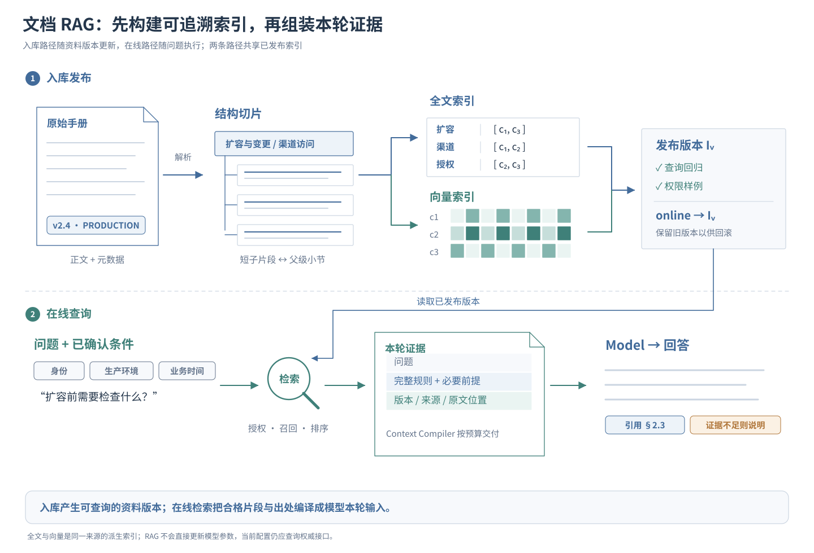
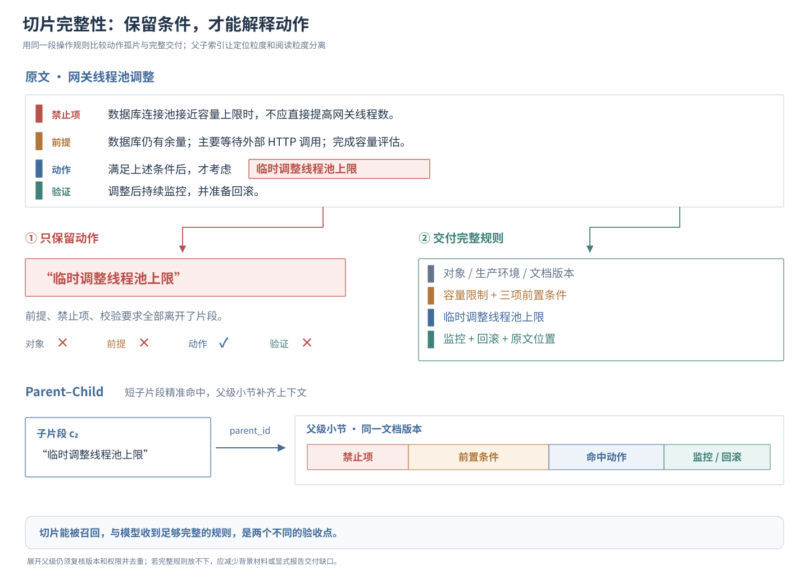
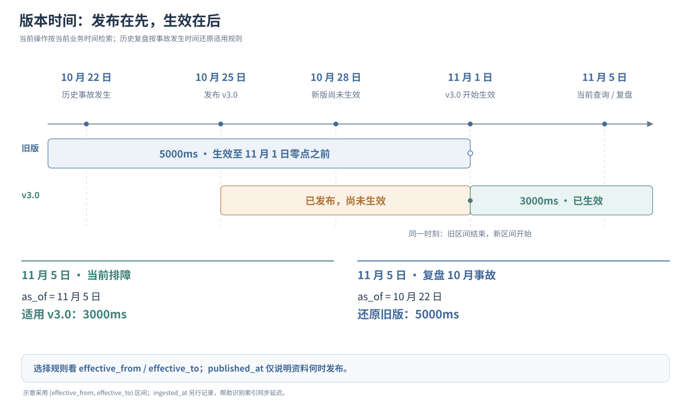

# 第4章 Knowledge & Memory：从知识供给到经验演进

**本章核心脉络与阅读导览**

第 2 章解释了模型如何基于训练参数生成回答，第 3 章说明 Runtime 如何把当前任务、工具结果和必要材料组织成一次模型调用的输入。本章继续追问一个跨任务的问题：**当前任务结束后，哪些信息值得保留？下一次任务开始时，系统怎样找到它们，并判断它们仍然适用？**

以支付网关排障为例，模型可以解释 HTTP 504 的常见成因，却不知道企业当前的渠道配置和扩容规范。10 月的一次事故记录曾支持“新实例出口地址漏配了下游白名单”这一结论；11 月再次出现类似现象时，这条经验可以帮助确定检查顺序，但不能代替对新实例当前配置的查询。

这里有两种不同的信息来源：

- **Knowledge（外部知识）**是由业务系统或资料负责人维护的规范、手册、接口说明和已批准复盘。它回答“按当前规则应该怎样做”，需要版本、适用范围和原文出处。
- **Memory（长期记忆）**是从任务和反馈中筛选出的案例、偏好与经验。它回答“以前发生过什么、哪些做法得到过验证”，需要证据、作用范围和后续修正能力。

两者都可能以文本交给模型，但写入、更新和采信方式不同。向量库能找到相似片段，却不能判断规则是否已生效；历史记录能还原当时的猜测，却不能自动证明猜测后来成立。**本章关注的是一条可检查的信息链：资料如何进入索引，候选如何筛选，哪些内容允许进入上下文，以及新的执行结果何时可以成为经验。**

本章沿用问题式的章节导览：

1. **信息边界（What）**：模型参数、外部知识、长期记忆、实时观测、任务状态和上下文各自负责什么？
2. **知识获取与切片（Where）**：哪些资料适合 RAG，原始文档怎样变成能独立理解、能追溯的检索单元？
3. **混合检索与重排（How）**：关键词、语义检索、过滤和重排怎样配合，检索质量如何单独评估？
4. **知识治理（Which）**：当前任务应该使用哪个版本，权限撤销和删除怎样传到索引及缓存？
5. **长期记忆（What to retain）**：哪些执行信息值得保留，如何从案例形成经验并在出现反例时修正？
6. **主动检索与质量闭环（When & How well）**：Agent 何时继续查资料，何时改查实时系统，怎样判断检索是否真的帮上了忙？

贯穿全章的案例是 10 月 22 日的历史事故和 11 月 5 日的当前事故。历史事故涉及实例 inst-09、inst-10；当前事故涉及 inst-11。案例中的指标和配置均为教学设定，不能作为真实环境数据使用。

## 1. 信息边界：参数先验、持久化知识与运行时证据

同一句话可能代表不同性质的信息。例如，“生产环境读超时是 3000ms”可能来自当前生效的规范、配置中心的一次查询，也可能只是某次对话中的推测。若不保留来源和时间，模型看到的都是一段文字，却无法知道它应被当作规则、现场事实还是待验证假设。

### 1.1 模型参数能做什么，外部数据又负责什么？

收到 payment-gateway 的 HTTP 504 告警时，模型可以根据通用知识提出下游响应慢、连接池不足或线程池阻塞等可能性。这种能力来自训练得到的参数，适合识别模式、理解问题和组织分析。

但生产排障还需要一些参数本身无法可靠提供的信息：

1. **企业私有事实**：当前服务拓扑、银行渠道协议和内部配置。
2. **频繁变化的事实**：本周刚发布的超时阈值或实例清单。
3. **需要引用依据的事实**：某项操作是否符合当前批准的 Runbook。
4. **受访问控制的信息**：不同团队或租户有权查看的不同资料。

这些信息需要放在可单独更新、查询、授权和追溯的外部数据源中。微调可以改善模型的格式、分类或工具使用习惯，但不适合代替逐条可更新的配置库。常规推理读取参数，不会因为刚完成一次排障就自动把结果写回参数。

### 1.2 六类信息在 Agent 系统中的位置

下表按信息由谁维护、何时更新来区分系统中的主要对象。它们可以共用数据库或基础设施，但不应因此混用数据模型和写入规则。

| 信息 | 主要来源 | 在任务中的用途 | 更新方式 |
| --- | --- | --- | --- |
| **Model Parameters** | 预训练与后训练 | 通用语言理解、领域先验和推理能力 | 随模型训练、评估和发布更新 |
| **Knowledge** | 规范、手册、接口文档、已批准复盘 | 提供有版本和出处的领域资料 | 由源系统或资料负责人维护，再发布索引 |
| **Memory** | 历史任务、用户确认、执行反馈 | 提供可复用案例、经验和偏好 | 经筛选、核验后写入；支持更新、归档和删除 |
| **Observation** | 监控、日志、追踪、配置查询 | 说明特定时间和范围内的现场情况 | 任务中按需获取，注明采集时间和数据口径 |
| **Task State** | Agent Runtime | 保存本次任务的已确认事实、假设和待办 | 随任务推进更新，可保存以支持恢复 |
| **Context** | Context Compiler | 提供模型本轮实际需要的输入 | 每次调用前按任务和预算重新组织 |

**表 4-1 Agent 系统中的六类信息**



**图 4-1 六类信息与本轮模型输入的关系**

Knowledge 和 Memory 是需要跨任务维护的信息；Context 是一次模型调用的输入。检索负责找到候选材料，Context Compiler 决定哪些材料实际进入本轮输入。扩大上下文窗口不能修复过期资料，增加候选数也不能自动解决预算裁剪和来源标记问题。

### 1.3 Knowledge 与 Memory：共享存储不等于共享治理

两者都可以存放在 PostgreSQL、对象存储或搜索引擎中，也都可以通过“输入查询、返回文本”的接口读取。真正的区别在于谁有权写入，以及什么证据能让内容被采信。

| 维度 | Knowledge | Memory |
| --- | --- | --- |
| 内容来源 | 由资料所有者维护的规范和文档 | 交互、任务执行与后续反馈 |
| 写入责任 | 文档流程或权威源系统 | Runtime 控制的提取与核验流程 |
| 主要判断 | 作者、审批状态、版本、适用范围 | 观测证据、确认方式、作用范围、反例 |
| 常见问题 | 过期、版本冲突、索引未同步 | 猜测被记成事实、旧经验套错场景 |
| 与正式规范的关系 | 可以作为正式规则来源 | 经审核的经验可以提交为规范变更，但不能直接覆盖规范 |

**表 4-2 Knowledge 与 Memory 的管理差异**

放回排障案例，三种信息不能互相代替：

- 当前扩容手册要求：新实例接入流量前，确认其实际出口地址已获下游渠道授权。
- 10 月事故记录显示：inst-09、inst-10 的出口地址未在渠道白名单中，修复后错误率恢复。
- 11 月监控显示：inst-11 的错误率为 45%，存量实例为 0.01%；inst-11 的出口地址和当前授权列表还没有查询。

历史案例让白名单检查更值得优先执行；手册给出检查标准；是否漏配仍要由当前配置查询和调用证据确认。

### 1.4 为什么原始 History 不能直接充当 Memory？

保留完整对话和工具日志对审计、调试和任务重放很有价值。但把原始历史直接拿来检索，至少会遇到三类情况：

1. 对话里同时出现“怀疑数据库”和“数据库指标正常，排除数据库”，检索可能只命中前半段。
2. 结果、依据和适用条件散落在多个回合里，下一个任务必须重新拼装。
3. 同一偏好或状态在不同时点发生变化，旧值和新值都会留在日志中。

因此，History 保存发生过的事件，Memory 保存经过整理、带状态和范围的可复用记录。被证伪的假设也可以保留，但要标记为已排除或反例，不能和已验证经验放在同一默认检索集合里。

区分这些信息之后，下一步要看哪些资料值得跨任务复用，以及它们怎样进入可查询的知识库。先从一次面向扩容手册的 RAG 请求看在线检索，再回到文档如何被解析、切片和发布。

## 2. 知识获取与切片工程：从原始文档到检索单元

企业文档通常按人类阅读方式编写：标题说明对象，上一段给出前提，表头解释数值，脚注列出例外。检索却经常只返回一小段文字。文档接入的工作，是让这个小段落离开原文后仍然保留解释它所需的条件和出处。

### 2.1 RAG 在系统中实际做了什么？

假设用户问：“payment-gateway 扩容前需要检查什么？”

一次最简单的文档 RAG 请求可以按四步理解：

1. 系统接收问题，并带上用户身份、服务范围和“生产环境”等已知条件。
2. 检索服务从已授权且当前适用的资料中，找到《支付网关扩容手册》对应的小节。
3. 系统把用户问题、命中的资料片段和来源信息一并交给模型。
4. 模型根据资料整理回答；应用展示引用。如果没有找到足够证据，应明确返回资料不足，而不是让模型凭常识补全内部规范。

例如，检索结果可能包含：“新实例接入流量前，核对实际出口地址已被下游渠道授权；完成配置后执行连通性验证并留存变更记录。”结果还应带上手册版本、章节位置和适用环境，方便系统过滤和用户回查。

RAG 改变的是模型本轮收到的材料，不是模型参数。文档更新通过源资料和索引发布完成；模型负责结合问题理解、归纳和表达资料。原始研究将外部检索与生成结合起来，但生产系统还要自行解决权限、版本、证据完整性和错误处理。[1]

上面的四步是在线查询路径。要让查询有东西可找，还需要一条入库路径：

1. 从文档系统取得正文、版本、所有者、适用范围和权限标识。
2. 解析标题、段落、表格和代码块；保留原文位置，检查解析结果。
3. 按结构切片，为每条切片记录来源、版本、环境和父级关系。
4. 为正文建立全文索引，为切片计算向量，并与元数据一起写入待发布的索引版本。
5. 对查询集和权限样例做回归检查，通过后再让线上检索切换到新版本。

因此，文档 RAG 不等于“把 PDF 丢进向量数据库”。解析、切片和发布决定哪些材料能被检索，在线检索决定哪些候选能到达模型；两边都需要保留版本和来源。



**图 4-2 文档 RAG 的入库发布与在线查询路径**

| 机制 | 适合解决的问题 | 变化如何进入系统 | 不能代替什么 |
| --- | --- | --- | --- |
| **微调** | 输出格式、任务行为、领域表达或工具选择习惯 | 训练、评测和模型发布 | 频繁更新且要求逐条引用的配置事实 |
| **RAG** | 手册、规范、接口说明和已批准复盘 | 更新资料并重建或增量更新索引 | 当前监控值、实例状态和精确权限查询 |
| **实时工具查询** | 指标、配置、订单、权限等当前状态 | 调用受控 API，检查时间戳和返回状态 | 长文档中的规则解释和历史案例整理 |

**表 4-3 微调、RAG 与实时工具的分工**

超时参数如果本来就在配置中心的结构化表里，应优先按渠道和版本调用接口查询；把它先转成文本再做相似度检索，反而增加解释和版本选择风险。

### 2.2 切片不能把规则的前提切掉

Chunking（切片）是把长文档拆成索引和交付时使用的较小单元。切片太大，搜索定位不准且消耗上下文；切片太小，则可能把规则拆得不完整。问题不在于某个长度数字，而在于拿到片段的人能不能正确理解它。

以一条线程池操作规则为例：

> 数据库连接池接近容量上限时，不应直接提高网关线程数。只有确认数据库仍有余量、请求主要等待在外部 HTTP 调用，并完成容量评估后，才考虑临时调整线程池上限。调整后应监控并准备回滚。

若切片只留下“临时调整线程池上限”，关键条件和禁止项就消失了。类似风险也常见于两类结构：

- **表格行没有表头**：数值 3000 可能是连接超时，也可能是读超时；单位和测试/生产范围也可能丢失。
- **正文离开章节标题**：“该服务扩容后应检查出口配置”里的“该服务”变得不明确。

因此，操作类切片至少要保留对象、适用环境、前置条件、动作、验证方式和例外。表格切片应带标题、列名、单位和适用说明。遇到“不”“仅”“除非”等词时，要把前后句一并保留。

### 2.3 先按文档结构切，再用长度限制兜底

解析 Markdown 和 HTML 时，可以利用标题、列表、表格和代码块边界；解析 PDF、扫描件或复杂 Word 文档时，还要抽查阅读顺序、跨页表格、脚注和 OCR 结果。文本抽取成功不代表结构正确。

对支付网关扩容手册，可以先按章节切出“扩容前检查”这一段。如果其中某条规则仍然太长，再沿段落或列表边界拆分，并保留必要的相邻条件。长度上限是第二层约束，不应成为第一切分依据。

检索单元和模型最终阅读的单元也不必相同。**Parent-Child（父子索引）**是常见做法：短子切片用于精准定位，父级小节用于补齐上下文。

例如，检索先命中“新增实例的出口地址必须加入渠道白名单”。系统可以通过 parent_id 取回完整的“扩容前检查”小节，避免模型只看到一句操作要求。但父级读取也必须重新检查版本和权限，并在交付前去重；若父级范围过大，只补取命中段落附近内容。



**图 4-3 切片完整性与父子索引的交付边界**

为了让结果独立可读并能回到原文，可以为每条切片保存类似以下字段：

```yaml
chunk_id: CHK-PAY-EXPAND-01
parent_id: PAR-PAY-EXPAND
doc_id: DOC-PAY-RUNBOOK
version: v2.4
section_path: 扩容与变更 / 渠道访问检查
service: payment-gateway
environment: PRODUCTION
source_location: page 18, paragraph 3
indexed_text: |
  支付网关扩容手册 v2.4，生产环境，渠道访问检查。
  新实例接入流量前，应核对实际出口地址已被下游渠道授权。
  配置后执行连通性验证，并留存变更记录和回滚方案。
```

字段用于过滤、授权和追溯；indexed_text 用于全文或语义检索。若系统通过模型生成检索前缀，应将其与原文分开保存，不能让生成的摘要伪装成权威原文。[7]

### 2.4 用固定样本验收解析与切片

每次更换解析器、切片规则或 Embedding 模型，都应在代表性样本上做回归检查。至少抽查警告段落、长表格、跨页内容、带代词的小节和明确限制操作的段落：

1. 只读该切片，能否确认对象、环境、单位和条件？
2. 操作步骤是否保留了禁止项、前提、验证和回滚要求？
3. 能否定位到准确文档版本和原文位置？
4. 从子片段展开父级内容后，是否仍为同一版本且权限一致？

关键 Runbook 不应只看自动指标，最好人工复核固定的危险段落。漏掉一个“不”或表头，通常比切片长度稍有差异更值得优先修复。

即使切片本身完整，系统仍可能因为提问方式、关键字或候选排序而找不到正确证据。下一节从召回和重排入手，说明怎样把可能相关的资料逐步收敛为可交付的候选。

## 3. 混合检索与重排：从候选到可用证据

本节继续使用问题：“为什么 payment-gateway 新扩容的实例调用银行渠道一直超时？”为比较不同检索方式，下面单独展开一个查询示例：假设系统已从失败日志中取得错误码 E-PAY-10243，检索请求因此同时包含“新扩容实例、银行渠道超时”和这个编号。错误码是需要解释的日志线索，还不能据此确认根因。

知识库中可能有三份资料：

- A：《扩容前检查》，直接提到新实例出口地址和渠道授权。
- B：《HTTP 504 常见原因》，介绍各种通用超时成因。
- C：《错误码 E-PAY-10243》，解释一个特定的银行渠道错误码。

关键词检索可能偏向 C；语义检索可能找到 A 和 B；当前任务只需要生产环境现行规程，还必须排除过期版本和无权访问的资料。检索系统通常因此分成先找候选、再精排和交付两个阶段。

### 3.1 召回和重排负责不同问题

**召回**从全库中找出一批可能有用的候选，首要目标是别漏掉关键资料。**重排**针对当前完整问题重新比较候选，首要目标是让最有帮助的证据排在前面。Top-K 只是结果条数上限，不代表每条都相关，也不要求系统一定凑满。

这两个阶段可以分别定位问题：

- 关键手册不在召回候选里：检查资料是否接入、切片是否完整、过滤条件是否过窄，以及关键词/向量检索是否覆盖了这类问法。
- 关键手册已经在候选里，却排在通用介绍后面：检查排序和查询条件。
- 手册排名很高但只交付一句截断的规则：检查父级上下文展开和上下文预算。

排序器无法找回从未进入候选的资料，也无法恢复切片时已经丢掉的前提。

### 3.2 语义检索：找不同说法描述的相近问题

用户可能说“新机器一访问银行就卡住”，手册却写“新增容器实例调用下游渠道发生读超时”。两句没有多少相同关键词，但表达的是相近现象。文本 Embedding 模型将查询和文档片段分别编码成向量，再按模型规定的相似度度量寻找近邻。稠密检索的代表性方法之一是 DPR（Dense Passage Retrieval）。[2]

文档向量可以在资料入库时预先计算；在线查询只需要编码一次，然后搜索索引。这使语义匹配适合大规模候选召回。工程上需要把模型标识、版本、输入前缀、向量维度和距离度量作为一组配置记录。更换模型后，即使向量维度相同，也不表示新旧向量空间兼容；未验证兼容性时，应重新编码并迁移索引。

向量相似度只说明两段表达在该表示空间里接近，不表示文档有多大概率为真。它也不擅长替代以下判断：

- E-PAY-10243 和 E-PAY-10240 是不同错误码，不能因为语义相似就混用。
- “已配置白名单”和“未配置白名单”讨论同一主题，却表达相反事实。
- “生产环境”和“测试环境”、当前版本和历史版本属于硬条件，应通过字段和权限规则检查。

### 3.3 关键词检索：保留错误码、配置键和专有名词

BM25 根据查询词项与文档词项的匹配情况评分，常用于全文检索。它适合找错误码、类名、配置键等字面信息，也会考虑词项在文档中的区分度和文档长度。[3]

从排障角度看，BM25 的几个因素可以这样理解：

- 查询词在文档里出现会加分，但重复出现的收益会逐渐变小，避免一篇反复重复同一词的长文无限占优。
- 在全库都很常见的词区分力低；少见的错误码或专有名词更能区分具体资料。
- 长文档包含的词更多，评分会对长度作归一化，避免大而全的手册仅凭篇幅压过聚焦的小节。

这些是相关性评分因素，不会自动理解否定、业务约束或用户意图；分词配置和字段类型仍会改变检索结果。

例如，用户问“E-PAY-10243 的排查步骤”，关键词检索能直接定位包含该编号的文档。只用语义向量则可能把相邻错误码排得很近。反过来，用户只说“新机器访问银行卡住”，BM25 可能找不到文字完全不同的扩容规程。

BM25 不等于精确字符串匹配。搜索分析器可能拆分或规范化标识符。因此，正文可以走全文索引，而错误码、配置键和版本号另存为 keyword 等精确字段。明确要求某编号时使用精确匹配；编号只是排障日志里的线索时，不要把它错误地设成必选过滤条件。

### 3.4 混合召回：合并互补的结果，而不是押注一种算法

同一个查询可以并行运行 BM25 和向量检索，再按共享的权限、环境和版本约束筛候选。举例：

| 结果 | BM25 | 向量检索 | 说明 |
| --- | --- | --- | --- |
| A：扩容前渠道访问检查 | 第 2 名 | 第 1 名 | 语义和部分关键词都匹配 |
| B：HTTP 504 通用说明 | 未命中 | 第 2 名 | 主题相关，但不够具体 |
| C：E-PAY-10243 错误码 | 第 1 名 | 未命中 | 精确编号匹配，但不一定是当前主因 |
| D：测试环境旧版扩容手册 | 第 3 名 | 第 4 名 | 主题相关，但环境和有效期不符合 |

如果查询明确要求生产环境当前规则，D 应在候选交付前被环境和有效期条件排除。剩下的结果中，C 的 BM25 排名最高，但 A 是更切合本次扩容场景的证据。系统需要融合两路候选，并让后续重排依据完整问题及过滤条件调整优先级。

两路检索的原始分数通常不在同一尺度上，不能直接把 BM25 分数和向量相似度相加。**RRF（倒数排名融合）**是可选的一种排名合并策略：同一结果在多路中都排得靠前，会累积更多贡献；只在一路出现的结果也不会被丢弃。[4][16] 在上表中，A 同时排在两路前列，因此会获得两路的排名贡献；B 和 C 只获得各自命中那一路的贡献。RRF 适合建立简单基线，但具体候选窗口和参数仍需用标注查询验证。

过滤需要区分硬条件与可放宽条件：

- **硬条件**：调用者权限、租户、明确指定的生产环境和查询时点。它们决定资料有没有资格进入候选。
- **可调范围**：服务名、资料分类、故障标签。初始范围过窄时，可以在不越过权限边界的前提下扩展到相关下游渠道文档。

如果先从全库取少量 Top-K，再把不适用的结果过滤掉，候选窗口可能被过期资料占满。检索引擎支持时，应让过滤参与候选搜索；同时记录使用的过滤条件，便于解释为什么某份资料没有出现。[15]

### 3.5 重排：在少量候选中比较具体条件

混合召回后，候选 A 和 B 仍可能都谈到超时。若当前异常只出现在新实例，讨论“全体实例同时超时”的通用手册就不如“新增实例出口授权”的小节相关。

Cross-Encoder（交叉编码器）把查询和候选文本一起输入模型，再计算两者的相关性。它可以直接看到“只在新实例发生”这个条件与候选内容的关系；Bi-Encoder 则已分别编码查询和文档，在线阶段比较向量。前者逐条判断更细，后者适合快速扫描全库。[5][17]

因此常见做法是先快速召回几十条，再对少量候选执行较贵的重排。具体数量要由延迟和效果测量决定。重排分数只是相关性分数，不是正确概率、可信度或版本状态；权限和生效时间仍由确定性字段处理。是否使用分数阈值，也应基于本系统的标注数据校准。[18]

典型链路可以概括为：


**图 4-4 混合召回、可选重排与证据交付**

### 3.6 检索应独立于生成结果评估

模型最后答对了，不一定是检索做得好：它可能凭通用知识猜中。答错了，也不一定是检索错：正确资料可能已经进入上下文，却被模型误读。要定位检索质量，应准备一组代表性问题，由评审标注哪些资料能支持答案，再检查系统召回和排序的结果。

常见指标可以直接对应工程问题：

- **Recall@K**：前 K 条里找回了多少已标注的相关证据。偏低通常意味着资料未接入、过滤太窄或召回方式漏检。
- **Precision@K**：前 K 条里有多少条确实相关。偏低意味着候选噪声多，或排序和去重需要调整。
- **MRR**：第一条相关资料平均排在多前。适合看用户通常只需一个答案来源的场景。
- **nDCG@K**：允许把证据按“背景相关”和“直接支持结论”等级标注，评估有价值的材料是否排得更前。[19]

例如，一个问题有 4 条已标注的相关证据，系统前 5 条结果命中其中 3 条，那么 Recall@5 是 3/4，Precision@5 是 3/5。若三个问题的第一条相关结果分别排在第 1 名、第 2 名和未命中，三个倒数排名为 1、1/2 和 0，MRR 就是它们的平均值 0.5。这个例子也说明：MRR 看第一条命中，不足以证明多证据问题已经找全；Recall 和 Precision 还要配合看。

评测集应覆盖口语表达、错误码、版本时间、权限受限和无答案查询。标注最好指向原文证据，而不是固定的 chunk_id；切片策略变化后，同一原文证据仍可用于对比。检索指标还要与 P95 延迟、候选数和最终交付 Token 一起看。

再看一次更容易误判的失败：Agent 回答“增加线程池上限”，却漏掉了第 2 节中“先确认数据库有余量、请求主要等待外部 HTTP 调用”的前提。评测显示关键规程已进入前 30 条候选，第一条相关结果也排得很靠前。扩大召回数量后，指标有所改善，回答仍然不完整。此时继续更换 Embedding 模型，解决的就不是已经暴露出来的问题。

沿一次请求往下看，可能发现同一规程的多个重叠子切片占据了交付预算；系统尝试展开父级小节，但完整小节超过剩余预算，最后只保留了含操作动作的短片段。修复应发生在交付环节：按文档、版本和原文范围合并重复命中，把动作及其前提作为一个完整单元取回，再为它腾出预算。若完整规则仍然放不下，应减少背景材料或报告证据无法完整交付，不能悄悄丢掉限制条件。

修复后重新跑同一组问题，除了比较召回和排序，还要核对模型实际收到的内容：必要前提是否完整、是否出现重复版本、引用能否回到原文。**候选里有正确资料，与模型拿到了足以支持判断的证据，是两个不同的验收点。** 只有后一个验收点也通过，才能继续判断问题是否出在模型对证据的使用上。

候选排序解决的是“哪些内容更相关”，还没有回答“这些内容此刻是否有效、当前用户是否可以读取”。因此，检索结果进入上下文之前，还要经过时间、权限和索引状态的治理。

## 4. 企业级知识治理：时间、权限与索引一致性

找到相关文档之后，还要判断它是否可以用于当前决策。历史版本可能适合复盘，却不适合当前操作；已生效的手册也不能越权交给调用者。治理规则决定候选是否合格，相关性排序只在合格资料中进行。

### 4.1 版本发布时间不等于规则生效时间

假设支付网关超时规则经历以下变化：

| 时间 | 事件 | 当时适用规则 |
| --- | --- | --- |
| 10 月 22 日 | 历史事故发生 | 旧版 5000ms |
| 10 月 25 日 | 发布 v3.0，声明 11 月 1 日起生效 | 新版已发布但尚未生效 |
| 11 月 1 日 | 新规生效 | 3000ms |
| 11 月 5 日 | 当前排障或复盘旧事故 | 当前查询用 3000ms；历史复盘查 5000ms |

如果系统按最后修改时间取最新版，10 月 28 日会提前应用尚未生效的新规；如果新文档覆盖旧文档，11 月复盘又无法还原事故当时的依据。

每个知识版本至少应区分：

- **published_at**：资料发布的时间。
- **effective_from / effective_to**：业务规则适用的时间范围。
- **ingested_at**：检索系统收到该版本的时间，用于识别同步延迟。

时间区间的边界语义要固定。例如使用“包含起点、不包含终点”，让旧版本在 11 月 1 日零点结束，新版本从同一时刻开始。当前排障按当前业务时间检索；历史复盘按事故发生时间检索。



**图 4-5 发布时间、生效区间与历史查询的关系**

按适用时间筛选可以写成如下逻辑：

```sql
SELECT doc_id, version, source_uri
FROM authorized_rule_versions
WHERE service = :service
  AND environment = :environment
  AND effective_from <= :as_of
  AND (effective_to IS NULL OR :as_of < effective_to);
```

这里的 authorized_rule_versions 表示已按调用者身份过滤后的版本集合，as_of 是本次查询的业务时间。如果同一范围仍匹配到两条相互矛盾的规则，应显式报告冲突；按更新时间排序并只取第一条，只会掩盖数据问题。

在审计或历史复盘场景中，还可能需要区分“规则何时在业务上生效”和“系统何时记录到这条规则”。这类双时态数据可以还原：事故发生时有效的规则是什么，以及当时系统实际上已经知道什么。[12]

### 4.2 权限过滤必须发生在模型看到资料之前

用户身份应在检索请求到达知识服务时就参与授权。未授权正文不能先交给模型或外部重排服务，再依赖模型判断是否该使用。

授权至少需要贯穿以下读取路径：

1. 初次搜索时，按用户、租户和资料权限限制候选。
2. 命中子切片后展开父级小节时，再检查父级权限。
3. 读取缓存时，将用户或授权范围纳入缓存键，权限变化后使旧缓存失效。
4. 生成答案和引用时，确认返回的标题、片段和链接也在用户可见范围内。

如果源系统是权限的权威来源，检索索引应保存其必要的权限标识并及时同步；无法确认权限状态时，应失败关闭，不能退化成“先返回结果再补检查”。安全过滤不能因为 Recall 较低就自动放宽。[20]

### 4.3 索引是源资料的派生读模型

搜索索引、向量和缓存都是源文档的派生数据。更新源文档并不代表所有派生副本都已更新。发布流程需要告诉系统哪个版本正在构建、哪个版本当前可读，以及失败后如何回滚。

一条稳妥的发布路径通常包括：

1. 拉取源文档和元数据，检查解析成功率、版本及权限字段。
2. 生成新切片和向量，在隔离的新索引或新索引版本中构建。
3. 对关键查询运行回归测试，确认有效版本、权限和来源位置都正确。
4. 全部检查通过后，将在线别名切换到新索引；保留一段可回滚的旧索引。
5. 对失败、删除和撤权事件建立可重试的传播任务，并监控其完成时间。

蓝绿索引切换可以避免用户看到半套新数据，但构建期间到达的文档变更也要补写到新索引，否则切换后会丢增量。索引版本还应绑定解析器、切片策略、Embedding 模型和距离配置；迁移时同时构建、比较再切换。

撤权和删除应优先阻断读取，再清理派生数据。受影响的切片、向量、倒排索引、缓存和父子关系都要纳入清理范围；若源数据还留在备份中，恢复流程需要重新应用删除记录。在线不可见不等于所有副本已经删除。

这些规则适用于由权威来源维护的 Knowledge。任务执行还会产生另一类信息：哪些现象出现过、哪些判断得到验证、哪些处置带来了什么结果。下一节讨论怎样把这些记录变成有范围、可更新的 Memory，而不是把整段历史直接当作经验。

## 5. 长期记忆工程：把执行结果变成可修正的经验

知识由资料负责人维护，记忆则来自 Agent 自己参与过的任务。关键问题不是“能否保存对话”，而是“保存什么、状态是什么、下一次能否判断是否适用”。

### 5.1 先记录案例，再谨慎归纳经验

10 月 22 日的事故结束后，可以保留一条带证据的情景案例（Episodic Memory）：inst-09 和 inst-10 扩容后出现银行渠道读超时，存量实例正常；配置查询发现两个新实例的源出口地址未在下游渠道允许访问的来源地址名单中，补充授权后错误率下降。案例还要说明处置限制：如果当时同时执行了其他变更，就不能把全部恢复效果都归因于白名单。

但即使事故中的信息都已核实，也不意味着它们都值得进入长期记忆。完整日志仍应按保留策略放在审计或日志系统中，Memory 保存结论、必要证据片段和可回查的引用即可。inst-09 当时的出口地址可以作为解释这次事故的历史证据，却不适合作为下一次任务查询当前配置的缓存；出口地址可能随扩容、路由或网络迁移改变，维护这样一份副本需要持续同步，收益通常不如直接查询权威配置源。

更值得复用的是这次事故改变了怎样的排查顺序。积累多个经过验证且适用条件相近的案例后，可以归纳一条语义经验（Semantic Memory）：**新实例异常而存量实例正常时，优先比较配置、网络路径和出口授权。** 它让下一次任务更早检查有区分度的差异，又没有把所有同类故障都解释成白名单问题。单个案例也能提供线索，但不足以宣称这一规律普遍成立。

因此，筛选记忆时除了问“这是真的吗”，还要问“下次遇到什么问题会用到它、能少做哪一步重复调查、失效后怎样发现和修正”。高频复用、适用范围明确且容易核验的经验值得维护；只能还原一次事件的细节可以留在案例附件或审计记录中。**记忆的价值在于改善下一次任务的判断，而不是把已经验证的信息再存一遍。**

确定值得保留之后，再为案例记录事件范围、观测事实、推断结论、动作、结果、来源和适用限制。案例与归纳规则可以分开存储，并互相引用；这样既能查看一条经验的依据，也能在出现反例时修正它，而不抹掉当时发生过的事实。

### 5.2 用受控写入阻止猜测升级为事实

事故处理期间，模型可能提出“新实例出口地址不在白名单里”。在配置查询完成之前，这只是待验证假设。Runtime 可以先将它保存为任务中的候选记录，但不应把它放进已验证经验的默认检索范围。

核验状态应维护在每条陈述上，而不是只给整份事故记录打一个“已验证”标签。配置查询可以证实“出口地址未获授权”，却不能单独证实“这就是超时根因”。整份记忆是否进入默认检索，还应使用独立的发布状态控制。

每条陈述的核验状态可以包括：

- **PENDING_VERIFICATION**：从任务中提取，尚未完成证据核验。
- **VERIFIED**：有独立观测或人工确认支持，可以按范围检索。
- **REJECTED**：证据否定该判断，保留为反例或审计信息。

适用性与生命周期应另设字段，例如 **ACTIVE**、**SUPERSEDED** 或 **EXPIRED**。一条陈述可以仍然是 `VERIFIED`，同时因新版本生效而变为 `SUPERSEDED`；不能用生命周期状态替代核验结论。

写入流程可以按以下顺序执行：

1. 从任务记录中提取候选陈述，并标明它是观测、推断、用户偏好还是操作结果。
2. 关联支撑来源，例如监控查询 ID、配置快照、用户确认或变更单。
3. 检查对象、环境、版本和时间范围是否明确。
4. 对需要跨用户或跨团队复用的规则执行更严格的权限和人工审核。
5. 决定记录是进入默认检索、仅用于审计，还是等待补充证据。


**图 4-6 记忆的逐条核验与独立发布流程**

11 月 5 日的任务目前只确认了监控异常，出口地址和渠道授权关系还没有查询。可以先把已确认的指标作为观测记录，把出口授权作为待验证假设；整条记录在补齐现场证据前不进入默认检索。

```yaml
incident_id: INC-20261105-504
publication_status: PENDING_REVIEW
scope:
  service: payment-gateway
  environment: PRODUCTION
  instance: inst-11
observations:
  - claim: 最近 15 分钟 inst-11 的 504 错误率为 45%，存量实例为 0.01%
    verification_status: VERIFIED
    evidence_refs: [OBS-METRIC-20261105-01]
assessment:
  claim: inst-11 的超时可能与出口地址或渠道授权配置有关
  verification_status: PENDING_VERIFICATION
resolution: null
outcome: null
```

监控指标是已观测事实，配置差异和根因仍待验证。之后先用日志对齐失败调用的时间与目标地址，再核对渠道和网络路径。如果修复时同时执行了重启和配置更新，错误率下降只能说明这一组操作后系统恢复，不能单独证明其中哪项是根因。

### 5.3 记忆检索先判断资格，再判断相关性

对 11 月事故查询 10 月案例时，不能只看文本是否相似。系统应先用确定性规则筛掉不适用或不授权的记录，再对剩余候选按相关程度排序。

| 判断 | 处理方式 | 例子 |
| --- | --- | --- |
| 权限和主体 | 硬性准入条件 | 一个用户的私人偏好不应被其他用户读取 |
| 状态和时间范围 | 排除失效记录，或只在历史复盘模式中允许 | 旧网络架构的案例不默认用于新架构 |
| 问题相关性 | 比较故障分布和条件，而不只看“504”关键词 | 新实例异常、老实例正常比单独的 504 更有区分度 |
| 验证质量 | 优先显示有观测和验证结果的案例 | 配置差异和处置前后数据比单独的模型总结更可靠 |
| 环境变更 | 变化较大时降低可直接套用程度并提示复核 | 网络架构刚迁移时，旧案例应先核对路径差异 |

时间衰减可以提醒系统某条经验很久没有复核，但不能代替明确的版本失效。旧经验可能仍正确，新写入的总结也可能未经核验。采用过某条记忆后任务成功，不足以证明成功由这条记忆导致；应分别记录是否采用、是否被现场证据支持以及最终结果。

### 5.4 冲突、过期和删除都要有明确语义

新旧记录不同，不一定是一个对、一个错。可能是业务时间不同、适用范围不同，也可能是真正证据冲突。

| 场景 | 处理 |
| --- | --- |
| 本次任务与默认偏好不同 | 遵守本次明确指令，但不自动覆盖长期偏好 |
| 业务状态发生变化 | 新值记录生效时间和来源，旧值保留为历史版本 |
| 同一范围出现互相矛盾的观测 | 保留双方证据，标记冲突并要求复核 |
| 新案例限制了既有经验 | 更新经验的适用条件，并关联反例，不要仅凭一个反例推导新概率 |

记录可以用版本链或 supersedes 关系说明谁取代了谁；并发更新应使用版本检查或条件写入，防止后到的旧任务覆盖新状态。模型可以建议合并内容，但权限、作用域和发布状态应由 Runtime 校验。

**归档**是把低频记录移出默认搜索，同时保留审计和历史查询能力；**删除**则需要追踪原始记录、派生摘要、归纳经验、向量、倒排索引和缓存。未命中不代表记录有错，也不应仅凭低频自动删除。

当记忆具备证据和适用范围后，它可以帮助新任务缩小排查方向；但它仍然只是历史参照。最后一节把检索放回排障过程，说明何时继续找文档、何时改查当前系统，以及证据不足时如何停下来。

## 6. Agentic RAG 与质量闭环：根据证据缺口决定下一步

简单问答通常能在一次检索后回答；多步排障一开始往往不知道要找哪一份手册。随着监控和工具返回新证据，查询条件才逐渐清楚。Agentic RAG 的重点不是多循环几次，而是让每次信息获取都解决一个明确的证据缺口。

### 6.1 把检索放进排障的阶段推进中

11 月 5 日的任务可以按以下顺序运行：

| 步骤 | 已知信息 | 下一步获取 | 结果用途 |
| --- | --- | --- | --- |
| 初步分诊 | payment-gateway 的 504 上升，范围未知 | 查分诊手册并按实例、渠道和时间拆分监控 | 确认主要异常在 inst-11 |
| 定向检索 | 新实例异常，存量实例正常 | 查当前扩容手册，并检索 10 月相似案例 | 得到需要比较的配置项，提升出口授权检查优先级 |
| 现场核验 | 手册说明应核对出口授权，历史案例曾漏配 | 先用日志关联失败请求与下游地址，再从受信配置源查询 inst-11 的出口地址、路由和授权列表 | 判断配置是否存在差异、是否与失败请求匹配，以及后续变更能否缩小到必要范围 |
| 形成结论 | 当前证据和历史线索已汇总 | 检查尚存矛盾；证据不足则补查或保留缺口 | 输出带出处的诊断和待审批处置建议 |

**表 4-4 检索资料、历史经验和现场观测的交替使用**

第二步的查询应该表达“生产环境扩容后渠道访问检查”，而不是把未证实假设写成“已确认白名单漏配”。否则查询本身会把系统引向支持既定结论的资料。

第三步需要先用日志定位失败请求，再调用能读当前配置的工具核对地址、路由和授权关系。这里尤其要区分两个方向：日志中的下游目标 IP 说明请求发往哪里；实例经过 NAT 等网络设施后的源出口 IP，才是下游渠道通常需要核对的来源地址。两者要通过渠道和实际网络路径关联，不能把日志中的目标地址直接当作待授权地址。

### 6.2 设置预算、检查增量，并定义停止时的返回状态

主动检索如果没有停止规则，容易不断改写近义查询、重复读取相同段落。Runtime 至少应检查：

1. **调用和时间预算**：限制检索次数、总耗时和交付 Token。超限时记录未解决的问题并转人工或返回证据不足。
2. **是否获得新证据**：新增一段重复原文不算进展；新增了能区分两种竞争假设的现场数据才算。
3. **查询是否实质不同**：对比服务、错误码、否定词、时间和版本条件。不要用模糊语义去重把“已配置”和“未配置”合并。
4. **冲突是否可以消解**：比较来源权威性、适用时间和版本关系；仍无法判断时，应保留冲突，而不是选分数较高的一份。
5. **没有结果时怎么表达**：检索未命中只表示当前路径没有找到合格证据，不代表企业从未记录该信息。

达到预算但证据不足时，系统应保留缺口，例如“已确认 inst-11 错误率异常，尚未取得实际出口地址与渠道授权快照”，而不是强行写出根因。


**图 4-7 按证据缺口推进的主动检索与停止状态**

### 6.3 从最终回答回溯到源资料

遇到错误回答时，需要知道资料是在哪一步丢失或被误用。可按以下路径排查：

| 故障位置 | 检查什么 | 典型修复 |
| --- | --- | --- |
| 源资料或解析 | 原文是否存在、是否最新、表格和条件是否解析完整 | 补资料、修解析、确认版本同步 |
| 召回与过滤 | 目标是否进入候选，权限/时间/环境过滤是否过窄 | 检查查询字段、索引状态和召回范围 |
| 排序与交付 | 候选已找到但排序靠后，或父级内容没进入最终上下文 | 调整融合、重排、展开和预算策略 |
| 记忆质量 | 未验证内容被发布，或跨环境经验被套用 | 修正状态、作用域、证据和版本链 |
| 上下文使用 | 正确完整的资料已进入模型输入但结论仍错误 | 检查来源标注、引用约束和模型误读 |

诊断记录应保留查询、过滤条件、索引和模型版本、候选 ID、排序位置、父级展开关系，以及最终交付的材料 ID。无需把敏感原文无限期复制到日志；可记录稳定 ID、版本和必要的哈希，再由有权限的审计流程按需读取。

### 6.4 把工程约定变成可回归的发布配置

知识与记忆链路会随着资料、解析器和模型更新而变化。以下内容应版本化，并在发布时检查：

| 配置或规则 | 验证方式 |
| --- | --- |
| 解析器、切片策略、父子关联和来源定位 | 用固定表格、警告段落和跨页文档做回归 |
| Embedding 模型、分词器、候选数、融合和重排 | 固定查询集比较 Recall、排序、延迟和交付内容 |
| 生效时间、权限、父级读取和缓存失效 | 测试历史复盘、跨用户访问、撤权与删除 |
| 索引发布、增量同步和回滚 | 模拟构建失败、发布期间更新和删除 |
| 记忆写入状态、证据要求、作用域和冲突处理 | 测试未经确认的假设、反例、偏好变更和并发更新 |
| 主动检索预算及不足/冲突出口 | 测试无答案、重复结果、工具不可用和预算耗尽 |

可以先从一个可评估的知识库基线开始，再根据失败样本增加向量检索、重排或主动检索。记忆则先保证案例带证据和状态，再归纳可复用规则。每增加一个机制，都应能指出它针对哪类失败，以及对质量、延迟和维护成本的影响。

整条链路最终要能解释一次结论是怎样形成的：哪些规则适用、哪些案例提供了线索、哪些现场观测验证了当前状态，以及证据还缺什么。本章总结回到 `inst-11`，把这些边界收束为下一阶段的工具执行前提。

## 7. 本章总结：交付有依据、有缺口的诊断

本章把第 3 章的上下文组织向上游延伸：知识从原文进入索引，记忆从任务记录进入受控存储，检索再把合格材料交给当前任务。

回到 11 月 5 日的主线，在完成监控分诊和资料检索、尚未完成现场核验的时点，Agent 应交付一份能让任务继续推进的诊断记录。例如：

> **已确认事实：** 最近 15 分钟，payment-gateway 的 inst-11 发生 504 的比例为 45%，存量实例为 0.01%。指标来源为本次监控查询 OBS-METRIC-20261105-01，异常主要集中在新实例。
>
> **判断依据：** 当前生效的扩容手册要求核对新实例的实际出口地址与渠道授权。10 月 22 日的事故中，inst-09、inst-10 曾出现源出口地址漏授权，补充授权后错误率下降。两份资料使配置差异值得优先检查，但还不能证明 inst-11 有相同故障。
>
> **待补证据：** 尚未取得 inst-11 失败请求对应的下游目标、实际网络路径与源出口地址，也没有当前渠道授权快照。需要分别记录这些查询的时间和范围，才能判断它们是否描述了同一批调用。
>
> **下一步：** 先受控查询异常时间窗内的日志，定位失败调用的目标与渠道；再从受信配置源核对 inst-11 和健康实例的出口配置及授权差异。现阶段可以提出查询计划，尚不能提交具体的授权变更。

这份产物已经缩小了调查范围，并把每个后续动作与一个证据缺口对应起来。它还允许接手者检验当前推断：如果出口和授权一致，就继续比较其他配置与网络路径；如果确有差异，再检查它是否与失败请求相符。任务因此可以沿证据推进，而不会被最相似的历史案例锁定。

下一章 Tools & Environment 将从这些待查询事项继续：如何让 Agent 安全取得现场数据，以及在证据充分时，把处置建议转成可授权、可重试、可验证的实际操作。

## 8. 参考研究与延伸阅读

正文优先说明工程职责和适用边界。需要深入算法或产品参数时，可参考以下论文与官方文档；研究结果和默认配置仍应在目标数据上验证。

1. Lewis et al. (2020), [Retrieval-Augmented Generation for Knowledge-Intensive NLP Tasks](https://arxiv.org/abs/2005.11401). 检索与生成结合的代表性研究。
2. Karpukhin et al. (2020), [Dense Passage Retrieval for Open-Domain Question Answering](https://arxiv.org/abs/2004.04906). 稠密向量检索。
3. Robertson & Zaragoza (2009), [The Probabilistic Relevance Framework: BM25 and Beyond](https://doi.org/10.1561/1500000019). BM25 的统计基础。
4. Cormack et al. (2009), [Reciprocal Rank Fusion Outperforms Condorcet and Individual Rank Learning Methods](https://doi.org/10.1145/1571941.1572114). 排名融合方法及其实验。
5. Nogueira & Cho (2019), [Passage Re-ranking with BERT](https://arxiv.org/abs/1901.04085). 基于联合编码的段落重排。
6. Malkov & Yashunin (2016, revised 2018), [Efficient and Robust Approximate Nearest Neighbor Search Using Hierarchical Navigable Small World Graphs](https://arxiv.org/abs/1603.09320). HNSW 索引。
7. Anthropic Engineering (2024), [Introducing Contextual Retrieval](https://www.anthropic.com/news/contextual-retrieval). 检索切片上下文补充的实践与评测。
8. Tulving (2002), [Episodic Memory: From Mind to Brain](https://doi.org/10.1146/annurev.psych.53.100901.135114). 情景记忆概念背景，不是 Agent 存储规范。
9. Park et al. (2023), [Generative Agents: Interactive Simulacra of Human Behavior](https://arxiv.org/abs/2304.03442). 模拟 Agent 中的记忆检索与反思。
10. Packer et al. (2023), [MemGPT: Towards LLMs as Operating Systems](https://arxiv.org/abs/2310.08560). 有限上下文与外部记忆调度。
11. Asai et al. (2023), [Self-RAG: Learning to Retrieve, Generate, and Critique through Self-Reflection](https://arxiv.org/abs/2310.11511). 按需检索与证据评价的一种研究路径。
12. IBM Db2, [Bitemporal tables](https://www.ibm.com/docs/en/db2/11.5.x?topic=tables-bitemporal). 业务时间与系统记录时间。
13. Faiss, [Faiss indexes](https://github.com/facebookresearch/faiss/wiki/Faiss-indexes). 精确检索、HNSW、IVF 等索引的资源取舍。
14. Elasticsearch, [Term query](https://www.elastic.co/docs/reference/query-languages/query-dsl/query-dsl-term-query). 精确词项查询。
15. Azure AI Search, [Filters in vector queries](https://learn.microsoft.com/en-us/azure/search/vector-search-filters). 向量检索过滤的实现方式和影响。
16. Elasticsearch, [Reciprocal rank fusion](https://www.elastic.co/docs/reference/elasticsearch/rest-apis/reciprocal-rank-fusion). RRF 参数和结果融合。
17. Sentence Transformers, [Retrieve & Re-Rank](https://www.sbert.net/examples/sentence_transformer/applications/retrieve_rerank/README.html). 召回与 Cross-Encoder 重排。
18. FlagEmbedding, [Reranker examples](https://github.com/FlagOpen/FlagEmbedding/blob/master/examples/inference/reranker/README.md). 重排输入和分数解释。
19. Elasticsearch, [Ranking evaluation API](https://www.elastic.co/docs/reference/elasticsearch/rest-apis/search-rank-eval). Precision、Recall、MRR 与 nDCG 的评估接口。
20. Azure AI Search, [Security trimming](https://learn.microsoft.com/en-us/azure/search/search-security-trimming-for-azure-search). 按用户或组身份限制搜索结果的实现参考。
