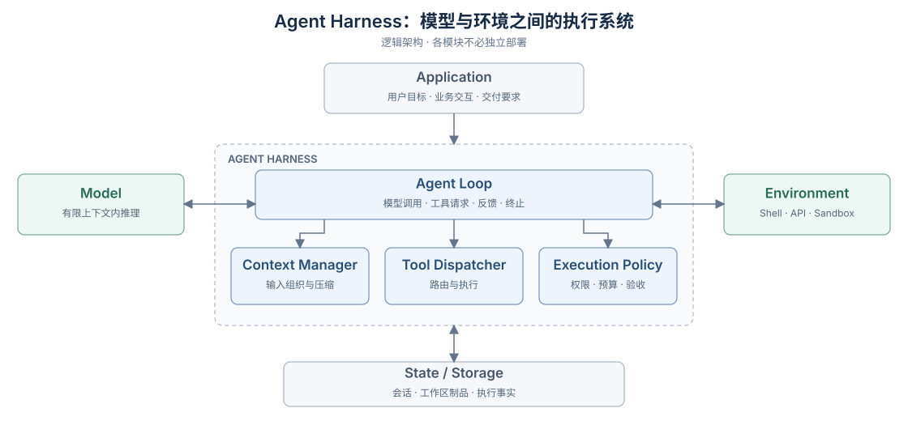
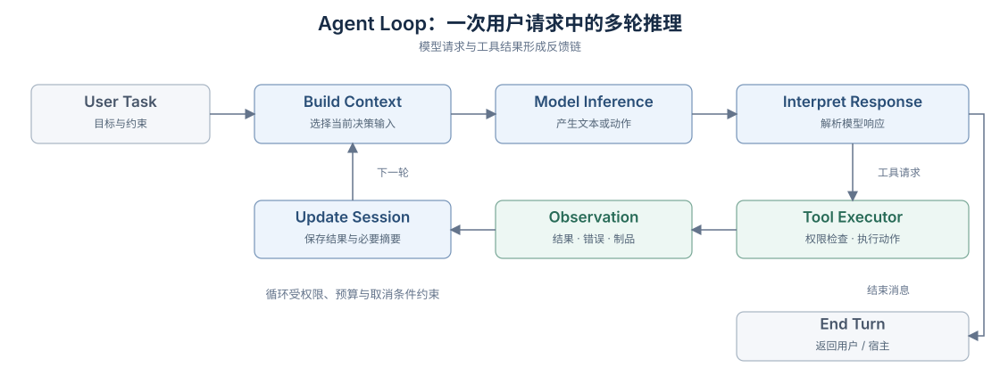
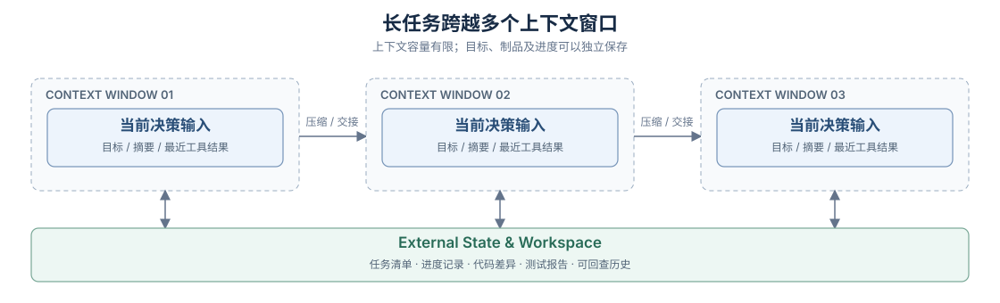
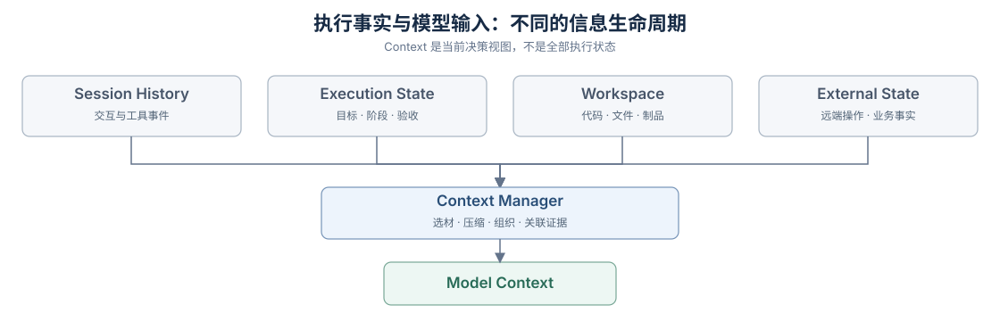
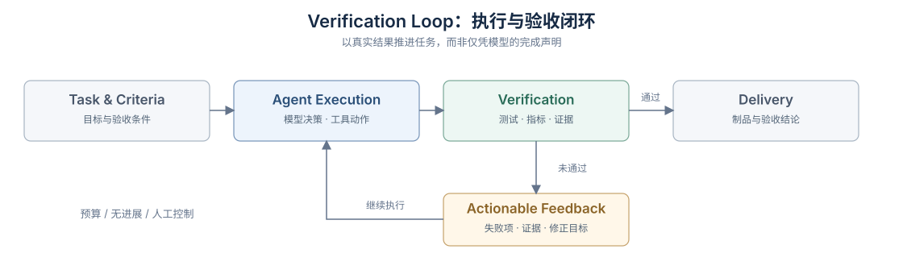
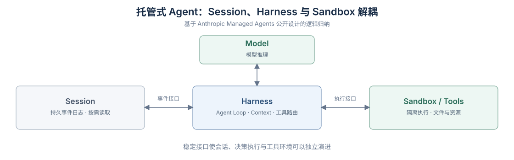
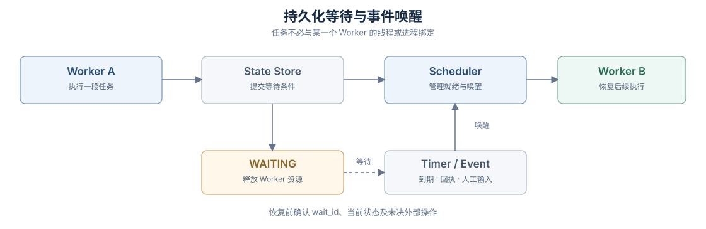
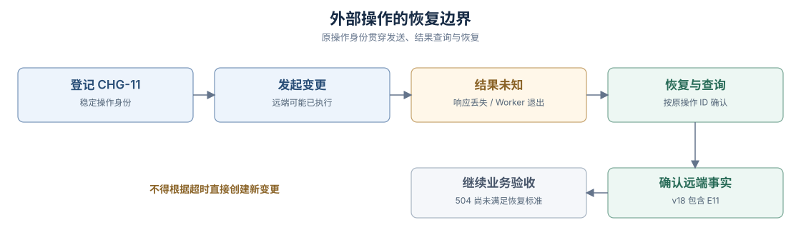
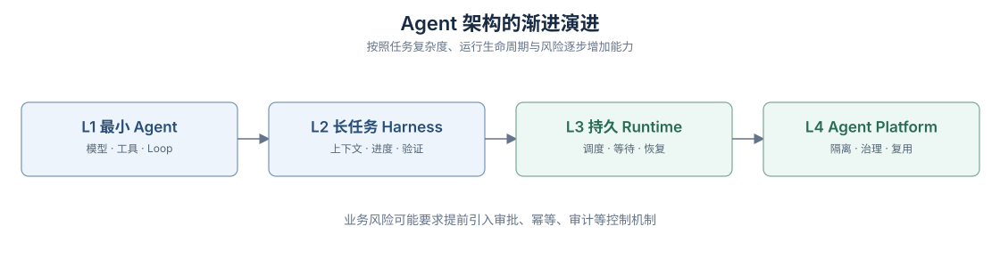

# 第 6 章 Agent Harness & Execution：从模型推理到长任务执行

**本章核心脉络与阅读导览**

在 Claude Code 或 Codex 中提出一个跨模块重构需求，Agent 通常不会立即给出一份代码，而是先探索项目结构、阅读已有实现、寻找调用关系，随后修改文件、执行编译与测试，并根据失败结果继续修正。在这一过程中，用户可能只提交过一次指令，Agent 却已经完成了数十次模型调用和工具交互。即使任务超出单个上下文窗口的容量，它仍然有机会继续推进。

这一现象值得从软件工程的视角重新审视：大语言模型提供的是有限上下文内的推理与生成能力，那么，持续工作、访问环境、保存进度、验证结果与恢复执行等能力究竟由谁提供？

答案涉及模型之外的一整套执行系统，即 **Agent Harness**。

第 3 章讨论如何组织模型的决策输入，第 4 章讨论知识与记忆如何被获取和保存，第 5 章讨论模型如何通过工具与外部世界交互。本章将这些能力放回一个完整的运行过程，研究它们如何共同支撑长任务执行。核心脉络如下：

1. 建立 Model、Harness、Context、Tool、Environment 与 State 的系统认知。
2. 展开 Agent Loop，理解一次用户请求如何转化为多轮推理和行动。
3. 研究上下文窗口、阶段性交付和跨会话工作交接。
4. 区分会话记录、执行状态与工作区，理解任务恢复的边界。
5. 建立验证、纠错、预算与人工控制机制，使执行过程产生有效进展。
6. 从本地 Agent 演进到托管式 Runtime 与后台任务系统。
7. 讨论生产环境下的可靠执行与外部副作用。
8. 给出一套能够逐步落地的长任务 Agent 工程方案。

本章以一个 Java 服务的跨模块重构作为主案例，并沿用第 5 章的 `payment-gateway` 排障案例解释高可靠业务操作。前者为教学设定；后者保留既有事实：变更 `CHG-11` 已将渠道 A 的规则从 v17 更新至 v18，读回配置包含 E11，但 `inst-11` 的 HTTP 504 尚未达到恢复标准。涉及 Codex、Claude Agent SDK 与 Claude Managed Agents 的具体实现，以公开资料为依据；本章的统一架构图、Java 接口与业务示例则是工程归纳，并非任何产品的内部实现原图。

## 1. Agent Harness：模型之外的执行系统

### 1.1 从一次模型调用到一个能够工作的系统

假设用户希望完成以下任务：

> 将订单服务中的风险判断从 `OrderService` 抽离到独立的风控决策模块，保持已有接口和业务行为兼容，并完成必要的回归验证。

如果直接调用模型 API，并附上 `OrderService` 的源代码，模型可以分析现有逻辑，给出抽取方案，甚至生成新的 Java 类。但它通常还不知道完整的调用关系、项目构建方式以及真实测试结果。如果这些信息没有被提供，它只能根据已有输入进行判断。

一个 Coding Agent 的工作方式不同。它能够根据当前问题选择下一步需要的证据：搜索调用者、读取接口定义、检查测试、修改工作区，然后运行 Maven，根据编译或测试结果再次决定下一步。

这里发生了两类计算：一类是模型根据上下文推断下一步应该做什么；另一类是软件系统真正读取文件、运行命令并管理执行过程。两类计算通过工具调用及其结果建立反馈关系。

以普通函数调用为例，模型返回 `run_tests(module="order-service")` 并不会使 Maven 自动启动。必须有某个组件解析请求、检查权限、执行命令并将结果传回模型。进一步，如果测试失败，它还要允许模型继续分析，而不是把失败的测试输出直接作为任务的最终答案。

因此，完整 Agent 的关键变化是：模型的输出可以参与决定后续的计算和行动，而系统能够将行动结果继续交给模型。一次请求由此展开为多步执行。模型 API 可以承载部分托管工具和会话能力；即使应用只发出一次 HTTP 请求，服务端也可能运行完整的 Agent。判断系统是否具有 Agent 式执行能力，应观察实际控制流程，而非 API 调用次数。

### 1.2 Harness 的定义与职责边界

OpenAI 在《Codex as a platform: build on the open agent harness》中，将 Harness 描述为围绕模型构建的执行系统，并介绍了 Codex 如何复用这一层来维护上下文、调用工具、管理执行边界和人机交互。[1]

本书将 **Agent Harness 定义为：围绕模型组织决策输入、驱动执行循环、调度工具并管理反馈与控制边界的软件系统。** 它使模型能够在给定环境和授权范围内，持续推进一个任务。



**图 6-1 Agent Harness 总体逻辑架构：模型决策与环境行动之间的执行层**

一个完整的逻辑架构可以从六个基本对象理解：

| 对象 | 核心职责 | Coding Agent 示例 |
| --- | --- | --- |
| Model | 根据本轮输入生成答复或动作请求 | 判断下一步需要读取哪个类、修改什么逻辑 |
| Agent Loop | 组织模型调用、工具执行、结果反馈与终止 | 连续进行搜索、编辑、编译和修复 |
| Context | 为当前模型调用提供任务、约束与相关证据 | 用户需求、代码片段、历史摘要、最新测试结果 |
| Tool | 定义模型可请求的操作及参数契约 | `read_file`、`apply_patch`、`run_tests` |
| Environment | 提供动作真正发生的资源与运行条件 | Git 仓库、文件系统、Shell、容器、构建环境 |
| State | 记录会话、任务进度或环境中的已发生事实 | 消息历史、验收记录、代码变更、未完成事项 |

Harness 以 Agent Loop 为核心，并调用上下文管理、工具路由、权限控制、会话存储等组件。上述六个对象不是六个必须独立部署的服务；一个本地进程完全可以承担多项职责。组件是否物理拆分，取决于隔离、规模和运行生命周期的要求。

应用层还承担业务目标、交互界面、业务权限及交付形式等职责。例如，一个风控策略分析应用可以复用现有 Harness 的执行能力，但策略评估口径、可访问的数据范围、上线审批及结果归档仍然由应用和业务系统决定。

### 1.3 Harness、Runtime、SDK 与 Sandbox 的关系

Agent 领域并没有完全统一的命名体系。同一个框架可能将循环、状态持久化和调度都称为 Runtime，另一个框架则可能把其中大部分能力归入 Harness。为了便于后续架构讨论，本章采用如下职责划分：

| 概念 | 本章采用的含义 |
| --- | --- |
| Harness | 模型周围的执行逻辑及其支撑机制，重点在如何组织一次或多次 Agent 工作 |
| Runtime | 承载 Harness 运行的基础设施与生命周期管理，重点在进程、任务调度、资源、持久化等待和恢复 |
| SDK | 供应用调用或扩展 Agent 能力的开发接口；可以封装现成 Harness，也可以仅提供构建组件 |
| Sandbox | 受隔离和资源约束的工具执行环境，是 Environment 的一种实现 |
| Application | 定义用户目标、业务语义及产品交互的宿主系统 |

这些概念具有重叠关系，不能根据产品名称直接推断部署方式。尤其是 Sandbox 不负责产生模型决策，SDK 也不必然等价于一套可靠的后台 Runtime。

Codex 的开源 Harness 可以经由 CLI、SDK 或 App Server 接入应用。[1] Claude Agent SDK 则提供面向工具驱动任务的 Harness 能力，Anthropic 的长任务实验直接建立在该 SDK 之上。[2] 对应用开发人员而言，这意味着可以在成熟执行循环之上建设业务专有的工具、上下文与验收机制，而无需每次重新实现通用 Agent 基础能力。

## 2. Agent Loop：持续执行的基本机制

### 2.1 一次用户请求如何展开为多轮执行

OpenAI 在《Unrolling the Codex agent loop》中公开了 Codex CLI 的基本运行流程：Harness 调用模型，根据模型产生的工具请求执行相应操作，将结果纳入后续输入，直至模型返回面向用户的结束消息。一次对话 Turn 内可以包含多次这样的循环。[3]

以订单风控模块重构为例，一段简化的执行过程如下：

| 轮次 | 模型根据当前证据作出的选择 | 工具执行结果 | 后续决策依据 |
| --- | --- | --- | --- |
| 1 | 搜索 `OrderService` 及风险判断的调用位置 | 发现创建订单和支付前检查两条调用路径 | 重构不能只修改创建订单 |
| 2 | 读取风险规则、接口和相关测试 | 发现规则顺序与拒绝原因存在兼容要求 | 需要保留决策顺序和错误码 |
| 3 | 抽取决策接口与实现，调整调用方 | 工作区产生代码变更 | 需要检查依赖及编译结果 |
| 4 | 运行模块编译 | 发现测试构造函数与新依赖不匹配 | 修正测试装配，而不是重新设计接口 |
| 5 | 修改测试装配并执行回归 | 已有测试通过，但支付前检查缺少覆盖 | 增加独立回归用例 |
| 6 | 执行新增用例及完整模块测试 | 验收所需结果通过 | 汇总修改范围与验证证据 |

这里的轮次是教学简化，不代表实际产品恰好调用六次模型。重点在于：后续行动依赖前一轮获得的真实结果。编译错误不是事先写好的流程分支，而是新的 Observation；模型可以据此决定修复哪部分代码。



**图 6-2 Agent Loop：工具结果进入下一轮模型决策**

### 2.2 工具调用协议如何闭合执行循环

从工程实现看，模型请求一般包含指令、当前输入以及允许调用的工具描述。响应可能包含普通文本、结构化工具调用或其他模型特定的响应对象。

下面是一个与供应商无关的简化工具调用示例：

```json
{
  "call_id": "call_17",
  "name": "run_tests",
  "arguments": {"module": "order-service"}
}
```

工具执行器在受控环境中运行测试，并返回可与原请求关联的结果：

```json
{
  "call_id": "call_17",
  "status": "completed",
  "exit_code": 1,
  "summary": "RiskDecisionServiceTest: 1 failure",
  "artifact_ref": "artifacts/test-report-17.xml"
}
```

此处 `completed` 代表工具运行已经结束，并不表示测试通过。下一轮模型需要同时看到原始工具调用及对应结果，以理解自己刚才执行了什么。不同模型 API 对消息结构、调用标识以及工具结果格式有各自的规定，适配层应遵循具体协议。

对于同一个响应中的多个工具调用，也不能无条件并行执行。相互独立的只读查询可以并行；修改同一文件与运行依赖该文件的测试则存在顺序依赖。工具调度应根据资源冲突与依赖关系决定执行策略，而不是简单地将所有请求交给线程池。

### 2.3 Thread、Turn 与执行步骤

在一个真实 Agent 产品中，用户会多次提交消息，每次提交又会触发多次模型和工具调用。如果把这三个层级都称为“轮次”，会导致接口与日志语义混乱。

Codex App Server 使用 Thread、Turn、Item 来组织会话协议。[4] Thread 承载持续的会话；Turn 表示由一次用户输入发起的工作；Item 则表达工具执行、消息、差异或审批等输入输出单元。一个 Turn 可以产生多个 Item，而一个 Item 并不必然等价于一次模型推理。

企业应用还可以在此基础上定义独立的 Task 与 Run：Task 代表需要完成的业务目标，Run 代表一次受控执行。例如，订单模块重构是一个 Task；失败后由用户显式重新发起的执行可以属于新的 Run。它们是应用的业务抽象，并不等同于 Codex 的 Thread 与 Turn。

补充说明：

在 Codex Harness 中，**Thread、Turn 和 Item 构成了 Agent 执行过程的三级组织结构**。其中，Thread（线程）代表一个完整且持续存在的会话，可以将其理解为一个长期保存的工作档案。例如，用户围绕同一个项目持续向 Codex 提出开发需求、修改要求和问题排查任务，这些交互都可以保存在同一个 Thread 中。Thread 负责维护会话的整体历史和生命周期，支持会话继续、恢复以及分叉等操作。Turn（轮次）则代表 Thread 中的一次完整任务执行过程，可以理解为用户布置的一项具体任务，以及 Agent 为完成这项任务所经历的整个过程。例如，用户要求 Codex 修复订单模块中的一个 Bug，Codex 可能需要先阅读代码、分析问题、调用工具、修改文件、执行测试，最后返回处理结果。这些步骤虽然涉及多次模型交互和工具调用，但都属于同一个 Turn。因此，Turn 并不等同于一次简单的用户提问或模型回复，而是一次相对完整的任务执行周期。

**Item（条目）则是组成 Turn 的最小结构化单元**，用于记录任务执行过程中产生的具体消息、操作及结果。例如，在上述 Bug 修复任务中，用户提出的需求、Agent 输出的消息、执行 Shell 命令、工具调用、文件修改以及命令执行结果，都可以分别作为独立的 Item 进行记录。每个 Item 都有明确的类型和生命周期状态，系统可以通过这些结构化记录追踪任务的执行进度，并将执行过程实时呈现给用户。由此，三者形成了清晰的层级关系：Thread 负责组织和管理完整会话，Turn 负责组织一次具体的任务执行，Item 则负责记录任务执行过程中的具体事件。**简单来说，Thread 管会话，Turn 管任务，Item 管执行过程。** 这种分层设计使 Agent 的执行过程不再只是一次简单的文本问答，而是成为一个可追踪、可恢复、可展示的结构化执行过程。

### 2.4 实现一个最小 Agent Loop

如果暂不考虑分布式调度、进程恢复与复杂审批，一个能够调用工具的 Agent 可以用以下 Java 风格伪代码描述：

```java
RunResult execute(UserTask task, Session session) {
    session.appendUser(task.instruction());
    while (policy.canContinue(session)) {
        Context context = contextManager.build(session, task);
        ModelResponse response = model.infer(context, tools.schemas());
        session.appendResponse(response);

        if (response.requiresUserInput()) {
            return RunResult.waitForUser(response.message());
        }
        if (!response.hasToolCalls()) {
            return RunResult.turnEnded(response.message());
        }

        // 执行器根据依赖、权限和工具契约处理调用，
        // 保留调用 ID；拒绝和失败也作为结构化结果返回。
        for (ToolResult result : executor.dispatch(response.toolCalls())) {
            session.appendToolResult(result);
        }
        contextManager.compactIfNeeded(session);
    }
    return RunResult.stopped(policy.stopReason());
}
```

这段代码只展示同步、本地、单执行者的最小控制流程。模型异常、流式输出、审批暂停、并发工具调用和持久化提交将在实际实现中进一步处理。尤其要注意，返回 `turnEnded` 表示本轮交互结束，不代表业务任务一定成功；返回 `waitForUser` 也需要由宿主保存会话才能在之后继续。

通过这段代码可以看出，Agent Loop 并没有要求模型具备一种特殊的长期运行能力。模型每次只处理当前输入；Harness 将一次次决策组织成持续的行动链。

然而，当任务从几轮工具调用增长到数十轮乃至多个小时，这个最小实现会逐渐暴露更深层的问题：上下文装不下全部历史、任务进展无法准确继承、模型可能在目标未实现时结束。长任务设计首先需要解决这些 Agent 特有的问题。

## 3. Long-running Execution：跨越上下文与工作阶段

### 3.1 长任务的三个不同边界

“长任务”并不只是运行时间长。对于 Agent，至少存在三种需要分别处理的连续性：

| 连续性 | 典型问题 | 对应机制 |
| --- | --- | --- |
| 跨推理轮次 | 模型能否根据上一轮工具结果继续行动 | Agent Loop、调用关联与结果反馈 |
| 跨上下文窗口或会话 | 旧历史被压缩或新会话启动后，是否知道目标、约束及剩余工作 | Compaction、结构化进度、工作区、交接协议 |
| 跨进程或环境故障 | Worker 退出、容器销毁或外部调用中断后，是否可以安全继续 | 持久化状态、制品恢复、操作确认与重新调度 |

前两类连续性直接影响 Agent 能否有效完成任务，第三类连续性决定它能否在不可靠的运行环境中继续承担任务。一个本地 Coding Agent 可以在没有独立 Scheduler 的情况下跨越多个上下文窗口；一个持久化工作流引擎也可能在模型不断作出低质量决策时可靠地执行错误步骤。因此，运行可靠性不能替代决策与任务推进质量。

### 3.2 Context Compaction：让模型能够继续推理

在重构案例中，Agent 可能已经读取几十个源文件、执行多次编译，并获得大量堆栈与测试输出。如果每次模型调用都携带完整历史，输入将持续增长。

第 3 章已经讨论了上下文预算及信息组织，本节只关注执行过程中的管理方式。当输入接近阈值时，Harness 可以对较早的执行过程进行压缩，将历史中仍然有价值的目标、结论、约束与未决问题交接给下一段执行，并保留必要的近期交互。

例如，一份用于交接的摘要可能包含：

```text
目标：抽离订单风控决策，保持 API、错误码及规则顺序兼容。
已完成：新接口和实现；创建订单路径迁移。
待完成：支付前风险检查迁移；补充拒绝场景的回归测试。
关键约束：风险拒绝原因需保持原有映射，禁止改变规则优先级。
证据：当前工作区 diff；artifacts/test-report-17.xml。
下一步：核对 PaymentCheckService 的调用链，完成迁移并运行回归。
```

压缩结果需要与当前任务和最新证据一起进入后续输入。压缩时还要遵守模型协议，例如不能随意保留工具调用而删除其必需的配对结果。具体阈值取决于模型窗口、预计输出以及工具结果大小，不宜把某个固定 Token 数视为普适标准。

Anthropic 的 Context Engineering 文章将压缩、外部笔记和子 Agent 作为长程任务的上下文管理方式。[5] 对本章而言，重要的是明确三者的分工：压缩为下一次推理释放容量；外部记录为后续执行提供可重新读取的信息；子 Agent 可以将局部探索和分析隔离在独立上下文中，仅将结论及必要证据交回主执行者。



**图 6-3 上下文窗口是有限的，任务与工作区可以跨窗口延续**

上下文压缩存在信息损失。模型在摘要中遗漏一个兼容性约束，可能导致下一阶段重新引入已经排除的错误。应将稳定的任务要求、验收定义和实际制品独立保存，并在需要时重新检索原始历史或证据，而非把摘要作为唯一事实来源。

### 3.3 为什么有了压缩仍然不能保证长任务成功

Anthropic 在 2025 年的长任务 Harness 研究中使用 Claude Agent SDK 开展应用开发实验。[2] 实验表明，单纯维持上下文循环仍可能出现阶段工作过大、下一会话难以接续以及功能尚不完整便结束等问题。

这些现象在工程团队中并不陌生。一次跨模块改造如果没有明确的阶段边界，即使代码已经写了大半，后续接手人员也可能不知道哪些变更已经验证、哪些只是临时方案。Agent 在上下文切换时面临类似问题，而且自然语言摘要并不能替代完整的工作区和验收记录。

因此，长任务的关键不只是如何保留过去发生的对话，还要设计**可以被后续执行者接续的工作阶段**。

在订单风险模块重构中，可以把任务拆分为：

| 阶段 | 交付物 | 验收条件 |
| --- | --- | --- |
| F01 基线分析 | 调用关系及兼容性约束 | 明确创建订单、支付前检查两条路径及原有风险规则 |
| F02 决策能力抽取 | `RiskDecisionService` 接口与实现 | 规则顺序、拒绝原因及异常语义与基线一致 |
| F03 调用方迁移 | 两条调用路径的改造代码 | 原业务接口兼容；编译及模块测试通过 |
| F04 全链路验证 | 回归用例及测试报告 | 新旧行为对照通过，无未解决的关键失败 |

阶段划分不必僵化为固定 Workflow。执行过程中发现新的调用方时，Agent 可以提出补充工作项，但不能在不保留修改记录的情况下悄悄删除原验收要求。第 7 章将进一步讨论计划和动态编排，本章关心的是这些阶段如何被执行、记录和验证。

### 3.4 Anthropic 的长任务 Harness 实验

Anthropic 的 2025 年实验采用初始化 Agent 与后续 Coding Agent 分工。初始化阶段建立可接续的开发环境；后续执行者按功能增量工作，并借助功能清单、进度文件、版本历史和初始化脚本交接。浏览器端到端测试提供了代码以外的功能证据。[2]

这套方案的工程价值在于将原本隐含于上下文中的任务信息转化为可独立读取和验证的制品。将其应用于 Java 项目，可以设计如下工作区（文件名为本章示例）：

```text
workspace/
├── AGENTS.md                    # 项目约束与操作指南
├── pom.xml
├── order-service/
├── risk-service/
├── .agent/
│   ├── task.json                # 目标、范围与验收要求
│   ├── features.json            # 阶段工作项及验收状态
│   ├── progress.md              # 最近进展、决策及未决问题
│   └── artifacts/
│       └── regression-report.xml
└── scripts/
    └── verify-baseline.sh       # 可重复执行的基线验证
```

其中，一份功能记录可以采用如下结构：

```json
{
  "id": "F03",
  "description": "迁移订单创建和支付前检查的风险决策调用",
  "acceptance": [
    "两条调用路径均使用统一决策接口",
    "已有错误码和规则顺序保持兼容",
    "模块编译与回归用例通过"
  ],
  "status": "in_progress",
  "evidence": ["artifacts/regression-report.xml"],
  "next_action": "完成支付前风险检查迁移"
}
```

下一段执行首先读取任务范围、阶段清单和最近进展，再核对工作区与测试基线。这样做既可以减少重复探索，也能及时发现前一阶段遗留的不可运行状态。对于共享仓库，Agent 应遵循宿主的 Git 策略；保存差异、生成隔离分支或创建提交并不意味着可以擅自提交和推送用户代码。

从架构角度看，功能清单描述尚需完成的工作，进度记录帮助后续执行者理解已有决策，代码和测试制品提供可复查的真实结果。它们不需要一开始就由复杂的数据库平台管理。单机、低风险任务使用文件即可获得相当一部分收益；当多个执行者并发推进状态或涉及外部业务操作时，再引入具备事务约束的存储。

## 4. State & Session：任务连续性依赖哪些状态

### 4.1 Session、Context、Execution State 与 Workspace

传统对话系统常将一组 `messages` 视为会话状态。但在工具驱动的 Agent 中，仅保存消息不足以表示全部工作。

假设模型上一轮输出“我已经完成接口抽取，正在执行测试”，随后进程退出。新进程即使完整恢复了这段消息，也需要检查代码是否真正写入、测试是否启动以及结果是否存在。这些问题对应不同的事实来源。



**图 6-4 Session、Execution State 与 Workspace 为 Context 提供不同类型的信息**

| 信息层 | 典型内容 | 权威来源及用途 |
| --- | --- | --- |
| Session History | 用户消息、模型响应、工具调用和结果 | 会话日志；用于恢复交互与追溯历史 |
| Context State | 摘要、选材记录、压缩边界、当前假设 | 上下文管理器；用于重建模型输入 |
| Execution State | 目标、阶段、状态、验收、预算、待处理操作 | 任务存储及受控状态转换；用于执行控制 |
| Workspace State | 代码、文件、差异、测试报告、环境配置 | 工作区与制品系统；用于确认实际产物 |
| External State | 线上配置、远端 Job、业务操作结果 | 对应外部服务；用于确认真实业务效果 |

本章沿用原稿 Execution State 与 Context State 的区分。前者记录能驱动执行的事实，后者服务于下一轮决策。实际的 Context 是 Harness 根据这些信息构造的一次模型输入，它可以只包含其中的一小部分。

一个常见的错误是让模型直接更新所有状态。例如，模型可以建议 F03 已完成，但在具有确定性验收规则的系统中，真正的完成状态应由校验结果和规定的状态转换更新。如果只是文件式 Coding Agent，也应将模型声明与测试报告分开，让后续执行者能够重新核对。

### 4.2 Session 是持久记录，而不是模型上下文窗口

Session 的历史可以比任何一次模型调用的输入长。保存原始事件与为当前模型选择信息是两个不同职责。

Anthropic 在 Managed Agents 的公开设计中将会话历史保存于持久事件日志，Harness 可以通过接口重新读取所需片段，再进行上下文转换。[6] 这一设计允许上下文压缩与历史保存采用不同的生命周期。

对于自研系统，最小实现可以使用一份追加式 JSONL 日志保存消息及工具事件，并另外记录当前摘要。这样既能快速重建最近的输入，也能在需要时重新查找被压缩的细节。进入生产环境后，再考虑按会话索引、事件分页、保留期限和访问控制。

需要注意，持久记录并不意味着无限期保留所有敏感输入。权限、脱敏、数据删除和合规保留策略应在存储层明确实施。

### 4.3 Checkpoint 与 Resume：恢复逻辑执行位置

Checkpoint 保存的是能够继续工作的逻辑边界以及必要的状态引用，而非任意时间点的完整进程镜像。[7]

例如，Agent 已经完成 F02，并通过该阶段的测试，可以建立如下检查点：

```yaml
run_id: RUN-ORDER-01
checkpoint_id: CP-03
state_version: 12
next_phase: F03
session_event_cursor: 86
context_summary_ref: summaries/summary-03.json
workspace_ref: artifacts/workspace-03
verification_ref: artifacts/f02-test-report.xml
pending_operations: []
```

若工作区只存在于原容器的 `/tmp` 下，恢复时即使能读取这份 YAML，也无法恢复代码。因此 `workspace_ref` 需要指向可重新取得的制品或受控版本，未提交变更也应有对应的快照、差异或持久卷。

恢复可以分为几个步骤：加载任务与检查点；恢复或重新定位工作区；核对实际文件和必要的测试基线；确认未决工具操作；刷新失去时效的外部信息；根据剩余工作构建新的 Context，再交给 Agent Loop。

在这一过程中，Resume 与 Replay 的语义应明确区分：

- **Resume**：沿已有执行事实继续推进，必要时重新观察当前环境。
- **Replay**：利用已记录的事件或结果重建状态、复现控制路径。为了复查历史，通常不应重新发送具有副作用的工具调用。
- **重新执行**：发起新的执行尝试，模型输出与外部环境可能均已变化。

框架对这些概念的命名及恢复粒度并不完全一致。例如 LangGraph 的检查点机制支持图状态持久化，但恢复时某些节点可能重新执行；Temporal 通过确定性工作流及活动结果管理重放。[7][8] 选型时应核对具体版本的恢复语义，不能只看到框架提供 `resume()` 接口就认为业务已经获得完整的故障恢复能力。

## 5. Execution Control：从持续运行到有效完成

### 5.1 完成条件应当成为任务的一部分

Agent 的基本 Loop 可以根据模型是否继续请求工具而结束。但模型认为不需要再执行，并不能自动证明用户目标已经达成。

以订单模块重构为例，若 Agent 只修改创建订单路径并通过现有单元测试，就可能生成一个看似合理的总结。然而支付前风险检查仍然调用旧逻辑，实际任务尚未完成。又或者两条路径都完成迁移，但规则的匹配顺序发生改变，业务行为不再兼容。

因此，需要区分三层结果：

| 层次 | 完成依据 |
| --- | --- |
| Tool Result | 某次工具调用结束，产生明确结果或失败信息 |
| Turn Result | Agent 本轮工作结束，控制权交回宿主或用户 |
| Task Result | 业务验收要求得到满足，或明确记录未完成原因及剩余事项 |

一个通用交互式 Agent 可以在模型返回最终消息时结束 Turn；一个具有严格目标的业务 Agent 则可在 Turn 结束后运行额外的验收逻辑，根据结果决定交付、继续执行或暂停。二者并不矛盾。

### 5.2 Verification Loop：将验证结果变成新的决策输入

从系统设计看，验证既可以作为 Agent 主动调用的工具，也可以作为 Harness 在关键边界强制执行的门禁。第一种方式提供灵活性，第二种方式可避免模型跳过不可省略的规则。两者通常可以组合使用。



**图 6-5 执行动作与业务验收之间的反馈闭环**

对于 Coding Agent，验证可以分为多个层级：编译和静态检查验证基本工程正确性；单元测试检查局部行为；集成测试及端到端测试检验真实调用关系；差异审查进一步确认是否引入超出需求的修改。对于涉及旧行为兼容的改造，还可以通过基线对照验证输入输出是否保持一致。

当验证失败时，Harness 应将可定位的问题交给模型，例如“支付前检查仍然使用旧实现”“拒绝码由 RISK_DENIED 变为 SYSTEM_ERROR”。相较于笼统的“质量不够，请继续优化”，这类反馈能够为下一轮提供具体的修复目标。

OpenAI 的 Harness Engineering 实践将工程环境、仓库知识、架构约束和反馈系统作为提高 Agent 开发能力的重要组成部分。[9] 对业务应用而言，这意味着除了为 Agent 提供查询、修改和发布能力，还需要提供相匹配的验证能力：

| 业务动作 | 配套验证能力 |
| --- | --- |
| 生成风控策略 | 表达式校验、规则样本验证 |
| 调整风险阈值 | 历史回放、误伤率及影响范围评估 |
| 订正商品类目 | 抽样检验、前后数据分布及异常归类检查 |
| 生成运营分析报告 | 数据口径校验、来源引用与汇总结果核对 |
| 修改生产配置 | 配置读回、指标观测及业务恢复验收 |

验证工具与执行工具同样是 Agent 能力建设的重要组成部分。没有可观测的结果，模型很难自主判断动作是否产生了预期效果。

### 5.3 确定性校验与独立评估 Agent

并非所有质量问题都能用断言表达。对于代码风格、产品体验或开放式文档，模型评估可以补充确定性检查，但其结论仍需要结合真实制品、评价标准和必要的人工判断。

Anthropic 在 2026 年的应用开发实验中引入 Planner、Generator、Evaluator，并在阶段开发前约定可检验的交付要求。评估者通过运行应用及检查行为给出反馈。这一研究也说明复杂 Harness 会增加执行时间和费用，不能仅以增加 Agent 数量作为优化目标。[10]

对普通业务 Agent，优先采用简单、稳定的验证手段：可以直接用程序判断的规则就不必调用第二个模型；需要独立审查时，再使用额外模型或人工验收。独立评估者有机会发现执行者忽略的问题，但共享同一模型或同一错误前提时，评估仍可能存在相关性偏差。任务越重要，越应该依靠独立证据和可复查结果，而非多个模型的一致赞同。

### 5.4 执行预算与无效循环

反馈循环也可能无限延长。Agent 遇到不可解决的错误后反复执行相同命令，或者不断读取相同文件却没有形成新的结论，都会消耗模型和工具资源。

工程中至少需要区分以下约束：

| 约束 | 目的 |
| --- | --- |
| 单次调用超时 | 限制模型或工具一次调用的等待时间 |
| Run 截止时间 | 限制整项任务的总运行时间 |
| 调用次数与费用预算 | 限制模型与工具的累计开销 |
| 并发配额 | 控制模型服务、沙箱和外部依赖的资源占用 |
| 无进展阈值 | 识别重复操作、反复失败及缺少新证据的循环 |

无进展检测不应仅统计是否调用了工具。更有价值的信号包括新增有效证据、验收失败项减少、未决问题缩小或工作阶段完成。可以根据工具名称、规范化参数、结果指纹和阶段状态识别重复执行；但相同命令在代码修改后再次运行可能是合理的回归验证，因此不能只根据参数相同就认定无效循环。

达到预算或无进展阈值时，系统应保存已经取得的结果并给出可理解的停止原因。涉及未确认的外部操作时，还需要保留必要的收尾和对账能力，不能因普通模型调用预算耗尽就遗弃在途业务动作。

### 5.5 Human-in-the-loop：人工控制执行权

Agent 能够提出一个操作，并不意味着它有权实际执行。对高风险操作，Harness 或宿主需要在工具派发前应用确定性的权限及审批规则。

例如，普通 Coding Agent 可以自动读取仓库和运行受限测试，但修改受保护分支、访问生产凭据或发布服务需要更高权限。审批应绑定具体动作、参数、资源范围和有效期；当关键参数或目标资源发生变化时，应重新核验审批是否适用。

人工介入还可以用于补充需求、确认任务边界和接管执行。当 Agent 暂停等待用户决定时，宿主需要保存等待原因及恢复条件。如果用户拒绝某个动作，模型可以根据拒绝结果重新选择路径，但不能绕过权限门禁改用另一工具执行相同的禁止操作。

在具有持久化恢复要求的系统中，人工决定应作为可关联的执行事件，而不是依靠模型对聊天内容的记忆来判定是否已经获批。

## 6. Agent Runtime：从本地执行到托管式运行

### 6.1 为什么需要将 Harness 与运行环境解耦

本地 Agent 的实现可以很直接：一个进程持有会话、调用模型，并在当前机器执行命令。如果 Agent 只为一个用户工作，进程和工作区的生命周期基本一致，这种部署方式具有较低的架构成本。

但当系统需要同时承载大量独立任务、在不同环境执行工具，或者允许用户断开连接后继续工作时，将所有组件绑定在同一进程或容器中会带来一些问题。例如，只进行资料分析的任务也需要等待完整开发容器创建；执行环境被销毁时，保存于其中的会话可能同时丢失；一个需要访问多个环境的任务必须通过同一容器进行转发。

Anthropic 在《Scaling Managed Agents: Decoupling the brain from the hands》中公开了一种面向托管式 Agent 的架构，将 Session、Harness 与 Sandbox 抽象为可独立演进的组件。[6]



**图 6-6 托管式 Agent 的逻辑解耦：决策循环、会话历史与执行环境**

这种设计具有几项重要的架构价值：

- Session 不再依赖某个运行容器的存活，历史信息可以由后继 Harness 获取。
- Harness 通过稳定的工具调用接口使用环境，工具运行位置不必与模型调用逻辑处于同一机器。
- 执行环境可在有实际需要时创建，纯推理或远程 API 查询不必预先启动本地代码环境。
- 组件可以分别扩容和演进，例如替换上下文管理逻辑而不改变会话存储协议。

这里的解耦主要描述逻辑职责与接口，不意味着一个 Agent 可以不经校验地更换任意 Sandbox。工作区文件、凭据、进程和外部连接仍需根据各自生命周期恢复。Session 的持久性也不能自动提供所有业务动作的可靠执行保证。

从工程角度看，稳定接口比固定内部实现更重要。模型能力持续提升，部分针对旧模型失败模式设计的约束可能逐渐不再必要。如果 Harness、Session 和工具环境具有清晰边界，就可以通过替换模型、调整上下文或简化执行策略来迭代系统，而不必重建所有基础设施。

### 6.2 Codex App Server：将 Agent 变成可集成的执行服务

当一个 Agent 从命令行工具扩展到 IDE、桌面应用及业务控制台时，应用需要的不仅是最终文本，还需要看到中间动作、文件差异、审批请求及当前执行状态。

OpenAI 在 Codex App Server 的工程文章中介绍了双向 JSON-RPC 协议，以及围绕 Thread、Turn、Item 提供的结构化通知与交互能力。[4] 应用可以发起工作，接收多个中间事件，并在需要审批时向执行系统返回决定。

对于自行建设业务 Agent 的团队，值得借鉴的是应用协议的设计，而非照搬某个产品的网络拓扑。一个运行接口可以提供以下能力：

| 能力 | 建议接口语义（本章示例） |
| --- | --- |
| 创建会话 | `createSession()`，返回稳定的会话身份 |
| 发起工作 | `startRun(sessionId, task)`，返回执行身份 |
| 订阅事件 | `subscribe(runId, cursor)`，读取进度、工具结果和交付物事件 |
| 提供人工输入 | `respond(requestId, decision)`，关联具体等待请求 |
| 中止执行 | `cancel(runId)`，登记取消并进入相应收尾流程 |
| 查询与继续 | `getRun(runId)`、`resume(runId)`，根据真实执行状态重新连接或继续工作 |

这些是本章提出的通用接口示意，并非 Codex App Server 的真实方法名。对交互式应用而言，流式事件可以改善用户体验；对后台任务而言，查询接口和可恢复的事件游标更加关键。界面断开后，用户应能重新获知任务状态，而不是通过是否仍然收到文本来猜测 Agent 是否还在运行。

### 6.3 从同步调用到持久化等待

长任务中包含计算、环境执行和等待三类活动。以第 5 章的排障案例为例，配置变更完成后，需要等待一个新的监控窗口，才能判断 504 指标是否下降。在此期间，没有必要持续调用模型，也没有必要让 Worker 一直占用线程等待。

生产级系统可以将一个 Run 的生命周期划分为 `READY`、`RUNNING`、`WAITING`、`SUCCEEDED`、`FAILED`、`CANCELLING`、`CANCELLED` 等状态。具体状态集取决于业务语义；重要的是不要把正常等待、未知结果和失败混在一起。

当外部指标查询被提交为异步 Job，或者人工审批需要数分钟才能返回时，Runtime 记录稳定的操作身份、等待条件与截止时间，然后释放执行资源。相关事件到达或计时器到期后，Scheduler 重新安排 Worker 从已保存状态继续运行。



**图 6-7 持久化等待将任务生命周期与 Worker 生命周期分离**

这一设计通常需要以下组件：

| 组件 | 职责 |
| --- | --- |
| Runtime | 维护 Run 的合法状态转换、执行策略与控制条件 |
| Scheduler | 根据就绪队列、事件和计时器安排下一段执行 |
| Worker | 调用模型、运行工具、处理结果及验证 |
| State Store | 保存任务、检查点、等待记录与操作结果 |
| Environment Manager | 提供或恢复工作区、Sandbox 及工具执行资源 |

一次等待记录可以非常简单：

```yaml
run_id: RUN-11-01
status: WAITING
phase: VERIFYING
wait:
  id: WAIT-11-04
  kind: TIMER
  not_before: '2026-11-05T14:15:00+08:00'
  deadline: '2026-11-05T14:20:00+08:00'
  resume_step: collect_verification_window
```

这些时点沿用原稿的教学设定，并非真实故障记录。等待可以由定时器、外部 Job 回执或人工输入触发。事件到达时，需要检查对应的 `wait_id` 是否仍然有效；如果同一事件重复投递，或者完成事件与超时同时到达，只允许一次合法的状态推进。外部操作的真实结果仍应被记录，即使对应 Run 已经停止。

对于耗时很短的本地任务，直接同步执行通常就足够了。持久化等待的价值主要体现在耗时不可控、需要释放计算资源或必须跨进程恢复的场景。语言层面的 `async/await` 可以提高进程内并发，但不会自动赋予进程重启后的恢复能力。

### 6.4 Background Agent：后台执行与自动触发

后台 Agent 通常涉及两种能力。一种是用户发起任务后，系统在界面断开时仍能继续执行；另一种是由预先授权的定时器、业务事件或监控告警创建任务。前者依赖 Runtime 的生命周期管理，后者还需要定义触发权限、范围与频率。

例如，风控运营团队希望每天分析前一日风险订单、输出异常分布，并在指标显著变化时发出通知。调度系统可以依据固定时区和周期创建分析 Run；Harness 负责在受控范围内调用数据查询与分析工具；业务应用负责报表口径、通知条件和验收。重复触发应有去重规则，上一周期未结束时需要明确是跳过、合并还是排队。

后台运行不应仅由模型承诺“稍后继续检查”。系统必须存在真实触发器、任务记录及执行资源，并支持取消当前运行与停止后续触发。用户在线状态不决定授权是否有效，后台工具仍需按当前业务权限执行。

## 7. Reliable Execution：生产环境中的可靠执行

### 7.1 Agent 的失败具有不同语义

传统 RPC 调用失败后，工程系统通常依据异常类型决定是否重试。Agent 引入了更多的失败层次：模型可能没有形成有效决策，工具参数可能不符合业务约束，外部动作可能成功但没有达到任务目标。若不区分这些情况，自动重试反而可能放大错误。

| 失败类型 | 典型表现 | 建议处理方式 |
| --- | --- | --- |
| 模型服务暂态失败 | 限流、连接异常 | 按预算及退避策略重试或延迟调度 |
| 模型决策或参数错误 | 工具参数不合法、引用不存在的资源 | 返回结构化错误，允许有限次数纠正 |
| 环境状态变化 | 文件被他人修改、业务资源版本变化 | 重新读取事实，核验原决策是否仍适用 |
| 权限不足 | 请求超出允许的工具或资源范围 | 拒绝动作，按授权流程处理 |
| 只读查询失败 | 查询超时、结果缺失 | 在查询契约允许范围内重试，并标注采集时间 |
| 写操作结果未知 | 请求超时，但远端可能已经完成 | 查询原操作、等待回执或对账，避免盲目重发 |
| 业务验收未通过 | 工具成功，风险指标或功能表现仍不符合要求 | 继续诊断、修正或受控撤回 |

重要的不是设计一个覆盖所有异常的巨大枚举，而是保证系统能够识别动作是否发生、能否再次执行以及任务是否真正完成。

### 7.2 稳定操作身份：超时并不等于失败

第 5 章的 `payment-gateway` 排障案例非常适合说明这一问题。变更 `CHG-11` 的目标是向渠道 A 的规则增加 E11。如果请求发出后网络超时，Agent 无法仅根据超时判断远端是否已经执行变更。

在生产级 Agent 中，Task、Run、Step、Attempt 和 Operation 可以采用不同身份，但无需为每个简单场景完整实现五层对象。对于有副作用的操作，至少要区分一次逻辑业务意图与其物理调用尝试。例如，`CHG-11` 作为稳定 Operation ID，在多次传输尝试与 Worker 恢复之间保持不变；每次实际请求则产生新的 Attempt。

| 观察到的结果 | 运行系统可以确认的事实 |
| --- | --- |
| 已登记操作意图 | 系统存在一个待处理的逻辑动作 |
| 请求已发出，响应超时 | 是否执行成功尚未确认，状态为 UNKNOWN |
| 按原操作 ID 查询为成功 | 该操作的业务效果已得到确认 |
| 配置读回为 v18 且包含 E11 | 配置达到已批准的预期状态 |
| 后续 504 指标仍偏高 | 变更成功，但故障恢复目标未达成 |

幂等不能仅依靠本地记录。具有副作用的接口应支持稳定的请求身份、参数绑定、结果查询以及下游可靠去重；这些能力需要由实际业务系统共同提供。[11] 对于不具备幂等或可查询操作身份的外部服务，系统应保留不确定状态，必要时暂停并交由人工核对，而不是承诺绝对安全的自动恢复。

### 7.3 Checkpoint 无法冻结外部世界

假设 Worker 在提交 `CHG-11` 后、写入本地结果之前退出。即使 Agent 拥有之前的检查点，仍无法从检查点判断远端当前状态。



**图 6-8 恢复时先确认外部事实，而不是重新发起原业务动作**

对于关键写操作，通常应先登记稳定意图，再发送外部请求，并单独保存操作结果。若存在数据库与消息系统双写的问题，可以使用 Transactional Outbox；若回执可能重复投递，可以使用 Inbox 去重与状态更新的本地事务。多个 Worker 争抢任务时，可通过状态版本、租约或成熟调度框架避免旧执行者提交过期决策。[8][12][13]

这些都是传统分布式系统中成熟的设计机制。应用于 Agent 时，有两个尤其需要关注的边界：一是模型重新生成的调用 ID 不能自动成为新的业务操作身份；二是本地任务状态的恢复不能代替对外部真实效果的核对。

如果原操作确需撤回，应创建新的受控补偿动作，重新检查当前配置、业务依赖及授权。回到旧检查点并不会撤销已经生效的线上变更。

### 7.4 取消、超时与迟到结果

取消 Agent 并不意味着所有外部请求已经被撤销。例如，用户在配置变更发出后点击停止，Runtime 可以阻止后续诊断和新的业务动作，但远端仍可能完成原变更。

此时，应独立记录 Run 是否继续追求目标，以及 Operation 的真实执行结果。Run 可以处于取消或收尾状态，而 Operation 仍处于处理中或未知状态。迟到的成功回执应更新原操作记录，不能未经授权重新启动已取消的 Run。

生产系统还需要明确取消的产品语义：是停止后续工作，还是等待所有已知副作用得到确认后才进入终态。对于不能立即撤销的行为，应向用户显示当前状态及后续责任归属。

### 7.5 Agent Trace：让运行过程可定位、可复查

Agent 可能跨越多次模型调用、若干工具、多个 Worker 和人工系统。仅保存最终答案无法解释为什么任务停止，也无法判断模型是否重复尝试了无效方案。

可以利用 OpenTelemetry 的 Trace、Span 与 Event 建立调用链，结合 Session、Run、Step 和 Operation 等稳定身份进行关联。[14] 对长任务，运行视图至少应该覆盖：

| 观测维度 | 典型信号 |
| --- | --- |
| 模型调用 | 调用次数、耗时、Token 与费用、上下文压缩次数 |
| 工具执行 | 工具名称、参数摘要、耗时、结果及失败原因 |
| 任务进度 | 阶段状态、通过和未通过的验收项、无进展时间 |
| 后台调度 | 队列时延、等待时长、重新调度次数 |
| 业务副作用 | 未确认操作数量、对账积压、重复操作异常 |

Trace 负责观察因果关系及运行质量，Execution State 和操作账本负责恢复。普通 Trace 可能被采样或删除，不能把零散日志直接当作权威业务状态。也不应为了可观测而默认记录所有提示词、完整业务数据和凭据；审计重点应放在输入证据、动作选择、门禁决定、工具结果与最终验收上。

恢复能力还需要故障注入测试。对于关键业务动作，可以在意图登记后、请求发出后、外部成功但本地未记录时分别终止 Worker，检查系统能否确认已有操作并避免产生重复效果。对于长任务 Agent，还应测试上下文压缩后约束是否保留、重新连接后工作区是否可用，以及不满足验收标准时系统是否会错误结束。

## 8. Engineering Practice：构建一个可持续执行的 Agent

### 8.1 从最小架构开始，而不是直接建设平台

综合前面的研究，一个 Agent 的核心执行系统可以先由若干清晰的逻辑模块构成。以下接口是本章针对 Java 工程的示意，不依赖某个具体供应商 SDK。

| 模块 | 建议职责 |
| --- | --- |
| ModelClient | 适配模型协议、工具请求及模型响应 |
| AgentLoop | 驱动推理、工具反馈、继续执行与停止 |
| ContextManager | 组织决策输入、控制容量并管理摘要 |
| ToolRegistry / ToolExecutor | 注册工具契约、校验与执行动作 |
| SessionStore | 保存交互事件及必要的上下文引用 |
| TaskStore | 保存目标、进度、验收和必要的控制状态 |
| Environment | 提供文件、代码、浏览器或业务资源访问环境 |
| ExecutionPolicy / Verifier | 管理权限、预算、关键验收及人工控制 |
| EventSink | 输出可追踪的运行进度及关键事件 |

模块化的主要目的是明确依赖关系，而非将每个组件做成独立微服务。小型系统可以将 SessionStore、TaskStore 实现为本地文件；对持久运行的业务 Agent，则可以替换为数据库和制品存储。若使用已有 Harness 或 SDK，应用只需补齐未被提供的业务能力。

下面以一个简化的状态推进接口说明模型与控制逻辑的边界：

```java
interface TaskStore {
    TaskState load(String runId);
    boolean save(String runId, long expectedVersion, TaskState next);
}

interface Verifier {
    VerificationResult verify(TaskState state, Evidence evidence);
}

interface ExecutionPolicy {
    Decision authorize(TaskState state, ToolCall call);
    boolean canContinue(TaskState state);
}
```

`ModelClient` 可以产生候选工具调用或完成建议；`ExecutionPolicy` 决定操作是否允许；`Verifier` 提供验收证据；`TaskStore` 负责保存已承认的状态变化。真实实现需要进一步处理事务边界、调用失败和授权时效。接口中的版本参数只能控制本地并发写入，不能单独保证外部动作不重复。

### 8.2 一个长任务的端到端执行过程

以订单风险决策模块重构为例，将前面各机制组合成一个完整过程：

| 阶段 | Harness 的职责 | 可复查的产物或状态 |
| --- | --- | --- |
| 初始化 | 接收目标，读取项目约束，建立阶段及验收要求 | task.json、features.json、基线测试 |
| 循环执行 | 根据上下文调用模型，路由工具，反馈结果 | 会话事件、文件变更、命令结果 |
| 阶段验证 | 执行编译、行为对照及测试 | 测试报告、差异、阶段状态 |
| 上下文压缩 | 汇总仍有效的事实和未决问题 | 摘要、证据引用、原始历史 |
| 工作交接 | 保存阶段进度及工作区，后续会话重新读取 | progress.md、工作区引用、检查点 |
| 中断恢复 | 核对工作区和未决动作，重建决策输入 | 最新事实、可恢复执行位置 |
| 完成验收 | 检查所有必需阶段和回归结果，输出交付 | 代码差异、验证证据及未完成事项 |

Agent 不必每个阶段都重新开启会话。对于能够在当前上下文中完成的任务，连续执行即可；当上下文、成本或任务阶段需要切换时，才进行适当的压缩与交接。

如果执行过程中出现新的调用方或兼容性约束，Harness 应让模型根据新证据调整工作计划，同时保留原目标和已确认的事实。任务状态与工作区中的实际变更保持对应，才能防止下一轮执行重复修改已经完成的部分。

### 8.3 如何选择已有 Harness、SDK 与持久执行框架

实际工程中，应该先分析应用需要控制哪些能力，再决定是否自研执行系统。

| 方案 | 适用场景 | 仍需应用负责的内容 |
| --- | --- | --- |
| 模型 API + 自研最小 Loop | 工具数量有限、需要精确控制执行逻辑的业务场景 | 上下文、会话、工具执行、异常及验证 |
| Codex CLI / SDK / App Server | 代码、仓库及工程工具相关任务；需要复用现有软件 Agent 的能力 | 业务目标、环境权限、领域工具、验收和产品集成 |
| Claude Agent SDK | 希望复用已有工具驱动 Harness，并构建定制 Agent | 领域数据和工具、权限边界、持久任务及验收 |
| LangGraph | 需要明确图结构、条件分支、状态管理及中断恢复的任务 | 节点实现、业务副作用、部署与验收语义 |
| Temporal 等持久工作流基础设施 | 跨服务、长等待、需要跨进程恢复及可靠业务协调的场景 | 模型和工具活动、上下文、业务幂等、验证策略 |

这些方案并非彼此排斥。应用可以让持久工作流管理业务任务的外层生命周期，并在某个有界阶段内部使用 Agent SDK 完成分析或开发工作。需要特别注意，非确定性的模型调用和外部 I/O 应作为工作流框架允许记录或隔离的活动执行，而不能直接混入需要确定性重放的控制逻辑。[8]

对于 Java 后端团队，初期可以采用 Java 作为业务服务与控制层，根据需求通过 SDK、进程或服务协议接入成熟 Agent。模型供应商提供的托管工具能力也可以直接复用。若没有清晰的差异化执行需求，不必从零开发完整通用 Harness。

### 8.4 四个层次的架构演进



**图 6-9 根据实际任务要求引入执行机制，而不是预先建设全部组件**

| 层次 | 核心能力 | 进入下一层的主要驱动力 |
| --- | --- | --- |
| L1 最小 Agent | 模型调用、工具执行、反馈循环 | 任务历史增长，跨阶段工作难以接续 |
| L2 长任务 Harness | 上下文管理、结构化进度、工作区与验证 | 用户断开、环境重启、长期等待 |
| L3 持久化 Runtime | Session/Run 持久化、调度、等待、恢复及操作追踪 | 多租户、资源竞争、平台化复用及高风险动作 |
| L4 Agent Platform | 隔离与资源管理、授权治理、观测、标准化工具与集成协议 | 根据实际规模与业务目标持续演进 |

这四个层次是本书提出的渐进式设计视角，并非行业标准或能力认证体系。某些任务会直接采用成熟托管服务获得较完整的 Runtime；某些本地工具则可能长期停留在 L2。高风险业务即使规模不大，也可能必须在初期具备权限、幂等与审计能力。

Harness 的复杂度应通过实际任务效果进行评估。可以建立代表性任务集合，记录完成率、回归通过率、人工干预次数、失败恢复情况、执行时长与成本。在对比方案时尽可能控制模型、任务输入和评估规则，再逐步增加上下文压缩、验证门禁或独立评估者，判断新增机制是否真正改善结果。模型升级之后，也应重新验证旧有约束的必要性。

## 9. 本章总结

Claude Code、Codex 等现代 Agent 的持续执行能力，来自模型推理与工程执行系统的协作。模型根据有限的上下文生成下一步决策；Harness 组织上下文、工具、反馈和控制条件，使这些决策不断与真实环境发生交互。

Agent Loop 解决多轮行动的连续性；Context Compaction、结构化进度与外部工作区解决跨上下文和工作阶段的连续性；Session、Checkpoint 与持久 Runtime 解决更长生命周期中的恢复问题。验证、权限、预算及人工控制则决定执行是否有效、是否安全以及何时结束。

由此可见，Agent 的工程能力不能仅通过模型效果或工具数量衡量。一个具备实际交付能力的 Agent，还需要让模型能够获得必要证据，让操作结果成为新的决策输入，使重要执行事实可以被保存与核对，并在适当的边界进行验收。

在本章的 Java 重构示例中，真正的交付不是模型输出“已完成重构”，而是工作区中的代码变更、原有业务行为的兼容性和回归验证结果。在 SRE 示例中，配置变更成功也不等于故障恢复，Agent 必须依据业务指标继续验收。两者共同说明：执行系统应将模型的完成建议与可验证的任务结果区分开来。

回顾本章，可以将 Agent 执行架构归纳为几个主要关系：Model 产生决策，Harness 组织执行，Tool 连接环境，Context 提供当前决策视图，State 保存任务事实，Runtime 承载必要的生命周期与资源管理。不同产品和业务场景可以选择不同的实现复杂度，但这些职责及其协作关系构成了理解长任务 Agent 的基础。

下一章将进一步讨论 Agent Reasoning & Orchestration。在已经明确如何执行、反馈、验证和恢复的基础上，研究复杂任务应当如何被规划、拆解与编排，以及哪些决策适合交给模型，哪些更适合由确定性流程承担。

## 10. 参考研究与延伸阅读

### 10.1 Agent Harness 与工业界实践

1. **OpenAI (2026-08-19)**. [Codex as a platform: build on the open agent harness](https://developers.openai.com/blog/codex-as-a-platform). Harness 的职责、复用及应用集成。
2. **Anthropic (2025-11-26)**. [Effective harnesses for long-running agents](https://www.anthropic.com/research/effective-harnesses-for-long-running-agents). 长任务的工作交接、增量执行与功能验证实验。
3. **OpenAI (2026-01-23)**. [Unrolling the Codex agent loop](https://openai.com/index/unrolling-the-codex-agent-loop/). Codex 的模型与工具执行循环。
4. **OpenAI (2026-02-04)**. [Unlocking the Codex harness: how we built the App Server](https://openai.com/index/unlocking-the-codex-harness/). App Server 的交互协议与会话抽象。
5. **Anthropic (2025-09-29)**. [Effective context engineering for AI agents](https://www.anthropic.com/research/effective-context-engineering-for-ai-agents). 动态上下文、压缩、笔记和子 Agent。
6. **Anthropic (2026-04-08)**. [Scaling Managed Agents: Decoupling the brain from the hands](https://www.anthropic.com/research/managed-agents). Session、Harness 与 Sandbox 的稳定接口和解耦设计。
7. **LangChain**. [LangGraph Persistence](https://docs.langchain.com/oss/python/langgraph/persistence)；[Interrupts](https://docs.langchain.com/oss/python/langgraph/interrupts). 检查点、持久化与中断恢复语义。
8. **Temporal Technologies**. [Workflow Execution overview](https://docs.temporal.io/workflow-execution)；[Workflow Definition: deterministic constraints](https://docs.temporal.io/workflow-definition#deterministic-constraints). 持久执行与确定性重放。
9. **OpenAI (2026-02-11)**. [Harness engineering: leveraging Codex in an agent-first world](https://openai.com/index/harness-engineering/). 仓库知识、工程环境、架构约束和自动化反馈实践。
10. **Anthropic (2026-03-24)**. [Harness design for long-running application development](https://www.anthropic.com/research/harness-design-long-running-apps). 规划、生成、独立评估及多阶段交付实验。

### 10.2 可靠执行与工程基础设施

11. **AWS Builders' Library**. [Making retries safe with idempotent APIs](https://aws.amazon.com/builders-library/making-retries-safe-with-idempotent-APIs/). 稳定请求身份、参数绑定及幂等重试。
12. **Amazon Web Services**. [Transactional outbox pattern](https://docs.aws.amazon.com/prescriptive-guidance/latest/cloud-design-patterns/transactional-outbox.html). 本地事务与可靠消息派发。
13. **Martin Kleppmann (2016)**. [How to do distributed locking](https://martin.kleppmann.com/2016/02/08/how-to-do-distributed-locking.html). 租约与过期执行者的写入保护边界。
14. **OpenTelemetry Authors**. [Traces](https://opentelemetry.io/docs/concepts/signals/traces/). 执行链路的 Trace 与 Span。

### 10.3 实现与开发入口

- [OpenAI Codex 开源仓库](https://github.com/openai/codex)
- [Codex 开发者文档](https://developers.openai.com/codex/)
- [Claude Agent SDK](https://platform.claude.com/docs/en/agent-sdk/overview)

上述官方研究介绍的是特定时期的产品实现、接口或实验结果。SDK 的具体接口、模型能力和执行策略会随版本变化；工程选型及源码研究应进一步核对所用版本。本文示例中的业务数据、阶段状态与接口定义为教学设计，不构成可直接部署的完整实现。
