# 第6章 Agent Execution Model：Agent 如何运行

**本章核心脉络与阅读导览**

第 5 章结束时，`payment-gateway` 的排障任务停在一个很有代表性的中间状态：变更 `CHG-11` 已经完成，渠道 A 的规则从 v17 更新为 v18，配置读回确认包含源出口地址 E11，但 `inst-11` 的 HTTP 504 尚未达到恢复标准。工具系统已经回答了“这次操作是否执行”，用户关心的“故障是否解决”仍然没有答案。

接下来，Agent 可能需要等待新的观测窗口，继续检查路由和下游响应，也可能需要暂停，让值班人员决定是否撤回变更。如果承载它的 Worker 此时重启，系统必须知道哪些事情已经发生、哪些结果仍然未知，以及下一步究竟应该查询、等待还是停止。把历史消息重新发给模型，并不能完整回答这些问题。

**Agent Execution Model（Agent 执行模型）定义的是：一个任务如何获得执行权，如何根据模型决策和外部结果推进状态，如何在等待时释放资源，又如何在中断之后继续承担尚未完成的工作。** 模型调用只是其中的一种计算步骤；任务的持续性由外围 Runtime、持久化存储和调度机制共同提供。

本章沿着这条执行链逐层展开：

1. **执行抽象（What）**：Task、Run、Step、Attempt 和外部 Operation 分别标识什么，Agent Loop 如何围绕它们运行？
2. **状态与生命周期（Where）**：Execution State 与 Context State 如何分工，谁有权把任务从运行中推进到等待或完成？
3. **持久化与恢复（How to resume）**：状态提交、并发控制和 Checkpoint 怎样配合，恢复时如何避免重做已经发生的动作？
4. **长任务与失败处理（How long）**：执行预算、重试、幂等和补偿如何限制长程任务的代价与影响？
5. **异步与后台运行（When）**：事件如何可靠地唤醒任务，后台 Agent 如何获得持续运行能力？
6. **人工参与（Who decides）**：人工输入、审批和接管如何成为可恢复的执行协议？
7. **执行管理（How to inspect）**：如何通过 Trace、运行视图和故障注入，判断任务卡在哪里、恢复是否正确？

本章继续使用第 4、5 章的 11 月 5 日排障案例。新增的任务 ID、时间线、指标阈值和资源配额均为教学设定；其中“变更成功但故障仍未恢复”这一事实保持不变。第 7 章再讨论怎样规划和编排复杂任务，本章先建立这些决策能够被可靠执行的底座。

## 1. 执行模型：把一次调用放进持续存在的任务

最简单的 Agent 可以写成一个循环：调用模型，执行工具，把结果放回上下文，再次调用模型。这段代码展示了反馈机制，但它还没有说明用户关闭页面之后任务是否继续、进程崩溃之后谁来接手，以及某次工具请求究竟是新的业务操作还是旧请求的重试。

这些问题需要先有稳定的执行对象。否则，运行过程里看似相同的“再执行一次”，可能指向完全不同的业务含义。

### 1.1 Task、Run、Step 与 Attempt：区分目标和执行尝试

本章采用下面这组术语。不同框架可能使用不同名称，工程设计中需要先固定自己的语义，再映射到具体 SDK。

| 对象 | 表示什么 | 生命周期与示例 |
| --- | --- | --- |
| **Task（任务）** | 用户或系统希望完成的业务目标，包括范围、验收条件与责任归属 | `TASK-11`：排查 `inst-11` 的 504，并形成有证据的处置结果 |
| **Run（执行实例）** | 在一组输入、配置与预算下，对 Task 发起的一次执行 | `RUN-11-01`：本次排障执行；Worker 更换不改变这个 ID |
| **Step（逻辑步骤）** | Run 中具有明确输入、结果与恢复边界的工作单元 | 获取配置、调用模型、提交变更、等待观测、验收结果 |
| **Attempt（物理尝试）** | 对某个 Step 或操作的一次实际调用尝试 | 第一次监控查询超时，第二次查询成功；两次尝试分别计时、计费 |
| **Operation（外部操作）** | 需要独立追踪结果和副作用的业务动作 | `CHG-11`：向渠道 A 增加 E11；跨重试保持稳定身份 |

**表 6-1 Agent 的执行对象与身份边界**

Task 表示目标，Run 表示一次执行；同一个 Task 可以先有一次自动排查，再由用户明确发起新的执行。Run 恢复通常沿用原来的身份，而显式重新执行则创建新的 Run，并关联前一次结果。

Step 与 Operation 也不必一一对应。一个模型步骤可能提出多个动作；一次外部变更可能经历提交、状态查询和验收多个步骤。工具协议里的 `tool_call_id` 用于关联模型请求与返回，通常不适合作为跨恢复的业务幂等身份。

例如，`CHG-11` 第一次请求超时后，Runtime 可以创建新的 Attempt 查询状态，但不能因为模型又生成了一个新的调用 ID，就把“增加 E11”当成第二次变更。反过来，两次参数完全相同的操作也可能是两个合法业务意图，参数哈希同样不能单独定义操作身份。

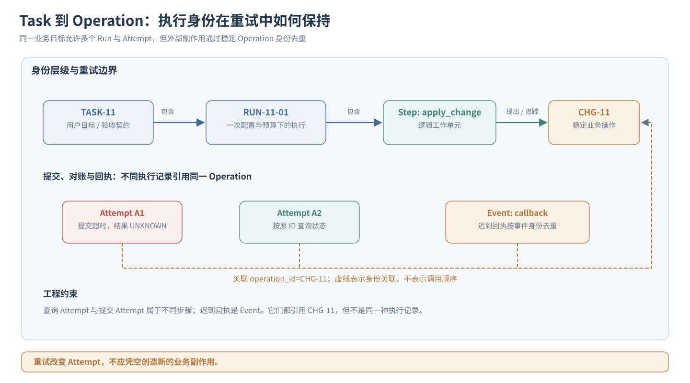

**图 6-1 Task 到 Operation：执行身份在重试中如何保持**

### 1.2 Runtime 管状态，Worker 执行工作，Scheduler 决定何时继续

这些对象可以先实现在同一个服务中，但职责需要区分：

- **Runtime** 解释执行状态，应用状态转换规则，校验模型提出的动作，并决定下一项可执行工作。
- **Worker** 承担具体计算和 I/O，例如调用模型、执行工具、整理结果。Worker 可以随时退出或被替换。
- **Scheduler** 根据就绪队列、等待条件、计时器和资源限制，决定哪些 Run 可以获得下一段执行时间。
- **State Store** 保存权威状态、操作记录和恢复位置，使任务不依赖某个进程的内存持续存在。

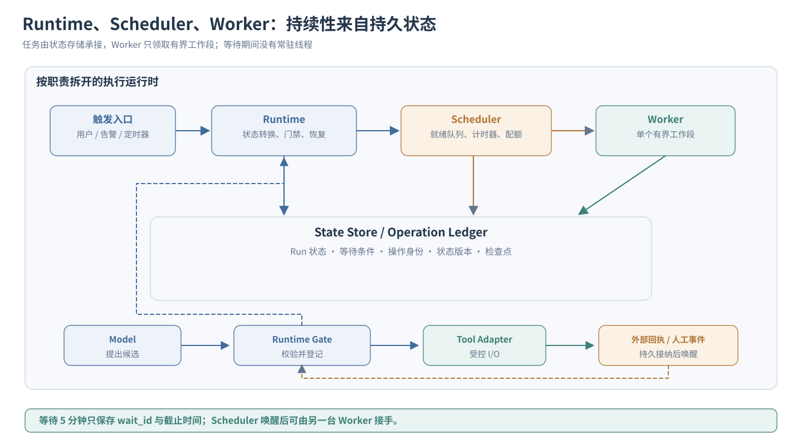

**图 6-2 Runtime、Scheduler、Worker：持续性来自持久状态**

因此，“Agent 持续运行”并不要求同一个线程一直存活。等待五分钟观测窗口时，可以只保留一个带截止时间的等待记录；到期后由另一台 Worker 继续执行。任务的连续性体现在持久身份和状态衔接上，而不是进程连续在线。

### 1.3 执行模型首先要回答五个问题

评估一个 Runtime 是否足以承载生产任务，可以先检查五件事：谁拥有执行权，什么条件允许下一步动作，哪些事实已经提交，遇到中断从哪里继续，以及什么证据允许结束。

这五个问题分别对应调度、门禁、状态、恢复和验收。模型能力影响它选择的下一步是否合理，但不会自动提供这些机制。对于 `RUN-11-01`，即使模型已经判断应该等待后续窗口，Runtime 仍需把等待对象和唤醒时间写入存储；否则 Worker 退出后，这条判断只是一段失去执行载体的文字。

建立对象与职责之后，接下来需要把 Agent Loop 从一段内存循环，变成可以逐步提交、随时暂停的状态推进过程。

## 2. Agent Loop：围绕已提交事实推进下一步

第 1 章用 Reason → Act → Observe 说明了 Agent 如何形成反馈。本章把它展开为运行时协议：读取当前状态、组织决策输入、取得动作候选、校验并提交动作意图、执行、接收结果，再决定是否继续。

这里的关键不是多加几个函数，而是明确每一步完成之后，系统究竟承诺了什么。

### 2.1 一轮模型决策不等于一个事务

可以把一次决策与推进表示为：

$$
C_t = \operatorname{Compile}(S_t, K_t, M_t, O_t)
$$

$$
D_t \sim P_\theta(\cdot \mid C_t), \qquad
S_{t+1} = \operatorname{Reduce}(S_t, E_t)
$$

其中，$S_t$ 是已经提交的任务状态，$C_t$ 是本轮模型输入，$D_t$ 是模型提出的决策候选，$E_t$ 是通过校验后接纳的事件，例如动作已登记、工具结果已确认或审批已到达。Knowledge、Memory 与 Observation 按第 3、4 章的规则参与上下文构建。

`Reduce` 按明确规则推进状态。它使用已经接纳的事件，不能把模型说“变更成功”直接转换成外部操作成功。实际实现可以采用数据库事务加应用逻辑，不一定需要专门的事件溯源框架。

模型调用和外部 I/O 往往持续数秒甚至更久，不应把数据库事务一直锁在这段时间上。Runtime 应先读取版本化状态，在事务外完成计算，再以状态版本和执行权校验提交结果。如果期间任务被取消，或者相关输入已经改变，原来的模型输出只能作为历史记录保存，不能照常下发动作。

本章的代码和配置均用于说明协议边界，不构成可直接部署的完整 Runtime；例如事务封装、鉴权与异常分支需要由实际存储和工具契约实现。尤其不要把示例函数之间的普通调用顺序，误当成已经获得数据库或跨系统的原子性保证。

### 2.2 从动作候选到下一轮 Observation 的提交边界

以追加一个新的诊断查询为例，一轮执行可以拆成以下过程：

1. Worker 取得 Run 的执行权，读取当前状态及其版本，检查取消标记、截止时间和预算。
2. Context Compiler 构建本轮输入，记录使用的状态版本、证据引用和配置版本。
3. 调用模型，保存响应及消耗；把工具请求或完成建议解析成候选决策。
4. Runtime 重新检查当前状态是否仍允许这项决策，验证工具、参数、权限、依赖和预算。
5. 在一次本地事务中登记 Step、稳定的 Operation 身份及待派发意图，并推进状态版本。
6. 执行器取走已登记的意图，访问外部系统；结果通过关联 ID 回到 Runtime。
7. Runtime 提交结果与下一步状态，随后编译下一轮 Context，或进入等待、完成、失败等分支。

对没有外部副作用的纯计算，提交边界可以更轻；对于生产变更，不能省略发送前的意图登记。第 6、8 节将说明，即使先登记了意图，跨系统执行仍然存在需要对账的窗口。

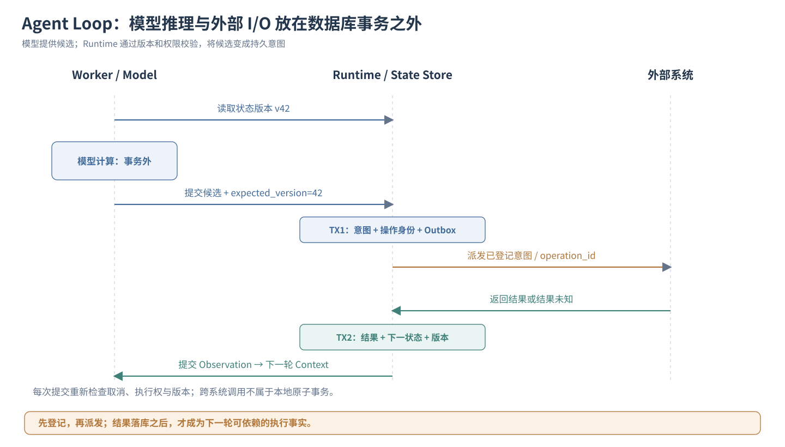

**图 6-3 Agent Loop：模型推理与外部 I/O 放在数据库事务之外**

### 2.3 “继续”“等待”和“完成”是不同的控制决定

一个可运行的 Loop 不只有 `continue` 和 `break`。模型可能提出调用工具、请求人工输入、提交最终答复；Runtime 也可能独立要求等待限流、处理取消或停止超预算执行。

| 候选或事件 | Runtime 需要检查什么 | 可以采取的控制动作 |
| --- | --- | --- |
| 请求工具调用 | 依赖是否满足、参数和权限是否有效、是否已有同一操作 | 登记操作并派发，或返回结构化拒绝原因 |
| 外部任务处理中 | 是否有可查询身份、等待截止时间和回执路径 | 保存等待条件，释放 Worker |
| 请求人工参与 | 缺少的输入是什么、谁能回答、回答如何关联 | 创建人工等待记录 |
| 模型建议完成 | 业务验收、交付物和未决操作是否满足终结要求 | 确认完成，或指出具体未满足条件 |
| 达到预算或截止时间 | 在途动作是否仍需收敛、能否安全停止 | 禁止新业务动作，转入停止与对账流程 |

**表 6-2 Loop 中的控制决定及其运行时依据**

`CHG-11` 成功并不满足 `TASK-11` 的验收要求，因此模型即使生成“问题已解决”，Runtime 也不能直接把 Run 标成成功。对于文档生成等难以完全机器判定的任务，可以采用格式检查、证据检查和人工验收组合；完成条件不必全部自动化，但必须明确由谁确认、依据是什么。

如果完成建议被拒绝，反馈应指出“后续窗口样本不足”或“仍有结果未知的变更”，而不是笼统地要求模型继续努力。对于连续没有新增证据、反复提出同一操作的情况，Runtime 还要限制重复尝试，避免拒绝完成反而制造无限循环。

Loop 的每个分支都依赖状态。下一节进一步区分：哪些信息必须成为执行事实，哪些只是帮助模型理解这些事实的上下文。

## 3. Execution State 与 Context State：运行事实与决策视图

第 3 章已经说明，Context 是当前可用信息的受限投影。到了执行层，这个区别直接决定恢复是否可靠：聊天记录可以帮助模型理解过去发生了什么，但调度器不能通过阅读聊天记录来判断哪个定时器该触发，工具执行器也不能通过摘要来判断一项审批是否仍然有效。

### 3.1 Execution State 保存能够驱动执行的结构化事实

Execution State（执行状态）至少需要覆盖目标、生命周期、运行位置、外部操作、等待条件和资源约束。它不意味着把所有材料放进一个庞大的 JSON：任务主记录、操作台账、审批记录和证据引用可以分表存储，只要身份与一致性关系清楚。

下面是一份处于后续观测等待阶段的示意记录：

```yaml
task_id: TASK-11
run_id: RUN-11-01
status: WAITING
phase: VERIFYING
state_version: 42
definition_version: incident-runtime-v3
goal_revision: 1

scope:
  service: payment-gateway
  instance: inst-11
  channel: A

operation_refs:
  - operation_id: CHG-11
    status: SUCCEEDED
    result_ref: result://CHG-11/v1
    resulting_config_version: v18

verification:
  status: NOT_PASSED
  evidence_refs: [metrics://inst-11/window-03]
  reason: HTTP_504_RATE_ABOVE_THRESHOLD

wait:
  wait_id: WAIT-11-04
  kind: TIMER
  resume_step: collect_verification_window
  not_before: '2026-11-05T14:15:00+08:00'
  deadline: '2026-11-05T14:20:00+08:00'

budget:
  model_calls_used: 9
  model_calls_limit: 30
  cost_used_usd: 0.42
  cost_reserved_usd: 0.00
  cost_limit_usd: 3.00

authorization_ref: authz://TASK-11/scope-v2
checkpoint_id: CP-42
```

这里的 `status` 描述 Run 是否可调度，`phase` 描述排障进行到哪个业务阶段。把两个维度分开，可以避免出现 `WAITING_FOR_APPROVAL_AFTER_DIAGNOSIS` 一类不断膨胀的复合状态。

操作成功来自工具结果，验收未通过来自指标证据，等待时间来自运行策略。授权引用指向受信系统中的约束，并不把长期凭据存进快照；实际执行时仍要检查当前权限。

### 3.2 Context State 保存如何重建决策输入所需的信息

“Context State”在不同框架中并没有完全统一的定义。本章将它限定为：**维护模型后续输入所需的上下文工作记录**，例如消息引用、有效摘要、压缩边界、选中的证据和上下文构建版本；真正发送给模型的 $C_t$ 则是这些记录与执行状态共同编译出的具体输入。

| 维度 | Execution State | Context State |
| --- | --- | --- |
| 核心用途 | 决定任务能否执行、如何恢复和何时结束 | 帮助下一轮模型理解当前任务 |
| 典型内容 | Run 状态、操作身份、等待条件、预算、审批与状态版本 | 对话引用、摘要、当前假设、选材记录、压缩游标 |
| 写入规则 | 通过授权事件和确定性状态转换更新 | 可由模型辅助生成，但需要来源标记和结构校验 |
| 缩减方式 | 不能因上下文预算丢弃必要的执行事实 | 可压缩、裁剪并按需重新构建 |
| 恢复作用 | 是继续执行的控制依据 | 是恢复决策质量的输入材料 |

**表 6-3 Execution State 与 Context State 的职责差异**

对于同一状态版本 42，排障模型的上下文可以写成：“白名单已更新至 v18；上一个验收窗口仍未恢复；等待下一窗口，优先核对渠道 A 的剩余失败路径。”展示给用户的进度视图则可能只需要“配置变更已完成，正在继续验收”。两者来自同一组事实，但并不承担相同的控制职责。

Context State 中的假设可以来自模型，外部操作的确认结果不能由模型摘要覆盖。例如，“怀疑另一个路由仍未生效”应保留为 `hypothesis`；只有当前路由查询提供证据之后，才能形成带来源的已确认事实。

### 3.3 用版本关系防止旧上下文驱动新动作

每次模型调用至少应关联 `run_id`、`decision_id`、`based_on_state_version` 和输入材料的版本或哈希。当模型基于版本 42 生成建议，而人工已经在版本 43 取消任务时，Runtime 必须拒绝把这份旧建议登记为新的执行意图。

最保守的策略是：状态版本变化就丢弃候选，重新构建上下文。高并发系统可以检查更细的依赖版本，只让与当前决策有关的变化使它失效，例如目标配置版本、授权范围和验收阶段；这需要明确读集与冲突规则，不能仅凭模型解释“变化不重要”。

审计时还要区分“能重建相似上下文”和“能证明当时模型看见了什么”。如果只保存可变文档的 URL，后者无法保证。需要精确回查时，应在保留策略允许的范围内保存输入清单、不可变内容引用和必要的请求快照，并对敏感内容实施访问控制。

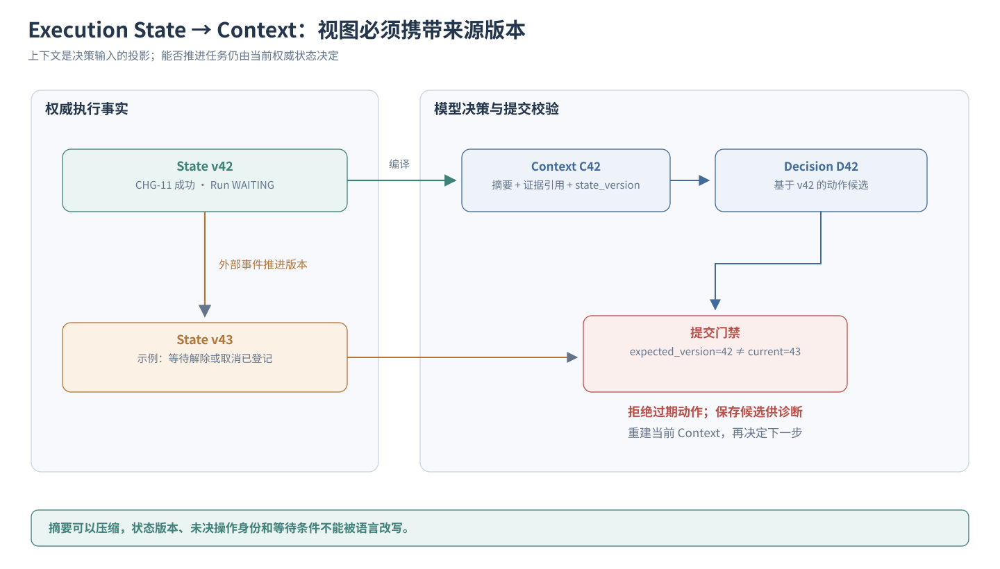

**图 6-4 Execution State 到 Context：视图必须携带来源版本**

明确了状态与视图的关系，下一步才有条件定义任务何时创建、何时等待，以及谁能宣布它结束。

## 4. Task Lifecycle：创建、执行、等待与终结

许多系统最初只有 `RUNNING / DONE / ERROR` 三个状态。任务一旦需要人工审批、异步工具和故障恢复，这种划分就会把正常等待、执行失败、结果未知和业务未完成混在一起。

生命周期设计的目标，是让调度器、用户界面和恢复程序对同一状态有一致理解。

### 4.1 创建任务时就定义完成条件

创建 Task 不能只保存一段用户 Prompt。至少还要确定任务范围、发起身份、目标修订号、执行策略和验收方式。对于告警驱动的任务，还需要保存触发事件与去重身份，防止同一告警反复创建相互竞争的执行。

在本章案例中，任务范围限定为 `payment-gateway` 的 `inst-11` 及其渠道 A 调用链。教学验收规则可以定义为：配置读回符合已批准方案；连续三个完整的一分钟窗口中，渠道 A 的 504 率低于既定阈值；每个窗口请求量达到最低要求；P99 延迟与对照实例没有超过允许差异。阈值应来自业务 SLO 和处置策略，而不是临时由模型决定。

这些条件还要允许“不足以判断”：指标延迟、窗口不完整或请求量不足时，应继续等待或报告证据不足，不能把空数据解释成零错误。人工允许以“诊断报告交付”为新目标结束，也需要显式修改目标和验收条件，不能在原目标未达成时悄悄降低标准。

### 4.2 Run 状态与操作状态使用两套状态机

一个简化的 Run 生命周期如下：

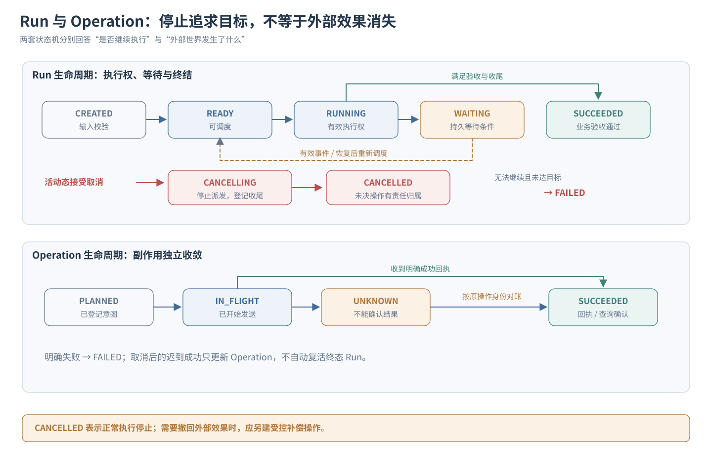

**图 6-5 Run 与 Operation：停止追求目标，不等于外部效果消失**

`WAITING` 通过 `wait.kind` 区分计时器、外部结果、人工输入和重试等待。`RUNNING` 则意味着当前存在有效执行权，不保证某台机器永远在线；Worker 失联后，由恢复程序检查租约与未决操作，再决定重新调度还是继续等待。

外部 Operation 单独维护 `PLANNED / IN_FLIGHT / SUCCEEDED / FAILED / UNKNOWN`。其中 `FAILED` 要有明确的失败语义，`UNKNOWN` 表示当前无法确认结果。某些部分完成的批量变更还需要逐项结果或额外的 `PARTIAL` 状态，不能把部分副作用藏进一个失败码。

因此，Run 已取消与 `CHG-11` 仍在处理中可以同时成立。Run 的生命周期表达系统是否继续追求目标，操作台账表达外部世界究竟发生了什么。把两者混成一个字段，就无法正确处理迟到回执。

### 4.3 取消与超时需要收尾协议

用户点击取消后，Runtime 应先登记取消请求、阻止新的业务动作，再尝试撤销尚未派发的工作并通知可取消的在途操作。对于无法中止的请求，需要继续追踪结果；若存在补偿要求，则创建独立的补偿操作。

`CANCELLED` 必须有清楚的产品语义。本章将它定义为：正常执行已经停止，所有已知未决操作都有持久记录及后续责任归属；它不承诺所有外部效果均已撤销。界面应同时展示“已停止”和“仍有一项变更等待确认”，避免用户误解。

若业务要求确认所有副作用之后才能终结，则 Run 应继续停留在 `CANCELLING`，并在超过收尾期限后交给明确的人工或对账任务。无论采用哪种规则，都不能让一个未知操作因 Run 终结而失去追踪。

类似地，截止时间到达只说明不再允许继续正常执行。已发送的变更不会随本地计时器自动消失，后续结果可以更新操作台账，但不能把终态 Run 自动重新唤醒。显式重新执行时创建新的 Run，并重新核验目标、当前状态和授权。

生命周期规定了合法转换，但多个 Worker 同时读到同一个状态时，仍可能都认为自己应该执行下一步。接下来需要把状态规则落实到并发控制与可靠提交中。

## 5. State Management：让状态只有一条被承认的推进历史

把状态保存到数据库，解决的是进程退出后还能读取的问题。两个 Worker 同时恢复、消息重复投递、模型响应晚到等情况，还需要状态版本、执行权与提交协议共同处理。

### 5.1 用状态版本阻止覆盖，用租约分配执行权

假设 Worker A 读取了版本 42，随后因网络卡顿暂停；Worker B 接手后把任务推进到版本 43。A 恢复时若直接按 `run_id` 更新整条记录，就可能把 B 的结果覆盖掉。

最基础的防护是乐观并发控制（Optimistic Concurrency Control）：提交时带上读取到的版本，仅当版本仍匹配才允许更新。

```sql
UPDATE agent_runs
SET status = :next_status,
    state_version = state_version + 1,
    updated_at = CURRENT_TIMESTAMP
WHERE run_id = :run_id
  AND state_version = :expected_version
  AND lease_epoch = :owned_epoch
  AND lease_until > CURRENT_TIMESTAMP;
```

受影响行数为 0 时，这次提交没有成功。调用方应重新读取状态并判断原因，不能把旧状态直接覆盖回去，也不能因为自己的数据库提交失败就再次执行已经发出的外部变更。

租约（Lease）负责限定某个 Worker 在一段时间内拥有执行权。领取和续租都应通过存储层的原子条件更新完成，时间判断尽量使用同一可信时间源。每次重新分配执行权，增加一个单调递增的 `lease_epoch`，也称 fencing token；旧 Worker 即使恢复，也不能用旧 epoch 提交状态。[6]

**租约解决执行权分配，版本解决并发提交冲突，两者都不能单独撤回已经发送到外部系统的请求。** 要防止旧 Worker 在租约过期后仍产生外部副作用，目标服务需要校验 fencing token，或依靠稳定操作身份、条件更新与下游幂等契约约束重复效果。只在发送前检查一次本地租约，检查结束到请求发出之间仍有竞态窗口。

对于模型调用，可以让 Worker 定期续租；续租失败就停止后续派发，晚到响应只允许按当前版本重新核验。即使这次响应不能采用，其实际 Token 和费用仍应进入 Attempt 账单。

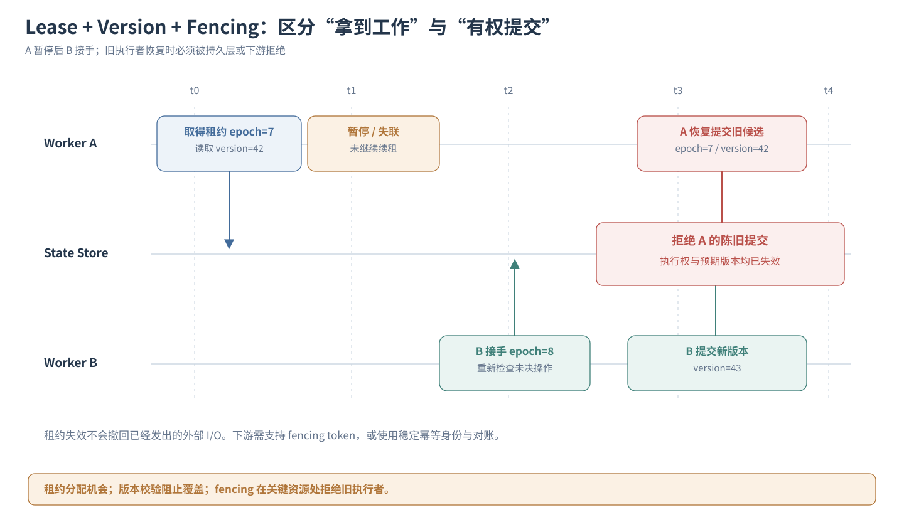

**图 6-6 Lease、Version 与 Fencing：分配执行权并拒绝旧执行者**

### 5.2 将状态、操作意图与待发送消息放进同一事务

一种常见实现同时使用数据库与消息队列：数据库记录 Run，队列把工作交给 Worker。这里存在一个双写问题：先更新数据库、再发送消息，进程可能在中间崩溃；先发送消息、再更新数据库，消费者又可能读不到已经承诺的状态。

Transactional Outbox（事务发件箱）把“状态变化”和“待发送的消息”写进同一个本地事务，再由独立投递器扫描 Outbox 并发布到队列。[3] 下例只展示事务边界，假设相关表位于同一支持事务的数据库中：

```python
def accept_operation(db, run_id, expected_version, owned_epoch, intent):
    # intent 已完成结构、权限、业务前提和预算检查。
    # operation_id 在进入此函数前已确定，提交重试时保持不变。
    with db.transaction() as tx:
        run = tx.lock_run(run_id)
        require_current_owner(run, owned_epoch, tx.now())
        require_version(run, expected_version)
        require_dispatch_allowed(run)

        tx.insert_operation_unique(
            operation_id=intent.operation_id,
            run_id=run_id,
            payload=intent.canonical_payload,
            payload_hash=intent.payload_hash,
            status="PLANNED",
        )
        tx.append_run_event(run_id, "OPERATION_REGISTERED", intent.operation_id)
        tx.insert_outbox_unique(
            message_id=intent.dispatch_message_id,
            topic="operation.ready",
            payload={"operation_id": intent.operation_id},
        )
        tx.advance_run_version(run_id)
```

事务提交后，即使进程还没发消息就退出，投递器仍能找到待发送记录。投递器也可能在“发送成功、尚未标记已发送”之间崩溃，因此接收端仍要接受重复消息。Outbox 主要消除本地状态与发送意图之间的丢失窗口，并不提供跨所有系统的恰好一次执行。

对于提交响应本身丢失的情况，调用方还应按已固定的 Operation 或命令 ID 查询本地记录，判断事务是否已经提交。唯一约束用于阻止重复创建，不能把唯一键冲突简单当作一次新的业务失败。

外部结果回到 Runtime 时也采用对应规则：在同一个事务中保存接收去重记录、更新操作结果、推进 Run，并写入必要的下一步 Outbox。这样，结果已经被承认时，后续推进不会只存在于某个消费者的内存里。

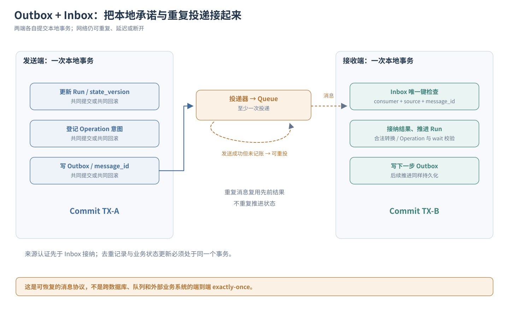

**图 6-7 Outbox 与 Inbox：把本地承诺与重复投递接起来**

### 5.3 Snapshot、Event Log 与操作台账各自保存什么

状态存储通常需要三种视角：

| 记录 | 主要用途 | 典型内容 |
| --- | --- | --- |
| **当前状态快照** | 快速回答任务现在在哪里、是否可调度 | status、phase、version、wait、budget |
| **状态事件记录** | 解释合法状态如何发生变化 | 取消请求、等待建立、结果接纳、目标修订 |
| **操作台账** | 追踪外部效果及其确认过程 | 操作身份、规范化参数、Attempt、已知结果、对账状态 |

**表 6-4 当前状态、事件记录与操作台账**

完整 Event Sourcing（事件溯源）要求以事件为事实源，能够按版本化规则重建状态；它会增加事件 Schema 演进、重放性能和迁移成本。许多团队可以先采用“当前快照 + 不可变关键事件 + 操作台账”，不必一开始就建设通用事件溯源平台。

无论采用哪一种方式，都应明确权威来源，避免两份记录各自修改、彼此矛盾。对执行控制有影响的关键记录，需要与当前状态在可解释的一致性边界内提交；它们不能只写入可能被采样或丢弃的普通日志。

状态管理建立了可靠的提交顺序。下一步要解决的是：停在某个提交位置的任务，换一台机器以后具体需要恢复哪些内容。

## 6. Checkpoint：保存可恢复位置，而不是冻结整个世界

Checkpoint（检查点）不是把 `messages` 序列化到磁盘，也不是给一个 Python 进程做无条件复活。它保存的是一个逻辑执行边界，以及从该边界继续工作所需的状态和依赖。[1][2]

### 6.1 一份可恢复检查点需要包含哪些内容

检查点至少需要关联 Run、状态版本、下一执行位置、操作台账、等待条件和必要的 Context State。若步骤依赖本地产物，还要保存可重新取得的制品，例如日志聚合结果、诊断脚本、配置快照或报告草稿。

```yaml
checkpoint_id: CP-42
run_id: RUN-11-01
state_version: 42
last_committed_event_seq: 118
next_step: collect_verification_window
execution_state_ref: state://RUN-11-01/42
context_state_ref: context://RUN-11-01/summary-07
operation_refs: [CHG-11]
artifact_manifest_ref: artifacts://RUN-11-01/manifest-09
compatibility:
  state_schema: 3
  runtime_definition: incident-runtime-v3
  tool_contracts: tools-2026-11-01
```

`artifact_manifest_ref` 还应指向包含内容哈希、版本、大小和权限范围的清单。仅保存 `/tmp/result.csv` 不足以恢复，因为原 Worker 退出时文件可能已经消失；仅保存一个可覆盖的对象地址，也不能保证恢复读到的是原始内容。

数据库与对象存储通常不共享事务。一种做法是先把制品写成不可变对象，确认可读取并校验哈希，再在数据库事务中提交清单引用和检查点。未被任何检查点引用的对象可以延迟回收；反过来先提交检查点再上传文件，会留下“检查点存在但恢复材料缺失”的窗口。

### 6.2 检查点无法消除外部副作用的崩溃窗口

回到 `CHG-11`，同样一次变更在不同时间崩溃，需要不同处理：

| 崩溃位置 | 本地能确认什么 | 恢复动作 |
| --- | --- | --- |
| 意图事务提交前 | 尚未承诺该操作可派发 | 在没有其他已提交命令的前提下重新决策或登记 |
| 意图与 Outbox 已提交，尚未派发 | 存在稳定操作身份与待处理意图 | 按原身份继续派发 |
| 已记录发送中，但不知请求是否到达 | 请求可能执行，也可能未执行 | 进入结果确认流程；必要时按契约使用原身份重试 |
| 下游已执行，本地尚未保存结果 | 外部效果存在，本地结果缺失 | 查询原操作并读回实际状态，不能另建变更 |
| 结果已提交，队列消息尚未确认 | 本地已拥有结果，消息可能重投 | 根据去重记录复用结果，不重复推进 |

**表 6-5 Checkpoint 周围的崩溃窗口与恢复策略**

这也是为什么“每一步结束后保存状态”仍然不够。动作结束与状态保存之间存在窗口；把检查点移到动作之前，只会把问题变成“有意图，但不知道是否已经执行”。Runtime 与外部业务系统没有共同事务时，需要幂等、状态查询和对账共同缩小不确定性。

检查点也不会冻结网络连接、浏览器登录态、沙箱进程或远端事务。浏览器任务恢复后可能需要重新登录并核对页面，代码执行可能需要重建环境，远端异步任务则应通过已保存的 Job ID 查询，不能假设原对象仍然可用。

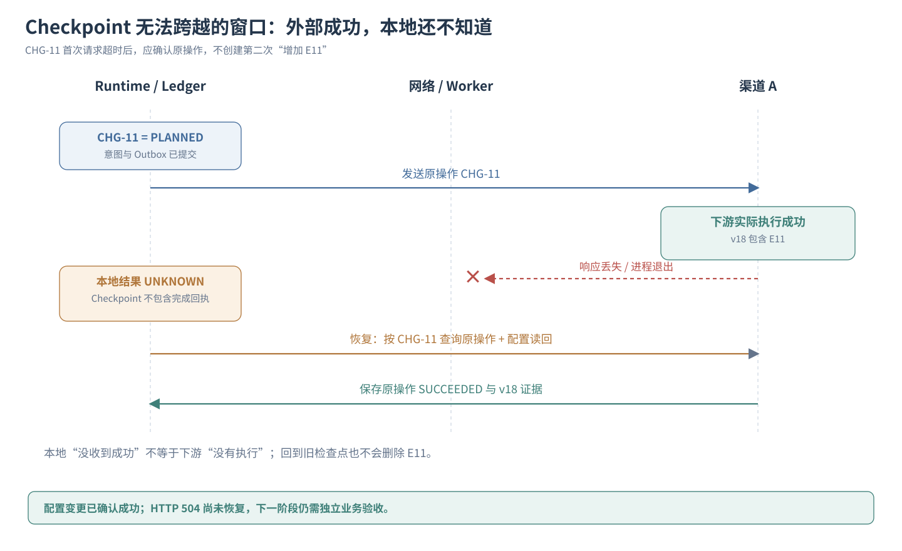

**图 6-8 Checkpoint 无法跨越的窗口：外部成功，本地还不知道**

### 6.3 Resume、Replay 和重新执行需要明确区分

**Resume（继续执行）**从已经提交的事实向前推进。它应先检查当前外部结果、等待条件和权限，再决定下一步，而不是从历史消息第一条开始重新跑。

**Replay（重放）**可能指两件事：用历史事件重建状态，或用保存的模型响应与工具结果复现控制路径。要保持可解释的重放，就应复用历史外部结果；重新调用模型或重新访问线上接口，会得到新的输出和现场状态，属于再次执行。

工作流引擎常通过事件历史重放控制逻辑，并复用已记录的活动结果；模型调用、当前时间、随机数和外部 I/O 需要放进可记录的活动或副作用边界中。若直接在要求确定性的控制代码里重新采样模型，历史重放可能走向不同分支。[2]

“从旧检查点分叉一个新 Run”也不是业务回滚。即使恢复到 `CHG-11` 之前，渠道 A 中的 E11 规则依然存在。新 Run 必须携带已有操作关系并重新核对现实状态；若要撤回，需要另行执行受控补偿。

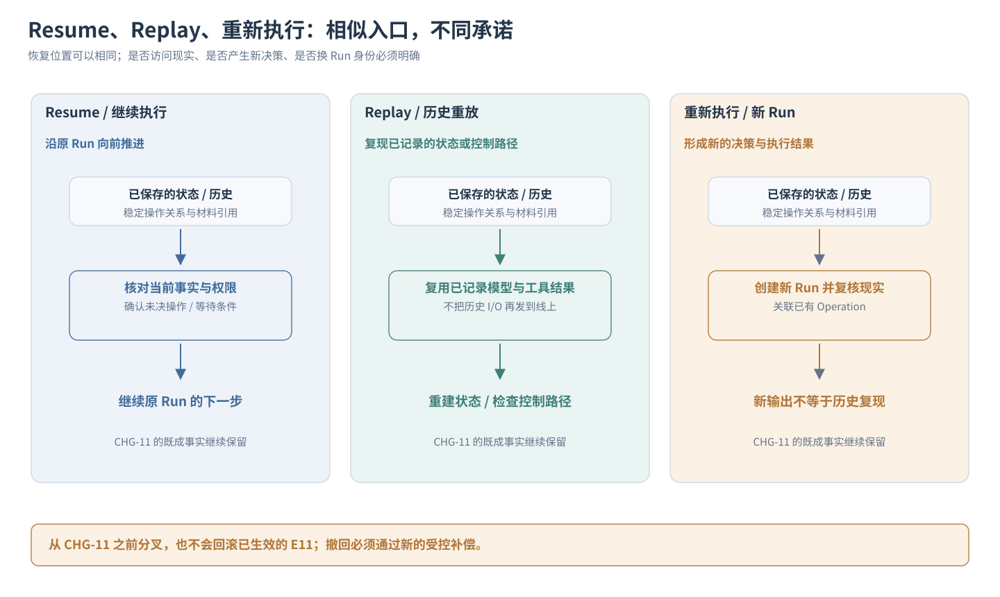

**图 6-9 Resume、Replay、重新执行：相似入口，不同承诺**

### 6.4 恢复前检查版本兼容性与运行前提

任务可能运行数天，期间 Runtime、Prompt、工具 Schema 或业务规则已经升级。恢复程序应检查状态 Schema 和执行定义是否兼容：可以固定旧定义继续运行，也可以通过显式迁移生成新状态版本；不能把旧状态静默交给不兼容的新代码。

Prompt、模型和工具版本同样需要记录。它们的变化不一定使恢复不可能，但会改变后续决策行为。若必须切换模型，应把切换作为执行事件保存，并重新评估输入和预算，不能把新的决策当成对旧结果的严格重现。

恢复过程还要重新核验现时权限、凭据、资源归属与证据时效。检查点保存“当时批准过什么”，不会让过期审批永久有效。保留期也应覆盖最长运行时间和可能的对账周期，否则系统虽然保存了恢复位置，却已经删掉所需的材料。

有了可靠的恢复边界，任务就可以跨进程、跨小时甚至跨天推进。接下来需要控制的，是这种持续执行的资源占用与进展质量。

## 7. 长任务执行模型：把长时间拆成有界工作与持久等待

任务持续三小时，不代表模型应该连续推理三小时。长任务可能只有几分钟计算，其余时间在等待数据、配额、部署完成或人工反馈。运行模型应当把“需要计算”和“等待条件满足”分开。

### 7.1 用阶段交付物承接长程进度

`TASK-11` 可以包含证据收集、变更处置、效果验收和报告交付几个业务阶段。本章不讨论模型如何规划这些阶段，而关注阶段之间传递什么：已经确认的事实、仍未排除的假设、操作结果、后续前提与可回查制品。

例如，离开变更阶段时，系统应该留下 `CHG-11` 的结果、v18 配置快照和验收计划；不能只留一句“白名单已修复”。后者容易让下一轮把“配置已改变”误读成“故障已消失”。

阶段边界也适合安排检查点、上下文压缩和人工检查。压缩可以删除重复日志描述，但不能删除正在等待的回执身份、未决变更或已否定假设的证据引用。

### 7.2 持久等待让 Worker 可以离开

设 Runtime 需要在 14:15 之后采集一个完整观测窗口。它应保存 `wait_id`、最早唤醒时间、截止时间和恢复位置，再把 Run 置为 `WAITING` 并释放执行权。持久计时器到期后生成事件，由 Scheduler 将任务重新放入就绪集合。

这与在 Worker 中 `sleep(300)` 的差别在于，等待记录不依赖进程存活；调度器重启也可以扫描未触发或逾期的计时器。为了容忍重复扫描，计时事件需要稳定身份，唤醒时还要确认该 `wait_id` 仍然有效。

短暂的网络退避可以留在进程内完成，但等待外部任务、长时间限流或人工输入，应使用可持久化的等待机制。一次执行权通常只覆盖一个有界工作段，结束时提交结果或等待状态，使多个任务能够公平共享 Worker。

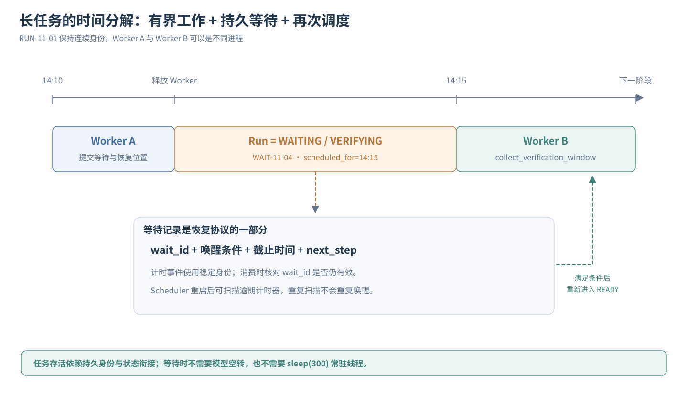

**图 6-10 长任务的时间分解：有界工作、持久等待与再次调度**

### 7.3 同时约束时长、成本、并发和无进展次数

长任务至少有四种不同时间：用户等待的总时长、Worker 活跃执行时间、单次调用时间，以及没有有效进展的时间。只设置一个 HTTP 超时，无法覆盖它们。

| 约束 | 解决的问题 | 示例处理 |
| --- | --- | --- |
| **Run deadline** | 限制任务总时间，包括正常等待 | 到期停止新业务动作，生成未完成交付并进入收尾 |
| **Attempt timeout** | 避免一次调用长期占用资源 | 中止本地等待，按工具语义确认是否存在未知结果 |
| **调用与费用预算** | 限制循环、重复调用和并发成本 | 派发前预留预算，响应后按实际消耗结算 |
| **并发配额** | 避免同时压垮模型和下游系统 | 限制每 Run、租户和目标服务的在途请求数 |
| **无进展阈值** | 识别重复查询、无效纠偏和循环计划 | 要求新证据或升级处理，而不是无限追加模型轮次 |

**表 6-6 长任务的多维执行约束**

并发调用时，“已经花了多少钱”不够，还要统计已经预留但尚未结算的成本。可用预算近似为：

$$
B_{available}=B_{limit}-B_{settled}-B_{reserved}
$$

预留应在共享存储中原子完成，覆盖重试和废弃响应；实际费用回填后释放差额。估算仍可能偏差，因此需要为停止与结果确认预留余量。不能让普通模型调用耗尽预算后，系统连已发送变更的状态都无力确认；关键对账可以由独立、受限的运维预算承担。

“有进展”也应有业务含义，例如新增有效证据、缩小未决问题、完成验收窗口或解除依赖。Worker 仍然发心跳、模型仍然输出文字，都不等于任务正在接近目标。

### 7.4 对过期证据重新观察，对已完成动作保留身份

任务暂停数小时后，配置可能已被他人修改，监控窗口也已经失去现时意义。恢复时应根据证据类型检查新鲜度：历史变更回执仍然能证明当时的动作，旧监控值却不能证明现在恢复，旧预检也不能保证当前条件仍满足。

因此，恢复时应保留已经发生的动作，刷新失去时效的观察，并重新评估剩余步骤的前提。对于持续数天的任务，还需要关注另一种增长：执行历史本身越来越大。

### 7.5 限制历史增长，并显式交接下一段执行

上下文压缩只能减少模型输入，不能自动减少状态事件、操作记录或工作流引擎的重放历史。运行时间很长、事件很密集的任务，可以在安全边界轮换执行段：把当前目标、有效证据、剩余预算、订阅游标和未决操作清单交给后继段，并保留完整的关联关系。

Temporal 的 Continue-As-New 就提供了一种具体实现：保留 Workflow ID，启动具有新 Run ID 和新事件历史的执行。[11] 本章的 Task/Run 是应用层定义；接入这类引擎时，应显式映射应用 Run 与引擎 Run，不能假设所有框架里的同名对象都拥有相同生命周期。

轮换边界最好选择没有未决副作用的位置。确实需要携带在途操作时，必须交接操作身份、结果路由与责任归属，确保回执不会送到已经停止接收的执行段。预算也要继承，不能每换一个 Run 就重新获得全部配额；历史归档和对账记录保留需要分别处理。

到这里，长任务已经具备分段、等待、约束和交接机制。对于执行中失败的步骤，接下来还需要区分哪些允许重试、哪些需要对账，以及哪些必须停下来处理。

## 8. Retry、幂等与失败恢复：先判断发生了什么，再决定是否重做

重试不是一个通用的 `except: retry()`。在 Agent 中，失败既可能来自网络，也可能来自模型选择、参数语义、权限、环境变化和业务目标未达成。把这些问题统一交给模型“再想一次”，会掩盖已经发生的副作用；把它们统一交给 SDK 自动重试，则可能不断发送同一个错误操作。

### 8.1 按失败语义选择恢复路径

| 失败类别 | 能确认什么 | 合适的处理方式 |
| --- | --- | --- |
| 模型限流或临时服务不可用 | 本次决策尚未被接纳为动作 | 按配额、截止时间和重试策略延后调用 |
| Schema 或参数校验失败 | 请求没有进入外部执行 | 提供结构化错误，允许有限次修正 |
| 业务版本冲突 | 预检条件已变化 | 重新读取相关状态，必要时重新审批 |
| 权限拒绝 | 当前主体无权执行 | 停止该路径，补充授权或调整目标 |
| 只读查询超时 | 未获得可信结果 | 在读取契约允许范围内重试，记录新的采集时间 |
| 有副作用调用超时 | 可能执行，也可能未执行 | 查询原操作、等待回执或对账；避免盲目重复 |
| 已确认的业务失败 | 根据接口契约，操作已终止；可能仍需检查部分效果 | 处理前提、分项结果或补偿，再决定后续 |
| 工具成功但验收未通过 | 动作完成，目标未实现 | 继续诊断或受控撤回，不能重复同一变更假装重试 |

**表 6-7 失败语义与恢复决策**

传输重试与语义修正要分开记录。模型把错误参数改成新的参数，是一次新的决策；如果变更意图本身发生变化，需要重新校验并分配适当的新操作身份。网络重发同一个已经批准的意图，则沿用原 Operation，并创建新的 Attempt。

### 8.2 指数退避需要随机抖动和总量限制

对于可重试的暂态错误，可以采用带随机抖动的指数退避：[5]

$$
d_n \sim U\left(0,\min(d_{max},d_0\cdot2^n)\right)
$$

其中 $n$ 从 0 开始表示重试序号。随机抖动避免大量任务在同一时刻重新冲击已经过载的服务；有有效 `Retry-After` 时，还应遵循服务端约束。实际等待不得突破 Run 截止时间，并应纳入持久调度。

重试总量必须跨层核算。假设 Runtime 最多尝试三次，适配器每次又尝试三次，HTTP SDK 每次再尝试三次，最坏可能产生 27 次请求。应明确哪一层负责重试，其他层保留必要的传输处理并暴露尝试次数，避免错误放大。

短时重试失败后，熔断与限流负责保护依赖；它们不会修复任务本身。任务应进入有截止时间的等待、降级或人工处置路径，并记录尚未完成的目标。

### 8.3 幂等需要操作身份、参数绑定与下游原子性

一个完整的幂等契约至少包含以下内容：[4]

1. **稳定身份**：首次提交前固定 Operation ID，在消息重投、调用重试和 Run 恢复时保持不变。
2. **作用域**：幂等键需要包含或绑定租户、业务主体和操作类型，防止不同业务误用同一键。
3. **参数绑定**：同一身份只允许同一规范化意图；相同键携带不同参数时应拒绝。
4. **原子执行**：下游去重记录与业务效果需要处于可靠的一致性边界内，或由可恢复的业务状态机保证。
5. **结果复用**：重复请求能够返回原操作状态或结果，包括处理中状态，而不是再创建一份工作。
6. **保留期限**：去重记录和结果查询能力至少覆盖允许的重试、离线恢复与迟到消息范围。

如果下游只保留 24 小时幂等记录，而 Run 在第三天恢复，复用同一个键也可能重新产生业务效果。此时不能继续假设去重有效，应转为查询业务实体、核对既有结果或人工处理。接口契约没有提供这些能力时，Runtime 必须承认自动恢复范围有限。

本地先查询“有没有执行过”，再向远端发送请求，也不能构成原子防重：两次查询都可能得到没有记录。真正有副作用的系统需要在自己的写入边界识别重复，或者提供可验证的条件更新语义。

### 8.4 `UNKNOWN` 是需要管理的事实缺口

当 `CHG-11` 首次超时，Runtime 保存 `UNKNOWN`，随后按原 ID 查询。若下游回答处理中，就继续等待；确认完成后保存原结果并读回配置；确认失败且说明没有产生效果时，才依据契约判断是否可以重试。

如果接口返回“找不到”，还要理解这个结论的范围：查询索引可能延迟，操作可能仍在队列里，或者结果已超出保留期。只有接口契约足以证明该 ID 不会再执行时，才能把不存在视为确定未执行。否则，短暂的未查询到仍然不能成为重复变更的理由。

对账（Reconciliation）负责把本地记录与远端事实重新对应起来。优先按操作 ID 查询，其次使用带唯一关联的业务记录；仅靠“当前配置看起来一样”不一定能确认是谁完成的变更。确实无法归属时，应保留证据缺口，交给明确的处理责任人。

### 8.5 补偿是新的受控动作，不是抹去历史

若后续判断 E11 规则应撤回，补偿操作需要自己的 Operation ID、当前状态检查、授权与执行结果，并关联原来的 `CHG-11`。[7] 不能因为原变更已批准，就默认任何撤回方式都被批准。

例如，撤回前发现另一个实例已经依赖 E11，直接删除整条规则可能扩大故障。补偿应尽可能针对本次变更增加的内容，核对资源版本和新依赖；无法安全撤回时应暂停并升级处理。补偿本身也可能超时，需要同样的幂等与对账机制。

失败恢复最后回到一个顺序：先确认事实，再判断是否允许继续，最后才选择重试、改计划或补偿。接下来将这套顺序放进异步消息环境，处理回执重复、乱序和迟到带来的执行问题。

## 9. Async Execution：由事件唤醒，而不是由模型空等

同步调用适合快速返回的小操作；当工具会等待部署、长时间分析、人工确认或外部批处理时，持有 HTTP 连接和 Worker 直到完成既浪费资源，也让客户端断开被误当作任务终止。

异步执行需要把“提交任务”与“等待结果”分离：提交阶段返回持久身份，后续事件推进操作和 Run 状态。语言里的 `async/await` 只能帮助调度进程内的并发工作；进程崩溃后是否还能继续，取决于这些身份、结果和等待条件是否已经持久化。

### 9.1 先登记异步操作，再把控制权交给队列

例如，下游指标平台提供长时间范围聚合任务。Runtime 先创建 `operation_id=OBS-11-03`，保存查询范围、指标定义与当前状态，再通过 Outbox 派发。外部系统返回 `job_id=METRICS-8921` 后，Runtime 记录映射并让 Run 等待该 Job 的完成事件；Worker 不需要为此保持常驻。

一个异步接口可以返回：

```json
{
  "operation_id": "OBS-11-03",
  "status": "ACCEPTED",
  "remote_job_id": "METRICS-8921",
  "status_query_ref": "/jobs/METRICS-8921",
  "next_action": "WAIT_FOR_RESULT"
}
```

`ACCEPTED` 仅表示任务被接收，后续仍可能失败或部分完成。若接口先返回受理、稍后才给远端 ID，受理记录也必须先在本地落库；回调中的关联字段应足以找到这个待关联的操作。创建远端 Job 的请求本身也可能超时，接口应支持按本地操作身份查询或幂等受理，避免重复创建耗时任务。

还有一个容易遗漏的竞争窗口：外部回调可能先于提交请求的响应到达。接收端应能按预先持久化的 `operation_id` 保存结果；建立等待记录时，应先检查结果是否已经存在。两条路径必须锁定同一条协调记录，或以相同的状态版本进行条件提交，让“检查结果并建立等待”和“保存结果并消费等待”串行生效；仅仅各自开启事务仍可能同时读到旧状态。否则，“结果先到、等待后建”会让一个已经完成的操作永久停在等待状态。

对于同一 Run 内的独立只读任务，可以有界并发，但汇合条件应明确要求全部完成、部分完成还是达到证据门槛；多个写操作则需要额外声明资源冲突与执行顺序。

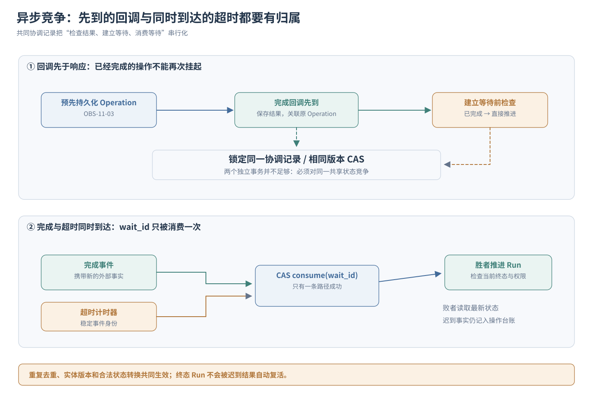

**图 6-11 异步竞争：先到的回调与同时到达的超时都要有归属**

### 9.2 Inbox 去重只能与状态推进一起生效

消息通常至少投递一次。接收端应先完成来源认证、签名与租户校验，再在一个本地事务里检查消息 ID、保存去重记录、校验 Operation 状态并推进 Run。认证失败的输入不能占用合法消息的去重身份；事务内的关联或语义校验失败时，应回滚接纳操作，必要时另存隔离的拒绝记录。

```sql
BEGIN;

INSERT INTO inbox_messages (consumer, source, message_id, received_at)
VALUES (:consumer, :source, :message_id, CURRENT_TIMESTAMP)
ON CONFLICT (consumer, source, message_id) DO NOTHING;

-- 来源认证已经通过。只有本次成功插入时，才校验关联操作与结果版本；
-- 接纳操作事实后，独立判断当前 Run 和 wait_id 是否允许继续推进。

COMMIT;
```

若消息重复，事务中应返回先前处理结果，不再重复推进。若 Inbox 先独立提交，进程却在更新状态前崩溃，重投会被当成重复而跳过，结果永久丢失。因此，去重记录与对应业务状态提交必须处在同一个事务边界。来自不同生产者的消息 ID 可能相同，去重键还需要来源作用域；CloudEvents 也以 `source` 与 `id` 的组合作为事件身份，但事件格式本身不保证业务执行幂等。[10]

如果消息处理后还要调用另一个外部服务，不能把该网络请求留在 Inbox 的数据库事务里。应以 Outbox 登记下一项操作，让另一个有明确身份的执行阶段完成 I/O。

### 9.3 乱序和迟到事件按实体版本处理

回执顺序不一定与发送顺序相同。例如，旧查询 Attempt 1 超时后，Attempt 2 已经确认指标结果；稍后 Attempt 1 的失败通知才抵达。较晚到达不等于更新，也不能覆盖已经确认的结果。

每个执行事件应携带来源、`message_id`、`operation_id`、`run_id`，并在可以取得时记录 `attempt_id` 和来源端版本。时间戳用于辅助诊断，不能依赖不同机器的时钟判断严格先后；没有可靠版本时，应结合状态图与权威状态查询处理冲突。终结结果不能被较旧的处理中状态回退，迟到的外部成功回执则可以补齐原 Operation 的真实结果。旧 Worker 无权提交新决策，并不意味着可以丢掉它曾经发出请求的真实回执。

如果 `RUN-11-01` 已经取消，迟到的变更完成回执仍应把 `CHG-11` 更新为成功，并触发必要的对账提示；它不能让 Run 回到 `READY`，也不能自动重启后续验收。若这项事实意味着目标需要继续处理，应建立明确的新 Run 或人工处理任务。

### 9.4 事件唤醒与轮询各有适用范围

有些下游支持带签名的回调，有些只提供状态查询。回调及时，但需要防伪造、重放、乱序和失效地址；轮询更容易部署，却要控制查询频率并承受恢复延迟。常见组合是：回调作为快速唤醒，持久计时器作为超时检测，状态接口作为最终事实来源。

若采用轮询，应保存下次查询时间并逐渐拉长间隔，同时尊重下游限流和总截止时间。重启后无需从某个内存循环恢复，Scheduler 只需要找到逾期的持久计时器。

当同一个等待条件的完成事件与超时计时器同时到达，只有一个应成功消费该 `wait_id`；另一个读取最新状态后，不再重复唤醒 Run。迟到结果如果带来新的外部事实，仍需写入操作台账。状态版本、消息去重和合法转换共同构成这条规则。

异步协议让任务可以释放 Worker，但它还需要明确谁会创建任务、什么时候创建。下一节区分用户交互触发、受控后台触发与不受约束的主动行动。

## 10. Background Agent：持久触发与主动运行的边界

“后台 Agent”可以指用户关闭界面后仍继续执行的任务，也可以指由告警、日历或监控周期主动创建的任务。前者是执行持续性，后者还包含触发授权；两者不应混成一个“Agent 自己会醒来”的能力。

### 10.1 定义合法的触发源和触发范围

常见触发源包括：

- 用户明确提交的 Run，按已声明目标在后台继续。
- 受监控服务发布的告警事件，创建限定服务和时间范围的排查任务。
- 经过审核的定时规则，例如每天输出指定范围的容量摘要。
- 另一个执行系统发出的状态变化或任务依赖完成事件。

触发规则应声明发起主体、目标范围、最大并发、频率、可调用工具集、费用上限和停止条件。对于同一告警重复发送，可以基于告警实例 ID 或服务、指纹、时间窗口构造去重键；触发去重不是动作幂等，前者阻止重复创建 Run，后者防止同一 Run 重复产生副作用。

告警内容和抓取到的网页属于 Observation，可能包含提示词注入或不可信命令。触发只创建被授权范围内的任务，不应让告警正文授予新权限或扩大工具集合。后台运行可以没有当前用户在线，但仍须有清楚的责任主体和策略。

### 10.2 调度公平性与执行隔离决定平台能否持续运行

后台任务容易挤占交互流量或形成任务风暴。调度器需要按照租户、优先级和目标系统实施并发上限与公平队列；依赖过载时暂缓非关键任务。长等待 Run 应占用存储记录，而不是 Worker 槽位。

工具执行仍应采用第 5 章讨论的沙箱和最小权限。后台任务执行到危险阶段时，如果原授权已失效或策略版本改变，应暂停并重新校验，不能因为任务是由历史事件创建就继承无限期权限。

取消一个 Run 与停用一个触发规则是不同操作。取消仅表示停止当前执行，下一次定时触发是否继续应明确展示；用户要求停止整个后台任务时，则要禁用触发源并按策略处理已创建的 Run。系统应能够追踪 Trigger ID 到 Task、Run 和操作的关系，并允许责任人查找和暂停触发源。

### 10.3 用变化触发动作，并给出明确的停止条件

如果后台 Agent 连续若干周期没有获得新证据，可以降低频率、暂停并请求人工判断；如果每次任务都只是重复检查同一个状态，就应修正触发器或停止它，而不是用更多模型轮次掩盖无进展。

持续监测可以保存最近确认的业务状态、事件游标和通知指纹，把“发现变化”与“采取动作”分成两个阶段。告警重复时更新已有事故的证据，状态真正恢复或需要人工决定时才产生相应通知；通知也是一种外部副作用，需要身份与防重。若通过增量游标消费事件，应与本地处理结果一起提交游标，避免提前推进后丢失事件。

定时规则还应声明时区、错过触发后的补跑策略，以及上一轮尚未完成时是跳过、合并还是排队。长期停机后无上限地补跑所有周期，可能瞬间制造任务风暴；所有补跑都应重新检查当前目标和预算。对临时事故创建的监测任务，可在恢复条件确认、期限到达或责任人关闭事故时结束，并清理对应订阅与计时器。

这类主动运行的效果仍需第 8 章评估体系检验。本章只要求它满足执行层的边界：所有运行有期限、预算和责任归属，触发行为可去重，任务终结后不会留下无人管理的在途操作。

后台触发说明系统何时可以开始做事；涉及高风险副作用时，还需要处理谁可以批准和如何让任务安全地等待人的决定。

## 11. Human-in-the-loop：把人的决定接成一个执行事件

人工参与包括补充事实、确认目标、批准操作和接管处置，它们对应不同的执行事件。对于高风险操作，仅保存一个布尔值 `approved=true` 不足以安全恢复；审批对象、执行版本和结果都必须可关联。

### 11.1 审批请求绑定不可变的动作意图

审批记录至少应绑定：

- Task、Run、Operation 和待批准的步骤身份。
- 目标资源、规范化参数及其参数指纹。
- 预检结果、相关资源版本和执行前置条件。
- 申请者、审批人授权范围、有效期和策略版本。
- 审批意见与最终决定的时间、身份和签名信息。

以 `CHG-11` 为例，批准“给渠道 A 增加 E11”不等于批准把 E12 也加入，或把范围扩大到所有渠道。若目标版本已从 v17 变化，或审批等待期间参数、策略或目标范围发生修订，Runtime 应重新核验；实质变化需要新的预检和批准。

### 11.2 消费批准结果时再次校验并原子登记

审批服务发回事件后，Runtime 验证事件来源、审批权限、有效期与绑定指纹，再把审批结果登记为一次不可变事实。派发操作时，还要以条件事务确保批准未被撤销、操作仍处于同一版本并且尚未被消费。

若审批系统与运行数据库之间没有共享事务，可在一个本地事务中保存 Inbox 去重记录、批准事实和后续待处理工作；派发阶段再以条件事务把该批准绑定到原操作。批准的“一次消费”表示只授权这一个逻辑操作，不能导致同一操作的安全传输重试重新申请审批，也不能让它授权另一个操作。

若审批撤销与操作派发存在竞态，需要明确授权生效的时点。共享版本或目标服务端的最终校验可以裁决竞争；短期授权只能缩小过期窗口，不能独自保证即时撤销。已经被目标服务接受的操作，后续撤销批准通常只能阻止新动作，不能撤回已发生的效果。

特别是高影响操作，下游服务仍应在实际变更事务里执行最终授权和版本检查。审批服务中的一次通过不能替代目标系统的实时访问控制。

### 11.3 将暂停原因、请求内容和唤醒条件显示给人

当任务进入 `WAITING` 等待审批时，人工界面应呈现目标资源、拟执行参数、影响范围、证据和预期副作用。交互控件至少提供明确的批准、拒绝或请求修改结果，以及回答后会发生什么；不能只露出模型的一段自然语言总结。

审批者请求修改时，应产生新的目标修订或动作意图，再从校验和预检阶段继续；不能在旧审批记录里原地改参数。拒绝时 Run 可以进入失败或关闭状态，也可以等待重新规划，但需要由明确定义的产品策略决定。

人工提供的信息也有来源身份和有效范围，应作为事件纳入上下文。一次授权不能自动变成跨任务的用户偏好或永久工具权限。

### 11.4 超时与接管同样需要恢复协议

人工等待应有截止时间和处理规则：到期后停止动作、通知责任人或升级到指定队列，不能默认视为批准。记录仍然存在时，迟到的批准事件也要重新校验有效期和 Run 状态，不能直接唤醒已取消的执行。需要提醒审批者时，提醒本身应去重，避免任务每次恢复都发送一次通知。

人工接管时，Runtime 应暂停新动作派发，明确在途操作，并把控制权转移记录下来。接管者直接修改了现场后，恢复 Agent 之前要核对变更记录、重新读取相关资源并使旧计划失效。无法确认人工做过什么时，应保留待核对状态，不能仅凭一句“继续”沿旧检查点执行。

还要核对所用框架的中断恢复边界。例如 LangGraph 的 `interrupt` 恢复会从被中断节点开头重新执行，节点中断之前的代码可能再次运行；有副作用的工作应放进独立持久步骤，或具备严格幂等语义，不能把中断误解成冻结调用栈后从下一行继续。[9]

审批建立的是人在系统中的控制点。要检查它是否按预期工作，还需要一条从请求、事件到外部结果都连得起来的观测路径。

## 12. Agent Trace：从可观察到可恢复

一次多步执行往往跨模型服务、任务队列、多个工具和人工系统。只查看最终答案，无法知道任务是停在了限流、等待回执还是业务验收失败；只看分布式 Trace，也不能把它当成状态机账本来恢复任务。

### 12.1 沿 Task、Run、Step、Operation 建立关联

Agent Trace 可以沿用 OpenTelemetry 的 Trace、Span 与 Event 组织方式，并增加 Agent 特有的执行身份和结果字段。[8]

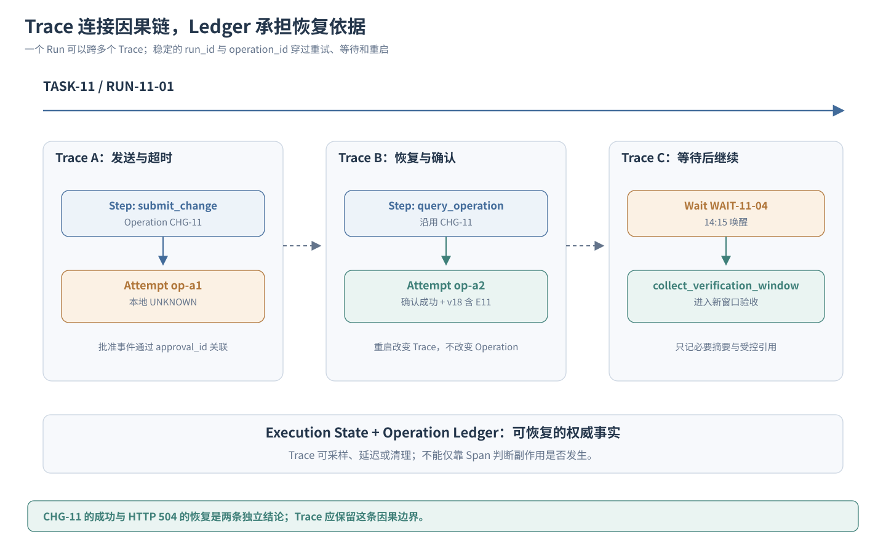

**图 6-12 Trace 连接因果链，Ledger 承担恢复依据**

`trace_id` 适合关联一次分布式因果链，`task_id` 关联用户目标，`run_id` 关联一次执行，`operation_id` 关联外部业务动作。跨数小时或数天的任务可能拆成多个 Trace，但应持续传递 Run 和 Operation 关联字段，不要假设一个 Trace 必须覆盖整个生命周期。

Span 可以记录调用者、耗时、状态、重试次数、状态版本、输入输出摘要与证据引用。涉及敏感内容时，不应为了“可观测”而默认记录完整提示词、凭据和大段原文；需按数据分类、访问控制、脱敏和保留策略保存。为了复查当时上下文，可以保存受控的不可变输入材料引用和摘要哈希，而不必让普通运维日志暴露全部正文。

Trace 关注耗时、依赖和因果关系；Execution State 与 Operation Ledger 决定下一步能否恢复。Trace 可能被采样、延迟或清理，所以不能用来判断一次写入是否发生，也不能从零散 Span 重建已完成的业务事实。模型可见的推理摘要可以按产品需要保存，但系统不应承诺得到完整、可信的内部思维过程；审计应聚焦输入来源、决策候选、门禁、外部动作与结果。

### 12.2 观察运行控制信号，而不只观察模型指标

最小运行视图应覆盖：

| 维度 | 建议观测信号 | 可能定位的问题 |
| --- | --- | --- |
| 生命周期 | 各 Run 状态数量、最长等待时间、终态分布 | 等待未唤醒、任务泄漏、异常终结 |
| 调度 | 队列延迟、租约续约失败、重新领取次数 | Worker 不足、竞争、执行权震荡 |
| 操作 | `UNKNOWN` 数量与年龄、状态查询成功率、重复接收数 | 下游结果无法确认、对账积压 |
| 预算 | 每 Run/租户实际与预留成本、重试成本 | 循环和预算耗尽、后台任务挤占 |
| 状态质量 | CAS 冲突、非法转换、状态 Schema 版本 | 并发设计或迁移缺陷 |
| 业务交付 | 验收通过率、证据缺失率、超时未完成比例 | 执行成功但未达成用户目标 |

**表 6-8 运行观测从调度状态延伸到业务交付**

“模型调用成功率”只能解释决策服务是否可用；“工具请求成功率”也只覆盖 I/O 的一部分。真正回答 Agent 是否履行任务，需要将结果与任务验收条件和证据关联。指标按服务、租户和任务类型聚合时，还要避免高基数 ID 直接作为时序标签；详细 ID 留给有访问控制的日志或 Trace 查询。

### 12.3 用故障注入验收恢复路径

恢复能力需要通过故障场景验证，而不是只检查 Checkpoint 表里有数据。可在沙箱或测试环境对每个持久化边界注入崩溃，并验证不变量：

| 注入位置 | 验收结果 |
| --- | --- |
| Outbox 事务提交后、派发前 | 重启后重新发现已登记 Operation；当前状态、授权与期限仍允许时继续派发 |
| 外部动作完成后、结果提交前 | 恢复后按原 Operation 确认结果，不创建重复业务效果 |
| 消息业务处理后、确认消息前 | 重投不会重复推进 Run |
| 租约到期后旧 Worker 恢复 | 旧 epoch 不能提交新状态或授权新动作 |
| Run 取消与回执同时到达 | 操作账本接纳真实结果，Run 不被迟到消息复活 |
| 审批有效期内资源版本变化 | 过期预检或不同参数不会被执行 |
| 去重记录接近保留期后恢复 | 系统拒绝盲目重放，先对账或升级处理 |

**表 6-9 执行恢复的故障注入验收点**

测试环境中的假服务应能记录实际副作用次数、消息顺序和参数指纹；只验证 HTTP 返回码，不足以证明没有重复写入。测试还应包含正常允许路径，避免系统通过永久拒绝动作看似实现了安全恢复。

### 12.4 按一条故障时间线检查各层是否一致

把 `CHG-11` 的过程完整放回运行视图，可以验证各节设计是否相互吻合。下表在第 5 章已有分支上增加一次教学性的 Worker 故障，不改变变更与业务验收的结论：

| 时点 | 发生的事情 | 必须保留下来的事实与后续责任 |
| --- | --- | --- |
| T0 | 模型提出增加 E11，预检和审批完成 | 批准绑定渠道 A、E11、v17 与稳定操作身份 `CHG-11` |
| T1 | 意图、Outbox 和状态版本提交 | 进程退出也不会丢失派发意图 |
| T2 | 下游完成变更生成 v18，但首次响应丢失 | 本地记录结果未知；不能由超时推断未执行 |
| T3 | Worker A 退出，租约到期 | Worker B 获得新 epoch，发现待确认的 `CHG-11` |
| T4 | B 查询原操作并读回配置 | 确认变更成功，保存 v18 证据，不再次增加规则 |
| T5 | 验收窗口仍显示 504 偏高 | Run 保持目标未完成，保存 `WAIT-11-04` 并释放 Worker |
| T6 | 计时器到期，另一 Worker 接手 | 校验等待身份，刷新指标，再决定继续诊断或等待人工 |

**表 6-10 从操作超时到等待下一次验收的完整执行链**

如果运行视图在 T2 显示“变更失败”，或在 T4 显示“故障已恢复”，就说明操作语义和业务验收被混淆；如果 T5 之后只有一段模型承诺“稍后检查”，却没有持久计时器，则后台持续执行还没有真正建立。沿同一条时间线检查模型输出、提交记录、外部事实和调度状态，比孤立检查某个接口更容易发现系统断点。

Trace 帮助找到链路位置，状态与操作记录帮助恢复，故障注入检验崩溃边界。最后再把这些工程状态转换成用户能够理解的交付结论。

## 13. 本章总结：执行持续性来自状态与恢复协议

第 5 章确认 `CHG-11` 已将渠道 A 的规则从 v17 更新为 v18，也确认配置中包含 E11；后续指标尚未满足恢复阈值。第 6 章把这个中间结果放进一个持久执行模型：Run 保存目标、当前阶段、等待条件与预算，Operation 保存真实外部效果，Context State 为下一轮模型提供必要视图；Worker 按租约领取工作，在明确的状态版本上推进，等待期间释放资源。

对 `TASK-11`，在教学验收窗口仍显示 504 偏高时，一份准确的当前交付可以写成：

> **执行状态：** `RUN-11-01` 当前处于 `WAITING / VERIFYING`；`CHG-11` 查询确认成功，规则版本 v18 的配置读回包含 E11。
>
> **业务验收：** 后续窗口的 504 指标尚未达到预设恢复阈值，当前证据不支持“故障已解决”的结论。Run 保持进行中，等待下一完整观测窗口后继续检查。
>
> **恢复与关联：** 下一执行位置为 `collect_verification_window`；等待条件为 `WAIT-11-04`；本轮证据引用及成本预算与 `RUN-11-01` 关联。Worker 重启不会重新提交变更，也不会清除该未完成目标。

围绕这一交付，本章的工程要点可以压缩为几条可检查的不变量：

- Task、Run、Step、Attempt 与 Operation 使用不同身份；恢复重试保留逻辑操作身份。
- Execution State 决定控制流，Context State 服务于下一轮决策；摘要不能覆盖权威执行事实。
- Run 与外部 Operation 分开管理；`UNKNOWN` 是需要确认的状态，不等于失败。
- 状态推进采用版本校验与执行权门禁；过期 Worker 不能覆盖新结果。
- 本地状态变化与待发送工作使用事务发件箱；重复消息在同一事务边界去重。
- Checkpoint 保存逻辑恢复位置，但不回滚或冻结外部环境。
- 长等待写成持久条件；重试、并发、费用和无进展时间都有预算。
- 业务目标只有满足验收条件才算完成；取消也需要处理在途操作与迟到结果。
- Trace 负责可观测和定位，状态账本负责恢复，故障注入负责验证恢复协议。

第 5 章回答了模型动作如何通过工具访问外部系统；本章说明这些动作怎样在长时间、失败与并发中继续执行。下一章将进入 Agent Reasoning & Orchestration，讨论模型如何规划和拆解复杂目标，以及确定性流程应当把哪些选择交给模型。

## 14. 参考研究与延伸阅读

1. **LangChain**. [Checkpointers — LangGraph](https://docs.langchain.com/oss/python/langgraph/checkpointers). 介绍 checkpoint、pending writes 与持久化恢复；用于理解框架中的检查点边界，具体语义以相应版本为准。
2. **Temporal Technologies**. [Temporal Workflow Execution overview](https://docs.temporal.io/workflow-execution) 与 [Workflow Definition: deterministic constraints](https://docs.temporal.io/workflow-definition#deterministic-constraints). 介绍执行身份、生命周期，以及重放对控制逻辑确定性的要求。
3. **Amazon Web Services**. [Transactional outbox pattern](https://docs.aws.amazon.com/prescriptive-guidance/latest/cloud-design-patterns/transactional-outbox.html). 说明如何处理数据库更新与消息发送的双写问题，以及为何消费者仍需处理重复消息。
4. **AWS Builders' Library**. [Making retries safe with idempotent APIs](https://aws.amazon.com/builders-library/making-retries-safe-with-idempotent-APIs/). 讨论调用者请求身份、重复请求、参数不一致和迟到请求等幂等契约问题。
5. **AWS Builders' Library**. [Timeouts, retries, and backoff with jitter](https://aws.amazon.com/builders-library/timeouts-retries-and-backoff-with-jitter/). 讨论分布式系统超时、退避和随机抖动的工程实践。
6. **Kleppmann, M. (2016)**. [How to do distributed locking](https://martin.kleppmann.com/2016/02/08/how-to-do-distributed-locking.html). 分析租约过期、进程暂停和 fencing token 的写入保护边界。
7. **Garcia-Molina & Salem (1987)**. [Sagas](https://dl.acm.org/doi/10.1145/38713.38742). 描述长事务如何由多个操作和补偿步骤组成，并在部分失败时推进恢复。
8. **OpenTelemetry Authors**. [OpenTelemetry Tracing](https://opentelemetry.io/docs/concepts/signals/traces/). 介绍 Trace、Span 和事件之间的关联模型。
9. **LangChain**. [Interrupts — LangGraph](https://docs.langchain.com/oss/python/langgraph/interrupts). 介绍暂停与恢复机制，以及节点恢复时重新执行对副作用管理的影响。
10. **Cloud Native Computing Foundation**. [CloudEvents Specification v1.0.2](https://github.com/cloudevents/spec/blob/v1.0.2/cloudevents/spec.md). 定义事件的 `id`、`source`、`type` 等基础属性；提供事件信封规范，不负责应用状态机或端到端恰好一次效果。
11. **Temporal Technologies**. [Continue-As-New](https://docs.temporal.io/workflow-execution/continue-as-new). 介绍在保持 Workflow ID 的同时，创建新 Run 与新事件历史的执行交接机制。
