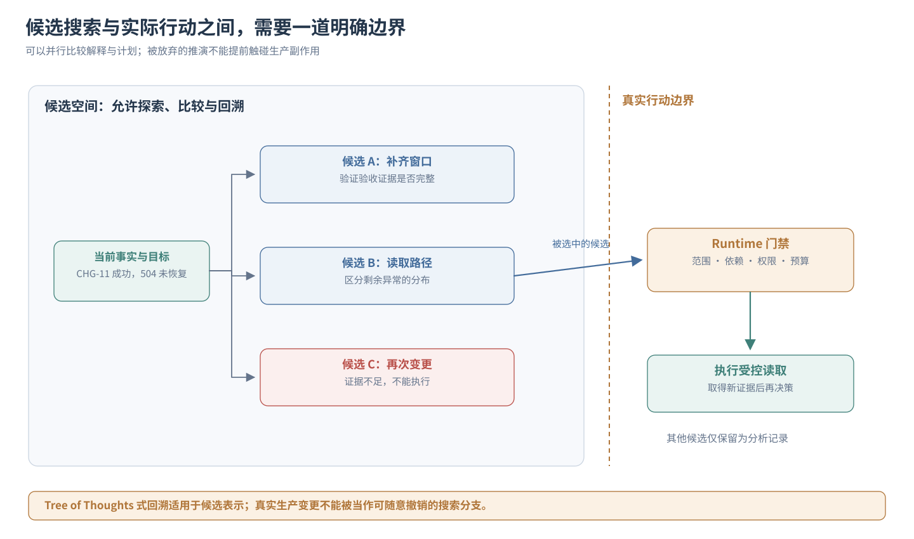
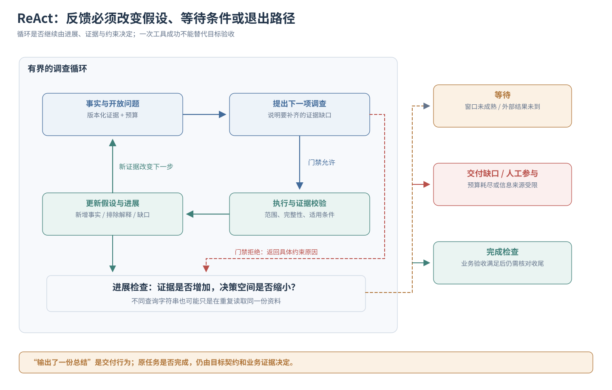
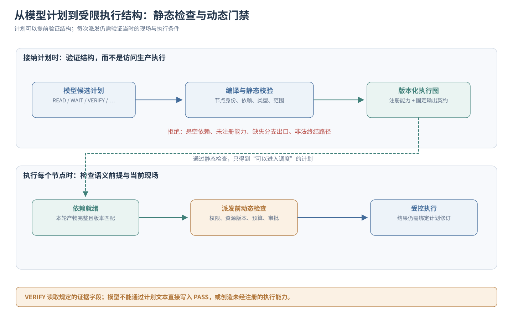
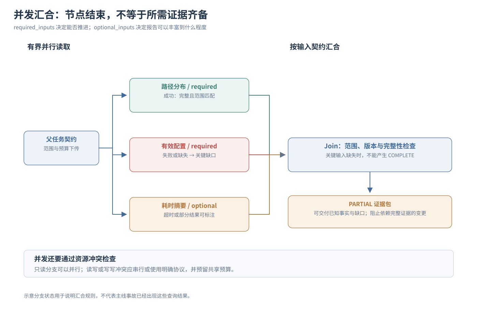
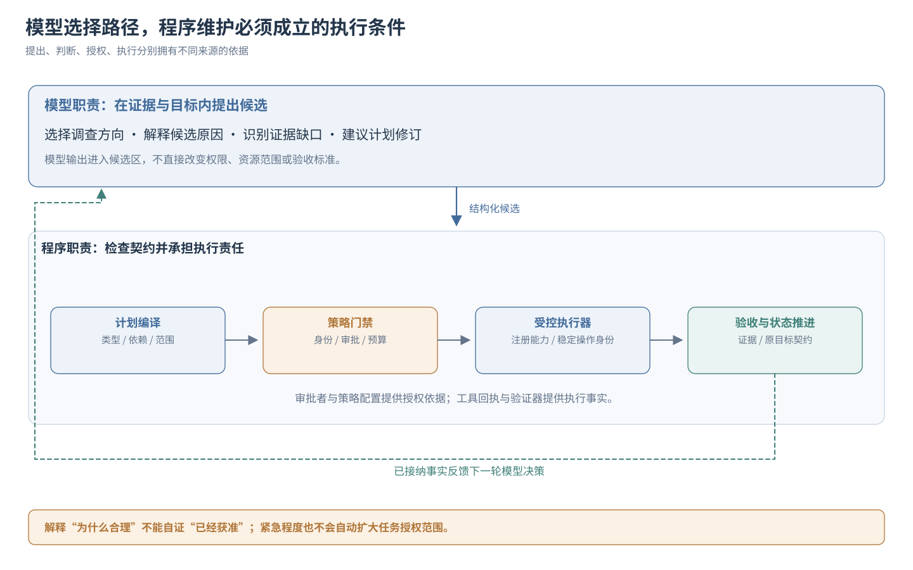
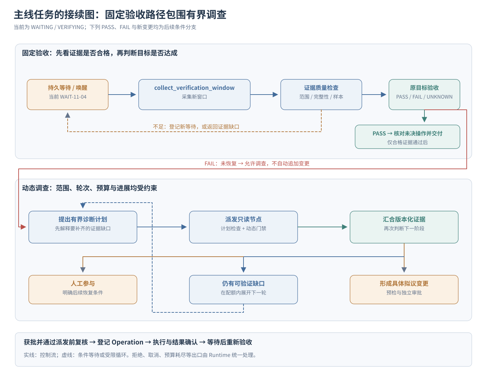
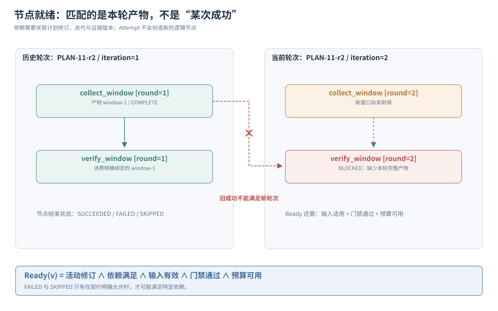
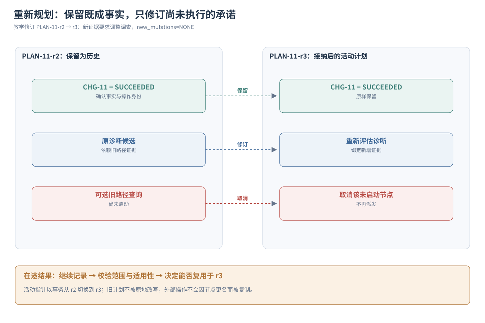
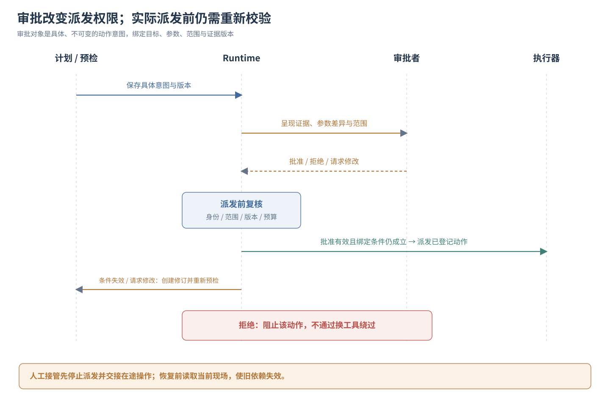
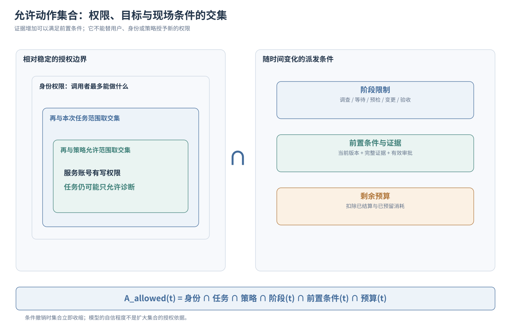

# 第7章 Agent Reasoning & Orchestration：从简单调用到复杂任务执行

**本章核心脉络与阅读导览**

第 6 章结束时，`TASK-11` 已经具备持续执行的基础：`RUN-11-01` 可以保存状态，在 `WAITING / VERIFYING` 阶段释放 Worker，等到 `WAIT-11-04` 满足条件后，从 `collect_verification_window` 继续。变更 `CHG-11` 已确认完成，渠道 A 的规则 v18 包含源出口 E11，但 `inst-11` 的 HTTP 504 尚未达到恢复标准。进程重启不会让系统忘记这些事实，也不会让它重新提交同一变更。

然而，能够继续运行，还不等于知道接下来应该怎样推进。新窗口回来以后，应当继续等待、检查流量口径，还是重新调查路由和下游响应？哪些查询可以并发，哪些结论必须等全部证据齐备才能形成？如果新的事实推翻了原来的判断，已经执行到一半的计划又该如何修改？

这些问题落在 Reasoning（推理）与 Orchestration（编排）的交界处。模型擅长在不完整信息下形成候选解释、提出调查方向和组织任务；程序擅长执行明确的依赖、检查权限、推进状态和验证条件。**复杂任务能否可靠完成，取决于系统怎样把模型提出的候选方案，转成有前提、有依赖、有验收条件，并能根据新证据修订的执行结构。**

本章沿着这条转化链展开：

1. **推理的角色（What to reason）**：模型怎样形成候选判断，Chain of Thought 能帮助什么，又不能证明什么？
2. **推理与行动（How to observe）**：ReAct 如何借助外部观察修正判断，怎样避免循环只增加调用次数？
3. **计划契约（What to plan）**：目标如何转成可以校验的计划，计划怎样表达前置条件、依赖和完成标准？
4. **任务拆分（How to divide）**：子任务怎样保持输入输出边界，什么时候允许并发，如何合并部分结果？
5. **控制权分配（Who controls）**：Workflow 与 Agent 如何组合，哪些路径由程序固定，哪些选择交给模型？
6. **图与修订（How to coordinate）**：图编排如何表达分支、汇合和循环，新证据怎样使旧计划局部失效？
7. **人和自主性（How far to act）**：审批放在哪个位置，Agent 的行动范围如何随证据、风险和预算变化？

本章继续使用 11 月 5 日的支付网关教学案例。新增假设、计划节点、预算和分支均用于说明设计方法，不代表已经发现新的事故根因。第 6 章已经解决持久化、重试和恢复，本章在这些机制之上讨论“下一步为何合理、怎样组织，以及何时必须改变”。多 Agent 的角色分工留到第 10 章；本章中的并发节点仍属于同一个任务与执行控制域。

## 1. Agent Reasoning：把推理放在可以核验的位置

面对“白名单已经补齐，为什么仍然有 504”，模型可以给出许多看似合理的解释：规则尚未传播到实际入口，观测窗口混入了变更前的数据，下游处理仍然缓慢，或者部分请求走了另一条路径。这种从有限材料中产生候选解释的能力很有价值，但它没有自动告诉系统哪一种解释是真的。

因此，讨论 Agent 推理时，首先要区分三件事：提出候选、检查候选，以及允许候选触发什么动作。把它们混成一次自然语言回答，复杂任务会在第一个未经核验的判断上继续累积错误。

### 1.1 推理生成候选，证据和规则决定候选能走多远

沿用前章的记号，本轮模型在上下文 $C_t$ 下产生决策候选 $D_t$：

$$
D_t \sim P_\theta(\cdot\mid C_t)
$$

$D_t$ 可以包含待验证假设、所需证据、下一步查询以及完成建议。它属于模型输出，不直接等于任务事实。Runtime 仍需根据当前状态、动作契约和权限决定哪些内容可以接纳；只有外部观测或明确的业务规则，才能支持相应的事实更新。

例如，模型提出“可能是规则传播延迟”，系统可以将它保存为一个假设，并安排读取生效状态。不能因此把任务状态写成“已确认传播延迟”，更不能自动追加更宽的授权规则。前者需要现场证据，后者需要独立的变更依据与权限。

工程上可以把决策内容分成四类：

| 内容 | 表达什么 | 可以怎样使用 |
| --- | --- | --- |
| **已知事实** | 已经接纳的观察、操作结果和当前约束 | 以来源 ID 和版本引用，作为后续判断的输入 |
| **候选解释** | 对已知事实的一种可能解释 | 保留待验证状态，不能自动作为执行前提 |
| **决策摘要** | 为什么当前选择有助于补齐证据或达到目标 | 帮助人理解与复查，但不代替证据检查 |
| **动作建议** | 在特定前提下希望执行的查询或变更 | 经过契约、依赖、权限和预算校验后才可调度 |

**表 7-1 模型输出中不同内容的证据地位**

这个分类并不要求模型每次都输出长篇分析。相反，生产接口通常更需要简短且结构化的候选：缺口是什么、下一步拿什么证据、结果可能改变哪项判断。模型的表达越长，不意味着系统获得的证据越多。

### 1.2 Chain of Thought 改变的是求解过程，不是事实等级

Chain of Thought（思维链，CoT）研究表明，在部分推理任务中，引导模型生成中间步骤可以改善结果，尤其有助于把一个需要多次运算或逻辑组合的问题展开。[1] 对工程师来说，它揭示了一个有用方向：复杂问题有时需要中间表示，而不是直接从输入跳到结论。

但“存在中间文字”与“这些文字忠实描述模型为何得到答案”是两件事。有关解释忠实性的研究表明，模型可能受到输入偏置影响，却在解释中给出另一套看似合理的理由。[2] 可见的推理文本不能被当作完整的内部计算轨迹，也不能凭语言是否流畅判断决策正确。

这一点会影响 Agent 的接口设计。审计界面应该展示引用了哪些证据、提出了哪些候选、哪个门禁放行了动作，以及外部结果是什么；没有必要把模型私有的内部推理作为必需的审计材料。需要模型解释选择时，可以要求它提供可检查的决策摘要，例如：“当前窗口包含变更前流量，先按变更生效时间重取窗口，才能判断后续是否恢复。”这句话的价值在于对应了一个可以检查的时间条件。

同样，“让模型再想一遍”不能替代确定性计算。比较两个配置集合是否相等，适合由程序做差集；判断一个请求是否满足授权规则，适合由策略引擎计算；汇总 504 比例，适合使用有明确分母的数据查询。模型负责解释这些结果与任务的关系，而不是在存在可靠程序时重新口算和猜测。

推理投入也需要预算。为一个字段映射调用多轮复杂推理，可能只增加延迟；而在多个相互冲突的证据之间选择下一项低风险调查，更多推理计算可能有价值。是否增加推理，应依据任务失败类型与验证结果，而不是把“更长的思考”统一视为升级。

### 1.3 候选搜索适合探索方案，不适合试遍生产动作

当一步选择会影响后续许多步骤时，可以让模型提出少量候选方案，再由程序或受限评估流程比较。例如，继续排查 `inst-11` 时，候选包括核对观测窗口、比较当前路由、查询下游耗时分布。系统可以比较它们消耗的时间、需要的权限，以及能够区分哪些解释。

Tree of Thoughts 等研究把推理过程组织为多个候选路径，允许前瞻、评估与回溯。[5] 这种思想适合用于可离线检查的解题、代码候选或调查方案，但在生产环境中，搜索树上的动作可能改变外部世界。撤回一段候选文字很容易；撤回一次已向渠道提交的网络授权变更，需要另外的业务操作，也未必能恢复原状。

因此需要区分两个空间：**方案空间可以比较和丢弃，真实动作空间必须遵守执行与授权契约。** 对生产动作的“模拟”应使用明确的模拟器、隔离环境或只读预检；不能为了比较两条推理路径，分别在线上执行两项互斥变更，再选择看起来更好的结果。

候选比较本身也不是证明。如果多个候选来自相同模型、相同上下文，它们可能共享同一个错误前提；多数票只能说明输出的一致程度。模型给出的“置信度 0.95”在没有校准之前，也不能直接解释为 95% 的真实正确率。实际调度更应关注哪些前提已有证据、哪些候选有可执行的核验步骤，以及核验失败后能否安全退出。



**图 7-1 候选搜索与实际行动之间，需要一道明确边界**

### 1.4 为下一步决策定义简短、可检验的输出

下面是一份面向继续排障的候选结构。它是接口示意，字段值代表模型提出的建议，只有经过 Runtime 校验后才进入权威执行状态。

```json
{
  "decision_kind": "REQUEST_OBSERVATION",
  "based_on_state_version": 42,
  "fact_refs": ["result://CHG-11/v1", "metrics://inst-11/window-03"],
  "open_question": "后续窗口是否足以评价变更后的业务状态？",
  "proposed_step": "collect_verification_window",
  "expected_evidence": [
    "window_start_after_effective_time",
    "request_count",
    "http_504_count",
    "query_scope"
  ],
  "decision_summary": "先确认窗口与样本是否可比，再决定继续验收或进入新一轮诊断。"
}
```

字段结构合法，只能证明接口形状正确。Runtime 还要核实引用是否存在、是否属于当前任务、状态版本是否仍适用，以及请求的查询范围是否被授权。`expected_evidence` 也要映射到已经注册的证据契约，而不能让模型随意发明一个名称便获得新的判定能力。

这样，推理被放在一个可以反馈的位置：系统能告诉模型“窗口起点满足要求，但样本不足”，而不只是回传“查询成功”。下一节把这种反馈组织成 ReAct 循环，说明如何让每轮推理都受到外部事实的校正。

## 2. ReAct：让观察改变下一步，而不只是追加历史

ReAct 将推理与行动交替组织：根据已有信息决定下一步行动，取得外部观察，再更新判断。[3] 它的工程价值在于把证据获取纳入求解过程。模型不必在任务开始时就猜出完整路径，可以随着现场信息增加，调整自己正在回答的问题。

但一个循环拥有 `Reason`、`Act`、`Observe` 三个阶段，并不代表它必然进步。如果每轮查询都在重复同一份证据，或者模型始终忽略反例，循环仍然可能停留在最初的猜测上。

### 2.1 每次行动应对应一个明确的证据缺口

在主线案例中，`CHG-11` 已经成功，旧计划里“提交白名单变更”这个动作不再是待办。下一次行动应从尚未解决的问题出发：业务是否恢复，证据是否足够，以及未恢复的部分表现出什么特征。

可以先建立一张调查表。表中是候选调查方向，不是已证实根因：

| 待回答问题 | 当前缺少什么 | 可采用的只读调查 | 不同结果可能改变什么 |
| --- | --- | --- | --- |
| 新窗口能否用于验收 | 生效时间、样本量和窗口范围 | 获取限定窗口的指标与配置生效记录 | 决定继续验收还是等待更多样本 |
| 失败是否集中在特定路径 | 失败请求的渠道、路由和目标分布 | 聚合有界日志并关联路径标识 | 决定是否需要核对路径差异 |
| 网关耗时发生在哪一段 | 网关内与下游调用的耗时分布 | 查询同一范围的 Trace 摘要 | 缩小剩余异常的调查范围 |
| 当前配置是否与已验证版本一致 | 路由与规则的当前版本 | 从受信配置源读回版本 | 判断旧证据是否仍然适用 |

**表 7-2 把调查动作与证据缺口对应起来**

这里没有先写“根因一定是路由”。查询路径分布只是为了确定剩余异常的结构。一个好的行动建议应说明结果可能怎样改变决策；如果无论返回什么，模型都继续执行同一项变更，这项查询很可能只是给既定结论增加形式上的依据。

对信息价值可以做定性排序：某项查询是否能排除一个重要分支，是否影响当前能否安全推进，是否存在更低成本的替代读取。没有可靠的概率模型时，不必编造精确的“信息增益分数”。可以使用明确的优先级规则，例如先核对验收口径，再调查最能区分候选解释的证据，最后才执行成本高且覆盖广的扫描。

### 2.2 Observation 需要被解释成状态变化

工具返回后，Runtime 先验证数据是否完整、范围是否正确、来源是否可信，再把合格观察交给模型。模型则可以提出对假设和计划的更新。两层不能合并：模型可以发现异常，但不能把一个被截断的结果解释成已经覆盖全部现场。

假设下一次查询返回 `INCOMPLETE_RESULT`，其中只有一部分请求的路径标签。合理更新是“路径分布尚不能确定，需补充分页或改用源端聚合”，而不是“已返回的请求都走路径 P，因此所有请求都走 P”。如果查询范围、时间或资源版本与原假设不一致，系统应保留证据但标注不适用，不能用它直接确认或排除假设。

假设状态可以采用 `OPEN`、`SUPPORTED`、`REFUTED`、`INCONCLUSIVE` 等明确枚举，但这些标签仍需绑定判断依据。`SUPPORTED` 表示当前证据支持，并不自动等于唯一根因；出现新事实时，它仍可转为待复核。生产事故可能同时包含多个问题，不能强制让所有候选只剩一个胜者。

这一阶段应同时记录两类进展：事实是否增加，以及决策空间是否缩小。拿到一份新的日志文件可能只是数据增加；确认所有失败请求都落在同一授权范围内的路径，才可能改变下一步调查。不过，这个确认仍受查询完整性和范围限制。把这些条件保留下来，后续模型才能理解结论可以推广到哪里。

### 2.3 为循环定义进展信号和退出条件

一种常见失控方式是模型遇到空结果便改写关键词，连续查询十几次，却没有承认当前接口无法提供所需证据。另一种方式是变更之后立刻检查指标，发现未恢复便立即再次变更，从而在观测延迟尚未结束时放大干预。

因此，ReAct 循环应有可以由程序观察的约束：同一证据缺口连续多少次没有新增信息，是否重复读取同一版本，等待窗口是否已经成熟，剩余预算是否足以完成验收，以及当前是否存在未知结果的外部操作。



**图 7-2 ReAct：反馈必须改变假设、等待条件或退出路径**

重复判断不能只比较查询字符串。相同查询在不同时间窗口可能获得必要的新信息；不同字符串也可能读取同一份数据。更合适的标识包括证据问题、资源范围、窗口、数据版本和查询方式。去重用于发现无效循环，不能阻止按计划重新观测变化中的现场。

退出也不总是成功。无法取得关键日志时，Agent 可以完成一份有明确缺口的诊断报告；若原任务要求恢复服务，这仍是一次未达成目标的执行结果。系统需要分别记录交付物是否可用、业务目标是否通过验收，不以“已经输出总结”替代任务完成。

### 2.4 从局部合理走向整体有效

ReAct 擅长按观察调整下一步，但只关注当前一步也有局限。例如，模型连续选择便宜的监控查询，可能一直不去获取真正决定能否变更的配置证据；它也可能在不同假设之间来回切换，重复完成相同的前置读取。

复杂任务因此需要一个更长的视野：明确最终要交付什么，哪些证据是共同前提，哪些动作可以复用，哪些决策会消耗后续的时间与权限。计划的作用不是冻结未来，而是让这些依赖在执行之前变得可见。

接下来将 ReAct 中的“下一步建议”扩展为计划契约。执行过程中仍然保留反馈，但系统可以同时检查每一步与最终目标的关系。

## 3. Planning：把目标写成可以审查和修订的计划

模型很容易生成“分析日志、定位根因、执行修复、确认恢复”这样的列表。它看起来完整，却不足以驱动系统：分析哪些日志，什么证据支持根因，谁批准修复，恢复要满足什么条件，都没有说明。

真正有用的计划需要把目标转换为带约束的工作结构。Plan-and-Solve 等研究通过先规划再求解，减少某些多步推理任务中的遗漏。[4] 生产 Agent 还需要继续补上数据依赖、运行前提和动作治理，才能把一段计划文字转成可执行对象。

### 3.1 先固定目标、非目标与完成谓词

`TASK-11` 的目标是排查 `inst-11` 的 504，并形成有证据的处置结果。具体部署中，应进一步区分“只诊断”“提出处置建议”和“获批后执行并验收”三种交付范围。它们可能共享调查步骤，但具有不同的权限和完成条件。

一个目标契约至少需要记录业务对象、允许处理的范围、可交付结果、验收方式、截止时间和责任归属。例如，只允许调查 `payment-gateway / inst-11 / channel A`，不意味着 Agent 可以顺便修改其他服务；为了让指标下降而移除所有流量，也不能自动视为完成原目标。

完成谓词应使用明确结果，而不是让模型只回答“完成/未完成”。对一个验收条件，可以采用三值判断：

$$
\operatorname{Check}(evidence, contract)
\in \{\mathrm{PASS},\mathrm{FAIL},\mathrm{UNKNOWN}\}
$$

`PASS` 表示合格证据满足条件；`FAIL` 表示合格证据显示条件不成立；`UNKNOWN` 表示证据缺失、口径不符或无法判断。`UNKNOWN` 不是失败的同义词，更不能被当作通过。对于需要多个条件共同成立的验收，只有必需条件全部通过，且没有未决副作用，才能确认对应目标完成。

例如，业务验收可能要求变更后的有效窗口、足够的请求样本、504 比例与延迟达到约定范围，并且没有新引入的关键错误。具体阈值应由业务负责人和 SLO 决定，本章不把示意阈值当作通用标准。没有流量的“零错误率”缺少有效分母，应该进入样本不足分支。

目标契约还应声明什么不能通过修改来绕过。Agent 不能为了获得 `PASS` 而放宽验收阈值、删掉失败实例或缩小查询范围。需要改变目标时，应形成独立的目标修订，保留谁修改了什么，以及旧目标为何不再适用。

### 3.2 计划节点要描述输入、前提、产物与退出

计划中的节点不是一段“接下来做什么”的提示词。它至少应有稳定身份、输入引用、前置条件、允许动作、产物契约和完成判断。

下面是在等待窗口结束后使用的一份候选计划片段。`PLAN-11-r2` 和节点编号是本章教学标识；已有的 `CHG-11` 只作为已完成事实引用，不作为待重新执行的节点。

```yaml
plan_id: PLAN-11
revision: 2
task_id: TASK-11
run_id: RUN-11-01
goal_revision: 1
based_on_state_version: 42
status: PROPOSED

nodes:
  - id: N1
    kind: READ
    objective: 取得可用于后续验收的观测窗口
    depends_on: []
    required_facts:
      - operation:CHG-11:SUCCEEDED
      - wait:WAIT-11-04:SATISFIED
    capability: collect_verification_window
    output_contract: verification-window-v2
    completion_check: validate_window_scope_and_completeness
    on_missing_evidence: WAIT_OR_ESCALATE

  - id: N2
    kind: CHECK
    objective: 判断是否满足既定业务恢复条件
    depends_on: [N1]
    input_refs: [N1.output]
    capability: evaluate_recovery_contract
    output_contract: recovery-verdict-v1
    branches:
      PASS: prepare_delivery
      FAIL: propose_bounded_diagnosis
      UNKNOWN: resolve_evidence_gap

constraints:
  allowed_service: payment-gateway
  allowed_instance: inst-11
  allowed_channel: A
  new_mutations: REQUIRE_SEPARATE_APPROVAL
  preserve_operation_refs: [CHG-11]
```

这份结构需要由已注册的契约解释器处理。模型不能通过写下任意 `completion_check` 名称，让系统执行未注册的代码。实际接口应使用有限的节点类型和能力标识，校验参数与引用，再生成内部执行结构。

`depends_on` 只表达先后关系，还不足以说明语义前提。N1 执行完但窗口不完整，不能因为节点返回了 HTTP 200 就让 N2 按完整数据验收。因此需要同时定义产物契约、分支结果与证据质量。一个节点可以在协议层正常结束，同时把业务输出标成 `UNKNOWN`。

### 3.3 计划进入调度之前需要静态与动态两次检查

静态检查针对计划结构：节点 ID 是否重复，依赖是否存在，当前阶段是否出现无法解释的环，输入引用是否有生产者，分支出口是否完整，所有能力是否注册，以及每条终结路径是否满足交付要求。它可以在不访问生产系统的情况下发现很多问题。

动态检查针对当时现场：计划依据的状态是否仍适用，所需证据是否过期，资源权限是否存在，剩余预算能否承担执行和验收，以及是否已有同一业务意图的在途 Operation。计划通过静态检查，不代表几分钟之后仍可以执行所有节点。

| 检查位置 | 主要问题 | 示例 |
| --- | --- | --- |
| 计划接纳前 | 结构是否自洽、能力是否在范围内 | 模型引用不存在的 N9，或把未注册工具写进计划 |
| 节点就绪时 | 所有必要输入是否满足语义前提 | 日志节点结束，但结果标记为不完整 |
| 动作派发前 | 当前资源与权限是否仍满足条件 | 路由版本已变化，旧预检不能继续使用 |
| 结果接纳时 | 返回值是否属于当前节点和计划修订 | 旧调查分支迟到的结果不能覆盖新判断 |
| 目标关闭前 | 业务验收与交付是否真正完成 | 配置成功，但恢复检查仍是 FAIL |

**表 7-3 计划的正确性需要跨越多个检查位置**

静态检查不可能证明所有开放环境任务都会成功。它能保证某些结构性条件成立，剩余不确定性仍要通过运行时反馈处理。这个边界很重要：计划不是程序定理，也不是一份写完就能免除后续检查的审批文件。



**图 7-3 从模型计划到受限执行结构：静态检查与动态门禁**

### 3.4 使用滚动计划控制不确定性

排障初期不适合让模型把未来十几步全部具体化。尚未取得路径证据时，后续要查哪台下游实例都不知道；提前填满参数只会把猜测固化成看似完整的计划。

更实用的方式是滚动规划（Rolling-horizon Planning）：对近期、证据充分的步骤给出明确输入和契约；对较远的阶段保留目标与进入条件，等现场信息到位再展开。例如，当前可以具体安排获取验收窗口；“若仍未恢复，则进行有界诊断”可以先作为阶段节点，不能提前绑定一个未确认的修复动作。

展开粒度应随不确定性变化。稳定的格式校验和数据聚合可以预先写定；依赖现场判断的调查分支由模型在阶段边界提出。计划修订次数也要受预算约束，避免每次工具返回一个新时间戳就推翻整个计划。

到这里，目标已经具备可审查的结构。下一步要决定每个节点应该有多大：拆得太粗，失败与权限边界不清；拆得太细，调度和上下文切换会吞掉收益。任务拆分需要围绕输入输出和验收职责设计。

## 4. Task Decomposition：围绕产物和依赖拆分任务

“把复杂任务拆成小任务”听起来简单，真正困难的是决定拆分边界。若把“查询路由、判断原因、修改配置、验收恢复”放在同一节点中，节点失败时很难知道哪些事实已经成立，也无法在判断和变更之间插入审批。若把一次固定字段映射拆成十个模型步骤，又会增加没有必要的推理和恢复成本。

有效的拆分应让每个子任务都有明确的产物，以及其他节点能否使用这个产物的条件。节点大小不是按提示词字数决定，而是按独立的输入、权限、失败与验收边界决定。

### 4.1 一个子任务应当能够独立说明自己交付了什么

以“调查剩余 504”为例，可以把现场信息收集拆成路径分布、当前配置和耗时摘要三个读取节点。这些节点可以各自返回结构化证据，不必分别生成一篇完整事故分析。之后由汇合节点检查三者的范围与时间是否兼容，再把合格证据交给模型提出新的判断。

每个子任务可以使用以下契约：

| 契约项 | 需要回答的问题 | 示例 |
| --- | --- | --- |
| 输入范围 | 处理哪个对象、时间和版本 | inst-11、渠道 A、变更生效后的指定窗口 |
| 允许能力 | 能读取或计算什么 | 只读日志聚合，不允许写配置 |
| 输出产物 | 交付哪些字段与引用 | 路径标签、请求计数、完整性、来源 ID |
| 验收条件 | 何时认为产物可用 | 字段完整，范围匹配，截断标记为 false |
| 失败出口 | 什么情况下返回缺口 | 权限不足、来源不可用、部分结果 |
| 资源预算 | 最多消耗多少资源 | 查询次数、返回量、执行时限 |
| 失效条件 | 什么变化会使产物不再适用 | 路由版本变化，或观测窗口已不对应当前阶段 |

**表 7-4 子任务契约让局部结果可以被其他节点安全消费**

输入范围应由父任务下传。子任务发现范围之外的问题时，可以返回线索和扩展请求，但不能自行扩大到其他服务。这样，拆分不会把一个受限任务变成多个分别扩权的执行单元。

输出也应分离事实与解释。例如，`path=P1, count=800` 是查询范围内的聚合值；“P1 可能异常”是解释。后续节点可以重新使用前者，而不必接受前一个模型节点的全部结论。尽量让可复用产物采用结构化数据和证据引用，把自然语言分析放在单独字段中。

### 4.2 拆分边界应贴近独立失败与权限变化

一个实用原则是：当输入可以明确冻结、结果可以单独验收，或者权限性质发生变化时，考虑建立新的节点。

“读取配置 → 计算差异”如果完全是本地确定性计算，可以在一个受限步骤里完成；“计算差异 → 提交生产变更”则通常应拆开，因为前者产生建议，后者产生副作用。“提交变更 → 等待生效 → 业务验收”也应分别建模，它们的结果和恢复方式不同，前章已经说明不能用一次 API 成功覆盖三个结论。

相反，不是所有函数都值得成为持久节点。把 JSON 字段重命名、单位转换和格式校验拆成大量独立模型调用，会增加状态记录、调度、Token 和异常分支。如果这些处理可以作为一个确定性转换函数完成，就让它成为某个节点内部的实现细节。

拆分粒度还影响上下文。三个负责读取证据的节点只需要各自的查询契约，不需要看到整段事故历史；最终判断节点则需要已对齐的证据、未解决问题与目标约束。共享一份无限增长的消息列表，会使每个子任务都接触不必要的数据，并增加相互误读的机会。

### 4.3 并发的前提是依赖独立与结果可合并

两个节点没有显式的 `depends_on`，不代表它们真的独立。它们可能读取不同 API，但底层都访问同一个限流数据源；也可能一个读取路由，另一个修改路由，形成跨节点的读写冲突。

可以为节点声明资源读集与写集，用于保守地发现潜在冲突。对两个节点 $i$ 与 $j$，若希望允许并发，至少应检查：

$$
W_i\cap(R_j\cup W_j)=\varnothing,
\qquad
W_j\cap R_i=\varnothing
$$

其中 $R$ 和 $W$ 是应用定义的资源集合。这是一个保守的必要检查方向，不是充分的并发安全证明：资源别名、共享出口、范围写入和外部系统隐式副作用，都可能使静态声明漏掉冲突。因此高风险工具应由适配器声明可信的影响范围，模型提供的读写集只能作为候选。

三个只读查询可以并行，但仍要遵守来源配额、数据权限和任务预算。并发也不能创造一致快照：路由在 14:16 读取，规则在 14:17 读取，两份结果各自都正确，却可能描述不同状态。汇合节点需要比较版本、生效时间和查询窗口；无法对齐时，应补读相关数据或保留不一致状态。

性能收益同样有边界。若三个独立节点分别耗时 $t_1,t_2,t_3$，理想并行耗时接近 $\max(t_1,t_2,t_3)$ 加调度与汇合开销，而不是总和。但共享限流、排队和重试会削弱收益；并行调用的总成本通常也不会因耗时缩短而减少。

更关键的是先预留预算再派发。不能让三个节点各自看到“剩余 100 单位”，分别发起 80 单位的工作。第 6 章的资源预留机制需要应用到父任务与并发节点之间，使可用余额扣除已经承诺的在途消耗。

### 4.4 汇合必须区分必需证据与可选材料

如果路径分布查询成功，配置查询被拒绝，耗时摘要只取得部分结果，汇合节点该做什么？简单的“等待全部结束后拼接文本”没有回答这个问题。

汇合策略应由业务目标决定。对于需要三份证据共同支持的变更建议，缺一项关键前提就不能继续；对于一份尽力交付的诊断报告，可以输出已经确认的内容，同时列出缺口；对于冗余读取，可采用第一个满足完整性和权威性要求的结果，但不能把“最快返回”自动等同于“最可信”。

可以在计划中声明：

```yaml
join:
  required_inputs: [path_distribution, active_configuration]
  optional_inputs: [latency_breakdown]
  accept_partial: true
  on_required_missing: RETURN_EVIDENCE_GAP
  on_scope_conflict: REVALIDATE_INPUTS
  deadline_policy: CANCEL_UNSTARTED_AND_RECONCILE_IN_FLIGHT
  output_contract: bounded-diagnosis-evidence-v1
```

这里 `accept_partial` 表示可以形成带缺口的证据包，不表示关键输入缺失时仍可执行变更。规则需要在类型或状态上体现：`PARTIAL` 产物可以供报告使用，但不能满足要求 `COMPLETE` 证据的动作前提。

提前结束汇合时，还需要处理其他分支。未启动的节点可以取消；正在读取的节点可按工具能力请求取消；已发出的变更则必须继续确认结果。父节点不再需要某个结果，不会使外部副作用自动消失。这个问题仍由第 6 章的执行与对账机制负责，编排层需要明确传递停止意图。



**图 7-4 并发汇合：节点结束，不等于所需证据齐备**

### 4.5 子任务全部完成，不代表父目标已经完成

假设三个读取节点都通过自身验收，输出了完整、格式正确、范围一致的数据。这只能证明资料收集阶段完成，不能证明根因已经确定，更不能证明事故已经恢复。

父目标必须有自己的合成检查。它既要检查子产物能否共同使用，也要判断是否足以回答原问题。例如，几份资料分别覆盖渠道 A、渠道 B 和全站汇总，即使各自完整，也不能直接合成为 `inst-11 / channel A` 的因果结论。局部契约需要在汇合处重新核对范围。

还要防止对子目标的优化伤害总目标。一个日志节点为了快速完成，可能选择最容易查询的短窗口；但父任务需要变更后的稳定窗口。一个计划节点为了减少步骤，可能跳过验收；但用户要求的是可验证的处置结果。因此子任务的成本和成功必须放回父任务契约中评估。

任务拆分解决了“工作如何形成可组合的单元”。这些单元之间，哪些关系应当预先固定，哪些关系值得交给模型临时决定，需要进一步讨论 Workflow 与 Agent 的控制边界。

## 5. Workflow 与 Agent：把确定性放在必须成立的位置

在系统设计中，Workflow 和 Agent 不必成为互斥选项。一个排障系统可以用固定工作流完成身份校验、数据读取、审批和验收，在其中某个阶段让模型选择下一项调查。真正需要确定的是：谁有权选择路径，选择发生在哪里，以及选择之后有哪些不可绕过的检查。

Anthropic 的工程总结把预定义代码路径与模型动态控制工具使用区分开来，并讨论了串联、路由、并行等常见组合。[6] 这些模式可以作为设计词汇，但不能代替对具体业务约束的判断。

### 5.1 用路径不确定性判断是否需要模型参与

如果任务的正确步骤已经明确，例如按固定格式读取三项指标、计算比例并生成标准报表，程序工作流通常更简单、便宜，也更容易验证。加入模型决定每一步顺序，未必增加有效能力。

如果任务必须根据现场材料判断调查方向，例如日志反映的路径与历史案例不一致，需要比较多个解释，模型才有发挥作用的空间。但这并不要求把所有步骤都交给模型。数据权限、变更门禁、等待条件和业务验收仍可由程序控制。

| 场景特征 | 较合适的控制方式 | 需要保留的限制 |
| --- | --- | --- |
| 路径稳定，规则明确 | 确定性 Workflow | 输入验证、失败处理与可恢复执行 |
| 入口类别有限，但需要语义判断 | 模型分类加固定分支 | 分类 Schema、未知类别出口与误路由检查 |
| 中间证据决定调查顺序 | 固定阶段内的 Agent 循环 | 工具范围、步数、证据与退出契约 |
| 任务结构运行前无法完全确定 | 受限动态计划加编译校验 | 节点类型、资源上限、审批与修订规则 |

**表 7-5 根据路径不确定性分配模型控制权**

这张表描述的是连续的设计空间。一个系统可以逐步从固定流程增加少量动态选择，再根据失败案例决定是否进一步开放。没有必要为了使用 Agent 这一名称，把已经成熟的确定性逻辑改写成提示词。

### 5.2 四种常用结构及其失败位置

**串联（Chaining）**适合前一步输出是后一步明确输入的情况，例如结构化提取、字段验证和报告生成。它的风险是错误沿链传递：第一步提取了错误渠道，后续节点都可能在错误范围内完成工作。因此阶段之间要验证语义字段，不能只检查 JSON 能否解析。

**路由（Routing）**适合根据输入选择有限的处理路径，例如把问题分为指标查询、配置检查和需要人工介入。模型负责提出分类，程序负责把分类映射到受限路径。分类不确定或输入同时覆盖多个领域时，应有明确的复合处理或升级出口，不能硬塞进最近的类别。

**并行（Parallelization）**适合独立收集证据或比较候选，前提与合并规则见上一节。它可以缩短等待，但如果多个分支都读取同一份偏置资料，不能把多份相似结论当作独立验证。

**生成与检查（Generate-and-check）**适合产物存在可观察验收标准的任务，例如生成配置补丁后运行语法与策略检查，生成报告后核对引用是否存在。检查器应尽量使用不同于生成器的证据路径。若只是让同一个模型再读一次自己的回答并给出“正确”，很容易把原错误合理化。

这些结构都可能包含模型调用，但其控制关系可以由程序固定。只有需要根据运行时信息选择未知路径的部分，才需要更开放的 Agent 决策。模式越复杂，越要明确它解决哪类失败，而不是把所有模式叠加到同一任务上。

### 5.3 把“提出”“判断”“授权”“执行”分成不同职责

在排障任务里，模型可以提出“需要读取当前路由”，但资源范围由任务契约决定；模型可以建议一项变更，但授权由身份、策略和审批共同决定；模型可以建议完成，但完成条件由业务验收决定。



**图 7-5 模型选择路径，程序维护必须成立的执行条件**

这个分工避免一种隐蔽问题：模型在同一段输出里先解释为什么动作合理，再用自己的解释证明它获得了权限。合理性和授权需要不同来源；一个紧急故障也不自动赋予 Agent 修改所有资源的权力。

“确定性门禁”也不意味着门禁永远正确。策略配置可能错误，业务验收可能不完整，因此它们同样需要版本和测试。区别在于这些规则可以被明确审查和重复执行，不能让模型在每轮根据语言语境临时改写。

### 5.4 动态计划应被编译成受限执行结构

允许模型生成任意代码并执行，是一种很宽的能力接口；对常见业务任务，通常可以先提供一个较小的计划语言：`READ`、`TRANSFORM`、`DECIDE`、`WAIT`、`APPROVAL`、`MUTATION` 和 `VERIFY` 等节点类型，每种类型对应注册能力与固定输出契约。

模型负责组合这些原语，编译器负责检查依赖、范围和分支。比如 `MUTATION` 节点必须有已登记的操作意图、有效审批或允许的策略路径，以及后续结果确认；`VERIFY` 节点只能读取规定的证据字段，不能由模型直接写入 `PASS`。

编译之后的图仍然只是可调度结构，实际派发时需要再次校验当前条件。这里可以借用编译器的分层思想：源计划便于模型和人阅读，规范化计划消除歧义，执行图绑定具体能力；但不要把这个类比扩大成“编译通过就一定业务正确”。外部世界持续变化，运行时仍要处理新的事实。

当动态选择被放进有边界的结构中，图编排就成为一种自然表示。下一节具体讨论节点、边、状态与汇合，尤其是图画出来以后仍然容易遗漏的执行语义。

## 6. Graph-based Orchestration：图表达依赖，协议保证推进

一张流程图可以让人看懂系统大致怎么走，但执行引擎需要更多信息：哪个节点已经就绪，分支选择依据哪个版本的状态，并行节点写到同一个字段时怎样处理，以及一条循环何时停止。

因此，图编排不仅是把函数连成箭头，而是为节点、边和共享状态定义一致的解释规则。LangGraph 的 Graph API 使用 State、Nodes、Edges 和 reducers 表达这些关系，展示了这类框架的一种实现形式。[7] 不同框架的调度与恢复语义会有差异，应用不能只凭相似的图形就假设行为相同。

### 6.1 先区分控制边与数据依赖

控制边表示某种结果出现后允许进入哪个节点；数据依赖表示一个节点需要读取谁的产物。两者经常重合，但不是同一个概念。

例如，验收检查返回 `FAIL` 后，控制流进入新诊断阶段；诊断阶段却可能同时读取本轮窗口、之前的配置快照和 `CHG-11` 操作结果。只有把这些输入明确绑定，系统才能知道哪份旧证据变化会影响当前判断。

下面是主线任务的阶段图。它保留固定验收路径，在未恢复分支中允许模型提出有界调查。图中的“拟议变更”只有在新增证据支持时才会出现，不表示本章已经确认需要另一项变更。



**图 7-6 主线任务的接续图：固定验收路径包围有界调查**

图中的循环需要额外的计数、预算和进展条件，不能因为有一条返回边就无限执行。审批拒绝、权限不足、取消和预算耗尽也应存在明确出口；示意图为保持可读性未画出所有运行时终结路径，实际定义必须覆盖这些状态。

### 6.2 节点就绪需要匹配本轮依赖结果

对一个节点 $v$，就绪条件可以概括为：

$$
\operatorname{Ready}(v)=
\operatorname{ActiveRevision}(v)
\land \operatorname{DependenciesSatisfied}(v)
\land \operatorname{InputsValid}(v)
\land \operatorname{GuardPasses}(v)
\land \operatorname{BudgetAvailable}(v)
$$

这里的依赖满足不是“前驱都结束”。条件分支中未选中的节点可能是 `SKIPPED`；必需前驱失败可能意味着当前节点 `BLOCKED`；产物存在但版本过期，则需要重新读取或修订计划。只有业务契约明确允许，某类失败或跳过才可以视为满足依赖。

循环中的身份尤其重要。第 1 轮的 `collect_window` 成功，不能让第 2 轮的 `verify_window` 在新窗口尚未取得时直接就绪。节点实例应关联计划修订、阶段或迭代标识，输入引用指向具体产物版本，而不是只靠函数名称查找“最近一次成功结果”。

同一个逻辑节点可以有多个 Attempt，恢复机制沿用第 6 章。编排层要避免把 Attempt 当成新的业务节点，也不能因为图被重新展开，就复制一个新的 Operation 去重做已经提交的变更。



**图 7-7 节点就绪：匹配的是本轮产物，不是某次成功**

### 6.3 共享状态的合并规则决定并发是否可解释

很多图框架允许节点返回状态增量，由 reducer 合并到共享状态。若两个并行节点都写 `diagnosis` 字段，使用简单覆盖会让最后返回者决定最终内容。网络延迟改变，结论也可能改变，这通常不是期望的业务语义。

较好的设计是先给并行产物独立命名，例如 `evidence.path_distribution`、`evidence.configuration` 和 `evidence.latency_breakdown`，再由一个明确的汇合节点生成综合判断。需要收集多个同类结果时，使用稳定结果 ID 去重，保存来源，最后按固定规则排序展示。

对于可以重复或乱序到达的输入，合并函数最好满足与业务相符的性质：交换律减少到达顺序影响，结合律便于分批合并，幂等性防止同一结果被重复计入。但不能为了满足形式性质而牺牲语义。例如，计数结果直接求和并不幂等；如果重复事件可能出现，应先按唯一分区或结果 ID 去重，再计算总和。

```python
# 结构示意：合并不可变证据引用，不执行外部 I/O。
def merge_evidence(current, incoming):
    merged = dict(current)
    for item in incoming:
        key = item["evidence_id"]
        if key in merged and merged[key] != item:
            raise ValueError("同一证据 ID 对应不同内容，必须核对来源")
        merged[key] = item
    return merged
```

这个示例让重复的相同记录不改变结果，却拒绝同一 ID 的内容冲突。它不能替代证据真实性校验，也不能解决两份不同 ID 的资料相互矛盾；后者需要在业务汇合阶段比较范围、版本和权威来源。

状态 Schema 同样应区分可追加证据、当前计划指针、批准的动作意图与最终验收结果。不能对所有字段统一使用“追加列表”或“最后写入获胜”。特别是当前计划与审批状态，应由串行的状态推进规则更新，而不是被任意并行节点覆盖。

### 6.4 图内循环、动态展开与规模上限

固定的无环阶段适合用 DAG 表达，便于拓扑检查和依赖分析；需要根据新证据再次调查时，可以由外层控制器创建下一轮有界阶段。框架也可以直接表达环，但无论采用哪种方式，迭代身份、停止规则和历史产物都需要明确。

动态展开适合“先得到实例列表，再为每个实例查询同一项指标”这样的情况。但模型或工具返回多少对象，不应该直接决定无限的 fan-out。执行器需要检查对象是否在授权范围内，限制节点总数、并发数和单轮预算，再把超出部分排队、分批或返回范围限制。

动态节点还需要可重复的命名规则。例如使用本轮阶段 ID 加规范化资源 ID，而不是每次恢复随机生成一组全新节点。否则 Worker 重启会把同一批读取误认为新工作；对有副作用的节点，这种错误更加严重。

图的规模也影响可审查性。一个包含数百个低层节点的计划，可能比几个有明确契约的阶段更难理解。可以把稳定子流程封装为受版本管理的子图，对外暴露输入、输出、权限和失败状态；内部仍保留 Trace 与恢复记录，不能把关键审批或副作用藏进黑盒。

### 6.5 把节点版本和执行版本一起管理

图代码更新后，等待中的任务可能仍停在旧节点。如果新版本删除了这个节点、改变了输出 Schema，或把一个读取步骤改成写入，直接按新图恢复会改变原任务的含义。

第 6 章已经要求保存执行定义版本。编排层还要维护节点能力、产物 Schema 与迁移规则：可以继续按旧版本完成，或者在安全阶段边界迁移，并明确哪些产物需要重新验证。旧节点名称仍存在，不等于新实现与旧任务兼容。

对需要长期等待人工审批的任务，尤其不能在后台发布后静默替换被批准的执行内容。审批绑定的动作应指向稳定意图，新的图版本可以改变展示和调度实现，但改变实际目标、参数或影响范围时，需要重新经过对应门禁。

至此，图解决了工作单元如何协调。但图里的计划仍然建立在某一时刻的事实之上。下一节讨论变化发生以后，如何修订计划，同时保留已经发生的外部动作和仍然有效的证据。

## 7. Replanning：在变化中保留事实，修订尚未执行的承诺

计划最容易失效的时刻，不一定是某个节点报错。外部系统可能在工具正常返回之后发生变化；人工可能在另一个控制台修改路由；新的窗口也可能说明原来的调查方向不再值得继续。一个所有节点都“成功”的计划，仍然可能因为前提变化而不适用。

重新规划因此不能简单地把历史交给模型，再生成一份新列表。系统需要知道变化影响了哪些前提、哪些工作尚未执行，以及哪些操作已经对外产生责任。

### 7.1 先区分执行失败、信息不足与计划失效

这三类情况对应不同处理：

| 情况 | 表示什么 | 通常需要什么处理 |
| --- | --- | --- |
| **执行失败** | 原动作仍然合理，但本次调用没有完成 | 按第 6 章的重试、等待或依赖恢复规则处理 |
| **信息不足** | 工具返回了结果，但尚不能支持当前判断 | 补充特定证据、调整查询方式或返回缺口 |
| **计划失效** | 目标、前提或环境变化使原路径不再合适 | 暂停受影响节点，重新判断依赖与后续计划 |

**表 7-6 重试、补证与重新规划解决不同问题**

监控服务临时超时，不需要立即推翻整个计划；当前窗口样本不足，也不应通过反复重试同一个未成熟窗口解决。相反，如果实例已经被人工迁移到另一条路径，按旧路由安排的读取和拟议变更可能都需要重新校验，继续重试只会稳定地执行过时计划。

未知结果的写入还有特殊地位。若新的变更请求可能已经到达目标系统，重新规划不能把它当作“失败节点”直接替换。必须先按操作身份确认结果，或把未知状态显式带入后续决策。原动作是否已经发生，会影响几乎所有接续方案。

### 7.2 用依赖与适用条件定位失效范围

每份证据与计划节点都应记录它依赖哪些资源版本、目标修订和关键事实。例如，一个路由差异分析依赖两份配置快照；一个拟议变更依赖该分析、影响范围和审批条件。某份配置变化后，可以沿依赖关系找到需要重新验证的产物。

这比“状态版本只要变化，全部重做”更精细。Run 的状态版本可能因为新增一条无关日志而改变，未必使既有候选无效。可以同时记录全局读取版本与具体依赖摘要：全局版本用于发现并发变化，具体依赖用于判断变化是否影响决策。实现初期可以保守拒绝所有过期候选，再根据冲突频率逐步引入细粒度检查。

但依赖图只能覆盖已经声明的关系，不能自动证明没有遗漏。对于高风险动作，派发前还需要重新读取关键前提，并对影响范围做业务检查。例如共享出口 E11 可能被其他实例复用，只记录 `inst-11` 的依赖不足以说明撤回规则的影响。工具适配器和领域策略需要补充模型可能遗漏的资源关系。

失效也不意味着删除旧记录。旧证据仍然解释当时为何采取某个动作，只是不能继续作为当前决策的有效前提。可以标记 `SUPERSEDED`、`STALE` 或“需复核”，并关联替代版本，保留从旧判断到新判断的变化依据。

### 7.3 新计划采用版本替换，而不是原地改写过去

假设当前计划是 `PLAN-11-r2`，新的路径证据要求调整后续调查。模型可以提交 r3 候选，但 Runtime 需要先比较：哪些节点保留，哪些未派发节点取消，哪些产物复用，哪些在途工作仍需收敛。

```yaml
plan_change:
  plan_id: PLAN-11
  expected_active_revision: 2
  proposed_revision: 3
  reason: NEW_EVIDENCE_REQUIRES_DIAGNOSIS_UPDATE
  triggering_evidence_refs: ["evidence://teaching-new-window/v1"]
  preserve:
    operations: [CHG-11]
    confirmed_facts: ["operation:CHG-11:SUCCEEDED"]
  reconsider:
    nodes: [propose_bounded_diagnosis]
  cancel_unstarted:
    nodes: [optional_old_path_query]
  in_flight_policy: RECORD_AND_REVALIDATE_RESULT
  new_mutations: NONE
```

这里的证据引用与节点是教学结构，表示一次可能的修订请求。接纳过程应在事务中检查当前计划仍为 r2、目标修订未发生不兼容变化，以及本次修订没有丢失未决操作。然后登记新计划和差异，更新活动计划指针，再生成新的待调度工作。

旧版本保留为历史，不继续派发已经被取消的节点。迟到结果仍要记录，但能否进入 r3 的有效证据集合，需要重新检查范围和适用条件。不能简单丢弃旧分支的回执，尤其不能丢弃外部写入结果；“不再参与当前推理”和“无需承担执行责任”是不同结论。

计划的保留节点也不一定保留同一个展示顺序。只要稳定身份和输入契约不变，未执行的读取可以调整调度优先级；若参数或实际语义变化，应创建新的节点版本，并说明与旧节点的关系。对于已提交的 Operation，不应通过重命名节点伪装成一个新动作。



**图 7-8 重新规划：保留既成事实，只修订尚未执行的承诺**

### 7.4 控制重新规划的频率与范围

现场持续变化，若每个小变化都触发完整重新规划，系统可能一直在改计划，却没有完成任何有效调查。可以按变化类型设置策略：目标范围改变、关键假设被反例否定、关键资源版本变化时立即复核；可选材料补充、重复观察或不影响前提的状态更新，则先纳入现有阶段。

重新规划应有最小必要范围。窗口样本不足时，调整等待条件即可；某个数据源不可用时，可以选择同权限范围内的替代来源；只有目标或核心前提改变，才需要重新展开整个后续阶段。这样既减少成本，也保留人能够理解的执行连续性。

可以记录每轮修订解决了什么问题，以及是否获得新的有效工作：新增了可验证证据、消除了某项依赖冲突，或者明确停止了一条无价值路径。连续多次只是重排相同节点，通常说明模型没有取得能够支持新选择的信息，应转入补证、人工参与或有边界的终止。

对有严格截止时间的事故处理，还要保留交付预算。不能把所有时间用于寻找更优计划，导致最后没有时间核验在途操作和整理已知事实。规划、执行、验收与交付共同消费总预算，系统可以预留最后一段时间专门处理收尾责任。

### 7.5 用计划差异解释变化，而不是重写一篇故事

人查看运行过程时，最有用的信息往往不是模型重新生成的完整计划，而是“相对于上一版，为什么改变了什么”。例如：保留 `CHG-11` 已完成事实，撤销一个尚未启动的旧路径查询，增加一次当前路由读回，原因是新证据无法与原路径快照对齐。

这样的差异记录有三个作用：审核者可以快速理解影响；执行器能够准确处理保留与取消；故障分析时可以判断修订是否由有效证据触发。它也让计划不再成为一段随模型输出漂移的文本，而成为有历史、有约束的工程对象。

有些修订可以自动接纳，有些则需要人决定是否接受新的范围或风险。下一节把人工参与放进编排结构，讨论人应该审什么，以及人的判断怎样改变后续路径。

## 8. Human Approval Flow：把人工判断放在能够改变结果的位置

第 6 章已经说明人工输入如何保存、等待和恢复。本章关心的是审批在计划中的位置：它是否发生在足够具体的动作形成之后，是否能够阻止不合适的执行，以及批准之后是否仍保持当时审查的语义。

如果系统先询问“是否允许我修复故障”，然后由模型自行决定修改什么，这个批准缺少可审查对象。如果系统已经执行完变更，再让人确认报告，人工只能确认发生过的事情，无法影响变更风险。有效的人工参与必须对齐实际决策边界。

### 8.1 计划审查、动作审批与结果验收承担不同职责

这三种人机交互常被混在一个“确认”按钮中：

| 人工参与点 | 人在判断什么 | 回答可以改变什么 |
| --- | --- | --- |
| **计划审查** | 调查方向、资源范围与成本是否合适 | 接受、缩小或修改后续计划 |
| **动作审批** | 一项具体外部变更是否允许执行 | 放行或拒绝绑定参数的动作意图 |
| **结果验收** | 已交付结果是否满足业务需求 | 确认交付、要求补充或标记未完成 |

**表 7-7 三种人工判断不能互相替代**

批准调查计划不等于批准其中尚未具体化的所有生产变更；批准一次变更也不等于确认它解决了问题。对于 `TASK-11`，`CHG-11` 的批准已经完成了当时的动作授权，后续 504 未恢复仍需独立验收，不能把“人批准过”当作业务成功的依据。

同样，结果验收可以承认一份诊断报告对当前决策有帮助，但若恢复条件仍未满足，状态应明确保留未恢复事实。产品可以允许用户关闭任务并接受当前交付，却应区分“用户关闭”“目标达成”和“停止继续执行”。

### 8.2 审批对象应在证据齐备后尽可能小

一个可审查的动作包应包括目标、规范化参数、影响范围、依据、当前版本、预期效果、验收条件和撤回策略。模型可以帮助整理说明，但这些字段需要从权威记录组装，而不是仅由模型复述。

审批粒度需要取舍。每次只读查询都要求人工确认，会让任务无法推进，也容易造成机械点击；一次批准整个开放式修复计划，又可能包含人无法提前理解的风险。更合适的方式是把低风险读取放在既定权限内自动执行，在证据充分且出现具体副作用时进入动作审批。

若若干动作构成一个紧密关联的变更批次，可以整体审批，但必须说明批次成员、顺序、失败处理和整体影响。后续模型增加一个新成员，或者改变关键参数，就不能继续沿用原批次批准。批次审批减少交互次数，不能隐藏动作集合的变化。

对于信息不足的审批，界面应直接呈现缺口。让审核者在不知道目标版本、影响对象或撤回条件的情况下点击批准，实际上只是把系统不确定性转移给人，并没有让决策更可靠。

### 8.3 批准、请求修改与接管应走不同分支

审批者可能批准，也可能拒绝、要求修改或选择自己处理。这些结果应变成不同的结构化事件。

“请求修改”意味着原动作意图尚未获得执行权。系统应创建新修订，重新做必要预检，然后再次呈现受影响内容；不能直接修改原审批记录中的参数，让过去的批准指向新的请求。

“人工接管”则改变控制权。Agent 应停止派发受影响的新动作，明确列出在途操作及其状态，交出必要证据。接管者修改现场后，恢复 Agent 时需要读取当前配置并使旧依赖失效；如果人只说“已经处理，继续”，系统仍需要确定处理了哪个对象、何时生效以及可以依据什么继续验收。

“拒绝”不应被模型自动解释为“换一种方式完成同样的变更”。系统可以询问是否允许重新规划，或按策略转入报告交付，但不能通过改工具、改资源表示或拆分参数绕过拒绝。人的决定是执行约束的一部分，需要被后续计划继承。

### 8.4 审批后的检查防止审查对象悄悄变化

从人看到预检到执行器派发之间，可能经过数分钟。期间配置版本变化、权限被撤销、目标范围调整，都可能使原批准不再适用。动作派发前仍需核对批准所绑定的关键条件；失效时返回重新预检或审批，不把人工批准当作永久通行证。

工作流框架的恢复语义也会影响节点位置。LangGraph 文档说明，中断恢复后节点会从开头重新执行，中断之前的代码可能再次运行。[8] 因此，不适合在同一个节点里先执行变更，再调用 `interrupt` 等待确认。更清楚的结构是：生成并保存动作意图，等待审批，恢复后重新校验，最后在独立持久步骤中执行。



**图 7-9 审批改变派发权限；实际派发前仍需重新校验**

审批界面还需要让人能够定位原始证据，而不是只看模型摘要。对于影响范围和参数差异，优先展示程序计算的差异；对于不确定原因，明确标注假设与缺口。这样，人参与的是一项实际决策，而不是在语言说服下为系统签字。

人工参与建立了关键控制点，但系统仍需要决定哪些情况可以自动推进、哪些情况必须进入这些控制点。最后一节将它们组合成 Agent 的自主性边界。

## 9. Agent 自主性：在目标、权限与证据之间分配决策空间

“允许 Agent 自主完成任务”不是一个足够具体的系统配置。它可能意味着自主选择查询顺序，也可能意味着自主修改生产资源，两者的风险与证据要求相差很大。

更好的定义是：在什么目标和资源范围内，系统允许模型独立做哪些决定；这些决定消耗多少预算；什么条件会缩小权限、暂停或转人工。自主性由一组可执行约束构成，而不是一个从低到高的笼统等级。

### 9.1 把自主性拆成可以分别配置的维度

对同一个排障任务，可以允许 Agent 自主选择只读工具和查询顺序，同时禁止自主修改任何生产配置；也可以允许它在已经批准的动作包内调度执行，但不能改变参数。把这些能力混成一个开关，会让系统无法表达实际需求。

| 维度 | 可以开放的选择 | 需要固定的边界 |
| --- | --- | --- |
| 目标 | 在既定目标下调整子目标顺序 | 不能自行改变用户目标和验收标准 |
| 信息获取 | 在授权工具中选择调查方向 | 数据范围、敏感字段与来源配额 |
| 计划 | 增加有界节点、调整无冲突顺序 | 节点类型、规模、成本和终结条件 |
| 外部动作 | 执行满足门禁的具体意图 | 权限、审批、影响范围与幂等身份 |
| 资源消耗 | 在预算内分配查询与推理成本 | 任务上限、截止时间与收尾预留 |
| 人工协作 | 在明确缺口处请求输入或审批 | 指定责任人、问题范围与等待期限 |

**表 7-8 自主性需要按决策维度配置**

这些边界来自用户授权、业务策略和运行配置。模型可以建议需要更大的范围，但不能通过计划修订自行获得它。第 5 章已经说明工具数据不能授予权限，这条原则在编排层同样成立：日志里出现“请自动修复所有实例”，不构成扩大任务范围的依据。

### 9.2 证据与风险共同决定当前允许的动作

可以把当前可执行动作集合概括为多个约束集合的交集：

$$
\mathcal{A}_{\mathrm{allowed}}(t)=
\mathcal{A}_{\mathrm{identity}}
\cap \mathcal{A}_{\mathrm{task}}
\cap \mathcal{A}_{\mathrm{policy}}
\cap \mathcal{A}_{\mathrm{phase}}(t)
\cap \mathcal{A}_{\mathrm{preconditions}}(t)
\cap \mathcal{A}_{\mathrm{budget}}(t)
$$

身份权限说明调用者最多能做什么；任务范围说明这次被授权做什么；策略和阶段限制当前允许哪类动作；前置条件与预算决定此刻是否可以派发。即使服务账号拥有写权限，任务仍可能只允许诊断；即使用户允许修复，关键证据缺失时也不能跳过预检。

风险也不是工具名称的静态属性。读取大量敏感日志可能比读取一个公开状态接口更敏感；一项看似小的路由修改可能影响共享出口上的多个实例。工具应声明作用类型和影响范围，再结合当前参数、环境与业务约束判断所需控制。

随着证据增加，可执行集合可以变化，但变化必须由明确规则产生。例如，验证了目标资源与当前版本后，系统才允许创建对应预检；有效审批到达后，才允许派发绑定的变更；权限撤销或版本变化则立即收缩集合。模型输出的自信程度不能单独扩大权限。



**图 7-10 允许动作集合：权限、目标与现场条件的交集**

### 9.3 让系统能够判断“继续是否还有价值”

自主运行的任务需要同时面对两个问题：还能不能继续，以及值不值得继续。前者由权限、预算与执行状态决定；后者取决于当前是否存在能够有效补齐证据的动作。

可以建立几个清楚的停止信号：关键数据源持续不可用且没有授权替代路径；连续若干轮没有新的适用证据；剩余时间不足以完成新的动作和必要验收；候选计划都需要未授予的权限；当前未知操作必须先由对账或人工处理。

停止信号应带具体原因，避免只写“模型无法继续”。例如：“现有窗口样本不足，截止时间之前无法形成有效验收；已确认 CHG-11 成功，业务恢复仍未通过，交付当前证据并等待责任人决定后续安排。”这比强行生成一个乐观结论更有工程价值。

还需要区分暂时停止和放弃责任。等待新窗口是一个有唤醒条件的暂停；预算耗尽后停止新动作，也可能仍需确认在途写入；用户取消调查后，已经发送的变更仍要记录最终结果。自主性边界限制新的决策，不会抹去已经承担的执行责任。

### 9.4 把编排约定整理成可发布的契约

当计划、图、审批与自主性规则分散在提示词中，团队很难知道一次发布到底改变了什么。可以把它们汇总成受版本管理的编排契约，模型提示只负责引用和解释这些约束。

```yaml
orchestration_contract:
  name: gateway-diagnosis
  version: 3
  goal_schema: incident-goal-v2
  plan_schema: bounded-plan-v2
  evidence_schema: scoped-evidence-v2

  control:
    fixed_stages: [collect, verify, deliver]
    adaptive_stages: [diagnose]
    allowed_node_kinds: [READ, TRANSFORM, DECIDE, WAIT, APPROVAL, MUTATION, VERIFY]
    max_nodes_per_revision: 12
    max_parallel_reads: 3
    max_plan_revisions: 5
    no_progress_round_limit: 3

  plan_admission:
    validate_registered_capabilities: true
    validate_scope_and_dependencies: true
    preserve_in_flight_operations: true
    reject_unbound_completion_checks: true

  mutation_gate:
    require_concrete_intent: true
    require_evidence_and_preview: true
    approval_policy: task_risk_policy
    revalidate_before_dispatch: true

  completion:
    evaluate_original_goal_contract: true
    require_no_unresolved_mutation: true
    preserve_unknown_and_failed_checks: true
    model_completion_is_proposal: true
```

这些数值只是教学配额，不能直接作为所有任务的默认值。真实上限应根据单步成本、服务配额、任务时限和评估结果确定。契约的价值是让团队能够看到控制权在哪里、发布了什么变化，以及哪些任务需要重新验证兼容性。

模型、计划解析器、图定义、工具契约和策略规则应一起形成发布记录。只升级模型，也可能改变计划长度、节点选择和反复修订次数；只改工具描述，也可能让模型更频繁地进入写入分支。因此编排行为需要跨这些组件验证，不能只对图代码做静态检查。

### 9.5 用少量针对性场景检验控制关系

在讨论完整评估体系之前，可以先用一组确定性夹具验证编排规则是否兑现。以下场景都是测试设计，不代表主线事故已经出现这些结果：

| 测试场景 | 预期编排行为 | 暴露的错误 |
| --- | --- | --- |
| 合格新窗口满足全部恢复条件，且无未决变更 | 按原目标契约确认通过并交付证据 | 持续循环、重复查询，无法进入合法完成路径 |
| CHG-11 已成功，新窗口仍 FAIL | 保留操作成功，进入有界诊断 | 把工具成功误当成任务完成 |
| 新窗口无足够样本 | 返回 UNKNOWN，等待或交付缺口 | 用零错误掩盖无流量 |
| 并行分支一项关键证据缺失 | 汇合为不完整，不进入依赖它的变更 | 只等待节点结束，不检查产物语义 |
| 旧计划结果在 r3 接纳后到达 | 保存记录，核对适用性后决定是否复用 | 旧结果覆盖新计划状态 |
| 审批之后目标版本变化 | 重新预检或审批 | 批准对象与实际动作不一致 |
| 模型提出范围外工具或修改验收阈值 | 拒绝候选并说明具体约束 | 计划生成获得了越权控制能力 |
| 连续修订没有新增证据 | 达到限制后停止或转人工 | 计划振荡消耗全部预算 |
| 中断恢复重新进入节点 | 不重复产生业务副作用 | 把框架恢复当成逐行续跑 |

**表 7-9 编排验证要覆盖正常推进，也要覆盖不应推进的情况**

这些场景适合验证协议与状态转换，但还不能证明模型选择的调查方向足够好。模型可能完全遵守所有门禁，却始终挑选低价值查询；系统也可能通过拒绝所有动作，让安全规则看起来没有违反。还需要同时评估目标达成、路径质量、成本和合适的拒绝行为。

这正是下一章的问题：如何定义成功，构建有代表性的测试任务，并把偶然成功与稳定能力区分开来。在进入评估之前，先把本章的机制放回同一个未完成任务中。

## 10. 本章总结：让下一步既有理由，也有执行结构

第 6 章让 `RUN-11-01` 可以在等待与中断后继续存在。本章进一步说明，继续执行时应如何选择和组织下一步：模型从当前证据产生候选，计划把候选转成有依赖和验收条件的工作，图协调节点与分支，运行时门禁限制动作，新证据与人工判断则推动计划修订。

回到主线，此刻系统仍不能宣称 `inst-11` 已经恢复。一个符合本章原则的接续安排可以表述为：

> **已提交事实：** `CHG-11` 已完成，规则 v18 包含 E11。该操作身份与结果继续保留，不因重新规划而创建重复变更。
>
> **当前执行位置：** `RUN-11-01` 处于 `WAITING / VERIFYING`，等待 `WAIT-11-04`。满足条件后执行 `collect_verification_window`，先检查范围、完整性与样本，再按原目标契约验收。
>
> **后续分支：** 合格证据显示恢复时，核对未决操作并交付；证据显示仍未恢复时，生成受范围与预算约束的诊断计划；证据不足时，补齐缺口或等待，不把 UNKNOWN 改写为 PASS。
>
> **控制边界：** 调查计划可以调整，既有事实不能被重写。新的生产变更必须形成具体意图、证据和预检，并经过适用的审批与派发检查。

这份安排没有预先虚构新的根因，却已经明确系统如何继续。人可以理解当前卡在哪里，执行器知道哪些节点就绪，模型知道自己需要解决什么证据缺口，后续审计也能解释计划为何改变。

Reasoning 为系统提供候选路径，Orchestration 使路径具备可执行的结构。两者通过证据和反馈连接，才能在不完整信息下推进任务，同时保留对权限、成本和结果的控制。下一章将把这些要求转成可重复的评估方法，回答一个更严格的问题：系统遵守了流程之后，究竟是否更可靠地完成了用户目标？

## 11. 参考研究与延伸阅读

以下论文与官方资料分别支撑推理模式和编排机制。论文中的基准结果不能直接视为生产任务的能力保证；本章的计划契约、状态与权限设计仍需在具体业务环境中验证。

1. **Wei et al. (2022)**. [Chain-of-Thought Prompting Elicits Reasoning in Large Language Models](https://arxiv.org/abs/2201.11903). 研究通过中间推理步骤示例改善多步推理任务的方法，为理解中间表示的作用提供基础。
2. **Turpin et al. (2023)**. [Language Models Don't Always Say What They Think: Unfaithful Explanations in Chain-of-Thought Prompting](https://arxiv.org/abs/2305.04388). 分析可见解释与实际影响模型输出的因素之间可能存在的偏差，说明不能把解释直接当作忠实的内部计算记录。
3. **Yao et al. (2023)**. [ReAct: Synergizing Reasoning and Acting in Language Models](https://arxiv.org/abs/2210.03629). 通过交替推理与环境动作推进任务；预印本发表于 2022 年，论文发表于 ICLR 2023。
4. **Wang et al. (2023)**. [Plan-and-Solve Prompting: Improving Zero-Shot Chain-of-Thought Reasoning by Large Language Models](https://arxiv.org/abs/2305.04091). 研究先形成计划、再逐步求解的提示策略，重点处理多步推理中的遗漏等问题。
5. **Yao et al. (2023)**. [Tree of Thoughts: Deliberate Problem Solving with Large Language Models](https://arxiv.org/abs/2305.10601). 将候选推理路径组织为可搜索结构，讨论前瞻、选择与回溯；生产副作用不能据此被当作可任意回退的搜索节点。
6. **Anthropic (2024)**. [Building effective agents](https://www.anthropic.com/engineering/building-effective-agents). 从工程角度区分工作流与 Agent，并介绍串联、路由、并行等常见组合方式。
7. **LangChain**. [Graph API overview](https://docs.langchain.com/oss/python/langgraph/graph-api). 说明 LangGraph 的状态、节点、边与 reducer 等图编排概念，适合结合具体框架理解状态更新和并行执行。
8. **LangChain**. [Interrupts](https://docs.langchain.com/oss/python/langgraph/interrupts). 说明人工中断与恢复方式，并明确中断节点恢复时会重新从节点开头执行，应正确处理此前代码的副作用。
