# 第9章 Agent Platform Engineering：如何规模化建设 Agent 系统

**本章核心脉络与阅读导览**

前面几章已经建立了一条完整的执行链：Context Engineering 决定模型看见什么，Tools & Environment 决定动作怎样进入外部系统，Execution Model 负责保存和恢复执行，Reasoning & Orchestration 组织任务中的选择与依赖，Evaluation & Reliability 判断结果是否满足要求。本章把视角从一项任务移到一组同时运行的业务：**当多个团队、多个租户和不同风险等级的 Agent 共享模型、工具与执行资源时，谁来决定它们可以使用什么、什么时候运行、花多少钱，以及出了问题由谁负责？**

继续看 `payment-gateway` 的教学事故。`CHG-11` 已经确认完成，渠道 A 的规则由 v17 更新为 v18，读回包含 E11；后续 HTTP 504 尚未满足恢复标准，`TASK-11` 的 `RUN-11-01` 仍处于 `WAITING / VERIFYING`，等待 `WAIT-11-04` 后执行 `collect_verification_window`。对单个 Runtime，这是一项可以恢复的未完成任务。对企业平台，还要回答：观测窗口到期时是否有资源继续它？批量报表 Agent 会不会占满模型配额？模型供应商故障后能否换到另一条路由？更换模型是否会把受限制的事故数据发送到未经允许的区域？

这些问题不属于模型推理本身，却直接影响 Agent 能否交付。一个共享模型转发接口可以统一密钥，但它无法单独管理任务生命周期、工具授权、预算归属和跨租户隔离；一个庞大的可视化编排器也不会自动提供这些保证。**平台的价值是把必须跨业务成立的约束做成可执行的基础设施，同时为业务保留目标、验收和处置策略的所有权。**

本章按以下问题展开：

1. **平台边界（What to share）**：哪些能力适合统一建设，业务 Runtime 与平台各自承担什么责任？
2. **接入与路由（Where to execute）**：Agent Gateway 与 Model Gateway 如何分工，模型选择与 Fallback 受到哪些硬约束？
3. **资源与成本（How much）**：限流、排队、并发与预算如何协同，如何避免一个租户消耗所有共享容量？
4. **能力与发布（Which version）**：Agent、Tool 和策略怎样注册、验证、发布，并与长任务恢复兼容？
5. **身份与隔离（Who may act）**：可信租户身份怎样传递到模型、检索、工具、缓存、沙箱和账单？
6. **平台运行（How to survive）**：控制面、数据面及依赖组件失效时，哪些任务可以继续，哪些动作必须暂停？
7. **建设顺序（How to evolve）**：怎样从一条可验证的业务路径扩展平台，而不是先制造一个难以维护的通用框架？

本章新增的租户、配额、流量和金额都属于教学设定，金额使用抽象成本单位，不对应任何供应商当前价格。它们用于解释资源分配与账本规则，不表示前述事故已经恢复，也不表示某个系统已经通过生产评测。

## 1. 平台边界：从单个 Runtime 到多个业务共享的执行基础设施

单个 Agent 可以把模型地址、工具列表、权限检查和运行数据库都写在一个应用里。第二个业务接入时，复制这些代码往往比抽象更快；第十个业务接入后，问题开始变成同一份凭据被分散使用、模型成本无法归属、工具版本各不相同，以及某个应用的无限重试拖慢整个组织。

平台建设首先要识别这些共同失败，而不是先收集所有应用的功能清单。只有明确什么约束需要集中保证，才能决定什么应当下沉。

### 1.1 共享的是运行契约，不是所有业务决策

以排障 Agent 和财务核对 Agent 为例，两者都需要模型调用、任务持久化、身份验证、工具访问和费用记录。但“HTTP 504 何时算恢复”与“账目差异何时可以接受”属于不同领域，平台无法用一个通用 `success=true` 判断替代它们。

可以把责任分成三层：

| 层次 | 应负责的内容 | 不应擅自决定的内容 |
| --- | --- | --- |
| **业务定义** | 任务范围、领域规则、验收谓词、风险分级、人工责任人 | 绕开企业身份、数据边界和费用约束 |
| **Agent Runtime** | 执行状态、上下文构建、计划推进、工具意图、恢复与验收调用 | 自行放宽平台授权或把重试记成免费调用 |
| **共享平台** | 接入身份、能力分发、调度配额、模型与工具访问、预算和审计 | 修改业务目标、代替领域负责人判定事故已解决 |

**表 9-1 业务、Runtime 与平台之间的责任边界**

这三层可以由同一个团队开发，也可以分布在不同服务中。这里划分的是决定权：业务声明需要哪些能力和完成条件，Runtime 在任务中使用这些能力，平台核验请求是否满足共享约束。平台拒绝一次未经授权的变更时，应该返回可处理的拒绝原因；业务可以调整计划或请求人工处理，但不能通过更换模型把拒绝改写为允许。

### 1.2 平台产品应当暴露契约，而不是暴露内部组件拼装方式

一个业务团队接入平台，至少需要明确四份契约：

- **任务契约**：输入与输出 Schema、同步受理或异步执行、取消语义、状态查询和业务验收入口。
- **能力契约**：允许的模型能力、工具及版本、可访问数据、环境和操作风险。
- **资源契约**：并发、排队期限、预算、交互式与后台任务的资源等级。
- **运维契约**：责任人、服务目标、升级路径、数据保留、审计查询与退出方式。

例如，一个调用方提交 `TASK-11` 后拿到的应是稳定任务身份和状态查询地址。它不需要知道任务被放入哪一个消息分区，也不需要理解某台 Worker 的租约。但它必须知道“任务已受理”与“业务目标已完成”是两个状态，预算不足会进入什么出口，以及人工接管后怎样继续。

把内部队列名、供应商专有错误码直接暴露给业务，会让每个接入方重新实现平台适配逻辑。反过来，过度统一也会丢失重要差异：监控查询与生产变更不能都被压成没有操作身份的 `execute(text)`。好的契约隐藏部署细节，同时保留调用者作出正确决定所需的语义。

### 1.3 用一条任务路径识别平台组件

下图沿一次任务从进入到交付标出主要组件。箭头表示调用或状态关联，不意味着每个方框都必须部署为独立微服务。

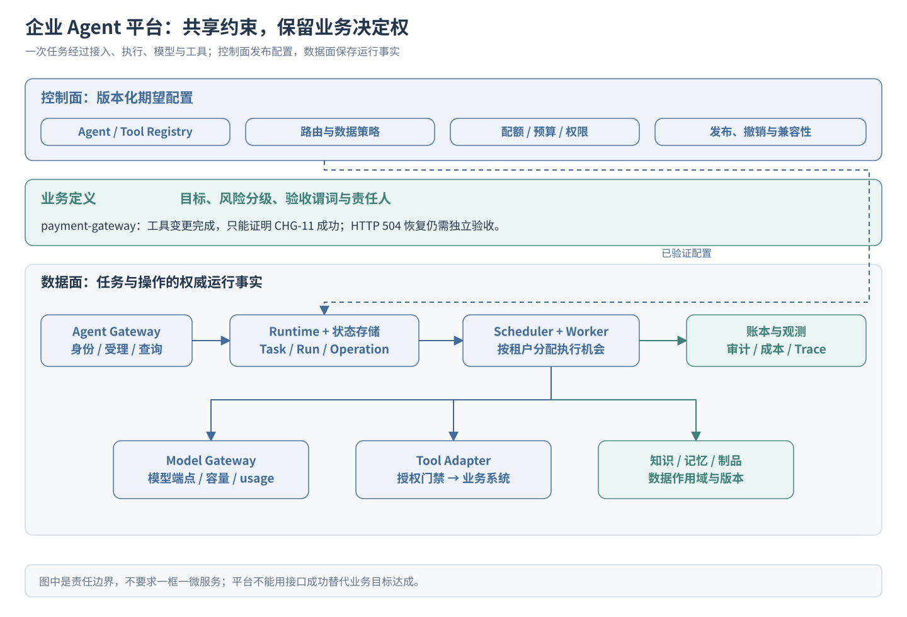

**图 9-1 从业务定义、控制面到任务运行数据面的平台路径**

平台的控制面维护“应该怎样运行”，数据面处理“此刻正在运行什么”。任务状态与操作账本属于数据面的运行事实；Registry、路由策略和配额配置属于控制面的期望配置。把两者分开后，更新一条路由规则不必暂停所有任务，查询某个 Run 的状态也不必依赖管理后台在线。

`TASK-11` 的业务状态仍由 Runtime 管理。平台知道它属于哪个租户、使用哪个 Agent 发布版本、还预留多少预算、等待何时到期，但不会因为 Model Gateway 返回 HTTP 200 就将它标记为恢复。接下来先看这条路径入口处最容易被混用的两个组件。

## 2. 双层 Gateway：分别接住任务契约与模型调用

“统一 Agent 接口”和“统一模型接口”看起来都在接收 JSON、转发请求，因此经常被做成同一个无边界的代理。问题在于，它们面对的对象、生命周期和失败处理方式不同。

Agent Gateway 接收的是希望持续推进的任务及其控制请求；Model Gateway 接收的是某一步决策所需的一次推理请求。前者可以跨小时存在，后者通常对应一个有明确调用期限的 Attempt。混淆二者，会让网络断开变成任务取消，或让模型超时变成整个任务重新提交。

### 2.1 Agent Gateway 管理任务接入与调用方视图

Agent Gateway 的首要工作是把外部请求转换成可信的任务请求。它验证调用身份，解析可信租户与用户归属，找到允许调用的 Agent 发布版本，检查输入规模和初始预算，再把创建意图交给 Runtime。

一个简化的受理结果可以是：

```json
{
  "task_id": "TASK-11",
  "run_id": "RUN-11-01",
  "agent_release": "incident-assistant@3.4.2",
  "accepted": true,
  "execution_status": "READY",
  "status_url": "/v1/tasks/TASK-11",
  "request_id": "REQ-11-01"
}
```

这表示平台已建立可查询的执行身份，并不表示 `payment-gateway` 已恢复。实际接口还应约定创建请求的幂等键作用域：同一个调用者重发同一受理请求，应得到原任务；用户明确“重新排查一次”则创建新的执行身份。客户端提供的幂等键需要与可信租户、调用方和接口一起构成唯一范围，防止不同租户碰撞。

任务接入不能采用“先返回成功，随后尽力写入数据库”。受理响应应建立在任务或可靠接收记录已经持久化的基础上；如果下游 Runtime 不可用，Gateway 可以拒绝受理，也可以写入有保障的接收队列，但必须明确排队状态、过期期限和去重协议。这个承诺决定用户重试后是否会出现两项任务。

### 2.2 Model Gateway 管理一次推理请求的资格和结果

Model Gateway 处理另一份契约：输入能够发送给哪些模型，当前是否有容量与预算，如何把响应返回给对应的模型步骤。它通常负责端点适配、路由、供应商凭据、调用限流、超时、可控重试、使用量采集与模型响应归一化。

但“归一化”不应把所有供应商强行伪装成完全相同。不同端点可能在工具调用、结构化输出、多模态输入、上下文长度、流式事件和使用量返回时机上有差异。平台需要先定义业务真正依赖的能力，再检测目标端点是否支持这些能力。无法保持的语义应明确拒绝或交给上层选择，不应静默降级。

| 维度 | Agent Gateway | Model Gateway |
| --- | --- | --- |
| 核心对象 | Task、Run 与控制请求 | Model Step 的调用 Attempt |
| 主要身份 | 租户、用户、服务、Agent 发布版本 | 继承的任务身份、模型步骤、供应商请求身份 |
| 持久承诺 | 已受理、可查询、可取消、可恢复 | 已调用、响应状态、使用量与结算状态 |
| 重试边界 | 同一创建意图去重，恢复原 Run | 只重试或替换本次推理尝试 |
| 不能代替 | 业务验收、Runtime 状态转换 | 工具授权、外部副作用恢复、业务完成判断 |

**表 9-2 两层 Gateway 的对象和失败边界**

对于 `collect_verification_window`，Runtime 可能先查询指标，再调用模型整理证据。若模型端点不可用，Gateway 可以选择符合要求的模型；它不能为了重新获得输入，擅自重放此前的 `CHG-11`。模型调用失败只触发模型步骤的恢复，不改变已提交的外部操作事实。

### 2.3 传递执行信封，避免每一层重新猜测请求归属

模型调用与工具调用都应携带由平台生成或验证的执行信封（Execution Envelope）。下面的结构只展示归属和控制字段，不代表这些字段全部直接交给模型：

```json
{
  "tenant_id": "tenant-payments",
  "principal": {"subject": "svc-incident", "delegated_user": "operator-27"},
  "task_id": "TASK-11",
  "run_id": "RUN-11-01",
  "step_id": "STEP-11-VERIFY-02",
  "attempt_id": "ATT-11-MODEL-01",
  "agent_release": "incident-assistant@3.4.2",
  "policy_revision": "policy-2026-11-05-7",
  "budget_account": "BUDGET-RUN-11-01",
  "data_classification": "internal-operational",
  "allowed_regions": ["region-a"],
  "deadline": "2026-11-05T14:45:00+08:00"
}
```

`tenant_id` 不能从用户 Prompt 中提取，也不能仅信任客户端传来的同名 HTTP Header。Gateway 应从认证主体及服务端映射获得租户，并核验委托关系。内部服务之间还需要验证信封签发方、有效期、目标服务和完整性；把字段复制一遍不等于建立可信传递。

`attempt_id` 标识一次物理请求；Fallback 后创建新 Attempt，以便记录失败尝试的延迟与费用。`step_id` 保持稳定，供 Runtime 判断多个响应中哪个结果可以被接纳。原请求晚到时，Gateway 可以保存其计费事实，但不能把两个模型输出都推进为新的业务动作。

### 2.4 流式响应需要区分展示、完成和提交

流式 Token 能降低用户的感知等待，却也扩大了部分响应的处理空间。连接在生成一半时断开，平台不能把已经展示的段落当成模型步骤成功，也不能直接把另一个模型的后半段拼上去。两个输出可能具有不同的前提、工具调用和结论。

一种清晰的协议是将事件分为 `delta`、`completed`、`failed` 和 `usage_finalized`。客户端可以展示 `delta`，Runtime 只在收到完整结果并通过结构校验后提交决策；费用结算则允许晚于内容完成。部分工具参数必须等到工具调用对象完整、Schema 校验通过并经过 Runtime 门禁，才具备执行资格。

Fallback 若发生在尚未向用户交付输出时，可以重做模型步骤；若已经交付部分内容，应通知上层本次尝试中断，并以新尝试重启或转入明确的恢复流程。具体产品可以允许文本修订，但必须让调用者识别修订边界。至此，Gateway 的边界已经明确，下一步才能讨论它如何选择端点。

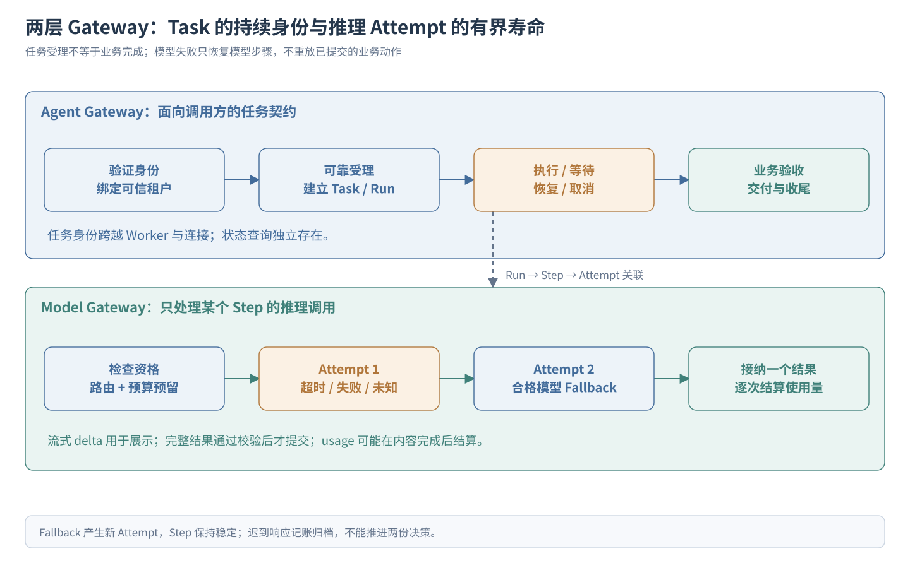

**图 9-2 任务 Gateway 与模型 Gateway 分别管理持续任务和推理尝试**

## 3. 路由与 Fallback：在能力、数据与预算内选择执行路径

选择模型并不只是比较单价或基准分数。对于包含内部事故日志的请求，某个端点即使更快、更便宜，也可能没有资格接收数据；对于要求输出生产变更结构的步骤，不支持相应 Schema 约束的模型也不能因为主模型故障就自动成为替代者。

因此，路由首先是资格筛选，然后才是在合格集合中优化。把顺序反过来，系统会在故障时最容易违反平时声称遵守的约束。

### 3.1 用硬约束构建候选集合

对请求 $x$，可以把候选模型集合表示为：

$$
\mathcal{M}_{eligible}(x)
=\{m\mid I(m,x)\land D(m,x)\land C(m,x)\land V(m,x)\}
$$

这里，$I$ 检查身份与租户授权，$D$ 检查数据分类、处理区域和留存约束，$C$ 检查上下文、工具调用、结构化输出等能力，$V$ 检查模型版本是否处于允许发布状态。运行容量和预算还需在真正派发前做实时预留；它们可能在选出候选之后发生变化。

本章的教学案例中，事故资料允许在 `region-a` 的已批准端点处理。若主端点故障，而剩余模型只在其他区域提供服务，合格集合就是空集。平台应排队、降级为不需要模型的确定性查询，或报告当前无法执行；把敏感数据删去几个字段后直接跨区域发送，并不能自动满足原有数据约束，脱敏本身也需要定义和验证。

能力契约应具体到调用行为。例如“支持 Tool Calling”还不足以说明是否支持并行工具调用、某种 JSON Schema 关键字、流式工具参数和结果续接。发布测试需要覆盖业务实际使用的那一部分协议。候选资格来自可验证契约，不能来自供应商宣传页上的同名功能。

### 3.2 在合格集合内优化，记录实际选择依据

路由可以采用固定模型、按任务等级选择、基于规则的升级，或经过评估的学习型路由。RouteLLM 等研究展示了用偏好数据学习强弱模型路由的思路，但具体收益依赖数据分布和成本假设，不能直接作为企业业务质量保证。[1]

平台可以先使用容易解释的策略：检索查询改写使用较小模型；高风险处置建议使用通过对应任务集评估的模型；结构校验失败后，在剩余预算内升级一次。这里的“风险等级”和“允许升级”由业务发布契约确定，Gateway 不应仅凭一段模糊 Prompt 自行判断。

可以用一个约束优化表达选择目标：

$$
m^*=\arg\min_{m\in\mathcal{M}_{eligible}}
\bigl(\alpha\,\widehat{C}(m,x)+\beta\,\widehat{L}(m,x)\bigr)
\quad\text{s.t.}\quad
\widehat{Q}(m,\mathcal{T}_x)\ge q_{min}
$$

$\widehat{C}$ 与 $\widehat{L}$ 是成本和延迟估计，$\widehat{Q}$ 是在相应任务类型 $\mathcal{T}_x$ 上得到的质量证据。估计值不是单次请求的承诺；如果任务分布发生变化，质量约束也可能失效。第 8 章的评估为路由提供依据，本章的平台则保存实际路由、策略版本、候选被排除的原因和后续效果，供重新评估。

### 3.3 Fallback 是新尝试，不能隐式扩大权限或重写历史

Fallback 至少有三种触发：端点不可达，调用返回可重试的基础设施错误，或完整输出未通过允许的格式校验。它们应采用不同规则。网络错误可以按期限与重试预算处理；内容被拒绝不应被当作“换个模型绕过去”；格式失败则应先确认是否属于模型能力不匹配、提示配置错误或偶发生成错误。

一个有边界的 Fallback 流程可以写成：

1. 将当前 Attempt 标记为失败、取消已确认或结果未知，并保存供应商请求身份。
2. 检查 Step 仍然有效，Run 未取消，剩余期限与预算允许再次推理。
3. 在同一数据、权限和能力约束内重新筛选候选。
4. 为新 Attempt 预留容量和成本，发送同一份受控输入或经过版本化规则重建的输入。
5. 校验新结果，只允许一个有效决策提交到 Runtime；迟到结果另行记账与归档。

模型输出可能不同，因此 Fallback 需要重新通过原有动作门禁。不能把主模型生成的前半个工具调用与备用模型生成的参数合并；也不能默认新模型拥有原模型内部不可见的状态。若请求依赖供应商持有的会话或缓存对象，平台应确认能否导出足够上下文；不能重建时，该步骤可能需要暂停，而不是假装完成透明切换。

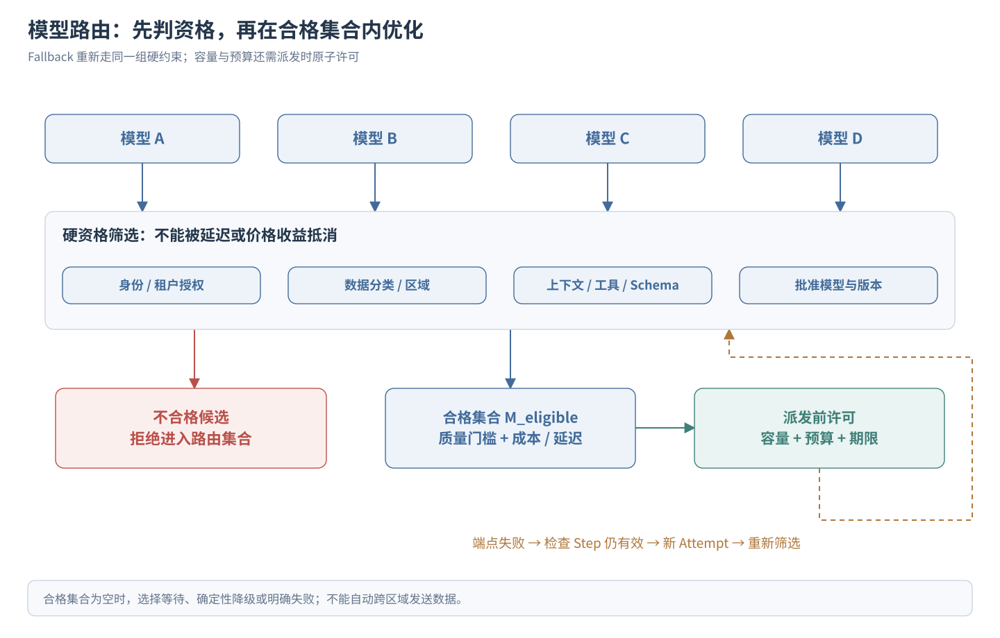

**图 9-3 路由先满足硬资格，再优化并控制 Fallback**

### 3.4 限制重试层数，避免将故障放大成流量风暴

应用 SDK、Model Gateway、供应商客户端和外围代理都可能重试。若三层各允许三次尝试，最坏情况下，一次逻辑调用会触发 27 次下游请求。共享平台应明确哪一层拥有重试策略，其他层只在清楚的传输边界内重试，或关闭重复机制。

AWS 关于幂等 API 和退避的工程资料强调，超时并不证明服务端没有执行；重试也可能加重过载。[2][3] 对模型调用，服务端可能已经生成并计费，客户端只是没有拿到结果。因此每次 Attempt 都应进入使用量对账，不能因本地超时自动视为零费用。对外部变更，这一问题更严格，仍由第 6 章的 Operation 身份和结果核对处理，Model Gateway 无权接管。

熔断（Circuit Breaking）可以在某个端点持续失败时减少新请求，半开探测则用有限流量判断是否恢复。Envoy 的断路器配置体现了对连接、待处理请求、活动请求和重试等资源分别设限的思路。[4] 熔断不等于模型质量检测：一个持续返回合法但错误答案的端点可能在基础设施指标上完全健康，需要评估与发布治理处理。

至此，模型路径具备资格、选择与失败边界。但即使所有请求都合法，多个租户同时运行仍会争夺有限容量。下一节从“能否调用”转向“谁先获得执行机会”。

## 4. 资源治理：从接口限流到按租户分配执行机会

假设教学平台同时承载三个租户：支付运维正在推进少量事故排查，数据分析团队提交了一批长报告，开发团队运行大量代码解释请求。三者都合法，也都可能愿意付费；如果仅设置一个全局每分钟请求数上限，先到的批量任务仍能占满所有模型连接，使事故任务的验收窗口迟迟无法采集。

资源治理需要回答四个不同的问题：是否接受更多任务，是否允许某租户继续消耗资源，已接受的任务按什么顺序运行，以及一次具体调用能否占用当前容量。它们分别对应接纳控制、配额、调度和并发门禁。

### 4.1 不同资源需要不同的计量维度

一次 200 Token 的分类请求和一次输出数万 Token 的报告生成，对模型容量的影响不同；一次等待外部审批的 Run 与正在执行浏览器操作的 Run，对 Worker 的占用也不同。统一按请求数收费或限流，容易奖励长请求并惩罚短请求。

| 资源 | 常见约束维度 | 需要防止的问题 |
| --- | --- | --- |
| 任务接入 | 活跃 Run 数、等待任务数、输入大小 | 大量未完成任务占满状态与调度容量 |
| 模型调用 | 请求速率、Token 速率、在途请求数 | 短时间突发、长输出占用连接、供应商配额耗尽 |
| Worker | CPU、内存、执行槽位、单段运行时间 | 长计算阻塞其他任务、内存失控 |
| 工具与业务系统 | 每租户/资源并发、接口速率、写操作串行约束 | 监控被打满、同一配置被并发修改 |
| 存储与检索 | 制品大小、索引容量、查询速率、历史保留 | 大文件、向量索引与历史快照无限增长 |

**表 9-3 Agent 平台需要分别治理的资源维度**

这些限制可以叠加：请求先满足租户配额，再满足模型端点配额和全局保护阈值。某个租户还有预算，并不代表供应商还有容量；供应商容量充足，也不代表允许突破该租户的费用上限。平台应保留结构化拒绝原因，例如 `TENANT_CONCURRENCY_LIMIT`、`MODEL_CAPACITY_UNAVAILABLE`、`RUN_BUDGET_EXHAUSTED`，让 Runtime 选择排队、延后、缩小工作范围或结束。

### 4.2 令牌桶控制速率，队列决定等待顺序

令牌桶（Token Bucket）适合控制一段时间内允许通过的资源量。桶以固定速率补充许可，允许在桶容量内发生短时突发。这里的“令牌”是限流许可，不一定对应 LLM Token；实现时应明确单位，避免把请求桶和模型 Token 桶混用。

对模型 Token 速率，可以在派发时按输入加输出估计占用许可，结束后按真实计量调整。输出尚未知，因此它是一种近似资源核算，不能替代成本硬预算。若供应商的限流口径按预先声明的最大输出计算，平台还必须适配该口径，否则本地认为尚有额度而供应商持续返回限流。

令牌桶并不提供公平排队。把全部请求放入一个 FIFO 队列，拥有大量任务的租户可以填满队列；单个长请求也可能在共享执行槽位中造成队首阻塞。更合理的起点是按租户建立逻辑队列，在租户之间分配执行机会，再在租户内部按任务等级和等待时间排序。

### 4.3 采用分层公平，防止优先级成为永久特权

一个可实现的调度层次是：先按资源池区分交互任务、后台任务和恢复工作，再在池内按租户权重轮转，最后从租户队列选择满足期限的 Step。分组不一定对应独立机器，但需要保留容量和最大并发边界。

加权轮转可以避免某个租户完全占据队列，却无法在请求大小差异很大时保证资源公平。Deficit Round Robin 一类思路可以按估算工作量扣减租户配额：每轮给租户增加服务额度，请求估计成本足够时才派发，完成后再修正实际消耗。对于模型生成，估算通常不准确，因此需要限制单次最大输出、最大执行时间和每租户在途数，而不能期待一种队列算法独自消除长尾。

优先级同样需要约束。事故任务可以获得更高权重或预留容量，但不能让调用方自行把所有请求标成 `critical`。优先级由身份、业务类型和平台策略映射；连续运行的高优先级任务也要受到总量限制。普通任务可以通过等待时间增长获得适度提升，或在超过排队服务目标后转入明确的延期状态，避免无限饥饿。

对 `RUN-11-01`，五分钟后采集完整观测窗口是有时间意义的工作。平台可以为到期验证保留一部分读取容量，而不必在等待期间一直占用模型连接。调度器先安排监控采集，拿到数据后再按需要安排模型解释；将二者捆成一个大槽位会使廉价的确定性工作也被模型拥堵拖住。

### 4.4 接纳控制应使用排队期限，而不是无限堆积

一个队列能保存一百万条消息，不表示系统有能力在业务期限内处理一百万个任务。若预计排队时间加执行时间已超过请求剩余期限，继续受理只会把即时容量问题延迟成大量超时。Google SRE 关于过载的讨论强调了按请求重要性拒绝超额流量、控制重试预算和避免多层重试放大的必要性。[5]

平台可以给出三种不同响应：未受理的容量拒绝；已可靠受理但预计延迟的排队状态；任务运行中遇到暂时容量不足的持久等待。三者需要不同的客户端重试行为。已经受理的任务不能因为客户端反复刷新状态而被重新入队；状态查询应有独立的轻量资源预算，避免故障期间用户无法知道任务去了哪里。

对于没有严格业务时点的批量工作，可以提供较长的排队期限和较低价格等级；对于交互任务，则需要更短队列和及时反馈。平台不必承诺所有任务永远成功，但需要让“已接受”与“能够在何时继续”的责任可查询。

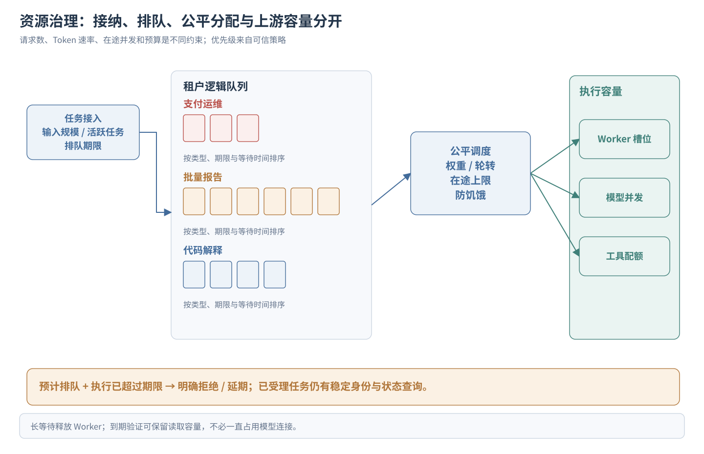

**图 9-4 接纳控制、租户队列、公平调度和上游容量的分层约束**

### 4.5 释放执行资源不等于释放全部责任

第 6 章已经说明，任务等待时可以释放 Worker。平台还要分别释放模型并发槽位、沙箱、临时凭据和资源锁；同时保留任务身份、等待记录和预算承诺。执行资源与财务承诺的寿命往往不同。

请求在本地超时后，可以释放本地连接，但如果供应商仍在生成，远端容量与费用未必已经结束。平台应尝试取消，并根据端点协议跟踪取消结果；无法确认时，应保留独立的未决调用记录和有限的远端占用估计。若每个本地超时都立即释放全部配额并发起新尝试，实际远端并发可能远高于本地计数。

类似地，一个已确认完成的模型请求可以释放并发槽位，但其费用可能尚未获得最终 usage。下一节将把这种“运行结束、账还没结清”的情况放进明确的预算模型。

## 5. Token 与成本：把预算做成可预留、可结算的账本

最容易实现的成本治理是在请求结束后累加 Token，再发现某个租户已经超支。对于串行小应用，这种事后计数或许足够；多个 Worker 并发读取同一剩余额度时，它无法阻止它们同时花掉最后一笔预算。

预算必须在派发前参与许可决定，实际使用量则在结果返回后参与结算。两者之间需要一份有状态的预留记录，而不是一个随意增减的计数器。

### 5.1 区分使用量、供应商成本与内部归属成本

平台至少需要保存三种口径：模型返回的使用量、按合同或账单口径得到的供应商成本，以及分摊到业务部门的内部成本。三者相关，但不必相等。

模型可能区分输入、输出、缓存读取、缓存写入或其他计费项；不同端点对内部推理等资源的报告和计价方式也可能不同。平台应保留供应商原始 usage 和归一化字段，同时保存价格表版本。不能把所有输入 Token 相加后乘同一个单价，也不能把没有返回的 usage 当成零。

内部成本还可能包含工具、沙箱、检索和存储。一次模型响应较贵但减少了十次工具往返，可能让整项任务更便宜；反过来，单次推理降价也可能因质量下降增加重试。第 8 章评价单位任务成本，本章的账本提供可归因的事实，不能只展示模型接口的平均单价。

### 5.2 用预留额度控制并发支出

对某个预算账户，定义预算上限 $B$、已结算费用 $S$、有效预留 $R$。可用额度为：

$$
A=B-S-R
$$

派发新请求前，平台根据可验证的输入量、最大输出设置、价格版本和其他可能费用，计算预留 $r$。只有原子检查 $A\ge r$ 并写入预留成功后，调用才可发出。请求结束后，以真实成本 $c$ 结算：

$$
S'=S+c,\qquad R'=R-r
$$

这是账本关系，不是要求把它实现成两条互不关联的计数更新。结算必须以预留身份去重，并与账户更新处于一致的事务边界。若结算通知重复到达，不得重复增加 $S$。若真实成本 $c>r$，则说明估算存在缺口，账本仍需记录真实费用，并停止后续支出或使用事先授权的风险额度；不能把账单裁成 $r$ 以维持表面不超预算。

对于要求严格费用上限的场景，预留必须覆盖可强制限制的最坏使用量，或由供应商端的硬限制共同保证。若某类费用无法事前界定，本地估算只能提供软预算控制，平台应在契约中说明边界，并对这类请求设置保守限额或不允许进入硬预算产品。

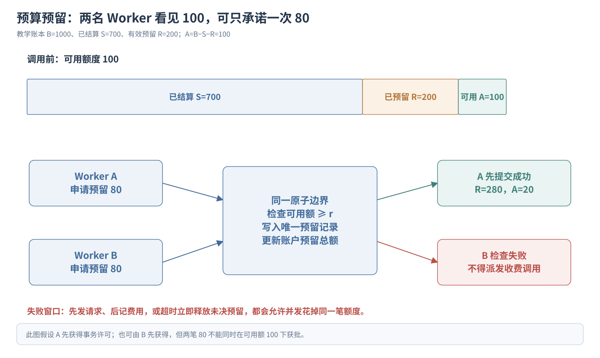

**图 9-5 调用前原子预留，防止多个 Worker 同时花掉最后预算**

### 5.3 将预留记录做成状态机

下面的教学结构展示一笔模型调用预算记录。它以 Attempt 为计费单位，以 Run 为业务归属：

```json
{
  "reservation_id": "RES-11-M-03",
  "tenant_id": "tenant-payments",
  "budget_account": "BUDGET-RUN-11-01",
  "run_id": "RUN-11-01",
  "step_id": "STEP-11-VERIFY-02",
  "attempt_id": "ATT-11-MODEL-02",
  "reserved_units": 40,
  "settled_units": null,
  "price_revision": "price-contract-19",
  "status": "RESERVED",
  "provider_request_id": null
}
```

`RESERVED` 表示获得派发资格；调用已发送后转为 `IN_FLIGHT`；获得可靠使用量后转为 `SETTLED`。只有能确认请求尚未发出，或供应商明确保证未产生费用的取消，才可以直接 `RELEASED`。本地超时、Worker 崩溃和 usage 丢失应进入 `PENDING_RECONCILIATION`，等待账单或查询核对。

教学预算账户上限为 1000 单位，已经结算 700 单位，现有预留为 200 单位，则可用额为 100。两个 Worker 各申请 80 单位时，原子预留只能允许一个成功。如果已发送请求超时后立即把 80 释放，另一个 Worker 就可能再次花掉这笔额度，而原供应商仍继续计费。这是预算超支的典型失败窗口。

对账记录也不能永久保留而无人处理。平台需要定义未决费用的查询途径、最长对账周期、责任人和最终会计处理。可以在明确风险额度内使用保守估计完成内部结算，后续真实账单到达再冲正，但必须保留估计与实际的区别，不能伪造精确 usage。

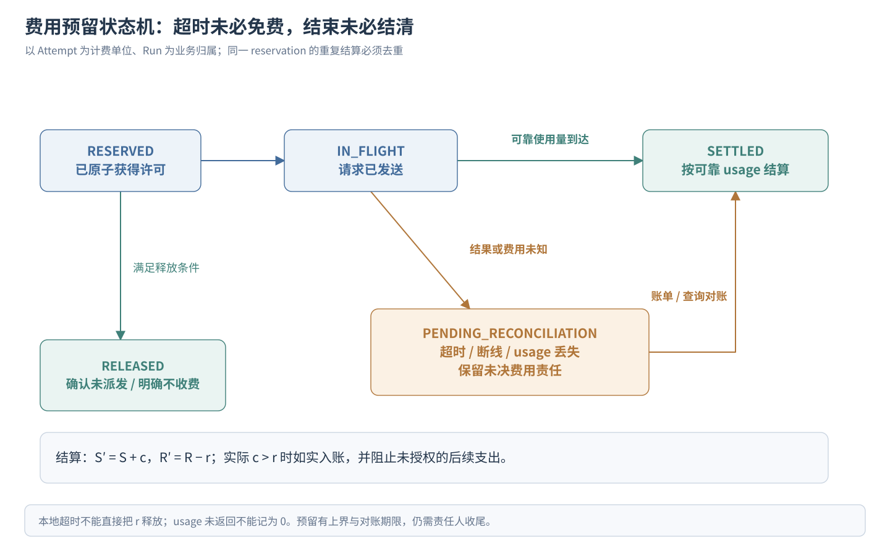

**图 9-6 预留、派发、结算与未知费用对账的独立生命周期**

### 5.4 多层预算要在一个许可结果中生效

企业通常同时存在组织月预算、租户日预算、Agent 预算和单 Run 预算。一次请求必须满足所有相关约束。若先扣租户预算，再扣 Run 预算失败，就需要释放前者；释放消息丢失会造成虚假占用。反过来，如果两个账户检查与扣减不原子，则可能在并发中突破其中一个上限。

可以把预算许可集中到一个具有一致事务语义的服务或数据库，按稳定顺序锁定相关账户，原子创建一份关联多个账户的预留。规模更大时，也可以把全局预算切成有上限的地域或租户子额度，由本地账本快速分配；总分配量本身必须受全局上限约束，回收与续发需要明确协议。

这种额度下放能降低远程调用和控制面依赖，但带来利用率取舍：某一区域有闲置额度，另一区域仍可能拒绝请求。平台可以进行低频再平衡，而不必让每次模型调用都同步访问全球预算中心。为了防止超支而选择保守拒绝，与为了容量利用率而允许少量风险敞口，是需要明示的产品选择。

### 5.5 Token 优化必须能解释收益和质量变化

成本优化可以从缓存稳定前缀、减少重复检索、压缩无用历史、限制无进展循环和选择合格的小模型入手。但每种优化都可能改变任务行为：压缩丢掉限制条件会降低正确率，缓存复用错误权限的内容会造成越权，较小模型增加重试会抵消单价收益。

平台应把节省与业务结果连接起来，至少观察每个成功任务的总成本、失败任务已消耗成本、Fallback 与重试占比、未决账单年龄，以及预算拒绝对任务完成率的影响。预算耗尽也是任务结果的一部分，不应从成功率分母里消失。

预算决定“还能执行多少”，但每一次支出还必须回答“到底执行了哪个版本的能力”。模型、Prompt、工具 Schema 和策略随时变化，长期任务却需要跨版本恢复。下一节把这些配置收束为可发布的能力对象。

## 6. Registry 与发布：让能力有版本，让运行能解释

Agent Registry 不是一个写着名称和简介的网页，Tool Registry 也不是把函数列表存进数据库。它们需要为运行时提供可验证的能力定义，并为发布、回滚和事故调查提供稳定版本。

一个 Agent 可以使用同一个名字持续迭代，但一次 Run 不能在毫无记录的情况下经历 Prompt、工具权限和完成条件的同时变化。否则，评估通过的是哪个系统、事故发生时运行的又是哪个系统，都无法回答。

### 6.1 Agent 发布物应当锁定一组相容配置

本章把 Agent Release 定义为一组经过验证、可追踪的配置和程序制品。它通常包括 Runtime 构建、状态 Schema、编排定义、Prompt 模板、工具绑定、模型能力配置、预算策略及评估证据。业务验收定义仍由业务负责，但它的版本也应成为发布记录的一部分。

```yaml
agent: incident-assistant
release: 3.4.2
owner: payments-sre
runtime_artifact: incident-runtime@sha256:<artifact-digest>
state_schema: incident-state/v5
orchestration_revision: incident-flow/12
context_template: incident-context/8
model_profile: incident-reasoning/4
tool_bindings:
  - monitor.read@2.1
  - channel.allowlist.read@3.0
  - channel.allowlist.change@3.2
acceptance_contract: payment-recovery/6
policy_profile: production-incident/7
evaluation_report: eval-report-2026-11-05-rc2
resume_compatibility:
  readable_state_schemas: [incident-state/v5]
  migration_required_from: [incident-state/v4]
```

这是发布清单示意，摘要占位符必须在真正构建时替换。引用评估报告表示发布流程应当能找到证据，不表示这份教学清单已经通过评估。`model_profile` 可以允许一个经过验证的模型集合，但实际路由到哪个模型版本仍需在每次调用中记录。

内容摘要（Digest）能绑定不可变内容；OCI 描述符规范提供了以媒体类型、大小和摘要描述制品的通用方式。[6] 摘要本身不证明制品安全，也不说明谁构建了它。来源证明（Provenance）则记录制品由什么构建过程和输入产生，SLSA 的相应规范可用于理解这类元数据。[7] 将发布配置与构建证据关联，是为了让回溯有据可查，不是为了用一个签名替代测试。

### 6.2 Tool Registry 必须描述副作用和恢复契约

Tool Registry 至少应保存工具身份、版本、输入输出 Schema、风险类别、权限范围、执行端点、超时以及幂等和状态查询能力。对于读取工具，还需要数据分类和结果最大体积；对于写入工具，需要资源版本前置条件、审批要求和结果未知时的查询方式。

| 字段组 | 需要回答的问题 | `CHG-11` 对应含义 |
| --- | --- | --- |
| 身份与版本 | 这项能力由谁维护，使用哪一份实现与 Schema？ | 渠道白名单变更工具的批准发布版本 |
| 权限与资源 | 能改什么环境、什么渠道、什么资源？ | 仅在已授权范围内处理渠道 A 的 E11 |
| 副作用协议 | 幂等键在哪里，重复参数如何处理？ | 重试沿用原 Operation，不创建第二次变更 |
| 并发前置条件 | 是否要求预期配置版本？ | 审批绑定 v17，执行前验证版本关系 |
| 结果恢复 | 超时后按什么身份查询结果？ | 查询 `CHG-11` 并读回 v18 |
| 验收与责任 | 工具成功证明什么，谁负责业务验收？ | 证明变更完成，HTTP 504 恢复仍由业务验收决定 |

**表 9-4 工具注册需要保留的工程语义**

工具作者声明 `read_only` 或 `idempotent` 并不自动建立可信保证。平台应通过接入评审、接口测试和必要的代理约束核验这些声明。一个名为“查询”的端点若会触发隐式刷新或创建作业，就需要如实描述副作用；Registry 的错误元数据会直接影响调度并发和重试策略。

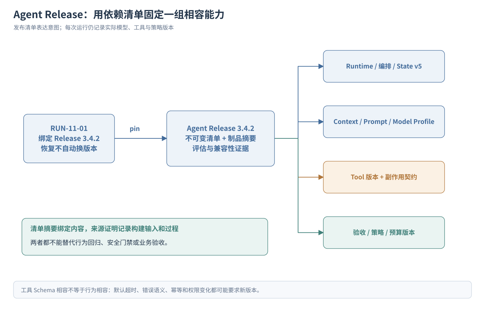

**图 9-7 Run 固定 Agent Release，Release 固定相容依赖与行为契约**

### 6.3 Schema 相容不代表行为相容

某次工具升级没有删除字段，只把 `timeout_ms` 的默认值从 3000 改为 30000。Schema 校验仍能通过，但任务期限、重试次数和业务压力都发生变化。又如工具把“未找到资源”从明确错误改成空列表，模型可能把权限缺失误认为资源不存在。

因此发布检查需要同时覆盖语法、行为和策略。语法检查包括字段类型、必填项、枚举和返回结构；行为检查包括超时、幂等、错误语义、排序和分页；策略检查包括权限、数据范围、审批与日志保留。改变其中任一维度，都可能要求新的版本及相应回归。

Registry 可以维护 `draft → validated → canary → active → deprecated → revoked` 等状态，但状态名不应代替准入规则。谁能把版本升为 active、需要哪些报告、撤销后如何影响正在运行的任务，都必须成为可执行流程。

### 6.4 发布、回滚与恢复是三个不同动作

新版本发布后，可以让新 Run 使用新 Release，而正在执行的 Run 继续绑定原 Release，避免执行中途被修改。需要迁移时，在安全边界暂停任务，验证状态 Schema 和工具语义相容，执行可审计迁移后再恢复。不能直接把数据库中的 `release` 字段改成新值，然后期待旧状态自然适配。

回滚通常影响后续创建的 Run，不会撤销新版本已经产生的外部效果，也不会自动把新状态格式变回旧格式。如果旧 Runtime 无法读取新 Schema，回滚代码可能比继续运行更危险。发布记录应明确向前恢复、向后读取和人工处置策略，而不只是保存一个“上一版本”按钮。

对于安全撤销，版本绑定也不是豁免。若 `channel.allowlist.change@3.2` 被发现存在越权缺陷，平台可以阻止所有新的变更派发，包括旧 Run 中尚未执行的动作；已发送操作仍需核对真实结果。恢复 `RUN-11-01` 时，读取 v18 和采集指标可能继续，而任何新增写操作必须重新通过当前有效的门禁。

### 6.5 灰度按任务身份分组，避免同一运行左右摇摆

灰度发布应根据稳定的 Task 或 Run 身份选定发布组，而不是让每一步随机落到新旧版本。前者可以比较完整任务的行为与成本，后者容易形成没有单独评估过的混合系统。

即使运行程序保持固定，模型路由、工具可用性和安全策略仍可能因故障或撤销而变化。因此运行记录应同时保存“声明的 Release”与“实际使用的组件版本”。发布清单提供意图，执行清单提供事实，两者差异可以被查询和解释。

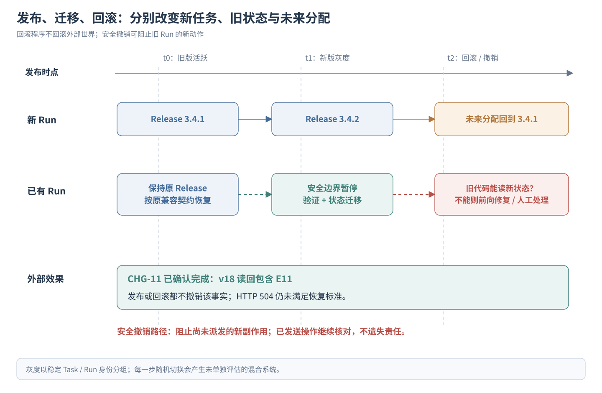

**图 9-8 新版本发布、已有任务迁移与回滚影响不同对象**

至此，Registry 回答了使用什么能力，但它还没有证明调用者有权使用这些能力。下一节把版本化能力放进身份、委托和授权链中。

## 7. 身份、权限与审计：让每一次动作都有可验证的责任链

企业 Agent 的权限问题不止是“用户能不能调用这个机器人”。用户有权读取事故报告，不一定有权修改生产配置；服务账号有权调用变更 API，也不代表它可以代表任何用户使用全部权限。Agent 将用户意图、模型建议和服务端能力连接起来，这条链上每一次权限放大都必须有明确依据。

NIST 的零信任架构将信任判断从单纯的网络位置和资产归属转向对主体、资源和访问条件的验证。[8] 放到 Agent 平台中，这意味着“来自内部 Worker”不能成为跳过工具授权的理由，模型生成的工具名称也不能成为授权证明。

### 7.1 同时保留发起人、执行主体和责任归属

一次生产操作至少需要关联三类对象：提出任务的用户或事件源，执行任务的服务主体，以及被授权操作的业务资源。后台 Agent 还需要区分持续授权的所有者与当前触发事件，不能因为没有用户在线就退化成无限权力的系统账号。

例如，`TASK-11` 可能由监控告警触发，`svc-incident` 承担运行，支付运维团队负责处置。若某个值班人员批准 `CHG-11`，审批人的身份和批准范围应另行保存；不能用“这个 Agent 曾经获得生产权限”代替这次动作的授权。

平台应将以下信息连成责任链：`initiator → delegated authority → service principal → operation → target resource`。事件源证明任务从哪里来，委托证明服务可以代表谁行动，Operation 记录具体作用于什么资源。链条中的每一项都应引用可信身份系统或审批记录，不能由模型自己填写后获得承认。

### 7.2 凭据交换应收窄权限，而不是转交万能密钥

一个常见错误是把用户原始 Token 或长期管理员密钥注入模型上下文，再让模型选择如何调用工具。这样既扩大泄露面，也让权限无法按照任务、工具和期限收敛。

更合理的方式是由可信后端完成凭据交换或凭据代理：根据用户委托、服务身份和目标工具签发短期、限定 audience 与 scope 的凭据，模型仅看到工具 Schema 和必要业务参数。RFC 8693 定义了 OAuth 2.0 Token Exchange，包括主体与行为者相关语义，可用于构建这类委托机制；它提供协议构件，具体权限收窄仍由授权服务器策略决定。[9]

对渠道变更，可以将凭据限制到指定租户、生产环境和允许的接口。资源级条件未必都能编码进标准 Token，可由工具代理在请求时查询策略并校验。无论采用哪种机制，凭据的有效期都应小于或等于任务允许使用它的期限，并有撤销或失效处理。

长任务恢复后，不应从 Checkpoint 读取一份旧密钥继续执行。它应根据当前有效的委托重新取得凭据，再验证动作仍被允许。保存“为什么有权取得凭据”的引用，比保存凭据本身更适合持久状态。

### 7.3 将决策点与执行点放在正确位置

授权可以采用策略决策点（Policy Decision Point，PDP）与策略执行点（Policy Enforcement Point，PEP）的分工。PDP 根据主体、资源、动作和环境给出决策；PEP 位于真正执行的位置，在未获允许时阻止操作。

对于 Agent，至少有三道不同门禁：Gateway 检查谁能创建哪类任务，Runtime 检查当前步骤及审批是否允许提出动作，Tool Adapter 或目标服务检查这次具体请求能否作用于该资源。入口允许只是必要条件，不能替代最后一道门禁。

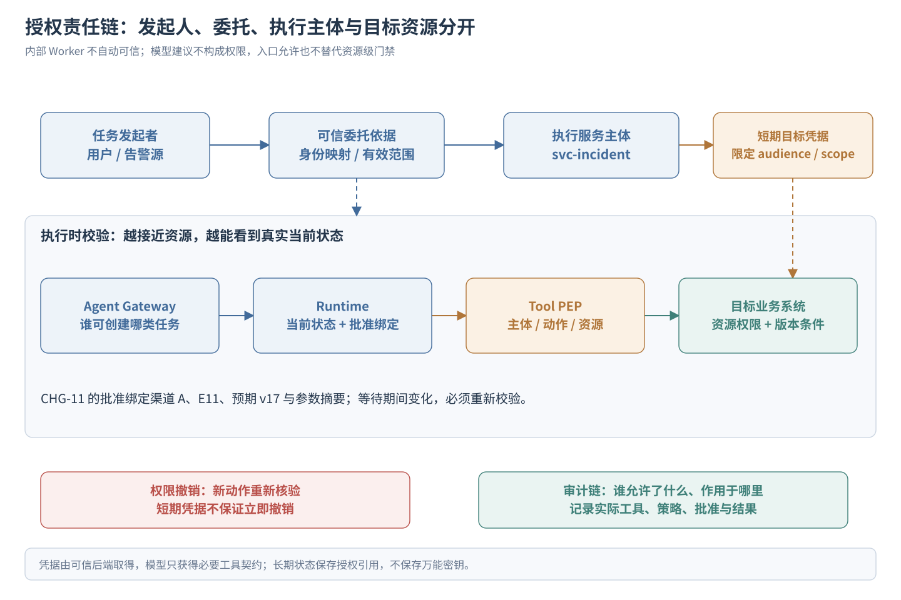

**图 9-9 从可信委托到工具执行和资源级授权的责任链**

这种设计不是把相同检查重复三次。Gateway 管任务资格，Runtime 管执行上下文，目标服务管资源真实状态。只有靠近资源的检查，才能可靠发现审批之后配置已变化、资源被转移或权限已撤销等情况。

### 7.4 防止检查与使用之间发生权限漂移

`CHG-11` 的批准绑定渠道 A、E11 和预期版本 v17。如果排队期间配置已更新到其他版本，仅凭“审批仍在有效期内”继续执行就可能覆盖新变更。第 5、6 章已建立资源版本与操作身份协议，平台需要确保这些字段穿过 Gateway、队列和工具代理时不会被丢弃。

类似的问题也发生在权限上：任务创建时用户有生产变更权限，等待人工审核期间该权限被撤销。对于新的副作用，平台应按动作风险在执行时重新检查当前权限。短期凭据只能限制旧授权继续生效的时间窗口，不能保证撤销立即生效；需要立即撤销时，必须依赖执行时校验或可靠的撤销协议，不能把创建时的一次允许无限延长到整个 Run。

审批也不应批准一句自由文本“按建议操作”。它应绑定规范化参数摘要、目标资源、工具版本、风险说明和有效期。参数或版本发生实质改变时，原批准不再适用。平台可以统一提供审批对象和校验机制，业务仍决定哪些动作需要谁批准。

### 7.5 审计记录要能回答“谁允许了什么”，同时限制敏感复制

一条可用的审计记录至少关联可信主体、租户、Task/Run/Operation、实际工具版本、规范化参数摘要、策略决策、审批身份、资源版本和结果状态。拒绝动作也值得记录，因为它可能解释任务为什么停止，或揭示某个 Agent 正在反复请求不适当的能力。

但审计不意味着把所有 Prompt、密钥和工具原文永久存储。可以保存对象引用、版本和哈希，在有权限的调查流程中读取原文；必要的内容快照则应采用访问控制、加密、保留和删除规则。完整日志可能包含其他租户或第三方信息，审计存储自身同样需要治理。

平台应区分运行诊断、业务审计和财务记录。Trace 可能采样，不能作为完整变更账本；成本记录需要覆盖所有收费尝试；生产变更审计可能要求严格保留。将三者只写进一个尽力发送的日志流，会在日志拥堵时同时失去恢复、追责和结算依据。

身份链建立之后，还有一个更隐蔽的问题：即使每次工具调用都正确授权，缓存、向量索引或临时文件仍可能把一个租户的数据交给另一个租户。隔离必须沿整个数据流检查。

## 8. 多租户隔离：从 API 身份延伸到每一份派生数据

租户隔离既包含保密性，也包含完整性、可用性和成本归属。一个租户读到另一个租户的文档是泄露；一个租户的任务修改了另一个租户的配置是越权；某个租户占满所有执行槽位是资源隔离失败；费用记到错误部门则是账务隔离失败。

“每张表有一个 `tenant_id`”只是起点。数据会从源表进入上下文、缓存、队列、索引、制品和审计，每一份派生对象都需要保留足够的作用域。

### 8.1 根据威胁模型选择隔离强度

同一企业内互相信任的团队，与共享平台上的外部客户，通常需要不同隔离。前者可能接受共享数据库、命名空间和 Worker 池，后者可能要求独立密钥、网络、存储甚至计算集群。

Kubernetes 的多租户文档区分控制面和数据面隔离，并讨论 Namespace、访问控制、配额、网络、存储和容器沙箱等机制。[10] Namespace 是管理范围，不是对所有攻击和资源争用的自动完整防护。运行不可信代码时，共享内核的容器是否足够，需要根据威胁模型、沙箱能力和业务风险判断。

可以采用分级方案：普通只读任务使用共享池；需要生产凭据的工具使用受控代理；执行任意代码的任务进入更强沙箱；存在特殊数据驻留或客户要求的租户使用独立资源池。隔离等级应在接入契约中声明，不能等事故发生后才发现某些任务实际上共享宿主文件系统。

### 8.2 数据库隔离必须抵达查询执行层

应用层每次手写 `WHERE tenant_id = ...` 容易漏掉一处管理接口、批量任务或关联查询。数据库的行级安全（Row-Level Security，RLS）可以作为额外防线，使查询受到服务端策略限制。

但 RLS 也有边界。PostgreSQL 官方文档指出，超级用户、具有 `BYPASSRLS` 属性的角色以及通常情况下的表所有者能够绕过行级策略。[11] 因此不能用拥有管理权限的应用账号访问所有表，再宣称开启 RLS 就已经实现隔离。迁移账号、运维账号和业务账号需要不同职责。

若使用连接池在请求开始时设置租户上下文，必须保证事务结束后清理状态，并避免复用连接时残留上个租户身份。租户值应来自服务端可信信封，不能允许模型生成的 SQL 或任意查询参数修改它。对于复杂分析，平台可以提供受限视图或查询代理，而不是把共享数据库凭据交给代码执行环境。

### 8.3 缓存键要包含安全作用域和配置版本

缓存最容易出现“逻辑正确、权限错误”：两个用户提出相同问题，命中同一个回答缓存，但他们有权查看的文档不同。仅以 Prompt 文本哈希作为缓存键，会把权限差异抹掉。

缓存身份至少需要考虑租户、授权范围或安全分区、模型与模板版本、检索数据版本，以及影响输出的工具 Schema。对于依赖用户细粒度权限的回答，未必适合直接共享结果缓存；可以缓存公开中间结果，再在当前授权下重新构建上下文。

撤权和数据删除还会带来失效问题。缓存内容即使没有变，获取它的资格也可能已经改变。平台应使权限版本或撤销信号参与缓存读取，并区分“缓存仍在”与“当前请求可以拿到”。供应商 Prompt Cache 也需要核验其作用域、驻留和留存契约，不能把平台本地隔离等同于外部服务所有内部缓存已经隔离。

### 8.4 检索、记忆和制品也需要完整的租户传播

向量检索不能只在模型回答后过滤敏感片段，因为内容一旦进入上下文就已经被处理。检索资格应在候选选择阶段生效，返回原文前再次核验对象权限；若使用共享索引，过滤条件由可信服务添加，不能交给模型决定。

长期记忆尤其容易跨租户污染。某个租户的配置经验可能带有私有服务名或操作习惯；将它整理成“通用经验”并不自动获得跨租户发布许可。跨租户共享需要独立的去标识、验证和发布流程，默认写回原作用域更容易维护清晰责任。

对象存储中的报告、截图、沙箱文件和模型批处理结果同样需要作用域。路径中包含租户名称可以方便组织，但访问控制仍应由身份与资源策略保证；猜不到 URL 不等于无权读取。临时下载地址需要有限有效期和目标对象绑定，不能因某个 Run 结束就留下永久公开链接。

### 8.5 队列和沙箱不能成为身份断点

异步执行把请求从 HTTP 线程移入消息系统，最容易丢掉调用者身份。消息中应保存可信租户、Run 与步骤身份的引用或受保护信封；消费者重新校验任务归属和当前执行权，不能仅相信生产者写入的字符串。死信队列、重放工具和人工补发接口也要执行同样的租户边界。

共享 Worker 运行多个租户任务时，应清理内存缓存、临时文件和环境变量；临时凭据不得进入可复用镜像或共享目录。沙箱应限制网络出口、挂载和资源，结束后按规则回收。即使制品要保留，也应先转入有租户权限的存储，再清理执行环境。

对平台运维人员，还需要明确跨租户调查权限。排障入口可以允许在审批或应急授权下访问特定对象，并记录访问目的和范围；默认允许所有运维账号读取所有 Prompt，会让业务侧的精细权限失去意义。

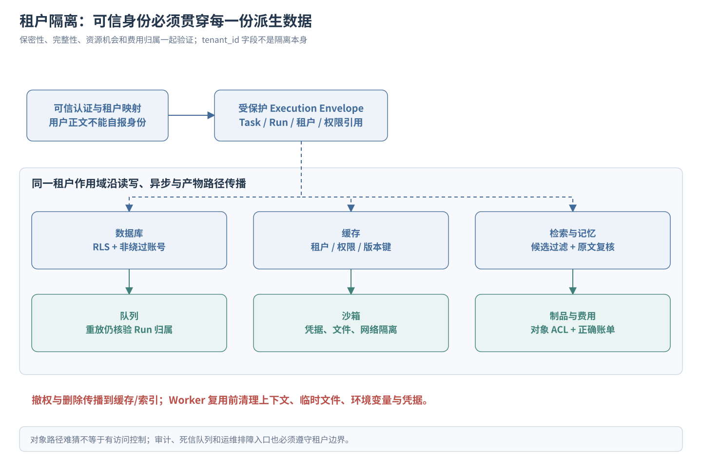

**图 9-10 租户身份贯穿数据库、缓存、检索、队列、沙箱与制品**

### 8.6 用跨边界测试验证隔离，而不是只检查配置存在

隔离测试需要主动构造身份相似、对象 ID 碰撞和缓存重复等场景，观察所有派生路径。下面是一组比“访问接口返回 403”更完整的验收点：

| 测试输入 | 应验证的结果 |
| --- | --- |
| 两个租户提交相同 Prompt 和同名文件 | 不命中包含对方私有内容的缓存或制品 |
| 客户端伪造 `tenant_id` Header | 服务端以可信身份映射为准，伪造字段不能改变作用域 |
| 消息重放时替换租户但保留 Run ID | 消费者拒绝不匹配身份，不能推进另一租户的 Run |
| 用户撤权后恢复长任务 | 新读取与副作用重新受当前授权限制 |
| 同一 Worker 连续运行不同租户代码 | 临时文件、环境和凭据没有残留泄露 |
| 高流量租户持续提交长任务 | 其他租户仍有约定的执行机会与状态查询能力 |

**表 9-5 多租户隔离的跨组件验收场景**

这些测试需要同时覆盖正常允许路径，防止平台通过一律拒绝获得表面安全。身份、数据和资源隔离建立以后，平台本身也会成为共享故障源；下一节讨论它如何在组件故障时保持这些边界。

## 9. 控制面与数据面：组件失效时仍保持可解释的运行边界

集中建设平台可以减少重复实现，也会集中风险。如果每一次工具调用都同步查询 Registry、策略中心、费用后台和管理数据库，任何一个管理组件故障都可能让所有 Agent 停止。若为了可用性在故障时绕过全部检查，又会把局部故障升级为越权和超支。

控制面与数据面分离的价值，是提前确定哪些信息可以安全缓存、哪些决定需要当前事实，以及每种依赖失效时系统仍能承诺什么。

### 9.1 让控制面分发版本，让数据面执行已验证配置

Registry、路由配置、配额设置和策略发布可以生成不可变版本，由数据面拉取、校验并原子切换。数据面保存当前有效版本和最近一次成功获取时间，调用时无需为每个字段访问管理数据库。

OPA 的 Bundle 机制提供了策略和数据打包、版本标识、下载与签名校验等构件，可作为策略分发的参考。[12] 但使用 Bundle 不代表策略永远新鲜。平台仍需规定最大允许陈旧时间、撤销传播方式和验证失败后的行为。

配置切换也需要一致边界。如果路由规则更新了允许区域，而数据分类规则还停留在旧版，两个各自合法的配置可能组合成违规路径。可将强关联配置封装成一次原子发布，或用兼容版本声明阻止错误组合。每次调用记录实际配置版本，才能解释发布期间的行为差异。

### 9.2 “使用最后有效配置”需要时效与风险条件

管理页面不可用时，已加载配置的只读任务往往可以继续。权限中心不可用时，是否可以继续使用缓存授权则取决于授权有效期、撤销要求和动作风险。不能给所有故障统一设置 `fail_open=true`，也不宜一概停掉所有状态查询和恢复工作。

可以将决策分为三类：

- **可继续的本地确定性工作**：整理已授权且仍有效的证据、生成已有状态视图、推进不依赖新外部效果的计算。
- **可在有效授权内继续的访问**：使用未过期、范围明确的短期凭据和已验证策略读取允许资源，并记录策略陈旧程度。
- **必须等待的动作**：缺少当前授权、预算许可或资源版本检查的生产写入；不能以“之前允许过”作为无限继续的理由。

应急授权也需要预先定义：由谁启用、允许什么范围、有效多久以及怎样补齐审计。它是另一条受控路径，不是平台故障时悄悄跳过检查。

### 9.3 按组件故障定义降级矩阵

下表给出一种教学平台的处理方式。实际选择应由业务风险与服务目标决定，但必须在故障之前写清楚。

| 故障组件 | 可以继续什么 | 必须限制什么 | 恢复后的处理 |
| --- | --- | --- | --- |
| Registry 管理接口 | 使用已验证、未撤销且仍符合策略的本地发布物 | 新发布与未知版本加载 | 核对版本及撤销状态 |
| 模型端点 | 合格候选 Fallback、确定性采集、持久等待 | 跨数据边界降级、无限重试 | 结算未决调用，逐步恢复流量 |
| 预算服务 | 在事先下放的有界额度内运行 | 没有额度仍发新付费调用 | 汇总本地账本并对账 |
| 权威状态存储 | 展示明确标注时间的缓存视图 | 新状态提交及无法安全登记的副作用 | 从已提交状态恢复，核对未决操作 |
| 消息系统 | 持久 Outbox 保留未派发工作 | 把未派发任务报告为已执行 | 去重重投，限速清理积压 |
| 遥测收集器 | 在容量允许时缓冲可丢失诊断数据 | 丢弃必须完整保存的操作审计却继续高风险动作 | 区分缺失诊断与完整审计事实 |

**表 9-6 共享组件故障时的继续、限制与恢复边界**

状态存储故障尤其关键。Worker 即使仍在内存里知道下一步要做什么，也不能在无法登记 Operation 的情况下继续发送生产变更。否则恢复后既不知道动作是否发出，也无法保证使用原身份核对。对已经发送的请求，可以接收并缓冲结果，但必须按持久化能力和下游协议决定怎样确认消息，避免丢失唯一回执。

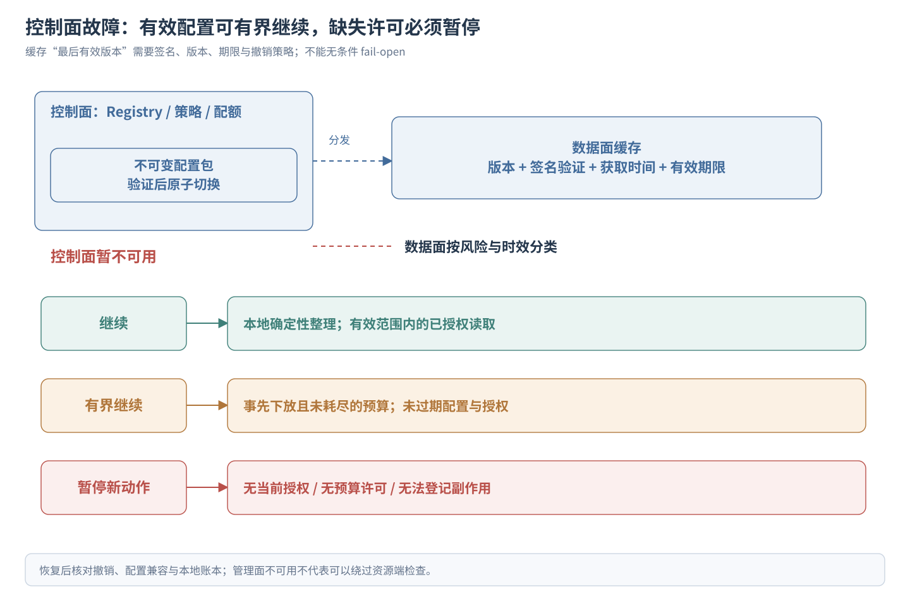

**图 9-11 控制面失效时按配置有效期与动作风险决定继续或暂停**

### 9.4 用故障域限制一次问题影响的范围

将所有租户、队列和 Worker 部署到同一个资源池，平台越统一，故障影响越大。可以按租户群、地域、业务等级或能力风险划分独立运行单元，使某个模型连接池耗尽、某个租户异常流量或某个版本缺陷只影响部分业务。

AWS 关于静态稳定性的工程文章强调，数据面应尽量能够在控制面不可用时利用已有资源继续工作。[13] 在 Agent 平台中，相应的实践是预留必要容量、提前分发配置和凭据获取机制，避免把故障恢复完全建立在故障期间新建大量资源之上。

隔离单元之间仍可能共享数据库、预算中心或供应商配额。平台必须画出这些真实共享依赖，否则表面上有多个集群，最终却会被同一个全局限额同时拖住。灾难恢复还应区分允许丢失多少已接受任务、允许中断多久，以及恢复时如何处理已产生但未确认的外部效果。跨区域备份不等于所有敏感数据都获准跨区域处理。

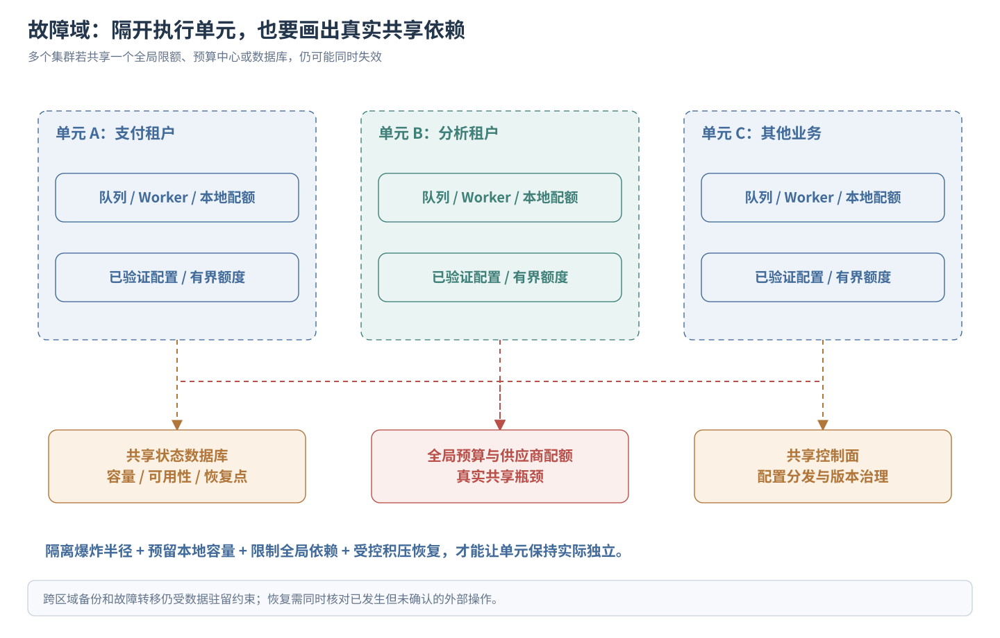

**图 9-12 独立运行单元之外仍需识别数据库、全局配额与控制面依赖**

### 9.5 平台服务目标应沿任务链拆解

一个总的“平台可用率”不足以定位问题。可以分别定义：受理成功率、状态查询可用性、就绪任务排队时延、可恢复任务的唤醒延迟、模型调用基础设施成功率、工具授权与派发时延，以及未决操作和未决费用的处理时长。

这些是平台运行指标，不能替代第 8 章的业务成功率。模型 Gateway 的 P95 延迟下降，可能只是平台更早拒绝长请求；平均任务完成时间降低，可能是最困难任务被排除在统计之外。指标应保留拒绝、排队、超时和取消等结果分布，并按任务类型和资源等级解释。

OpenTelemetry 的 Trace 与 Span 可以关联一次任务在多个服务中的调用路径。[14] 对长任务，可以用 Run 身份关联多个短 Trace，而不必让一个 Span 持续数天；跨异步等待可使用显式关联关系。详细身份放在受控日志或 Trace 属性中，避免把每个 Run ID 都作为时序指标标签造成高基数压力。

平台运行看板最终应支持一个具体问题：`RUN-11-01` 为什么还在等待？答案可能是业务观测窗口未结束、监控工具限流、模型预算不足或策略要求人工输入。把这些原因区分出来，才能确定应该增加容量、修复配置，还是让业务负责人作出决定。

## 10. 企业落地：从一条完整路径建设可演进的平台

前面各节已经覆盖 Gateway、路由、调度、预算、Registry、权限、隔离和故障处理。如果把这些机制全部作为第一版建设清单，平台很可能在接入真实业务之前就变成长期项目。更可靠的起点是一条能够端到端解释和验证的任务路径，然后围绕已经出现的共享约束逐步扩展。

### 10.1 把 `RUN-11-01` 的下一次唤醒走完整

以下是对既有事故的教学性平台演练，不预设下一窗口一定恢复。任务仍从 `WAITING / VERIFYING` 继续，`CHG-11` 已完成这一事实保持不变。

| 环节 | 平台与 Runtime 的动作 | 必须保持的约束 |
| --- | --- | --- |
| 等待到期 | Scheduler 接收 `WAIT-11-04` 的到期事件，核对当前等待身份 | 旧计时器或重复事件不能重复推进 Run |
| 分配执行机会 | 在支付租户队列中安排 `collect_verification_window` | 批量报告任务不能无限挤占到期验证 |
| 恢复执行 | Worker 加载绑定的 Agent Release 与当前状态 | Worker 更换不创建新 Run，不重提 `CHG-11` |
| 读取指标 | 工具代理验证身份、资源范围与有效凭据 | 只读取获准的服务、实例和时间窗口 |
| 组织决策 | Context Compiler 放入新观测、已完成操作和未完成目标 | v18 包含 E11 不被误写成事故恢复 |
| 调用模型 | Model Gateway 筛选允许区域与能力，预留预算后派发 | Fallback 仍遵守同一数据范围和能力契约 |
| 接纳结果 | Runtime 校验结构、证据及完成谓词 | 模型文字不能直接覆盖业务验收结果 |
| 提交与结算 | 保存下一状态、操作与等待；按 Attempt 结算成本 | 迟到响应不重复推进，收费尝试不遗漏 |

**表 9-7 一次验证唤醒如何穿过企业平台**

若新的完整观测窗口仍未满足恢复标准，Runtime 可以继续诊断、再次等待或请求人工判断，具体由第 7 章的编排和业务规则决定。平台负责保证这项选择能够在正确身份、版本、资源与预算下发生。若监控接口不可用，系统应留下证据缺口，而不是通过更强模型补出一组不存在的指标。

这张表也提供了联调顺序：先验证单次正常路径，再注入重复计时器、模型超时、权限撤销和预算服务故障，确认每种情况下任务仍有清晰归属。平台是否成熟，可以从这些边界是否经得起检查判断，而不是从控制台有多少菜单判断。

### 10.2 第一阶段：建立最小但完整的治理闭环

第一阶段可以只支持一种 Agent、一种模型接入方式和少量工具，但必须具备可信身份、持久任务身份、可查询状态、明确工具授权、每次调用的版本记录与成本归属。高风险动作需要审批和稳定 Operation 身份；长等待需要可靠唤醒；日志中应能找到实际使用的配置。

这些能力可以由一个模块化服务和一个数据库提供，不要求立即拆出十几个微服务。关键是将责任边界体现在接口和数据结构中，例如预算通过一个原子许可函数发放，而不是由各业务代码自行检查余额。等流量或团队边界需要时，再把这个模块独立部署。

这一阶段的交付标准应该具体：新业务接入一项工具，需要提交哪些 Schema、权限与恢复说明；一项任务超时，值班人员能否定位最后确认的状态和费用；租户被停用，是否能阻止新动作并保留未决操作的处理责任。

### 10.3 第二阶段：根据资源冲突增加共享治理

当第二个租户或第二类任务接入后，再引入分层配额、公平队列、资源池和按任务风险配置的路由。优先修复已经观察到的冲突，例如后台报告占满连接、某个供应商故障触发重试风暴、或者多个 Worker 并发突破预算。

此时还需要建立发布准入：Agent 和 Tool 版本必须有负责人、相容性说明和评估证据，灰度按稳定任务身份分组。平台应提供默认模板和自助检查，使普通接入不依赖平台团队逐项手工审核；涉及新权限域、外部数据处理或高风险副作用时，再进入相应评审。

平台可以统一错误信封、身份传播、预算和审计，但不必强迫所有业务采用相同的 Prompt、图编排框架或存储内部结构。只要 Runtime 能遵守状态、动作、成本与观测契约，就可以保留领域实现。要求所有团队重写业务逻辑才能接入，往往会推动它们绕开平台。

### 10.4 第三阶段：以故障域、迁移和退出能力支持规模化

规模扩大后，需要重点处理跨区域、独立租户资源池、配置分发、账单对账和版本迁移。平台的长期成本往往来自兼容旧任务和旧工具，而不只是新增 API。应提前设置版本支持周期、废弃通知和迁移验证，明确哪些长期 Run 可以继续，哪些必须在安全边界重新评估。

还应提供退出机制：任务、制品、审计和费用可以按权限导出；工具和模型的绑定可以迁移；业务不因使用平台而失去自己的目标定义和验收证据。可退出的契约会迫使平台把运行语义讲清楚，也降低单一平台故障或技术路线变化造成的锁定。

平台自动化程度也需要与风险匹配。低风险只读任务可以采用较快发布节奏，高风险生产写入需要更严格的接入、灰度和恢复验证。统一平台不意味着所有业务被迫接受同一最慢流程，而是相同风险受到相同约束，不同风险可以拥有不同速度。

### 10.5 用责任矩阵结束组件之间的推诿

共享平台一旦出现异常，最常见的争论是“模型说错了”“工具返回成功了”“平台只是转发”。为了避免每一层只对自己的 HTTP 200 负责，可以把关键结果映射到明确责任人：

| 结果或约束 | 首要责任方 | 平台提供的支持 |
| --- | --- | --- |
| 业务成功标准是否合理 | 业务负责人 | 验收契约版本、评估数据和结果查询 |
| 计划与上下文是否正确 | Agent 应用团队 | 执行记录、组件版本、可重现测试环境 |
| 工具副作用与错误语义 | 工具/业务系统负责人 | 注册契约、授权代理、操作台账关联 |
| 共享容量与公平性 | 平台运行团队 | 调度、限流、资源池和服务目标 |
| 数据与权限边界 | 资源所有者及安全治理方 | 身份传播、策略执行、审计与隔离测试 |
| 预算和费用是否可解释 | 平台账本团队与费用归属方 | 预留、结算、对账和价格版本 |

**表 9-8 平台与业务之间的结果责任**

责任矩阵并不要求每一行都有独立团队。它要求在出现“变更完成但事故未恢复”这样的状态时，系统能继续找到目标负责人；在出现“模型请求超时但供应商已计费”时，账本有人对账；在出现“工具版本撤销但旧任务仍在运行”时，平台和业务知道如何共同处理。

## 11. 本章总结：共享平台需要把约束做成可执行契约

`RUN-11-01` 仍然是一项未完成的业务任务。平台不会把 v18 的配置读回当成事故恢复证据，也不会因为某个模型成功返回就替业务宣告结束。它所增加的能力，是让这项任务与许多其他任务同时运行时，仍然拥有可信身份、明确版本、公平的执行机会、可控预算和可追溯的动作。

本章建立了几条跨业务都应成立的约束：

- Agent Gateway 接收和管理任务契约，Model Gateway 管理一次推理请求；模型重试不重放业务动作。
- 路由先核验身份、数据范围、能力和允许版本，再优化成本与延迟；Fallback 不能绕过这些边界。
- 请求速率、Token 速率、并发、队列和预算分别治理；公平调度需要防止大租户和长任务长期挤占资源。
- 费用在调用前预留、调用后结算；超时但可能收费的尝试进入对账，不能直接视为零成本。
- Registry 保存可验证的能力与发布契约；固定 Release、实际组件版本和当前安全门禁共同决定恢复行为。
- 身份来自可信认证与委托链，具体动作在执行点重新授权；审批绑定资源、参数、版本和有效期。
- 租户边界贯穿数据库、缓存、检索、队列、沙箱、制品和计费，而不只存在于入口 Header。
- 控制面分发版本，数据面执行已验证配置；组件失效时按风险和有效期限继续或暂停，避免无条件放行。
- 平台负责共享运行约束，业务保留目标、验收和领域处置责任，两者通过可查询的执行事实衔接。

第 6 章解决一项任务如何持续执行，第 7 章解决复杂目标如何组织，第 8 章提供判断效果和可靠性的证据，本章把这些能力放入多个业务共享的运行环境。接下来，当一个目标需要多个 Agent 分工完成时，问题会进一步从资源共享走向协作：不同 Agent 如何划分职责、交换信息和处理冲突，第 10 章将继续讨论。

## 12. 参考研究与延伸阅读

1. **Ong, I. et al. (2024)**. [RouteLLM: Learning to Route LLMs with Preference Data](https://arxiv.org/abs/2406.18665). 研究基于偏好数据学习模型路由，在质量与成本间进行权衡；其结果不能直接替代具体企业任务的评估。
2. **AWS Builders' Library**. [Making retries safe with idempotent APIs](https://aws.amazon.com/builders-library/making-retries-safe-with-idempotent-APIs/). 讨论调用者请求身份、参数一致性、迟到请求和副作用幂等边界。
3. **AWS Builders' Library**. [Timeouts, retries, and backoff with jitter](https://aws.amazon.com/builders-library/timeouts-retries-and-backoff-with-jitter/). 讨论超时、重试、退避及抖动，以及重试对过载的放大作用。
4. **Envoy Project**. [Circuit breaking](https://www.envoyproxy.io/docs/envoy/latest/intro/arch_overview/upstream/circuit_breaking). 介绍连接、待处理请求、活动请求和重试等资源的断路器限制。
5. **Google SRE Book, Chapter 21**. [Handling Overload](https://sre.google/sre-book/handling-overload/). 讨论客户配额、请求重要性、过载保护、重试预算和多层重试问题。
6. **Open Container Initiative**. [OCI Image Format Specification: Content Descriptors](https://github.com/opencontainers/image-spec/blob/main/descriptor.md). 定义内容类型、摘要和大小等制品描述字段，帮助理解不可变制品引用。
7. **SLSA**. [Provenance, Version 1.1](https://slsa.dev/spec/v1.1/provenance). 定义构建来源证明所描述的信息与关系；来源证明不等于业务正确性或安全评估通过。
8. **NIST (2020)**. [SP 800-207: Zero Trust Architecture](https://csrc.nist.gov/pubs/sp/800/207/final). 强调不能仅依据网络位置或资产归属授予隐含信任，并说明主体与资源访问的验证原则。
9. **IETF (2020)**. [RFC 8693: OAuth 2.0 Token Exchange](https://www.rfc-editor.org/rfc/rfc8693.html). 定义 Token Exchange，以及资源、受众、作用域和委托相关协议语义。
10. **Kubernetes Documentation**. [Multi-tenancy](https://kubernetes.io/docs/concepts/security/multi-tenancy/). 讨论多租户的控制面与数据面隔离，包括 Namespace、权限、配额、网络、存储和沙箱。
11. **PostgreSQL Documentation**. [Row Security Policies](https://www.postgresql.org/docs/current/ddl-rowsecurity.html). 说明行级安全策略及超级用户、`BYPASSRLS` 角色和表所有者等绕过条件。
12. **Open Policy Agent**. [Bundles](https://www.openpolicyagent.org/docs/management-bundles). 介绍策略及数据的打包分发、版本标识和签名验证机制。
13. **AWS Builders' Library**. [Static stability using Availability Zones](https://aws.amazon.com/builders-library/static-stability-using-availability-zones/). 讨论控制面与数据面，以及在依赖故障时利用已有资源维持运行的设计原则。
14. **OpenTelemetry Authors**. [Traces](https://opentelemetry.io/docs/concepts/signals/traces/). 介绍 Trace、Span、事件和关联关系，为跨服务执行观测提供基础模型。
