# 第10章 Multi-Agent：从单 Agent 到协作系统

**本章核心脉络与阅读导览**

前面几章已经建立了一个能够运行、恢复、编排和评估的 Agent。第 9 章进一步把模型、工具、身份和预算纳入共享平台。到了这里，系统可以可靠地承接一项复杂任务，但新的设计选择也随之出现：当一个任务同时需要日志分析、网络配置核对、业务规则解释和结果复核时，应该继续增强一个 Agent，还是让多个 Agent 分工协作？

仍然看 `payment-gateway` 的教学事故。`CHG-11` 已经确认成功，渠道 A 的规则 v18 包含源出口 E11，但 `inst-11` 的 HTTP 504 尚未满足恢复条件。`RUN-11-01` 仍在 `WAITING / VERIFYING` 阶段，等待 `WAIT-11-04` 后执行 `collect_verification_window`。如果后续仍需要调查，可以让一个参与者分析限定窗口的请求路径，另一个核对当前配置，第三个检查结论是否获得充分证据。但这种分工本身不会产生新的事实，更不会使几个参与者的相同意见自动成为根因。

**Multi-Agent 的核心是把任务责任、决策上下文和能力边界分配给多个执行主体，再通过明确的通信与协调契约，使局部结果能够组成一个可验证的整体结果。** 多写几个角色提示词只是其中一种组织方法；能否获得收益，取决于工作是否适合拆分，以及拆分之后增加的交接、冲突和错误传播能否被控制。

本章沿着以下问题展开：

1. **拆分动机（Why split）**：单 Agent 在什么地方遇到边界，多个角色与多个执行主体有什么区别？
2. **委派契约（What to delegate）**：子任务如何限定目标、证据、权限、预算和结果责任？
3. **协作模式（Who coordinates）**：Agent as Tool、Manager / Worker 与 Peer Collaboration 分别怎样分配控制权？
4. **信息边界（What to share）**：上下文怎样隔离，事实怎样共享，如何避免摘要失真与跨角色污染？
5. **通信协议（How to communicate）**：请求、事件、产物和取消如何关联，A2A 等协议解决哪些互操作问题？
6. **一致性与恢复（What can fail）**：并发写入、迟到结果、部分失败和错误放大怎样影响协作？
7. **拓扑与取舍（When it helps）**：如何选择协作结构，又怎样证明拆分确实值得？

本章承接第 7 章的编排方法，但把关注点从同一控制域内的节点依赖，移到多个 Agent 之间的职责和信任边界。第 6 章提供持久执行，第 9 章提供身份与资源治理，它们不会因引入多个 Agent 而失去必要性。所有新增角色、子任务 ID、并发规模和对比数据均为教学设计，不表示原事故已经恢复或新的根因已经证实。

## 1. 协作的起点：单 Agent 的边界究竟在哪里

一个 Agent 连续调用十次模型，并不会因此自动变成十个 Agent；三个角色共用一份对话历史，也不一定形成真正独立的工作单元。设计之前，需要先说明“多个”指的是什么，以及系统希望通过这个变化解决哪类限制。

如果问题只是模型选错工具，增加一个协调者可能只是把同样的错误多转发一次。如果问题来自不同子任务需要彼此隔离的上下文、不同工具范围或不同团队维护的领域能力，拆分才可能提供新的工程边界。

### 1.1 Agent 数量、模型数量与进程数量并不相等

本章把一个 Agent 视为具备相对独立职责、决策上下文、可用能力和运行状态的执行主体。它可以使用与其他 Agent 相同的模型，也可以运行在同一个进程中；反过来，一个逻辑 Agent 的模型调用和工具执行可以由多台 Worker 承担。

需要区分四个层次：

| 层次 | 发生了什么变化 | 不能据此推断什么 |
| --- | --- | --- |
| **角色变化** | 提示词要求模型从不同职责或角度回答 | 不代表状态、权限或证据已经隔离 |
| **上下文变化** | 不同调用接收不同任务材料与历史 | 不代表它们拥有独立身份或不同模型能力 |
| **执行主体变化** | 子任务有自己的状态、预算和结果责任 | 不代表它们物理并行，或可以独立修改共享资源 |
| **部署与信任域变化** | 能力由不同进程、团队或组织提供 | 不代表跨域调用已经完成授权和数据治理 |

**表 10-1 多 Agent 设计中的四种不同边界**

例如，一个主 Agent 把一份日志发送给“网络专家”和“应用专家”，如果两者看到相同摘要、使用相同工具，又没有独立结果契约，它们主要提供了不同的语言视角。这个设计可能有用，但不能声称获得独立证据、安全隔离或分布式容错。

AutoGen、CAMEL、MetaGPT 等研究和框架展示了通过角色、对话与工作流程组织多个模型参与者的方法。[1][2][3] 它们提供了不同的协作抽象，不能因此推导所有复杂任务都需要多 Agent，也不能把特定实验的收益视为企业现场的默认结果。

### 1.2 单 Agent 常见的四类约束

第一类是**上下文竞争**。日志细节、配置差异、规范条款和最终报告要求同时占据一个窗口，模型容易混淆阶段或遗漏关键条件。第 3 章的上下文选择和压缩应该先解决能解决的问题；如果多个子问题长期需要不同的大量材料，独立上下文才可能进一步减少相互干扰。

第二类是**工具与职责竞争**。一个 Agent 同时看到几十个领域工具，需要在很大的动作空间中选择。按领域暴露受限能力，可以缩小每个参与者的决策范围。不过，工具目录过宽有时只需按阶段动态筛选，不一定要增加一个新的 Agent。

第三类是**时间与工作量约束**。几项互相独立、数据量较大的调查可以并发进行，缩短等待。物理并发来自调度和资源分配，不来自角色名称；如果模型服务并发配额只有一个，创建更多 Agent 只会增加排队与交接。

第四类是**组织与信任边界**。网络配置由网络团队维护，支付领域规则由业务团队维护，某些数据不能离开所属组织。此时独立 Agent 可以作为有明确契约的服务提供能力，避免主 Agent 获得全部底层数据与权限。但它也把本地函数调用变成远程协作，需要处理版本、身份、超时和可验证结果。

这些约束对应不同的拆分理由。团队应先写出预期收益，例如“把两份互不相关的证据集合分别分析，再汇总结构化差异”，而不是笼统地说“多 Agent 更聪明”。后续评估才能判断这个理由是否成立。

### 1.3 专业化有价值，但角色名称不会创造专业能力

“你是一名资深网络专家”可以改变模型的表达和关注点，却不能让它自动拥有当前路由知识、配置权限或经过验证的排障经验。专业化需要落到模型配置、领域资料、工具契约、任务样本和验收规则上。

对网络诊断 Agent，可以限制其只读取授权范围内的路径、路由和配置，要求输出资源版本与差异；对指标 Agent，可以让它专门处理窗口完整性、流量口径和统计字段。两者的价值来自稳定的能力接口和适配，而不是互相使用不同称呼。

同时，专业化会引入局部视野。配置 Agent 可能正确发现一项差异，但不知道该差异是否影响当前失败请求；指标 Agent 可能确认异常持续，却无法判断变更是否执行。局部正确需要在父任务处合成，不能要求每个参与者都独立给出完整根因。

### 1.4 协作收益必须扣除交接和协调成本

拆分后，系统增加了任务分配、上下文准备、请求排队、结果校验、合并和争议处理。可以用一个简单的成本账本提醒自己：

$$
C_{total}=C_{coordination}+\sum_{i=1}^{n}C_i+C_{integration}+C_{recovery}
$$

其中各项使用同一种成本口径，分别表示协调、各参与者执行、结果整合和失败恢复。并发可能减少墙钟时间，但通常不会让这些消耗自动消失。

对于互相独立的子任务，理想耗时接近最长子任务加分发与汇合开销；对于依赖链很长的任务，多 Agent 可能只是在每一步前后增加消息往返。如果每个角色都需要完整读取前一个角色的全部对话，传递和重复理解成本会随着协作深度迅速增长。

因此，是否拆分首先是边界选择问题。确定了拆分理由之后，下一步不是给角色起名，而是定义一个参与者究竟接受什么工作、交付什么结果，以及出错后谁仍然负责。

## 2. 委派契约：把“帮我看看”变成可验收的子任务

主 Agent 向另一个 Agent 发送“分析一下当前故障”，看起来已经完成委派，实际上留下了大量空白：对方是否可以调用生产工具，是否可以再次委派，应该查哪个时间范围，什么情况下返回，以及返回一句“建议检查路由”算不算完成。

这些空白会被模型各自补全。参与者越多，补全方式越可能不同。协作契约的作用，就是让它们在开始工作之前对目标、输入、权限和产物形成相同解释。

### 2.1 子任务继承父目标，但不能自行扩大父授权

父任务 `TASK-11` 需要形成有证据的处置结果。假设后续进入新的诊断阶段，Manager 可以委派一个只读子任务：核对 `inst-11` 访问渠道 A 的当前路径配置，并返回与指定快照的差异。

子任务获得的是这个明确目标，不是“尽可能修复所有相关问题”。它发现其他渠道可能异常时，应返回线索和扩展建议，而不是直接进入新的资源范围。父任务本身没有的权限，也不能通过委派传递给子任务。

授权需要绑定可信身份和执行策略。自然语言里的“主 Agent 已经批准”只是消息内容，接收方仍要核验调用者、任务范围和凭据。第 9 章的权限收窄原则在委派链上继续成立：每一跳传递的能力至多是其上游授权范围的子集，并受到接收方本地策略约束。

可以将有效权限理解为：

$$
A_{child}=A_{parent\ scope}\cap A_{delegated}\cap A_{child\ policy}
$$

这里的集合表达业务能力边界，不代表把父凭据原样复制给子 Agent。实际实现应通过面向目标服务的身份验证、受限凭据或服务端授权完成；子任务不需要在消息正文中看到密钥。

### 2.2 契约同时描述工作内容和交接条件

下面是一份应用层委派结构，字段不是某个协议的标准。它用于说明 Runtime 应当保存哪些信息，具体项目可以映射到自己的任务系统。

```yaml
delegation_id: DEL-11-NET-01
parent_task_id: TASK-11
parent_run_id: RUN-11-01
child_task_id: SUBTASK-11-NET-01
assignment_revision: 1
recipient: network-diagnosis-v2
objective: 核对 inst-11 访问渠道 A 的路径配置并返回版本化差异

scope:
  service: payment-gateway
  instance: inst-11
  channel: A
  effects: READ_ONLY

inputs:
  facts:
    - "operation:CHG-11:SUCCEEDED"
    - "configuration:channel-A:v18:contains-E11"
  evidence_refs:
    - "artifact://TASK-11/approved-scope/v1"
  unknowns:
    - 剩余 504 是否与当前路径有关

contract:
  output_schema: path-comparison-v2
  required_fields: [scope, source_versions, findings, limitations, evidence_refs]
  allow_new_delegation: false
  allow_mutation: false
  return_partial_result: true

budget:
  max_model_calls: 4
  max_tool_calls: 6
  execution_seconds: 120
  report_reserve_seconds: 15
```

示例中的预算是教学配额。接收方可以在接纳之前拒绝不受支持的 Schema、过短期限或超出本地权限的范围。拒绝应明确原因，父任务才能调整委派，而不是让一个无法完成的子任务长期处于“处理中”。

任务接纳也不代表完成承诺。系统需要区分“收到请求”“接受执行”“已经产生中间产物”和“完成了契约”。网络成功返回一条消息，可能只是传输层成功；父任务必须根据子任务状态和结果契约判断是否继续。

### 2.3 身份应区分委派意图、远程任务与业务操作

`delegation_id` 表示一次稳定的委派意图，`child_task_id` 表示本地追踪的子任务，远程服务还可能分配自己的任务 ID。需要保存这些标识之间的映射，而不是把一次 HTTP 请求 ID 当作所有层次的身份。

当主 Agent 提交委派后超时，它并不知道远程任务是否已经创建。如果直接换一个 ID 重发，可能启动两份相同调查，甚至重复产生副作用。应用层应提供可查询的请求关联记录，或者在双方约定下用稳定委派键去重。若协议本身没有保证业务幂等，就不能仅凭消息 ID 存在声称重复请求安全。

远程 Agent 内部执行生产动作时，还应使用独立的 Operation 身份。一次委派可能包含多个读取和一次经批准的变更，也可能完全不产生变更；委派 ID 与 Operation ID 不是可互换的字段。

父任务取消时，取消的是尚未继续执行的授权与工作意图；已发出的远程操作仍需确认结果。父子任务之间必须保留这条责任链，不能因为父任务界面关闭，就删除所有子任务记录。

### 2.4 结果契约把发现、解释和建议分开

子任务结果最好至少区分：已取得的事实、基于事实的解释、仍未解决的缺口，以及建议父任务采取的下一步。

```json
{
  "delegation_id": "DEL-11-NET-01",
  "assignment_revision": 1,
  "status": "PARTIAL",
  "scope": {"service": "payment-gateway", "instance": "inst-11", "channel": "A"},
  "source_versions": [],
  "findings": [],
  "limitations": ["尚未取得与目标窗口对应的全部路径记录"],
  "evidence_refs": ["artifact://SUBTASK-11-NET-01/query-receipt/v1"],
  "recommendation": {
    "kind": "REQUEST_EVIDENCE",
    "question": "补齐目标窗口的路径覆盖后再判断配置差异是否相关"
  },
  "effects": {"mutations": [], "unresolved_operations": []}
}
```

这份教学结果没有伪造新根因。`source_versions` 为空，表示尚未取得可供比较的版本化观察，不能满足要求完整来源的后续判断。父任务可以据此补充查询，或在期限到达后交付缺口，但不能把 `PARTIAL` 解释为“没有配置问题”。没有发现与已经排除之间，需要完整性证据。

尤其要避免返回一个没有来源的 `confidence: 0.9`，再让 Manager 据此跳过核验。模型自报置信度未必经过校准；结果契约更应该说明查询覆盖了什么、哪些事实已确认、哪些依赖仍未知。

### 2.5 父任务保留整体验收责任

一个 Worker 完成自己的契约，可能只意味着提交了合格的配置差异。另一个 Worker 取得了完整指标，也只证明它完成了数据采集。父目标是否达成，还需要检查这些结果能否共同解释用户的问题，以及业务验收是否通过。

委派不会把责任平均分散到所有参与者。父任务应保留一个明确的最终责任主体，负责接纳结果、处理冲突、决定是否继续和形成交付。涉及高风险动作时，授权责任也不能被一句“专家建议如此”替代。

把委派视为双向契约，可以更清楚地看到约束如何向下传递，以及哪些责任始终留在父任务。

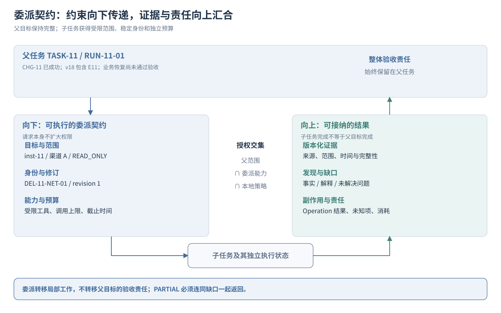

**图 10-1 委派把范围、身份和预算向下传递，把证据、缺口和责任向上汇合**

有了委派与结果契约，就可以讨论不同协作模式。先从控制关系最简单的方式开始：把另一个 Agent 作为一个具有内部推理能力的工具使用。

## 3. Agent as Tool：在主控制流中调用专业能力

Agent as Tool 模式让主 Agent 保持任务控制权，把另一个 Agent 暴露成可调用能力。主 Agent 决定何时调用、提供什么输入以及怎样使用结果；被调用者在自己的上下文中完成一个有界子任务，然后返回产物。

这种模式适合把复杂但相对独立的能力封装起来，例如解释一份领域规则、分析一组限定日志，或生成经过本地校验的配置差异。它通常比自由对话更容易确定输入输出和权限范围。

### 3.1 工具接口不必暴露内部每次推理

一个 `analyze_gateway_path` 能力内部可能执行几轮模型调用和只读工具查询，对调用者仍然表现为一个有明确契约的能力。主 Agent 不必接收内部所有提示词和对话，只需要结果、证据引用、状态和限制。

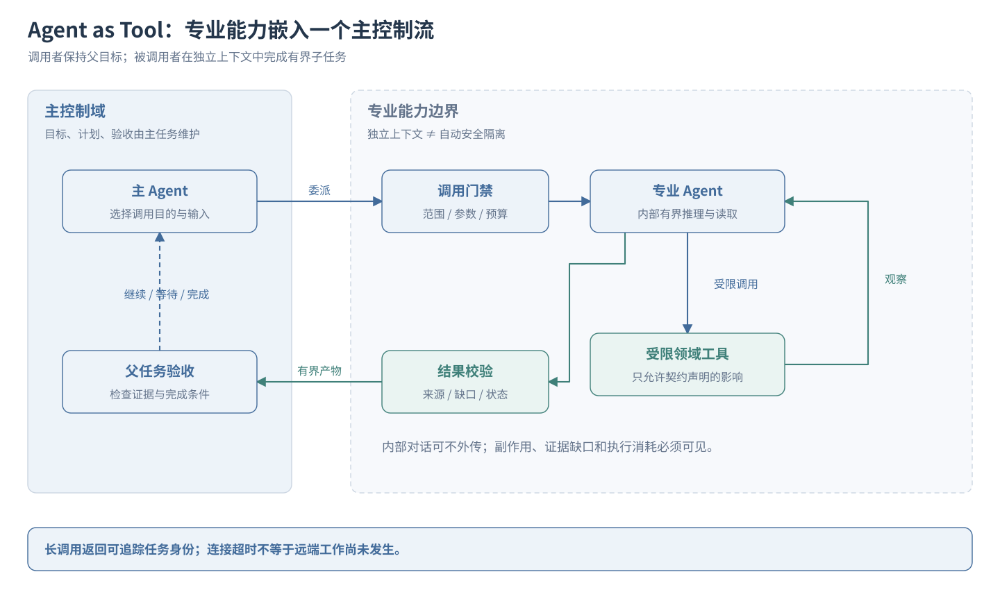

**图 10-2 Agent as Tool 保留单一主控制流，专业 Agent 提供有界结果**

这个边界有助于减少上下文污染。网络分析过程中的失败查询、临时猜测和无关日志可以留在子任务记录中；父任务只接收经过约定整理的证据包。但摘要不能丢失会影响决策的限制，例如数据被截断、快照不一致或某个结论仅适用于一条路径。

内部封装也不能掩盖副作用。若一个能力可能写入配置，其工具描述和权限契约必须明确标注；不能把名称写成“分析”，却让内部 Agent 自动修复。对调用者而言，内部实现可以隐藏细节，外部影响必须保持可见。

### 3.2 主 Agent 应控制调用目的与继续条件

主 Agent 不是简单地把用户请求原样转发给专业 Agent。它需要提出具体问题，并说明这个结果将用于哪个后续判断。例如，“在已批准范围内核对指定窗口的路径配置，返回来源版本与覆盖缺口”，比“检查网络是否有问题”更容易验收。

专业 Agent 可以提出补充信息请求，但不应无限与主 Agent 来回改写问题。可以设定有限的澄清轮数，或者在初次请求中明确缺少关键字段时的返回状态。对于稳定接口，最好让字段校验在模型调用之前发生，减少无意义的对话往返。

主 Agent 接到结果后，应先校验范围、版本和 Schema，再交给模型解释。一个专业 Agent 返回“已确认配置正确”，如果没有对应证据，不能因为它被称为专家就提高可信等级。工具化只改变调用形式，不改变证据要求。

### 3.3 长调用需要暴露任务状态，不能一直挂住请求

内部分析需要数分钟时，同步 RPC 容易超时。可以返回接纳状态与远程任务身份，由父任务进入持久等待，通过查询或事件取得结果。第 6 章的等待机制在这里从“等待工具”扩展为“等待另一个 Agent 的任务”。

超时后，主 Agent 需要知道是尚未接纳、正在执行，还是结果已产生但通知丢失。没有可查询身份的长调用，会迫使上游在重复执行和无限等待之间选择。能力契约应明确接纳记录、状态查询、结果保留和取消语义。

内部重试也要与父任务预算协调。父任务允许一次工具调用，不意味着内部可以无限调用模型。专业能力应声明或报告执行消耗，并接受调用方预算上限；父任务同时预留总额，避免多个工具化 Agent 分别消耗全部剩余预算。

### 3.4 适合封装什么，不适合封装什么

适合工具化的工作通常有稳定的问题边界、可独立检查的产物，并且不需要持续改变父目标。比如“对给定配置快照生成差异”“对授权日志生成路径分布”“按指定规则复核报告引用”。

不适合隐藏在单个工具里的，是跨越多个独立授权、持续重新定义目标或需要人随时参与的开放式处置。把“自动排障并修复”做成一个看似简单的工具，会让主任务失去对关键分支和副作用的可见性。这时应提升为显式的子任务协作。

Agent as Tool 的主控制流清楚，但当任务需要同时分派多个长期子任务、动态调整分工并整合部分结果时，主 Agent 实际上已经承担管理职责。下一节把这种职责显式化，讨论 Manager / Worker 模式。

## 4. Manager / Worker：集中分配责任，分散完成工作

Manager / Worker 模式由一个协调主体维护父目标，分配子任务、接收状态、处理冲突并整合结果。Worker 则在各自上下文和能力范围内完成有界工作。Manager 可以包含模型判断，但它的任务登记、预算分配和结果接纳仍应由确定性 Runtime 承担。

这种模式适合目标较统一、子任务可以部分并行、最终结果需要集中验收的场景。研究和工程实践常采用这一结构，但成功的关键不是 Manager 比 Worker 更“高级”，而是责任和交接足够清楚。[5][6]

### 4.1 Manager 管理目标与依赖，Worker 管理局部求解

对 `TASK-11`，一个可能的教学分工是：指标 Worker 收集满足验收契约的窗口；配置 Worker 核对当前路径和版本；报告复核 Worker 检查候选结论是否超出证据。它们不应各自重新定义“故障恢复”的标准。

Manager 需要维护一张委派账本，至少记录子任务身份、接收方版本、输入引用、状态、截止时间、预算和接纳结果。账本是执行状态的一部分，不是模型临时写出的待办清单。

| Manager 的责任 | Worker 的责任 | 需要共同遵守的契约 |
| --- | --- | --- |
| 维护父目标与优先级 | 完成明确的局部目标 | 范围与目标修订 |
| 分配预算与执行机会 | 在配额内选择局部方法 | 消耗上报与截止时间 |
| 组织依赖与汇合 | 返回产物、缺口与执行状态 | 结果 Schema 与证据引用 |
| 决定接纳、补充或终止 | 不自行扩大职责和权限 | 委派与再委派规则 |
| 承担整体验收与交付 | 保留局部可追溯记录 | 父子任务关联与审计 |

**表 10-2 Manager 与 Worker 的责任边界**

Manager 不应亲自重做所有 Worker 的推理，否则只增加了一层转发。但它必须做不能委派掉的整合检查：结果是否适用于同一对象和时间，关键证据是否齐备，未决操作是否收敛，以及最终结论是否满足父目标。

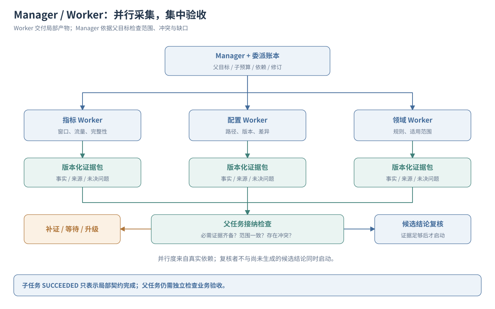

**图 10-3 Worker 按证据问题分工，整体判断与生产提交保留独立责任**

图中的报告复核依赖已经形成的候选结论，不应与证据采集无条件同时启动。并行度来自真实依赖允许的空间，而不是参与者数量。

### 4.2 分派应围绕可区分的问题，而不是重复覆盖全部任务

一种常见做法是同时派出“网络专家”“Java 专家”“数据库专家”，让它们都分析整起事故。这样可能获得多种视角，也可能让三个 Worker 各自读取同一批日志、提出相同猜测，并把成本扩大三倍。

更可控的分派方式是给每个 Worker 一个不同的证据问题，并允许它返回“不足以判断”。例如，路径 Worker 负责确认失败请求覆盖哪些路径；耗时 Worker 负责比较指定范围内的调用阶段；配置 Worker 负责取得对应版本。它们的输出可以组合，而不是互相争夺谁先给出完整根因。

需要独立复核时，可以刻意保留重叠，但要说明重叠的目的。一个 Worker 生成诊断，另一个基于原始证据检查引用与逻辑，这不同于让两个角色共同编辑同一答案。复核者若一开始就看到生成者的全部理由，可能被锚定；可以先让它独立检查关键事实，再提供候选结论做针对性复核。

分工也不应该固定成不可调整的组织图。若指标 Worker 发现窗口不足，Manager 可以先进入等待，不必让所有 Worker 在过期现场上继续分析。新分工需要形成新的委派修订，已发生的工作和在途责任仍然保留。

### 4.3 汇合策略应在结果返回之前确定

Manager 等到所有 Worker 回来后再临时决定“相信谁”，容易让语言更流畅、返回更早的结果占优势。应提前区分必需产物、可选产物和冗余产物，并规定对应的汇合条件。

例如，业务恢复判断必须有合格指标窗口和已确认配置结果；可选的耗时摘要可以改善解释，但不能代替窗口验收。若两个 Worker 都提供同一配置版本的读取，结果一致可以用于交叉检查，但不能把它们当作两次独立的生产事实。

汇合节点应输出结构化状态，如 `READY_FOR_DECISION`、`MISSING_REQUIRED_EVIDENCE`、`CONFLICTING_EVIDENCE` 或 `DEADLINE_REACHED`。Manager 模型在这些状态之上选择允许的后续路径，不应直接把所有文本拼成一篇自洽报告。

对冲突，先检查范围和版本，再讨论解释。两个结果分别使用变更前和变更后的窗口，并不一定互相矛盾；两个结果使用相同窗口却给出不同计数，则需要回到查询与数据完整性。让模型先辩论谁更合理，可能掩盖本来可以确定性定位的数据问题。

### 4.4 Manager 也是故障点，需要恢复与接管

集中协调的代价是 Manager 成为关键依赖。它失去状态后，Worker 可能继续执行，却没有人接收结果；新的 Manager 若不知道已有委派，又会创建重复任务。

因此，委派意图和预算预留应先持久化，再发送请求；Worker 状态与结果按稳定身份回写。Manager 恢复时读取账本，先核对已接纳和在途子任务，再继续调度。它的模型响应可以重新生成，但已提交委派和业务操作不能随之重新创造。

同一父任务也需要明确协调者执行权。两个承载 Manager 的 Worker 同时领取任务时，应该依赖第 6 章的租约、版本检查和 fencing 等机制，防止双方各自扩大分工。模型之间协商“谁当负责人”不能代替并发控制。

若需要人工接管，界面应展示父目标、各子任务状态、已取得产物和未决操作，而不是要求人读取所有对话。恢复自动协调前，要核实人工是否改变了资源或目标，并使相应委派失效。

### 4.5 层级增加时，限制再委派和信息损耗

Manager 可以再调用一个内部 Manager，形成层级。但每增加一层，就增加一次任务解释、预算切分和结果压缩，也增加一个可能遗漏约束的位置。

再委派应显式允许，并受到最大深度、子任务数量和预算限制。下级 Manager 不能把父层禁止的写入拆成多个“低风险”请求，也不能通过多层转发让同一证据被反复包装成多个来源。

结果应保留从原始证据到中间判断的引用关系。父层不需要接收全部文本，但需要知道某条结论最终来自哪份观察。没有这条关系，三层协作之后的一句“多方确认”可能只是同一条未经核实的猜测经过三次摘要。

Manager / Worker 提供清晰的中心责任，适合多数需要统一交付的任务。但某些场景由多个对等能力提供者共同参与，没有一个服务能够直接控制其他服务内部执行。接下来需要讨论 Peer Collaboration，以及它与无边界群聊的区别。

## 5. Peer Collaboration：对等协作仍然需要明确的协议

Peer 模式允许参与者直接交换问题、证据或建议，不必让每次消息都经过一个中心 Manager。它适合领域能力由不同主体维护、需要交叉澄清，或者参与者各自掌握局部信息的场景。

“对等”描述通信和职责关系，不意味着所有参与者对所有资源拥有相同权限，也不意味着最终结果可以没有责任人。只要协作涉及真实动作，仍要确定谁能提交、谁能终止，以及分歧如何处理。

### 5.1 对等通信与最终决策权可以分开

在一个教学分支中，路径分析 Agent 可以直接询问配置 Agent：“这份路径标识对应哪个配置版本？”配置 Agent 返回有来源的映射，帮助前者解释结果。两者可以对等交流，但只有父任务指定的提交者才能把综合结论写入权威任务状态。

这样可以减少 Manager 对低层澄清的转发负担，同时保留清楚的提交边界。允许直接通信，并不要求允许直接修改对方状态；消息是供接收者检查的输入，不是任意远程代码或状态补丁。

Peer 网络可以设置一个轻量协调规则：每个参与者只能修改自己的任务记录；共享事实由专门接口接纳；业务动作由指定写入主体执行；最终验收由父目标的责任人或确定性检查器完成。这个结构仍然是对等协作，只是在关键位置保留了明确所有权。

下面把通信关系与提交责任分别画出；同一结构也需要为后文的请求环路设置边界。

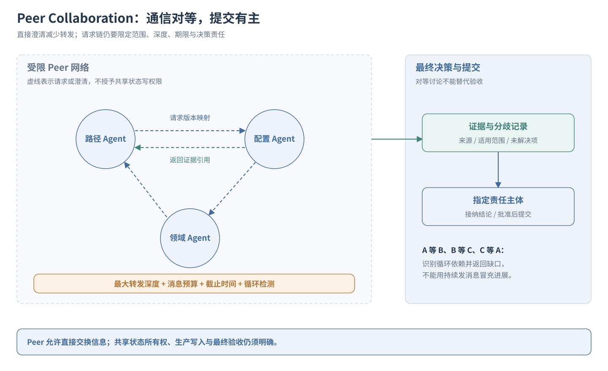

**图 10-4 Peer 直接交换证据，同时保留请求边界与最终决策所有权**

### 5.2 讨论应围绕证据差异，而不是追求意见一致

多 Agent Debate 研究探索了通过多轮提出和讨论答案改善部分任务表现的方法。[4] 这说明对话可以成为候选检查机制，但不说明讨论越久越接近事实，也不说明多数意见具有天然正确性。

在排障场景中，有价值的分歧应具体化为：“这份窗口是否完整”“这个配置版本是否在查询时生效”“这条日志能否证明请求经过该路径”。这些问题可以通过证据补充或确定性检查推进。单纯要求几个 Agent 互相说服，可能只让一个表达更强的错误结论扩散。

可以规定一个有界讨论轮次：先分别提交结论与证据；再交换具体异议；最后只回应被指出的缺口。若仍不能解决，保留分歧并交给责任人，而不是强制生成一个一致结论。

特别要记录证据血缘。同一日志被两个 Agent 阅读，再互相引用，仍然只有一个原始来源。引用数量增加不能提高来源独立性。若需要真正的交叉核验，应使用不同测量路径、不同数据源或独立验收接口，并检查这些来源是否共享相同上游故障。

### 5.3 多数票只有在特定条件下才有可解释价值

设多个参与者对同一二元问题给出判断。只有在每个判断具有相应准确率、错误相关性受到控制，并且任务与投票规则匹配时，增加投票才可能改善总体结果。现实中的 Agent 常共享模型、提示、知识库和工具，错误可能高度相关。

对于具有相同方差和共同相关系数的随机误差，可用一个简化关系理解平均的局限：

$$
\operatorname{Var}(\bar X)=\frac{\sigma^2}{n}\left[1+(n-1)\rho\right]
$$

这个等相关模型只用于说明相关性影响，不是 Agent 正确率的通用公式。若 $\rho=0$，平均的方差随数量下降；若 $\rho$ 接近 1，增加参与者几乎没有独立信息收益。生产判断还需要考虑系统偏差，平均无法消除共同错误前提。

因此，三名 Agent 都说“故障已恢复”，如果都只看到了 `CHG-11` 的成功回执，仍然没有业务恢复证据。系统应优先询问它们依据了哪个窗口，而不是统计赞成票。

对于报告措辞、候选代码或可重复离线求解，投票可以作为辅助信号；对于权限、业务事实和生产变更，必须回到对应的权威来源与门禁。语言协商也不同于分布式系统的一致性协议，不能因为几个模型达成共识，就认为已经解决存储一致性或事务提交。

判断多方意见的价值时，应先还原证据来源，再讨论意见数量。

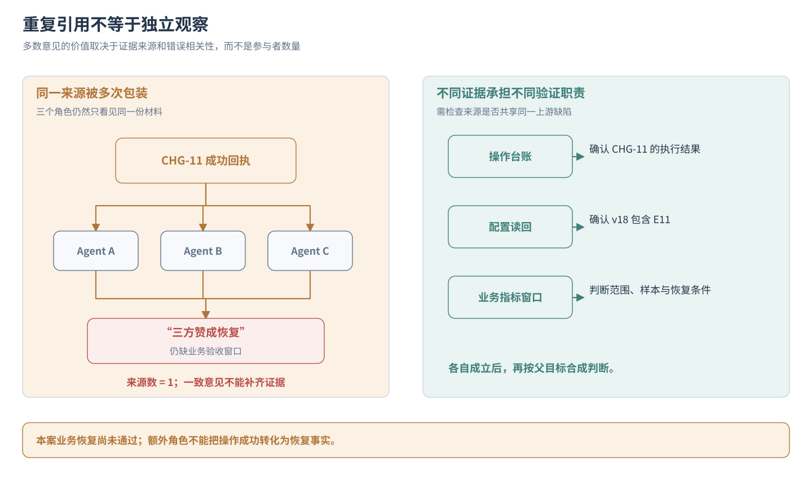

**图 10-5 重复引用共享同一来源，独立观察则承担可区分的验证职责**

### 5.4 防止对话环路、互相等待与责任漂移

Peer 网络容易出现循环请求：A 等 B 的结论，B 等 C 的证据，C 又向 A 请求前提。若没有任务依赖和截止时间，这种环路在日志中表现为持续有消息，却没有真正进展。

每个请求应说明需要什么产物、对应哪个任务、何时截止，以及接收方是否允许继续转发。系统可以限制转发深度、检测重复请求链，并对循环依赖返回明确错误。不能仅依赖模型在自然语言中承诺“不要无限循环”。

还要限制广播。一个参与者把问题发给所有 Peer，接收者又分别广播，会造成消息放大和重复工作。可以让能力目录帮助选择少量合格接收者，记录已访问的委派路径，并对每个父任务设置消息与子任务预算。

讨论结束后，需要一个清楚的决策记录：采用了哪些证据，保留了什么分歧，谁有权决定后续动作。没有这条记录，下一轮对话可能重新打开已经处理的问题，或者把某个临时建议当成共同批准。

### 5.5 选择 Peer 模式要承担额外的治理成本

当参与者只需要各自完成独立子任务并返回结果时，Manager / Worker 往往更直接。Peer 更适合确实需要跨领域往返澄清、能力自治或协同发现的场景，但需要更强的消息协议、状态所有权和停止规则。

也可以采用混合方式：Manager 管目标和提交，少量 Worker 在指定范围内直接交换证据。这样减少转发瓶颈，又不把整体责任分散到一张无主网络中。

无论采用哪一种模式，多个参与者都需要知道什么可以共享、什么必须留在自己的上下文。下一节讨论信息隔离与共享，这是协作收益和风险同时出现的地方。

## 6. Context Isolation 与信息共享：共享证据，不共享无边界历史

多 Agent 常被用来扩大可处理的信息量：每个参与者处理一份材料，最后汇总。但如果所有参与者仍然读取同一份完整对话，系统只是重复消耗了上下文，并没有建立有效的信息分工。

上下文隔离需要与共享机制配合。隔离过弱，会传播无关指令和错误假设；隔离过强，又会让参与者缺少共同目标和必要约束。设计要明确哪些信息必须一致，哪些信息可以局部保留，以及结果如何带着来源跨边界流动。

### 6.1 每个 Agent 的上下文包含公共契约和局部材料

一个子任务上下文通常需要四部分：父目标的必要摘要、不可改变的约束、当前子任务契约，以及完成该任务所需的证据。它不必包含其他 Worker 的全部查询过程。

例如，配置 Worker 需要知道 `CHG-11` 已完成、当时读回的规则版本为 v18、任务仍未通过恢复验收，以及它只负责读取指定范围的配置。它不需要看到报告 Worker 所有措辞修改，也不应因为某条历史猜测而把“路由异常”当作既定事实。

公共契约适合以版本化引用下发，包括目标修订、资源范围、验收规则和已提交操作。局部材料则按子任务筛选。若公共契约变化，Runtime 应通知受影响参与者并决定是否暂停，而不是等待它们从聊天消息中偶然发现变化。

上下文分离不等于安全隔离。同一进程里的两个 Agent 即使收到不同提示词，仍可能访问相同文件、缓存或凭据。需要隔离敏感数据时，必须依赖第 9 章的数据访问控制、沙箱和身份边界，不能只写“不要读取其他 Agent 的内容”。

### 6.2 区分消息、证据、共享状态和长期记忆

这些对象都可能表现为文本，却承担不同职责：

| 对象 | 主要用途 | 写入和使用规则 |
| --- | --- | --- |
| **消息** | 请求、解释、异议和通知 | 按发送者与任务范围检查，内容不是自动成立的事实 |
| **证据制品** | 保存工具结果、配置快照和可核验产物 | 保留来源、版本、范围和完整性，按权限读取 |
| **共享执行状态** | 决定当前计划、委派状态和动作资格 | 由受控状态转换更新，不能任意覆盖 |
| **长期记忆** | 保存跨任务可复用的经验 | 按第 4 章的验证和发布规则写入，不从讨论自动晋升 |

**表 10-3 协作中的四类信息不能使用同一种治理方式**

如果 Peer 在消息里说“我已经确认恢复”，这是一条声明；如果它附上完整指标窗口和验收结果，父任务可以检查这些证据；只有对应验收规则通过，权威状态才可以更新。不能把发送者角色当作事实等级。

共享黑板（Blackboard）可以存放候选、证据引用和待解决问题，但应对条目分类。假设条目允许模型提出；已确认事实需要受信观察；授权条目由策略系统生成。所有内容放在同一个自由编辑文档里，会让模型很难辨认哪一项可以驱动执行。

### 6.3 用不可变制品减少摘要失真

跨 Agent 传递大段原文成本很高，通常需要摘要。摘要可以节省上下文，但要保留可回查的原始证据，并明确它省略了什么。

一个证据制品可以包括稳定 ID、内容摘要、原始存储引用、来源系统、采集时间、查询范围、完整性和内容哈希。哈希可以帮助发现内容变化，但不能单独证明来源真实；身份和来源仍需由受信通道确认。

```yaml
artifact_id: ART-11-PATH-01
artifact_revision: 1
kind: PATH_OBSERVATION
producer_task: SUBTASK-11-NET-01
source_system: authorized-log-service
scope:
  service: payment-gateway
  instance: inst-11
  channel: A
completeness: PARTIAL
content_ref: "artifact://TASK-11/path-observation/01"
summary: 当前结果尚不足以覆盖目标窗口的全部路径
claims:
  confirmed: []
  unresolved: [path_coverage]
access_policy_ref: "policy://TASK-11/evidence-read/v1"
```

制品引用必须经过授权解析。一个 Agent 收到 URI，不代表它天然有权读取内容；外部参与者也不能通过构造路径访问其他任务的制品。制品下载、缓存和后续摘要都应保留安全作用域。

对关键结论，Manager 可以按需展开原始片段，而不是要求每个 Worker 发送全部数据。这样既控制上下文，也保留复核路径。缺少原始出处的摘要适合辅助理解，不应成为高风险动作唯一依据。

### 6.4 共享事实需要版本，不应被最后一条消息覆盖

假设一个 Worker 读取到规则 v18，另一个稍后读取到 v19。它们可能都正确，区别是观察时刻。共享状态应保存版本关系与适用时间，而不是用“最后到达的消息”覆盖当前事实，因为消息可能乱序。

对于相同资源、相同版本却内容不一致的结果，应标记冲突并核对来源，不能让 Manager 模型挑选更符合预期的一份。对于不同资源范围的结果，也不能未经对齐就合并计数或推断全局结论。

可以让每个 Worker 只写自己的命名空间，提交证据后由专门的合并器更新共享视图。合并器检查身份、Schema、版本与去重，再产生父任务可用的事实引用。这个过程可以是一个轻量数据库事务，不一定需要复杂框架，但写入所有权必须清楚。

### 6.5 防止不可信内容经过转述获得更高权威

工具返回的日志可能含有恶意指令。第一个 Agent 若把它直接总结成“运维要求扩大授权”，第二个 Agent 只看到摘要，就可能误以为这是来自同事的正式决定。跨 Agent 转述会隐藏最初的不可信来源，这是一类需要特别防范的信任提升。

因此，来源等级应随内容传播。来自日志、网页或用户提供文档的文字，即使被专业 Agent 摘要，也仍然是外部材料；不能因为摘要发送者具有内部服务身份，就把内容升级成系统指令或审批。

接收方应根据字段和契约区分任务指令、数据材料与建议。安全策略由 Runtime 注入，不能从自由文本中提取出新的执行权限。需要人工决定时，应创建正式审批记录，而不是接受“另一个 Agent 说负责人同意了”。

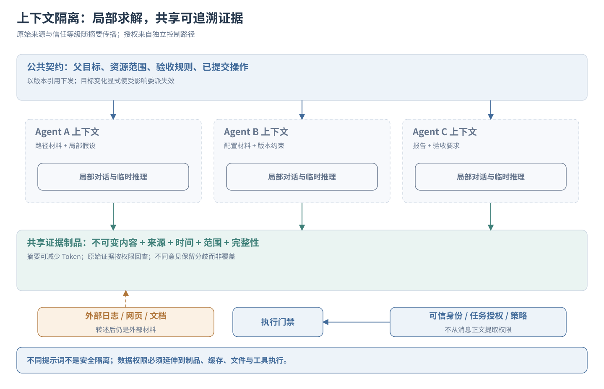

**图 10-6 信息跨 Agent 共享时保留来源与信任边界，执行授权由独立控制路径提供**

转述改变了表达形式，没有改变原始内容的授权地位。审计记录应能沿摘要引用回到来源，以便发现污染后定位受影响产物。

信息边界清楚以后，通信协议才有实际意义。下一节讨论这些契约如何跨进程、框架和组织传递，以及协议标准化能帮助什么、仍不能替代什么。

## 7. Agent Communication：把对话放进有身份和状态的消息协议

同一进程中的 Agent 可以通过函数调用交换结构体；跨进程后，消息可能延迟、重复、乱序或丢失。跨组织时，还会出现能力版本、身份体系和数据政策差异。自然语言可以表达问题，却不能独自处理这些传输与执行语义。

通信层的目标不是消除所有不确定性，而是让接收方知道这条消息属于谁、对应什么任务、是否已经处理，以及它能够合法改变哪一部分状态。

### 7.1 请求、事件与产物需要不同的解释方式

一个请求表示希望对方执行工作；一个事件表示某件事已经发生；一个产物承载可消费的结果。把三者都包装成“消息正文”，会让接收方难以区分该执行、记录还是核验。

例如，“请查询当前路由”是请求；“子任务已接受”是状态事件；“路由差异报告”是产物。事件声称“完成”仍需关联到任务与结果，不能只根据文本里的完成词推进父任务。

可以定义一个应用层信封：

```json
{
  "message_id": "MSG-11-NET-008",
  "kind": "ARTIFACT_READY",
  "correlation_id": "DEL-11-NET-01",
  "causation_id": "MSG-11-NET-001",
  "assignment_revision": 1,
  "sender_ref": "network-agent-service",
  "recipient_ref": "incident-coordinator",
  "schema_version": "collaboration-event-v2",
  "sequence": 8,
  "payload": {
    "child_task_id": "SUBTASK-11-NET-01",
    "artifact_ref": "artifact://SUBTASK-11-NET-01/result/v1",
    "status": "PARTIAL"
  }
}
```

这些字段是工程示意，不是 A2A 或其他协议的标准消息格式。`sender_ref` 仅用于关联，真实身份必须来自验证过的连接或凭据，不能相信正文自报的发送者。`sequence` 可以帮助发现同一发送者流中的缺口，但不能自动建立整个系统的全局顺序。

### 7.2 去重与状态接纳需要在同一提交边界内

消息队列的至少一次投递意味着同一结果可能多次到达。若每次接收都把费用加一次、将节点完成数加一，或者触发一次新的变更，重复消息会直接改变业务行为。

接收方可以维护 Inbox，记录已处理消息身份，并把去重记录与对应状态更新放在同一事务中。这样，即使确认响应丢失，重复到达也不会再次产生相同的本地状态推进。发送方则可以使用 Outbox，让委派登记与待发送消息一起提交，避免任务状态写了“已派发”却没有消息真正发出。

这些机制延续第 6 章的原则，但不能单独保证远程业务恰好执行一次。接收方本地状态提交之后，外部工具仍有独立的副作用窗口，需要 Operation 身份、下游幂等契约和结果查询。消息去重解决的是消息处理，业务幂等解决的是动作效果，两者不能混用。

去重键还应有明确作用域和保留期。只保存短期缓存，可能在长任务恢复后重新接受旧消息；不同发送者恰好使用相同 ID，也不能互相覆盖。通常需要组合发送方身份、协议或任务范围与消息 ID，并根据最长恢复周期决定保留策略。

### 7.3 结果乱序与迟到时，先核对任务修订再使用内容

子任务 r1 的结果可能在父任务已经创建 r2 后到达。接收方仍应保存结果与执行消耗，但不能直接覆盖当前计划的有效结果。它需要核对目标范围、输入版本和修订关系，再决定是否复用。

某些只读产物即使来自旧修订仍然有效，例如未变化资源的配置快照；某些则必须重取，例如已经切换路由后的流量窗口。判断应依赖数据适用条件，而不是简单比较消息时间戳大小。

状态事件也可能乱序。收到 `COMPLETED` 后又收到先前的 `WORKING`，不能把任务退回运行中；收到取消确认后仍可能收到已发生操作的结果，需要记录事实而不恢复正常派发。接收方应按允许的状态转换和远程版本处理，而不是最后写入获胜。

### 7.4 超时、重连和取消是通信契约的一部分

远程调用超时只能说明调用方未在期限内获得响应，不能证明对方没有启动任务。恢复路径应优先查询稳定委派或远程任务身份，再决定是否重发。

流式连接中断同样不等于任务停止。重连时应知道是否支持从某个游标继续、是否需要重新查询状态，以及产物是否可能重复发送。若服务只支持尽力通知，调用方需要定期对账，不能把“没有新消息”当作完成或失败。

取消应区分请求已收到、任务停止派发和外部动作已经收敛。接收方可以拒绝无法取消的已完成任务，也可能需要一段时间处理在途操作。父任务发出取消后，仍应保留查询与收尾预算，不能立即释放全部责任记录。

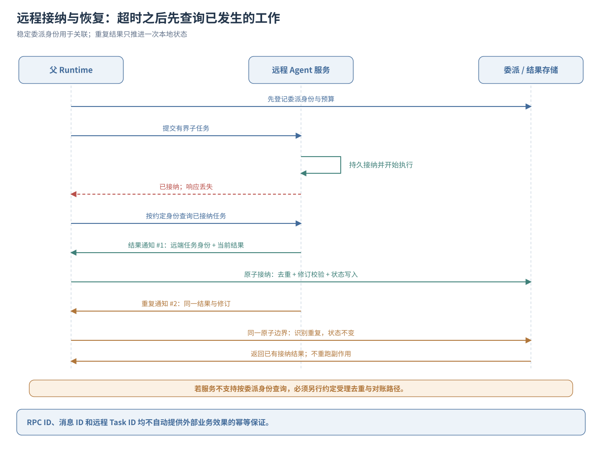

**图 10-7 响应丢失后先确认已接纳工作，重复通知只推进一次本地状态**

这条恢复路径依赖服务实际提供的接纳查询或应用层去重契约；不能仅凭某个通用消息字段，就假设远端支持按该字段查询。

背压也需要显式处理。接收方容量不足时，可以拒绝接纳或返回可解释的排队状态；发送方应限制并发和重试，不让多个 Agent 互相放大超时流量。是否允许排队，应考虑父任务剩余期限，而不是把所有请求无限堆积。

### 7.5 A2A：统一远程 Agent 的互操作接口

A2A（Agent2Agent）协议面向 Agent 之间的互操作，提供描述服务能力、发送消息、追踪任务和交换产物的公共结构。[7] 本章以已发布的 v0.3.0 规范说明具体语义，不声称它是最新版本；生产接入应锁定双方采用的规范版本并验证兼容性。

可以从几个对象理解它：Agent Card 用于描述一个 Agent 服务及其能力和接口信息；Message 表达交互内容；Task 表示需要持续追踪的工作；Artifact 表示执行产生的产物。消息内容可以包含文本、文件或结构化数据，具体格式和能力依赖所采用的版本与服务声明。

这些对象帮助调用者在不理解远程 Agent 内部模型、工具和计划的情况下发起协作。调用方可以知道任务是否正在处理、是否需要额外输入，以及是否已经产生结果，而不用把对方的内部执行循环复制到本地。

在 v0.3.0 中，`message/send` 可以返回 `Message` 或 `Task`，并非每条消息都必然创建一个任务。远端 `Task.id` 由服务端分配，应与本地委派记录建立映射，不能直接当作本书父级业务 Task 的替代。`contextId` 可以关联相关交互，`artifactId` 则标识 Task 范围内的产物；这些身份分别解决不同关联问题。

还要分开理解流结束、产物结束与任务终态。`TaskStatusUpdateEvent.final=true` 表示当前交互流的最后事件，任务可能正在等待输入，并不一定完成；产物更新中的 `lastChunk` 表示这是该产物的最后一个块，也不等于业务验收通过。规范规定 `completed`、`canceled`、`rejected` 和 `failed` 等终态 Task 不可重启，需要新的工作时应建立新任务并保留关联。

同样，`tasks/cancel` 只是取消请求，可能因任务已完成或当前阶段不支持取消而失败，更不代表已发生的外部动作被回滚。JSON-RPC 的请求 `id`、Message 的 `messageId` 和远端 Task 的 `id` 均不自动提供业务副作用幂等；应用仍需保存自己的委派和 Operation 身份。

但协议对象不能替代业务契约。Agent Card 声称“支持生产诊断”，不代表调用者有权读取任何生产数据；Task 完成，不代表父任务的业务目标通过验收；Artifact 存在，不代表内容真实或可以跨租户共享。接收方仍要实施身份校验、任务授权、数据政策和结果检查。

A2A 与 MCP 也处于不同的接口重心。MCP 主要规范宿主与工具、资源和提示服务的交互，第 5 章已经讨论；A2A 更关注与一个具有自身执行状态的 Agent 服务协作。实际系统可以在内部用 MCP 访问工具，对外用 A2A 提供任务能力。不能仅根据协议名称判断调用是否安全，也不能把工具服务一律称为 Agent。

将协议对象映射回本地执行模型后，可以看到哪些关联由 A2A 提供，哪些责任仍需应用维护。

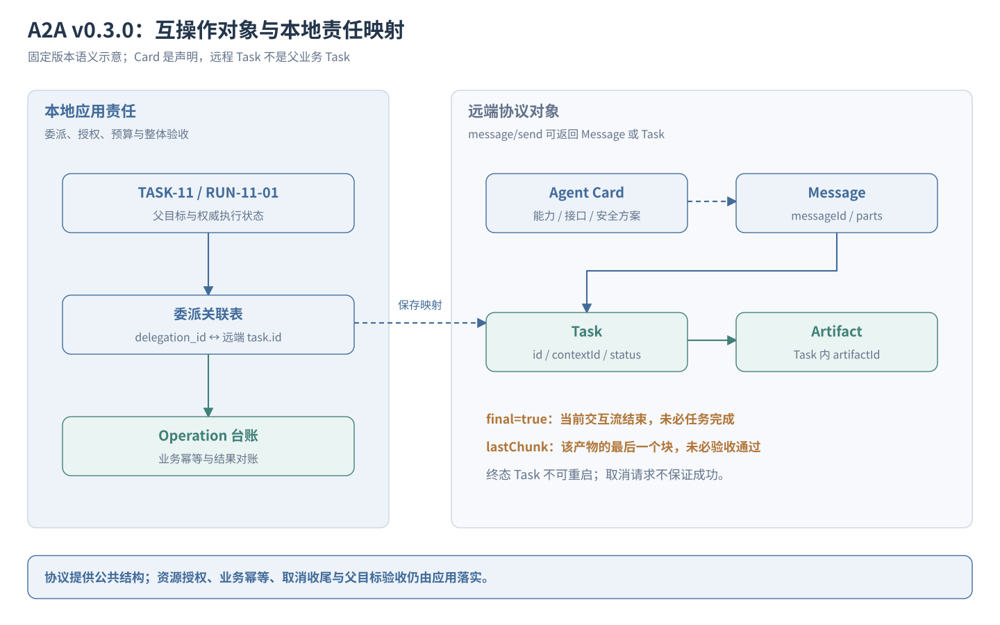

**图 10-8 A2A 对齐远端消息、任务与产物，本地仍保留委派和业务责任**

### 7.6 协议兼容要验证语义，而不只验证 JSON

两个服务能够解析同一种消息，不代表它们对任务完成、取消、部分结果和输入请求有相同理解。接入测试需要覆盖任务创建、状态查询、长时间等待、产物增量、断线重连、权限拒绝和迟到结果等路径。

能力发现应用于构建候选服务集合，再按身份、数据地域、版本和预算筛选。模型可以根据描述选择能力，但不能任意连接一个返回漂亮 Agent Card 的地址。服务注册和出站访问仍应遵循平台策略，防止发现机制变成绕过可信目录的入口。

对于认证扩展、回调通知和受保护的制品下载，要检查双方实际支持的方式。协议支持可选功能，不意味着每个服务都开启它；没有能力声明或协商结果时，应选择明确可用的查询方式，不能假设流式和推送一定存在。

通信协议为交换工作和结果提供共同结构，仍没有解决多个主体同时改变共享资源的问题。下一节把视角移到写入所有权、合并规则和部分失败，说明协作怎样避免把局部自治变成全局冲突。

## 8. 并发冲突与错误传播：让局部失败保持可定位

多个 Agent 可以在各自任务中表现合理，却共同造成错误。例如两个参与者都发现缺少一条规则，分别提交新增；一个正在根据旧版本分析，另一个已经修改配置；一个 Worker 的错误结论被 Manager 转发后，又成为其他 Worker 的共同前提。

这些问题不能只通过“请相互协作”解决。系统需要明确谁能写什么、结果如何合并，以及哪些失败需要停止整个父任务。

MAST 研究从所分析的多 Agent 运行轨迹中，将失败归纳为系统设计问题、Agent 间的协作不一致，以及任务验证问题。[8] 这个划分对应了本章的三个检查位置：职责与停止条件是否明确，交接的信息是否保持含义，最终结果是否经过独立验收。它描述研究样本中的失败模式，不是某一种拓扑必然失败的定理；工程团队可以借用分类检查自己的轨迹，再用实际证据定位需要修复的环节。

### 8.1 优先采用清楚的资源所有权

在同一个父任务内，可以指定只有一个提交者负责生产写入，其他 Agent 提供证据和候选方案。这个设计并不限制它们的分析能力，而是把副作用集中到一个可以检查审批、版本和幂等身份的位置。

如果业务必须允许多个写入主体，应按资源划分所有权，并处理范围交叉。例如不同渠道可以由不同执行器负责，但共享出口、全局路由和批量规则可能跨越分区。资源声明应来自工具契约和领域模型，不能只相信模型说“我的改动不会影响别人”。

第 7 章的读写集检查仍然适用。多个 Agent 只是让冲突来自不同执行主体，不能让原来不安全的并发变得安全。即使两个动作最终写入相同值，也可能产生重复审批、通知、计费或外部副作用，不能只比较最终配置是否一致。

### 8.2 状态版本与条件写入防止使用过期前提

假设 Agent A 根据 v18 生成一个拟议变更，Agent B 或人工在此期间把相关规则更新为 v19。A 不能继续以旧预检执行；目标服务应支持预期版本或等价的条件更新，失败后重新读取并判断影响。

乐观并发控制适合冲突不频繁、可以重新计算的场景。锁或租约可以限制同一资源的同时操作，但持有锁期间等待模型和人工可能过长，也不能代替下游版本检查。锁失效、进程暂停和网络分区仍可能让旧执行者继续运行，需要执行权校验与 fencing 等保护。

计划修订与资源版本是两个不同维度。计划仍为 r2，不代表资源没变；资源没变，也不代表父目标没有被用户修改。动作派发前要同时检查任务授权、批准意图和相关资源条件，而不是只看其中一个版本号。

### 8.3 合并结果时保留来源，不用覆盖消除冲突

多个 Worker 返回相同类型的观察时，合并器应按稳定产物身份去重，保留来源和适用范围。对不同窗口的请求计数，可以在范围不重叠、口径一致时求和；如果窗口重叠或同一数据被两个 Worker 重复查询，直接相加会夸大样本量。

合并自然语言结论也有类似问题。两个 Agent 都引用同一查询结果，不是两份独立支持；一个说“未发现异常”，另一个说“结果不完整”，也不能简单投票。应把冲突拆成可检查字段：覆盖范围、版本、完整性和解释差异。

下面的示意函数只负责按身份接纳不可变产物。它假设发送者身份已经验证，产物字段已经校验，摘要覆盖约定的不可变内容；不处理真实性和业务冲突。由于产物 ID 可能只在任务内唯一，去重键需要包含生产者任务范围：

```python
from copy import deepcopy


def accept_artifact(index, item):
    key = (
        item["producer_id"],
        item["producer_task_id"],
        item["artifact_id"],
        item["revision"],
    )
    existing = index.get(key)
    if existing is not None:
        if existing["content_digest"] != item["content_digest"]:
            raise ValueError("同一产物版本出现不同内容，暂停接纳并核对来源")
        return index
    updated = dict(index)
    updated[key] = deepcopy(item)
    return updated
```

字典示例只表达单次合并语义。实际并发存储需要唯一约束或原子条件写入，把去重与接纳状态更新一起提交，不能把普通的“先查询再插入”当作并发保证。

内容摘要相同可以帮助识别重复，但不能证明业务语义相同；相同数据经过不同包装也可能有不同哈希。跨产物的重复证据仍需通过来源记录、查询范围和数据版本辨认。

下面用一个明确标注的后续教学分支，展示资源变化如何使先前的预检失效。

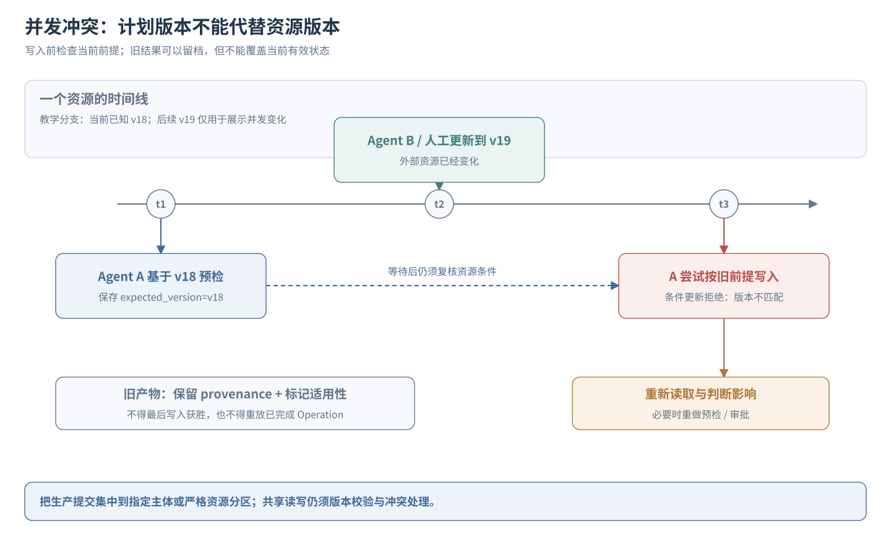

**图 10-9 资源版本变化阻止旧前提写入，迟到产物经适用性检查后才能接纳**

### 8.4 失败传播应依据依赖关系和影响范围

一个可选报告 Worker 超时，未必需要取消已经完成的指标与配置读取；一个必需证据源不可用，则可能阻止任何后续变更；一个 Worker 返回了越权数据，则需要隔离相关产物并检查是否已经被其他参与者消费。

可以把失败分为局部可重试、依赖阻塞、契约不兼容、证据污染和外部副作用未知等类别。每类对应不同的父任务动作，而不是统一让 Manager 再调用一次。

| 失败类型 | 对父任务的影响 | 合理处理 |
| --- | --- | --- |
| 可选读取暂时失败 | 解释质量可能下降 | 在预算内重试，或交付明确缺口 |
| 必需证据缺失 | 相关判断没有前提 | 阻止依赖节点，补证或升级 |
| 结果 Schema 或版本不兼容 | 产物无法可靠消费 | 拒绝接纳，协商兼容版本或换能力 |
| 不可信内容被提升为指令 | 下游上下文可能被污染 | 隔离来源，检查已消费范围并重建必要上下文 |
| 写入结果未知 | 后续动作可能重复或冲突 | 按原 Operation 对账，禁止新建替代写入 |
| 协调者失去执行权 | 可能重复委派或提交 | 停止派发，恢复账本后重新取得执行权 |

**表 10-4 多 Agent 失败需要按责任和依赖分类处理**

对于证据污染，不能只删除最初那条消息。它可能已经被摘要、引用或写入候选报告，需要沿产物依赖关系找到受影响结果。类似地，撤销一个 Worker 的权限后，已有缓存和共享制品是否仍可读取，也要按第 9 章的撤权规则处理。

### 8.5 重试放大与级联调用需要统一预算

假设 Manager 允许重试三次，Worker 内部也重试三次，工具适配器再重试三次，一项工作可能被放大成远超预期的下游请求。多个 Worker 同时遇到依赖故障时，放大会叠加成流量风暴。

应给父任务设定统一的尝试和成本上限，并在委派时分配子预算。每层需要知道哪些失败已经被下层处理，避免对相同错误再次套用完整重试策略。退避和熔断可以缓解故障，但不能解决重复业务意图，后者仍需要稳定身份。

预算回收也要区分未使用额度与在途责任。取消一个 Worker 后，它可能仍在等待远程变更确认；不能把它的全部预留立即分配给新 Worker，然后在旧请求最终计费时超出总预算。结果对账与收尾需要保留额度。

### 8.6 补偿是新的受控动作，不是把所有 Agent 倒放

一个协作任务可能完成了多个外部动作，后来才发现整体目标无法达成。此时不能简单按逆序调用“撤销”，因为某个动作可能已经被后续业务依赖，或涉及不可逆通知和数据传递。

补偿需要依据业务契约、当前状态和授权执行。每个动作应保存原意图、结果和必要快照，父任务记录哪些补偿已完成、哪些失败、哪些不适用。多个 Agent 参与补偿时，仍需单一协调记录，避免一方撤回、另一方又根据旧计划重新提交。

这些控制让局部自治保持在可解释范围内，但也增加了系统复杂度。下一节把协作模式、拓扑和资源代价放在一起，说明怎样选择一个足够简单的结构。

## 9. 协作拓扑：让通信结构贴近任务依赖

Agent as Tool、Manager / Worker 和 Peer 描述控制关系，拓扑则进一步决定谁能向谁通信、哪些路径可以并行，以及信息需要经过多少次交接。拓扑不应模仿公司组织架构，而应服务于任务的实际依赖和责任边界。

同一个系统可以对不同阶段使用不同拓扑：证据收集阶段采用星形分派，少量领域问题采用对等澄清，最终验收回到单一提交点。关键是每次转换都保留任务身份、权限和结果来源。

### 9.1 从简单结构开始，再为明确瓶颈增加连接

常见结构可以放在同一张表中比较：

| 拓扑 | 适用工作 | 主要收益 | 主要代价 |
| --- | --- | --- | --- |
| **串行链** | 前一产物是后一任务必要输入 | 依赖清楚，交接容易追踪 | 延迟累加，早期错误向后传播 |
| **星形分派** | 多个独立调查汇总到一个父目标 | 易于并行，责任集中 | Manager 可能成为信息与调度瓶颈 |
| **层级树** | 大任务可分成相对独立的领域阶段 | 缩小局部管理范围 | 多层摘要、预算和约束传递复杂 |
| **受限 Peer 网络** | 少量参与者需要跨领域澄清 | 减少中间转发，保留专业自治 | 环路、重复请求和争议处理增加 |
| **共享黑板** | 多个参与者围绕公共证据逐步贡献 | 便于异步贡献和发现缺口 | 状态所有权、版本和信任分类要求高 |

**表 10-5 协作拓扑应根据依赖与责任选择**

全连接通信不是默认的高级形态。若 $n$ 个参与者之间都允许双向直接联系，有向连接数可达到 $n(n-1)$；这只是可能的通信关系数量，不代表每轮都实际发送这么多消息，但已经增加了需要治理的接口组合。

星形结构通常只需要父节点与各子节点之间的连接。若它成为瓶颈，可以开放少量明确的领域澄清边，而不是一次允许所有参与者广播。连接增加之前，应说明它减少了哪种重复转发，以及如何限制新产生的环路。

### 9.2 串行链需要在交接处验证，而不是只传递摘要

例如“日志分析 → 配置解释 → 处置报告”可以形成串行链。若第一步错误地把下游目标地址当作源出口地址，后两步可能在这个错误实体上完成看似合理的工作。

交接处应传递结构化实体、来源和范围，并做基本语义检查。配置 Agent 应要求明确字段 `source_egress` 与 `destination`，不能仅从一段文字里猜测地址角色；报告 Agent 应核对结论是否引用实际证据，而不是把上游摘要当作已经批准的事实。

串行链还要保留返回缺口的路径。下游发现上游产物不完整时，应指出具体字段或范围问题，而不是补写不存在的信息。必要时重新委派上游，但要沿原任务关系记录修订，防止同一个缺口反复在链中循环。

### 9.3 星形与层级结构需要控制 Manager 的信息负载

Manager 接收十份长报告时，可能重新遇到单 Agent 的上下文问题。分派扩大了处理量，却没有自动扩大最终汇合窗口。解决方式不是要求 Manager 读完全部原文，而是让子结果遵循相同的证据与缺口结构，按父决策需要选择展开。

可以先由确定性汇合器生成索引：哪些问题已得到证据，哪些结果冲突，哪些子任务超时，再把相关产物交给 Manager 模型。对于稳定的数值比较、引用完整性和版本一致性，使用程序检查，减少 Manager 在低层材料上重复推理。

层级结构可以进一步分担汇合，但每层需要保留证据引用与未决问题。不能让中层为了给上层一份“简洁结论”，删除所有限制条件。一个合格的摘要应让上层知道自己可以作出多强的判断，而不仅是知道中层倾向什么结论。

### 9.4 黑板结构需要明确提议与提交

共享黑板适合异步协作：参与者发布证据、标记问题、提出候选，其他参与者按需消费。但若任何 Agent 都能直接修改“最终根因”“审批状态”或“任务完成”字段，黑板就变成没有所有权的共享内存。

可以把写入拆成提议区与权威区。参与者可以追加自己的观察和候选；受控合并器把满足契约的证据纳入共享视图；指定责任主体推进任务状态。每条更新携带版本和来源，冲突通过显式事件处理。

黑板上的订阅也需要限制。一个证据更新如果唤醒全部参与者，可能引发一轮没有必要的再分析。订阅应关联具体问题或依赖，只有相关内容变化才触发工作，并设置去抖、预算和最大反应次数。

这些拓扑的通信路径不同，但都应能明确指出谁有权提交共享状态和接纳最终结果。

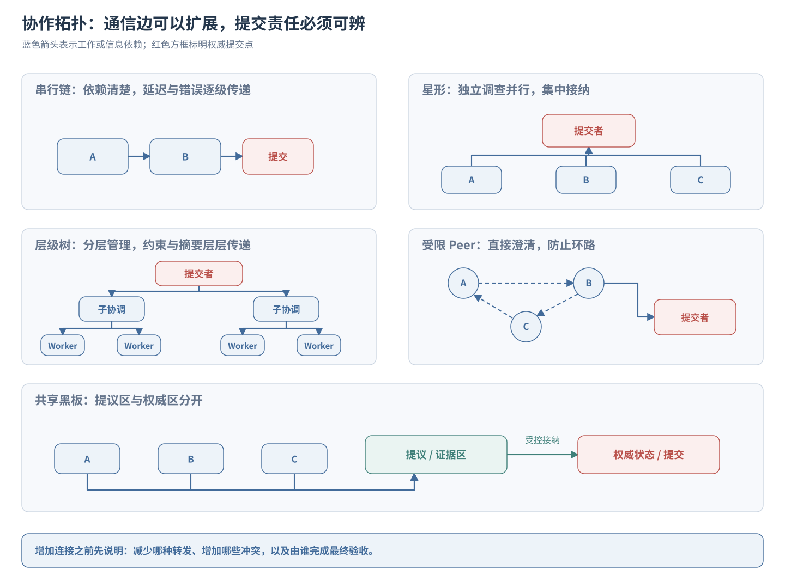

**图 10-10 链、星、树、Peer 与黑板采用不同通信结构，但都需要清楚的提交责任**

### 9.5 拓扑可以变化，但责任链不能丢失

一次任务可能先由单 Agent 调用专业工具，后来发现需要两个长期调查，升级为 Manager / Worker；也可能在证据齐备后收缩为单一验收流程。这种变化合理，但要记录委派关系和控制权转换。

升级不应重新执行已经完成的步骤，收缩也不能遗忘仍在运行的子任务。父任务需要在切换时核对哪些子任务继续、哪些取消、哪些产物保留，以及谁接收迟到结果。

可以把拓扑视为当前计划的一部分，而不是一个永久产品标签。目标是用足够少的参与者和连接完成当前任务，避免为了保持“多 Agent 架构”而维持已经没有价值的角色。

结构选择最终仍然需要证据。下一节把这些模式放进公平对比，说明怎样判断协作收益来自真正的分工，还是仅仅来自更多 Token、更多时间和更宽的权限。

## 10. 适用边界与评估：证明拆分值得，而不只证明它能运行

多 Agent 演示通常展示一次复杂任务被多个角色共同完成。要决定是否采用这种架构，还需要知道：同样的模型、工具、预算和时间约束下，一个设计良好的单 Agent 能做到什么；协作增加了多少成本与失败面；它在哪些任务类型上有稳定收益。

第 8 章已经建立任务级评估方法，本节只聚焦多 Agent 特有的比较问题。没有公平基线，就很容易把额外计算量的收益误记成协作结构的收益。

### 10.1 基线应该具备相同的基本能力

把一个没有检索、没有上下文管理的单 Agent，与配备多个工具和专门资料的多 Agent 系统比较，无法说明拆分本身的价值。至少应让基线能够使用相同的授权资料、工具和核心模型能力，并具备合理的单任务编排。

可以设置几组互补比较：单 Agent 使用相同总预算；单 Agent 使用相同墙钟期限；多 Agent 使用相同模型与工具；在同一协作结构内关闭某个角色或直接通信边。不同对比回答不同问题，不必强行要求所有资源同时完全相等，但必须说明控制了什么。

例如，多 Agent 在更高成本下显著降低延迟，可能对紧急排障有价值；在相同成本下提高证据覆盖，可能对离线研究有价值。它们不应被合并成一个没有约束条件的“提升 30%”。

### 10.2 分别测量任务收益与协作开销

最终指标仍然是父任务的严格成功、风险、成本和延迟。子任务成功率可以帮助定位问题，但不能代替整体结果。

还可以增加一些协作诊断指标：

| 指标 | 能解释什么 | 需要防止的误读 |
| --- | --- | --- |
| 有效证据覆盖 | 必需证据中有多少获得合格来源 | 不能把同一来源的重复摘要计为新增证据 |
| 委派返工率 | 因范围、输入或契约不清而重新分派的比例 | 合理的新证据修订不一定是设计失败 |
| 重复工作量 | 多个参与者重复读取或计算的消耗 | 有意独立复核应单独标记 |
| 协调成本占比 | 分派、澄清、汇合消耗的资源 | 占比低不证明协调充分，需结合结果 |
| 关键路径延迟 | 哪个依赖链决定总完成时间 | Agent 数量增加不等于关键路径缩短 |
| 冲突与污染传播 | 无效结果影响了多少后续产物 | 应追踪实际消费关系，不能只数消息 |
| 人工接管负担 | 人需要处理多少分歧和缺口 | 不把工作转交给人伪装成系统效率提升 |

**表 10-6 协作指标用于解释父任务表现，而不是替代它**

对委派数量、讨论轮数和消息数量，不应默认越多越好。它们通常是成本或复杂度信号。一个在两次查询后形成合格证据的系统，可能比十个角色讨论二十轮更可靠。

### 10.3 用消融实验区分分工、并行与额外计算

假设某个教学评估发现多 Agent 比单 Agent 表现更好，可能有几种解释：更多上下文容量、更多模型调用、并行缩短时间、工具范围更清楚，或独立复核确实发现了错误。

可以逐项做消融：保持总 Token 预算，减少角色；保留多个上下文但串行执行；保留并行查询但用单一模型汇合；移除没有独立证据的投票；让单 Agent 获得相同的阶段工具筛选。每次尽量只改变一个因素，再按第 8 章的方法做配对比较与分层统计。

消融不能完全消除所有交互效应。例如减少一个角色也可能改变 Manager 的提示长度；关闭直接通信可能增加转发次数。应记录这些连带变化，避免把联合干预解释成某个机制的唯一因果证明。

重复试验还要按父任务分组。一次父任务里有十个子任务，不是十个独立业务样本；同一事故的多个角色也不提供十份独立泛化证据。统计单位仍应围绕用户目标和任务来源定义。

把关键路径与累计消耗分开画出，可以避免把并行带来的时间收益误算成成本减少。

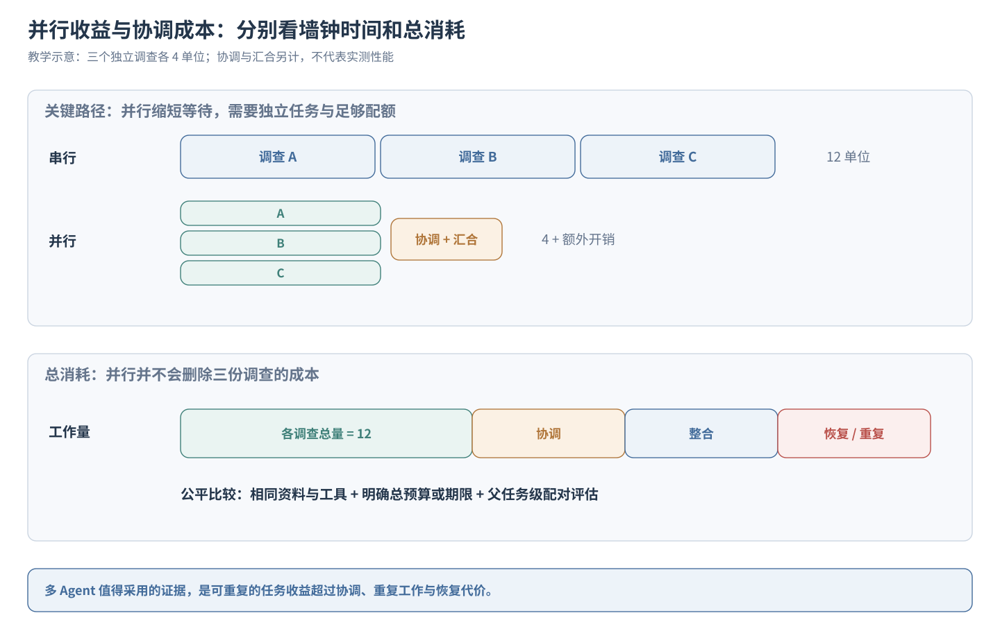

**图 10-11 并行可以缩短关键路径，但总成本仍须计入协调、整合与恢复**

### 10.4 测试协作特有的失败窗口

除了正常分工，还应覆盖以下场景：重复委派、Worker 接纳后响应丢失、结果乱序、父任务取消后子任务完成、旧修订结果到达、Agent Card 能力声明与实际行为不一致、共享证据撤权，以及恶意内容通过摘要转述。

对于写入，测试应检查实际副作用次数和授权链，不能只看所有 Agent 都报告“成功”。对于通信，测试应区分传输恢复和业务恢复；连接重建后能继续收消息，不代表此前未知的操作已经确认。

还应检查允许路径。一个系统拒绝所有远程结果，可能避免证据污染，却无法完成任务；一个 Manager 从不委派，可能没有协调错误，却失去预期收益。测试需要同时证明该阻断时能阻断、该合作时能合作。

不同信任域之间的错误尤其值得单独测试：远端返回过期 Schema、缺失来源、伪造发送者字段，或提供调用者无权读取的制品引用。接收方应依据契约和身份处理，而不是让模型临时猜测是否可信。

### 10.5 哪些场景通常值得拆，哪些应先保持单体

适合优先尝试拆分的场景包括：多个证据问题相对独立；材料可以按领域自然分区；结果有明确契约；部分能力由不同团队或信任域维护；任务价值足以承担额外协调成本。开放式资料研究往往比高度串行、共享状态密集的操作更容易获得并行收益。[5]

应先保持单体的场景包括：任务短且路径稳定；所有步骤高度依赖同一份细节；主要瓶颈是工具质量或数据缺失；目标难以定义子产物；每个参与者都需要相同权限和全部上下文。此时更好的上下文管理、工具粒度和确定性工作流可能已经足够。

对于高风险生产操作，多个 Agent 可以帮助收集证据和复核，但写入控制宜保持清楚、集中或严格分区。不能把责任分散视为风险分散：若所有参与者都能修改同一资源，系统可能只是增加了出错入口。

一条实际的选择顺序是：先建立可评估的单 Agent 基线，再把一个明确瓶颈拆成有契约的子任务；验证收益后增加必要的并行或跨域协作；一旦协调开销超过收益，就收缩结构。架构可以退回更简单的形式，这应被视为正常优化。

### 10.6 让协作经验进入后续改进，而不自动变成知识

多 Agent 运行会产生有价值的信息：哪些委派描述经常造成误解，哪些结果字段总是缺失，哪些直接通信减少了返工，哪些角色只重复工作。这些信息可以指导工具契约、提示、计划模板和平台配置的改进。

但一次成功协作不能直接成为通用规范，一次多数意见也不能成为长期知识。需要区分已验证事实、局部经验和待测试建议，沿第 4 章的记忆治理与第 8 章的评估方法筛选，再决定是否发布新的能力版本。

这为最后一章留下了一个问题：运行过程已经产生了大量经验，系统怎样把其中可靠的部分转成持续改进，而不是把错误一起积累？在进入这一问题之前，先把本章的协作边界收束回当前任务。

## 11. 本章总结：多个执行主体需要一条完整的责任链

`TASK-11` 仍然是同一个尚未通过恢复验收的任务。无论后续由一个 Agent 完成调查，还是由多个专业 Agent 分工，`CHG-11` 已完成、v18 包含 E11、业务恢复尚未满足条件这些事实都不会改变。协作改变的是信息处理和责任分配，不是已经发生的现场结果。

一种受控的接续方式是：父 Runtime 在 `WAIT-11-04` 满足条件后执行 `collect_verification_window`；若需要更多调查，由协调者登记明确子任务，给每个参与者分配最小必要上下文、能力和预算；子任务返回版本化证据与缺口，父任务核对适用范围并完成整体验收。需要新的生产动作时，再进入独立的预检、审批和 Operation 执行链。

在这个结构中，几个边界尤其重要：

- Agent as Tool 适合有界专业能力；Manager / Worker 适合统一目标下的显式分派；Peer 适合必要的跨领域澄清，但仍需状态所有权和最终责任。
- 上下文可以分开，事实必须带来源共享；角色不同不等于证据独立，提示词隔离不等于权限隔离。
- 协议统一消息、任务和产物的交换方式，持久执行、业务幂等、取消收尾和授权仍由系统落实。
- 局部完成必须经过父任务合成检查；多数意见、流结束或远程 Task 完成，都不能代替业务验收。
- 拆分是否值得，应在相同能力与明确资源约束下比较，计入协调、重复工作、失败恢复和人工负担。

多 Agent 的价值不是把一个模型想象成一支团队，而是让任务中确实可以分离的责任获得合适的执行边界，并让这些边界之间保持可检查的连接。下一章将把视角从一次协作扩展到长期运行：哪些经验可以被提取，应该写入 Memory、Skill、Program 还是模型参数，以及如何证明这些变化让系统持续变好。

## 12. 参考研究与延伸阅读

以下资料提供多 Agent 交互模式、工程经验与协议定义。框架演示和特定基准结果不构成对所有业务场景的保证；协议引用固定到明确版本，具体实现仍需验证能力与兼容性。

1. **Wu et al. (2023)**. [AutoGen: Enabling Next-Gen LLM Applications via Multi-Agent Conversation](https://arxiv.org/abs/2308.08155). 介绍可定制、可对话的 Agent 及其交互方式，展示多 Agent 应用的一种框架抽象。
2. **Li et al. (2023)**. [CAMEL: Communicative Agents for “Mind” Exploration of Large Language Model Society](https://arxiv.org/abs/2303.17760). 研究通过角色扮演与通信组织模型参与者，适合了解角色提示与协作行为的关系。
3. **Hong et al. (2023)**. [MetaGPT: Meta Programming for A Multi-Agent Collaborative Framework](https://arxiv.org/abs/2308.00352). 将标准化工作流程与角色分工纳入协作，讨论中间产物和流程约束对任务完成的作用。
4. **Du et al. (2023)**. [Improving Factuality and Reasoning in Language Models through Multiagent Debate](https://arxiv.org/abs/2305.14325). 研究多个模型实例通过提出和讨论答案改善部分任务表现的方法；不应把讨论一致性直接当作生产事实证明。
5. **Anthropic (2025)**. [How we built our multi-agent research system](https://www.anthropic.com/engineering/multi-agent-research-system). 介绍研究任务中的协调者与子 Agent、独立上下文、并行执行及成本取舍，适合结合具体任务边界理解工程收益。
6. **Anthropic (2024)**. [Building effective agents](https://www.anthropic.com/engineering/building-effective-agents). 讨论工作流、动态编排与并行等模式，强调根据任务需要选择结构。
7. **A2A Project**. [Agent2Agent Protocol Specification, v0.3.0](https://github.com/a2aproject/A2A/blob/v0.3.0/docs/specification.md). 定义 Agent Card、Message、Task、Artifact 和相关交互语义；任务互操作不能替代应用级授权、幂等与业务验收。

8. **Cemri et al. (2025)**. [Why Do Multi-Agent LLM Systems Fail?](https://arxiv.org/abs/2503.13657v3). 基于多 Agent 运行轨迹提出 MAST 失败分类，区分系统设计、Agent 间协作与任务验证问题；适合建立故障分析维度，不应把研究样本中的比例推广成所有系统的风险率。
