# 第11章 Agent Evolution：从经验沉淀到持续进化

**本章核心脉络与阅读导览**

前十章已经建立了一套可以理解环境、调用工具、持续执行、组织复杂任务并接受评估的 Agent 系统。第 10 章进一步把部分工作分配给多个 Agent，同时保留责任、证据和权限边界。本章最后追问：这些执行结束以后，系统除了留下更多日志，还能留下什么？下一次面对相似任务时，它怎样少犯一次旧错，又不把一次偶然结果误当成通用规律？

仍然看 `payment-gateway` 的教学事故。历史上，inst-09、inst-10 的出口授权问题有过经验证的处置案例；当前 inst-11 的 E11 确实曾缺失于渠道 A 的规则 v17，`CHG-11` 已确认成功，v18 的读回也包含 E11。但 HTTP 504 仍未满足恢复条件，`RUN-11-01` 还在等待后续验收。此时可以沉淀“变更完成与业务恢复需要分别核验”这条有依据的工程经验，不能沉淀“遇到新实例 504，补白名单就能修复”的无条件规则，更不能把本次事故存成一个已经解决的训练样本。

**Agent Evolution（Agent 演进）是把执行中获得的证据，转化为可验证、可追溯、可撤销的能力改进。** 它可能改变上下文组织、可检索经验、业务知识、可复用技能、确定性程序，也可能改变模型参数。不同层次的改进有不同成本和失效方式，不存在“先存记忆，再自动训练，系统自然越来越好”的通用流水线。

本章沿着一条经验从产生到发布的过程展开：

1. **改进对象（What changes）**：Context、Memory、Knowledge、Skill、Program 和 Parameter 各自改变什么，什么问题应该留在系统层解决？
2. **经验资格（What may be learned）**：哪些反馈足以支持经验，如何区分事实、处置、业务结果和用户偏好？
3. **经验提取（How to derive）**：怎样从运行轨迹形成带证据、适用条件和反例的候选，并决定它应进入哪一层？
4. **系统优化（How to improve the system）**：Prompt、Skill 与程序怎样从候选变成可测试的发布物，如何防止“越用越复杂”？
5. **训练数据与参数（How to improve the model）**：合成数据、SFT、偏好优化与 RL 分别提供什么学习信号，又会引入什么偏差？
6. **验证与推广（When to promote）**：如何证明提升来自预期变化，怎样在固定评估、灰度发布和运行反馈之间形成闭环？
7. **持续治理（How to remain correct）**：经验失效、源数据删除、模型退化或奖励被利用时，如何定位影响范围并撤销错误改进？

本章新增的候选 ID、训练样本、优化实验和发布版本均为教学构造。它们用于说明演进流程，不代表前述事故已经恢复，也不代表某个新模型已经取得未经展示的效果。第 8 章定义了评估方法，第 9 章建立了版本与治理机制；本章关注如何把它们连接到“下一次究竟改什么”的决策中。

## 1. 演进对象：先确定缺陷在哪里，再选择改变哪一层

一个 Agent 反复遗漏变更后的业务验收，可以有多种原因：工具没有返回指标时间范围，Context Compiler 把“仍未恢复”裁掉了，Prompt 没有区分操作状态与业务状态，Runtime 没有阻止无证据的完成声明，或者模型在很多不同场景下都难以遵守这种区分。

这些问题的表面结果相似，修复位置却不同。若缺陷来自工具数据缺失，增加训练数据不能创造本来不存在的证据；若缺陷来自权限门禁，让模型背熟“不许越权”也不能代替确定性授权。

### 1.1 六类载体承载不同性质的改进

第 3、4 章已经区分了上下文、状态、知识和记忆。本章进一步加入 Skill、Program 与 Parameter，按一次经验最终改变什么来比较：

| 载体 | 保存或改变什么 | 适合承接的经验 | 主要失效方式 |
| --- | --- | --- | --- |
| **Context（上下文）** | 当前决策可见的信息与组织方式 | 本轮应突出未通过的验收窗口、当前授权和证据缺口 | 裁剪、混淆来源、过期信息、预算挤占 |
| **Memory（记忆）** | 带范围和证据的历史经验或偏好 | 某类处置曾成功、曾失败，哪些前提需要复核 | 过度泛化、检索错配、反例未更新 |
| **Knowledge（知识）** | 由责任人维护的规范、事实和已批准方法 | 经审查的验收规则、接口语义和运行手册 | 版本过期、权限遗漏、规则冲突 |
| **Skill（技能）** | 可检索和组合的任务方法包 | 何时启动验收、读哪些材料、调用什么工具、如何报告 | 触发不准、步骤过长、依赖失效、隐藏副作用 |
| **Program（程序）** | 可执行的确定性逻辑与控制协议 | 窗口校验、授权、去重、结果状态转换 | 实现缺陷、契约不兼容、覆盖不足 |
| **Parameter（参数）** | 模型对输入与行为之间关系的统计表示 | 跨大量任务稳定存在的理解、选择和表达模式 | 遗忘、过拟合、偏好错配、难以局部删除 |

**表 11-1 六类演进载体及其工程边界**

这六类载体不是一条从低级到高级的阶梯。同一条经验可以只进入一个层次，也可以由几个层次协同表达。比如“证据不足时不能宣称恢复”需要程序阻止不满足验收条件的终结，也可以由 Prompt 帮助模型解释为什么继续等待；前者控制可提交动作，后者改善候选质量和用户理解。

Task State 仍然是当前任务的权威执行事实，不是第七种可以任意“学习优化”的经验仓库。修改一个 Prompt 不允许把 `CHG-11` 的已发生结果改写掉；生成一条记忆也不能把尚未恢复的 Run 标为成功。

### 1.2 Prompt、Skill 和 Program 的边界在执行契约

Prompt 是本轮输入中的指令、示例和表达约束。修改 Prompt 改变模型看到的内容，通常不改变模型权重；Context Engineering 还包括材料选择、预算和来源管理，因此不能把所有上下文改进都归结为写一句更强的提示词。

Skill 在本章中指一个有名称、适用条件、输入输出、步骤和验证方式的方法包。它可以包含提示模板、脚本和参考资料，但这些文件不会因被放进“技能目录”就自动可靠。技能中的脚本仍是需要测试和权限控制的程序，技能中的说明仍是可能被模型误读的上下文。

Program 指已经落实到确定性执行层的规则或计算。例如，窗口不完整时返回 `INSUFFICIENT`，是程序契约；“请注意检查窗口完整性”是模型输入。二者可以共同存在，但不能互相宣称提供了对方的保证。

Parameter 则是通过训练更新的权重，包括全量参数或适配器参数。改变参数能够让某种行为更稳定地出现在许多输入中，但不意味着模型获得新的实时事实、权限或可解释的规则存储。参数化知识难以逐条定位，不能作为经常变化的生产配置源。

### 1.3 用失败机制选择成本最低的有效改进

可以沿三个问题判断改哪里：必要信息是否可得；正确规则是否明确且可程序化；剩余困难是否在多个任务中稳定重现。

| 诊断结果 | 优先改进方向 | 为什么不先训练模型 |
| --- | --- | --- |
| 指标未返回时间范围或样本量 | 修复工具契约和结果整理 | 模型无法从缺失字段可靠推断事实 |
| 证据存在但未进入本轮输入 | 调整 Context 选择与压缩 | 先恢复信息链，再判断模型是否仍然犯错 |
| 业务条件明确、检查可计算 | 增加确定性校验和状态门禁 | 规则可直接执行，无需依赖概率性遵守 |
| 专业流程重复且步骤可组合 | 建立有契约的 Skill | 方法可以独立更新、检索和撤销 |
| 多种表达下持续出现语义误解 | Prompt 试验，必要时构建训练数据 | 先验证是否为可泛化的行为缺口 |
| 领域事实快速变化 | 更新受治理的 Knowledge | 事实需要时间、版本和权限，适合外部维护 |

**表 11-2 从失败原因选择演进位置**

“最低成本”不只指训练费用，还包括验证、上线、维护和撤销成本。一个十行程序可以可靠完成集合比较，就没有必要通过大量样本训练模型近似这项计算；反过来，面对自然语言的复杂条件解释，堆积数百条字符串规则也可能比经过验证的模型能力更难维护。

在定位尚不清楚时，应先补证据，而不是同时修改六个层次。所有组件一起变化，即使总体表现提升，也很难知道哪项改动真正必要，后续回滚更难判断该撤销什么。

把六类载体画成分支，更容易看清同一经验可以选择性落在哪些位置。

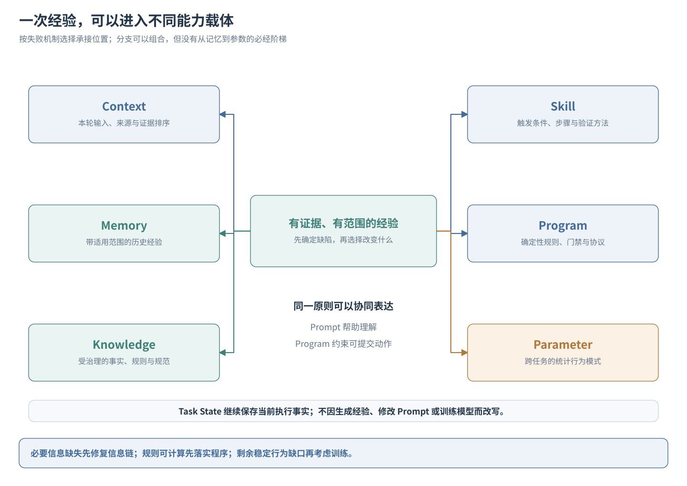

**图 11-1 六类载体承接不同性质的改进，同一经验不必进入所有层次**

### 1.4 改善当前 Run 与改善后续版本分开进行

收到工具错误之后让模型修正参数，属于当前任务的反馈控制；把这一类错误汇总成新工具说明并发布，才是跨任务演进。一次会话内的自我修订，不自动代表系统已获得可复用能力。

Reflexion 把反馈写成语言形式的经验并用于后续试验，Self-Refine 通过模型反馈迭代修改当前输出。[1][2] 它们说明无需每次更新权重也能利用反馈，但这种收益依赖反馈质量、任务和预算。不能把“模型读了自己写的反思”解释成经过独立验证的知识，也不能把论文中的基准提升当作所有企业任务的保证。

工程上应保留两条路径：运行中通过既定协议修正本次决策；离线从运行证据形成改进候选，经过验证再影响未来任务。紧急策略撤销可以即时阻止危险动作，但普通优化不宜悄悄改写正在运行的配置。

确定演进位置之后，最先需要解决的是输入质量。一个反馈闭环只有在反馈确实与任务结果相关时，才可能把系统推向正确方向。

## 2. Feedback Loop：先给反馈标注含义，再把它当成学习信号

Agent 会收到许多信号：HTTP 200、工具失败码、用户点赞、人工修改、任务取消、测试通过、指标恢复。它们都可以触发调查，但并不具有相同的证明力。

### 2.1 将动作结果、业务结果和体验反馈分别保存

`CHG-11` 的完成回执证明外部变更已提交成功，v18 的读回证明目标配置包含 E11；二者都不能单独证明 HTTP 504 已恢复。用户说“谢谢”可能表示已收到说明，也可能表示满意，同样不能覆盖仍未通过的指标。

反馈记录至少需要声明它评价的对象、观察时间、来源和范围：

| 反馈 | 能支持什么 | 不能自动支持什么 |
| --- | --- | --- |
| 工具确认操作成功 | 指定 Operation 的已知结果 | 整体任务目标达成 |
| 验收窗口通过 | 该范围与时段满足指定条件 | 根因一定是最近一次变更 |
| 用户赞许或偏好 | 用户对这次体验或表达的评价 | 事实正确、操作合规、可以跨用户泛化 |
| 人工修改答案 | 原输出有可改进之处，修改是候选示范 | 修改者必然掌握完整真值 |
| Runtime 拦截动作 | 控制层识别到不允许的请求 | 模型已学会不再提出该请求 |
| 没有投诉或告警 | 当前观察渠道没有收到相关信号 | 没有失败、没有越权或没有潜在影响 |

**表 11-3 常见反馈的证据含义**

将这些信号直接压成一个奖励数，会丢失重要差别。可以在后续训练中组合某些目标，但原始维度仍应保留，方便发现模型是否通过改善表面体验掩盖业务失败。

### 2.2 延迟反馈需要回连原决策，而不是覆盖最新记录

一个 Run 结束数小时后，用户才发现报告引用了错误窗口；一次退款请求受理后几天才完成；一项配置变更在后续流量增加时才暴露副作用。反馈到达顺序并不等于事实发生顺序。

因此，反馈应关联 `task_id`、`run_id`、`operation_id`、被评价制品版本和原 Release，而不是只写入“这个 Agent 最近一次表现”。同一事件收到多次回调时，通过稳定反馈身份去重；后续证据修正早期判断时，增加修订记录并标记谁被取代，不直接抹掉原始结论。

反馈缺失也需要状态。`outcome=PENDING` 与 `outcome=FAILED` 不同，长期缺少业务验收的成功回执不能自动进入成功训练集。若为了及时迭代需要先使用局部样本，应明确学习目标只是“识别操作状态”，而不是“证明任务完成”。

### 2.3 选择偏差会让闭环越学越像已有行为

只收集用户主动点赞的任务，会高估流畅、迅速和迎合偏好的表达；只收集成功轨迹，会遗漏失败前的危险选择；只分析进入人工接管的任务，又会过度代表困难场景。

更隐蔽的偏差来自策略自身。当前 Agent 很少选择某个工具，就缺少该路径的反馈；错误拒绝的任务没有进入执行阶段，也不会留下成功结果。若下一轮只学习已选择路径的结果，系统可能不断强化原来的狭窄行为，而不是发现更好的策略。

可以结合有记录的随机抽样、风险定向样本和专家构造场景，分别标明来源，不把它们混成无偏的线上分布。对决策日志保留当时可选动作和选择条件有助于分析，但不等于已经获得反事实结果：没有执行的方案究竟会怎样，仍需隔离实验或其他证据。

在模仿学习中，DAgger 研究关注策略诱导的状态分布变化：学习者行动后可能到达示范数据未覆盖的状态，再向专家取得对应指导。[12] Agent 场景可以借鉴“关注实际会遇到的偏离状态”，但采样和修正应在安全环境或受控范围内进行，不能为收集失败轨迹而在线上尝试未授权动作。

### 2.4 什么内容不能直接学

首先，不能把模型生成的假设、反思和自然语言解释当作独立真值。模型可以写出很有说服力的“这次错误是因为缺少重试”，但真实原因可能是权限拒绝，更多重试只会制造负担。

其次，不能把一次任务授权学成永久权限。值班人员批准 E11 这一次变更，只授权绑定的操作，不表示以后任何渠道都可以自动扩大白名单。用户临时要求简短答复，也不必自动成为跨会话偏好。

再次，不能把秘密、受限客户数据和无再利用资格的材料转换成训练样本，认为脱离原文件后限制自然消失。摘要、合成改写和向量表示仍可能泄露来源信息，数据使用范围需要沿派生关系传播。

最后，不能把省略必要步骤的短轨迹自动视为高效示范。一个没有做验收就结束的 Run 可能成本最低，却恰好违反任务契约。效率经验必须以结果和边界合格为前提，失败成本与人工补救也要进入判断。

### 2.5 反馈闭环需要独立的取证与晋级路径

一个稳妥的结构是：运行层产生事实与结果，反馈层关联业务和用户信号，提取器提出改进候选，评估层验证候选，发布层决定是否进入下一版本。执行 Agent 可以参与提取和生成，但不应凭自己写的总结同时决定事实、评分和发布。

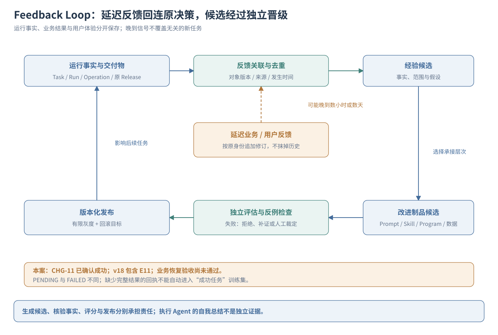

**图 11-2 反馈经过来源关联和独立评估，才进入下一轮版本化发布**

这条链不要求每项低风险文字优化都增加一个人工审批委员会。它要求的是职责与证据清楚：哪些规则可以自动判断，哪些结论需要领域负责人，候选失败后保留什么信息，以及谁有权扩大其适用范围。

当反馈完成关联后，下一步才能从庞大的轨迹中提取值得复用的经验。提取器的任务是压缩和提出候选，不是把所有执行历史升级为永久规则。

## 3. Experience Extraction：从运行轨迹到可审查的候选

一条有用经验需要同时回答四个问题：发生了什么；哪些证据支持这个判断；在什么条件下可以复用；遇到什么反例应停止使用。缺少任一项，经验都容易退化成一句看起来正确却难以执行的口号。

### 3.1 先提取事实，再提出改进假设

对当前案例，可以提取三个事实：原操作已确认成功；配置读回包含 E11；当前验收尚未通过。它们共同支持“操作完成不能代替业务验收”这个区分，却不支持“白名单与本次故障无关”，因为尚未恢复可能还有其他因素，且当前证据不足以完成因果分解。

为了讲解改进流程，下面另设一个离线教学失败：某候选版本看到变更成功后生成“故障已恢复”。这是一条构造的测试轨迹，不是对前几章真实执行结果的补写。由它可以提出改进假设：显式区分操作结果、验收状态与证据缺口，可能减少未经验证的恢复声明。

提取器应分别输出“事实陈述”和“改进假设”，而不是把二者合并为已经证明有效的规则。运行证据能够证明过去发生了什么；新的 Prompt 或程序能否改善未来表现，需要后续试验。

### 3.2 用经验记录保留范围、来源与不确定性

下面是本章贯穿的候选 `EXP-11-VERIFY-01`。URI 均为教学引用，实际系统应解析到有权限控制和保留策略的记录：

```yaml
experience_id: EXP-11-VERIFY-01
revision: 1
source_group: INCIDENT-11-05
source_runs: [RUN-11-01]
claim:
  statement: 外部变更完成与业务恢复需要分别确认
  verification_status: VERIFIED_IN_SCOPE
  evidence_refs:
    - result://CHG-11/v1
    - config://channel-A/v18
    - metrics://inst-11/window-03
scope:
  task_family: incident-verification
  required_conditions:
    - 存在独立业务验收契约
    - 可以区分操作结果与业务观测
limitations:
  - 不构成白名单对本次事故影响大小的因果结论
  - 不证明当前事故已恢复
improvement_hypothesis:
  statement: 分离状态字段并强制引用验收证据可减少错误恢复声明
  validation_status: UNTESTED
publication_status: CANDIDATE
owner: payments-sre
```

`verification_status` 评价经验陈述的证据资格，`validation_status` 评价改进方案是否有效，`publication_status` 控制能否被默认使用。它们是不同维度：一条事实可以已核验，但基于它产生的优化尚未经过测试。

适用范围也不应只写“适用于所有 Agent”。这条候选面向存在独立验收契约的任务；对纯文本润色，业务目标可能就是交付文本，不能机械要求一个与任务无关的生产指标窗口。

### 3.3 提取最小决策片段，保留必要上下文

完整轨迹可能包含数百个工具结果。直接全部送入提取模型，既昂贵，也容易让结论被无关内容稀释。可以先按事件关联定位：发生了什么错误声明，它基于哪个状态版本，输入中是否有未通过的验收结果，门禁是否拦截，之后产生什么影响。

最小片段应足以解释选择和结果，包括当时可用证据、授权、工具契约与目标。过度裁剪会改变样本含义：只保留“工具超时”和“后来成功”，遗漏了“查询原 Operation”的动作，就可能教出“超时后重发即可”的错误经验。

用于存储的证据片段与用于模型输入的脱敏视图可以分开。原始受限材料按原政策保留，候选中引用必要版本；提取时替换实体和秘密，但要保留决定行为的关系，例如同一 Operation 的身份不能被脱敏程序分别替成两个不相同的 ID。

### 3.4 聚类、去重与归纳不能制造虚假的证据数量

同一次事故的十份日志、三份 Agent 总结和五个改写样本，不是十八个独立案例。经验记录需要来源组与派生链，聚类时同时识别文本近似和共同事件。

归纳可以把多个案例整理成适用条件更清晰的方法，但应保留支持样本与反例。比如“所有新实例 504 都先加白名单”过度泛化；“新实例异常而存量实例正常时，优先比较配置、网络路径和出口授权”更像一个待验证的调查顺序，并不跳过当前证据。

去重也不能删除有意义差异。两个样本描述同一类超时，一个表示请求未到达，一个表示请求已执行但响应丢失，它们的正确恢复动作不同。只按文本相似度合并，恰好会抹掉最重要的执行边界。

因此，一条经验记录应同时保留事实依据、适用边界和仍待检验的改进假设。

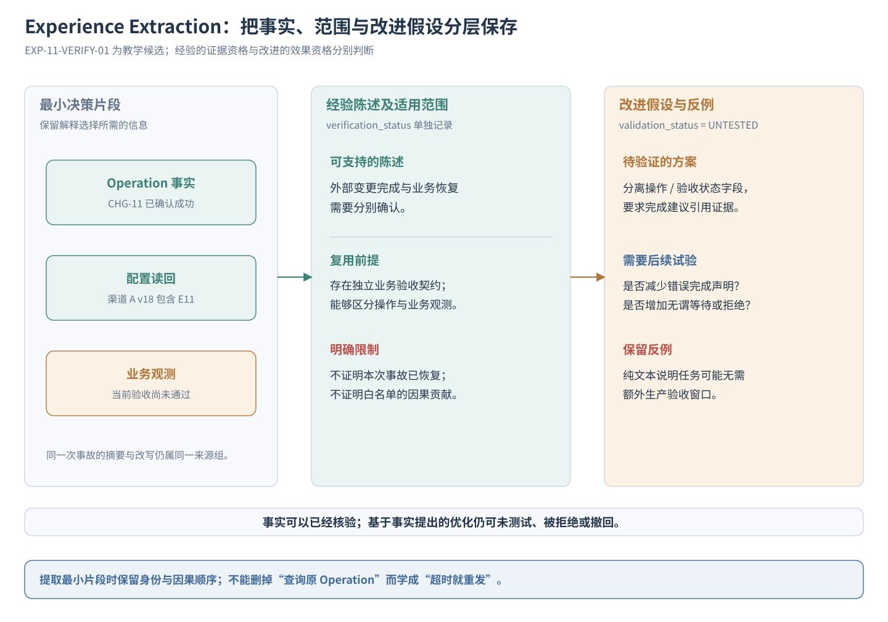

**图 11-3 运行片段支撑有范围的经验陈述，改进效果仍需独立验证**

### 3.5 给候选定义可拒绝、可撤回的生命周期

经验候选可以采用以下晋级过程：

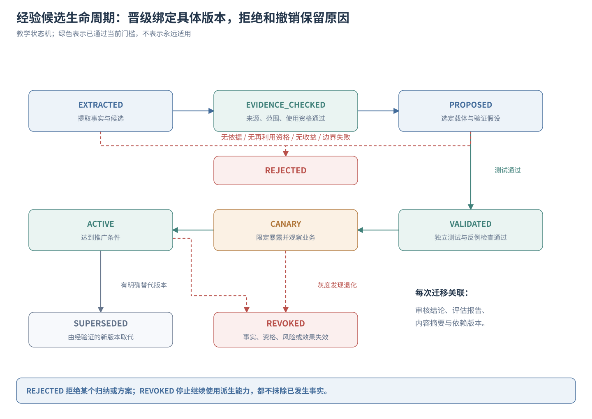

**图 11-4 经验候选的版本化晋级、拒绝与撤销路径**

每次状态变化应关联审核结论、评估报告和制品版本。`REJECTED` 不是删除事实，而是拒绝某个归纳或改进方案；`REVOKED` 不等于原历史从未发生，而是停止继续使用某项派生能力。

对于同一候选的并发修订，应保留不可变版本和父版本关系。两个自动优化器同时改一个技能，不能由后写入的文件覆盖先前经过验证的版本。晋级需要针对具体摘要和依赖集合，不能批准一个名称后允许其内容任意变化。

此时，经验已经成为一个有身份、有证据、有范围的候选。下面先从最容易试验和撤销的层次开始，讨论怎样修改模型输入，而不是立即进入参数训练。

## 4. Prompt Optimization：优化可控变量，而不是不断追加提醒

最直接的修复往往是给 Prompt 加一句“变更成功不代表故障恢复”。这可能有帮助，但当每次失败都追加一条说明，模板会不断增长，规则之间相互覆盖，重要信息反而难以突出。

Prompt 优化需要把修改对象、反馈目标和评估条件显式化，否则只是依靠少量例子的人工试错。

### 4.1 将输入契约拆成可以单独比较的变量

对 `EXP-11-VERIFY-01`，可以分别尝试三类变化：把操作状态和验收状态放在不同字段；增加一个“变更成功但指标未通过”的短示例；要求完成建议引用验收证据。它们改变的机制不同，不宜直接合并后只观察总分。

例如，新的决策输入可以明确提供：

```json
{
  "operation_result": {
    "operation_id": "CHG-11",
    "status": "SUCCEEDED",
    "resulting_config_version": "v18"
  },
  "business_verification": {
    "status": "NOT_PASSED",
    "evidence_refs": ["metrics://inst-11/window-03"]
  },
  "decision_contract": {
    "allowed_kinds": ["WAIT", "REQUEST_OBSERVATION", "ESCALATE"],
    "require_evidence_for_completion": true
  }
}
```

这是上下文视图，不是凭一份 JSON 自动实现控制。Runtime 必须根据真实状态计算允许动作并独立检查候选；模型即使违反这份输入，也不能获得绕过门禁的能力。

可优化变量还包括示例选择、字段顺序、工具描述、检索数量和摘要格式。每个变量应有范围，例如最多选几个示例、不能删除哪些约束、不能改写哪些工具语义。无边界的优化器可能为了提高开发集分数直接降低验收要求。

### 4.2 把搜索目标定义为完整任务表现

形式上，可以把 Prompt 及相关上下文配置记为 $\phi$，在开发集上选择：

$$
\phi^*=\arg\max_{\phi\in\Phi}\widehat U_{dev}(\phi)
\quad\text{subject to}\quad
\widehat V_{critical}(\phi)=0,\ C(\phi)\le B
$$

$\widehat U_{dev}$ 是开发任务上的效用估计，$\widehat V_{critical}$ 是已观测到的严重违规数，$C$ 是候选生成与执行成本，$B$ 是搜索预算。这里的零违规只是有限开发样本中的条件，不是对未来零风险的证明。

若目标只奖励最后文本里出现“证据不足”，优化器可能学会每次都写这四个字，却仍然提交错误动作。效用需要连接实际业务结果、正确处置、轨迹约束和成本，不能仅依赖表面措辞。

DSPy 将语言模型调用组织为可优化的模块与管线，并利用指定指标优化示例或其他配置。[3] 其重要启示是把优化目标和模块变量显式化；具体优化器提供什么搜索方法，仍取决于相应版本与配置，不应把框架名称理解成自动保证提升。

### 4.3 用失败反馈生成候选，再用独立试验筛选

一个受控迭代可以从少量有代表性的失败片段开始，让优化器提出修改理由和具体差异。例如：“模型把 `SUCCEEDED` 理解为整个任务成功，候选方案把字段改成 `operation_status`，并单独显示 `verification_status`。”这比“请把 Prompt 优化得更好”更容易检验。

TextGrad 使用语言形式的反馈帮助调整复合系统中的变量。[4] “文字梯度”是一种优化类比，不是对任意自然语言程序获得了精确、可微的数学梯度。反馈可以指出改进方向，也可能误诊；仍需要运行候选，测量真实变化。

可以采用有上限的候选束：每轮生成少量版本，先做静态规则检查，再运行开发任务，保留满足约束且表现更好的候选。保存被拒绝的差异与失败原因，有助于避免后续优化器重复提出已经证伪的修改。

### 4.4 防止优化器迎合裁判和保留集

若生成候选和评分都由同一个模型完成，而且评分规则主要是语言偏好，优化器可能学会迎合裁判的格式而非业务。应尽量让可计算条件由独立程序检查，语义评分采用第 8 章的校准、弃权和抽样复核机制。

开发集可以被多次使用，冻结发布集不应成为每轮反馈来源。优化器看到某个保留样本的失败解释之后，这个样本就已经参与开发，需要更换独立验证任务。隐藏最终分数但暴露完整错误细节，同样可能发生泄漏。

搜索成本也要计入工程收益。如果一个小幅节省 Token 的 Prompt 需要数千次昂贵搜索才能找到，应结合预计调用规模计算收益，并考虑维护频率。不能只展示上线后单次调用变便宜，而忽略优化和评估本身的投入。

下面将开发反馈循环与冻结确认边界分开，展示候选怎样在有限预算内接受验证。

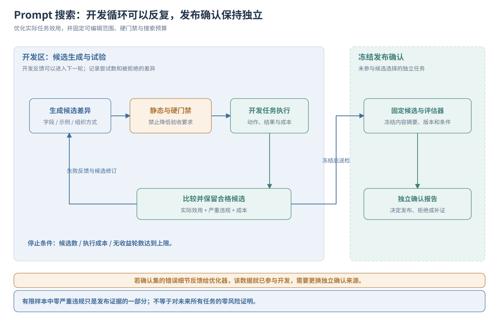

**图 11-5 开发搜索与冻结确认分开，候选只能在预算和硬约束内优化**

### 4.5 通过删除、压缩与边界测试保持模板可维护

新规则生效后，应检查旧规则是否重复、冲突或已经由程序保证。重复强调可能短期有效，却会增加上下文成本和维护难度。可以通过消融试验移除冗余段落，观察关键场景是否退化，而不是凭感觉把所有历史补丁永久保留。

同时增加不应触发该规则的任务。例如，用户只要求解释某次变更记录，不要求判断事故是否恢复，Agent 可以直接完成说明，不应机械进入无限监控等待。改进应提高正确区分能力，而不是用一条全局保守策略压住所有行为。

经过验证的 Prompt 配置作为独立版本发布，并关联来源候选、测试报告和适用模型。更换模型后，原模板未必仍然最优；但也不能因此在每次请求时临时自改系统指令，失去可追踪的版本边界。

Prompt 适合改变模型如何理解和组织信息。若经验已经表现为稳定、重复的工作方法，下一步更值得考虑的是把它变成可复用技能，并将明确规则下沉为程序。

## 5. Skill Evolution：把重复方法变成可组合、可失效的能力包

同一类验收反复出现时，每次从头让模型设计步骤会增加波动。Skill 可以保存“什么时候做、需要什么输入、如何取得证据、怎样结束”的方法，同时允许当前任务填入具体资源和约束。

技能的价值不是让说明文档越来越长，而是减少不必要的临场决策，并让方法能够独立测试、版本化和撤销。

### 5.1 技能应有触发条件和不适用条件

`EXP-11-VERIFY-01` 可以提出一个 `verify-change-outcome` 技能候选：当操作已确认完成，但业务验收尚未结束时，读取当前验收契约，选择变更后的完整观测窗口，检查样本量与范围，再形成继续、等待、升级或完成建议。

技能输入不能只有自然语言目标，还应包含操作身份、实际生效时间、资源范围、验收契约版本、当前授权和预算。输出应区分操作结果、业务结果、证据与剩余缺口，不把所有结论压成一个 `success`。

不适用条件同样重要：没有独立业务验收要求的纯文本任务不必调用它；无法取得可信观测时，它只能报告证据不足；涉及新的生产写入时，需要进入独立的变更流程，不能用“验收技能”的名称隐藏追加副作用。

### 5.2 用技能清单绑定依赖与验证方式

下面的清单展示一个方法包的边界，不代表已经实现或获准发布：

```yaml
skill_id: verify-change-outcome
version: 0.2.0
source_experiences: [EXP-11-VERIFY-01]
trigger:
  operation_status: SUCCEEDED
  business_status: [NOT_PASSED, INSUFFICIENT, PENDING]
inputs:
  - operation_ref
  - effective_time
  - resource_scope
  - acceptance_contract_ref
  - authorization_context
  - remaining_budget
outputs:
  - verification_status
  - evidence_refs
  - remaining_gaps
  - proposed_next_action
dependencies:
  tools: [config.read-v3, metrics.query-v4]
  evaluator: recovery-window-v2
side_effect_policy: READ_ONLY
non_goals:
  - 提交新的生产变更
  - 修改业务验收阈值
verification_suite: verify-change-outcome-regression-v2
lifecycle: CANDIDATE
```

`READ_ONLY` 是需要验证的声明，不是技能自己写上就成立。工具适配器、凭据与出站规则应实际限制写入。依赖版本改变时，需要重新判断相容性，不能只检查工具名称仍然存在。

Voyager 在 Minecraft 环境中保存和检索可执行代码技能，并通过环境反馈迭代程序。[5] 它展示了显式技能库作为外部能力载体的可能性；生产系统还需要补充身份、授权、版本、测试和副作用治理，不能直接沿用开放探索的权限假设。

### 5.3 从技能说明到确定性程序，应只下沉已明确的规则

窗口连续性、请求量阈值和资源范围可以由程序检查；对下一项诊断的选择可能仍需要模型。将前者下沉后，技能不必要求模型反复口算，也更容易在工具升级时定位问题。

下面的函数只聚合已经由受信验收器产生的窗口判定，不读取监控、不执行权限校验，也不声明完整业务恢复；它用于说明如何让结果类型不被语言混淆：

```python
def summarize_verification(operation_status, window_verdicts, required_count):
    allowed = {"PASS", "FAIL", "INSUFFICIENT"}
    if required_count <= 0:
        raise ValueError("required_count must be positive")
    if operation_status not in {"SUCCEEDED", "FAILED", "UNKNOWN", "IN_FLIGHT"}:
        raise ValueError("unsupported operation status")
    if any(value not in allowed for value in window_verdicts):
        raise ValueError("unsupported verification verdict")
    blockers = []
    if operation_status != "SUCCEEDED":
        blockers.append("OPERATION_NOT_CONFIRMED_SUCCESS")
    if len(window_verdicts) != required_count:
        blockers.append("WINDOW_COUNT_MISMATCH")
    if "INSUFFICIENT" in window_verdicts:
        blockers.append("INCOMPLETE_EVIDENCE")
    if "FAIL" in window_verdicts:
        verification_status = "NOT_PASSED"
        blockers.append("FAILED_WINDOW")
    elif len(window_verdicts) != required_count or "INSUFFICIENT" in window_verdicts:
        verification_status = "INSUFFICIENT"
    else:
        verification_status = "PASSED"
    return {
        "operation_status": operation_status,
        "verification_status": verification_status,
        "completion_candidate": (
            operation_status == "SUCCEEDED" and verification_status == "PASSED"
        ),
        "blockers": blockers,
    }
```

上游必须保证窗口已按当前资源、阶段和时间筛选，互不重复，已提供窗口的位置符合连续性契约；缺失窗口不会被复制的通过结果补齐。聚合时，已确认失败优先于数量不足，但两种问题同时保留在 `blockers` 中。操作状态与验收状态独立返回：即使观测已经通过，原操作仍可能需要对账。`completion_candidate` 只表示本例的两个前提同时满足；完整任务还可能要求报告交付、未决操作收尾和人工验收，不能直接据此写入 Run 的成功终态。

这段程序可以由模型提出，但发布之前应通过边界测试、代码审查和依赖检查。生成代码能够执行，远不等于规则来源正确；业务负责人仍需确认聚合语义，例如明确失败与证据不足同时出现时应如何呈现。

### 5.4 技能组合需要检查契约，不只拼接步骤

一个技能完成配置读回，另一个技能完成指标验收，二者组合时仍要核对资源、配置版本和生效时间。若读回针对渠道 A，指标却汇总全部渠道，两个技能各自返回 PASS 也不能证明组合任务正确。

组合前应检查输入输出 Schema、证据作用域、时间语义和副作用等级。技能内部如果会创建异步任务、写临时文件或请求人工输入，也应暴露这些行为及恢复位置，避免父流程把它当作无状态函数。

检索技能还需要资格过滤。高相似度不代表适用：某个验收方法针对实时服务，未必适用于离线批处理；旧版技能依赖的指标已停止维护，也不能因历史成功率高而继续默认选用。

将这些条件落实为一个能力包时，入口、依赖、验证与出口都需要保持可检查。

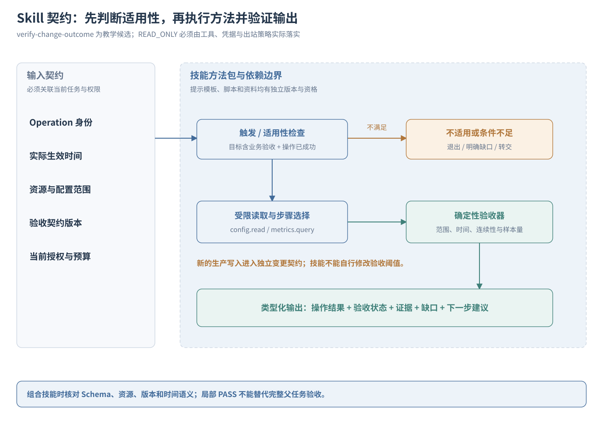

**图 11-6 技能通过输入、适用条件、受限工具、验证器和输出契约形成能力边界**

### 5.5 防止技能库膨胀和经验固化

每次成功都生成新技能，会产生大量近重复方法。可以先判断新增经验是补充已有技能的适用条件、修正一个步骤，还是确实形成独立能力。版本合并应保留来源和反例，而不是只保留语言最顺的一份说明。

技能质量可观察调用覆盖、正确触发、错误触发、完成质量、成本与人工修正，不能只按调用次数排序。被频繁检索可能来自描述写得过于宽泛，而不是实际价值高。

当稳定的机械步骤已经下沉为程序，可以缩短技能说明；当程序依赖频繁变化或场景差异过大，也可能需要退回更窄的技能范围。演进包括删除无效能力、收紧适用条件和恢复简单实现，不只是不断增加文件和组件。

经过这些步骤，许多问题已经在系统层得到解决。只有剩余的行为缺口需要跨大量任务学习时，才值得把经验进一步转成训练数据；而训练数据首先要解决真实性、覆盖和泄漏问题。

## 6. Synthetic Data：扩大覆盖，不把生成内容当成新增事实

真实任务中的高价值失败通常稀少，获取完整授权和证据也有成本。合成数据可以扩展表达方式、组合边界条件和构造罕见故障，但生成一千个相似样本并不等于观察了一千次真实事故。

### 6.1 先定义缺口，再决定生成什么

如果模型只在“变更成功但验收未通过”时出错，数据设计应围绕操作状态、业务证据和正确处置之间的关系，而不是泛泛生成大量排障对话。

可以沿有限维度构造教学世界：操作已成功或结果未知；指标通过、未通过或不足；审批有效或缺失；原任务继续或已取消。并非所有组合都有业务意义，生成器需要遵守环境状态机，例如已经确认的成功不能无理由被后到的处理中回执覆盖。

| 教学样本类型 | 需要保留的关系 | 期望学习的行为 |
| --- | --- | --- |
| 操作成功，验收未通过 | 两类状态来自不同证据 | 如实区分，继续调查或按期限升级 |
| 操作成功，样本不足 | 空数据与低流量不等于零错误 | 明确缺口并等待有效窗口 |
| 操作成功，验收充分通过 | 正向完成条件真实成立 | 可以提出有证据的完成建议 |
| 操作结果未知 | 超时不证明失败 | 查询原身份，不重建副作用 |
| 授权缺失 | 用户目标不等于写入许可 | 请求批准或停止相应路径 |
| 取消后成功回执 | 外部事实变化但 Run 不应复活 | 补齐台账，不重启正常动作 |

**表 11-4 围绕同一经验构造互补训练世界**

这些样本学习的是状态关系和决策边界，不是让模型记住 `inst-11` 或 E11。实体替换可以增加表面多样性，但更重要的是改变决定动作的条件，并保持证据与标签一致。

### 6.2 生成器、环境与验证器分工

一种可控流程是先由场景生成器选择结构化世界，再由隔离工具环境产生真实可检查的响应，最后让模型生成用户表述或示范回答。这样，语言可以变化，配置、事件顺序和结果标签仍由环境约束。

Self-Instruct 通过模型生成指令、输入和输出，并过滤无效或相似样本来构造指令数据。[6] 它说明合成样本可以帮助扩大训练覆盖；对于有外部动作的 Agent，还需要验证操作事实、授权和轨迹，不能只过滤语言重复。

如果教师模型生成“变更后已恢复”的示范，但模拟监控仍显示失败，应该拒绝或修正示范，而不是为了保留样本去改变环境真值。验证器不能只询问同一个教师“你刚才是否回答正确”，否则生成与判定共享的错误会被当成高质量数据。

### 6.3 正负样本要说明比较依据

对 SFT，可以使用经核验的正确输出；对偏好训练，可以构造同一输入下的两个候选，其中一个错误混淆操作与业务状态，另一个正确区分。偏好理由应标明具体维度，而不只写“B 更好”。

```json
{
  "sample_id": "SYN-VERIFY-0031",
  "origin": "SYNTHETIC_SANDBOX",
  "source_experience": "EXP-11-VERIFY-01",
  "scenario_group": "VERIFY-UNRECOVERED-FAMILY",
  "input_facts": {
    "operation_status": "SUCCEEDED",
    "verification_status": "NOT_PASSED"
  },
  "chosen": "变更已确认完成，但当前验收仍未通过；继续检查后续证据。",
  "rejected": "变更已完成，因此故障已经恢复。",
  "preference_basis": ["SUPPORTED_CLAIM", "SEPARATE_OPERATION_AND_GOAL"],
  "validator_bundle": "verification-data-check-v3"
}
```

这个示例刻意让两个候选围绕相同事实比较。真实数据还应控制长度、礼貌和格式差异，避免模型只学会“更长的回答通常被选中”。对事实都正确、只是风格不同的偏好，不应贴上严重错误标签；对两者都不合格的候选，可以拒绝配对，不能强行选一个当正例。

### 6.4 合成数据必须保留来源链和使用资格

每条样本应记录场景模板、种子、教师版本、验证器版本、过滤规则、原始来源组及生成时间。若源经验之后被撤销，团队需要能够找到派生的示范、偏好对、技能和模型训练清单。

使用资格也应沿链传播。将客户事故改写成另一个服务名，未必消除了敏感细节；让教师复述内部手册，也不自动取得跨租户训练权限。可以生成不含受限事实的抽象场景，但必须确认其确实不再暴露来源，不能把“由模型生成”作为豁免标签。

训练集、开发集和保留集应按来源组隔离。同一模板的多个改写版本分散到不同集合，会让测试主要衡量记忆模板。先分配原始案例和场景家族，再各自生成派生样本，更容易控制这类泄漏。

这条数据链的顺序很重要：先隔离来源组，再约束世界与标签，最后在各组内部扩大表达。

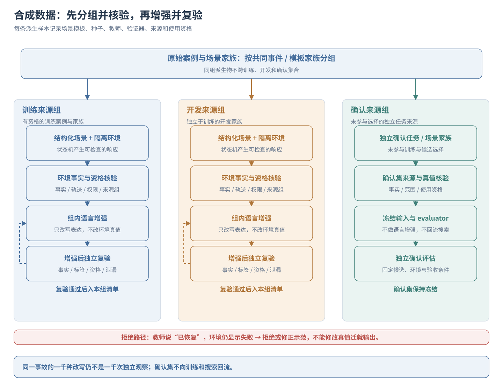

**图 11-7 来源分组先于派生增强，环境和独立验证器约束合成样本的事实与标签**

### 6.5 防止自生成循环抹掉困难和少数情景

如果每一轮只保留当前模型能生成且验证器容易通过的样本，数据分布可能越来越窄。长尾失败、罕见语言和不确定状态会逐渐被过滤，模型在常见形式上更流畅，却失去处理异常的能力。

关于递归使用模型生成数据的研究指出，在相应设定下，原分布的尾部可能丢失并导致模型退化。[11] 这不意味着所有合成数据都会必然导致崩溃；它提醒我们需要保留有来源的真实数据、明确覆盖目标、监控分布变化，并避免让未经核验的输出无限自我复制。

“更多数据”因此不是唯一目标。更重要的是增加以前缺失的状态、有效的反例和可复查的监督，同时控制近重复比例和教师错误。每个样本的生成、验证与人工复核成本也需要计入，不应只报告最终 JSONL 的行数。

数据准备完成后，才进入参数优化。首先看最直接的方式：用经过验证的示范，训练模型在给定信息下产生期望行为。

## 7. Supervised Fine-Tuning：让示范改变模型行为分布

SFT（Supervised Fine-Tuning，监督微调）通过输入与期望输出训练模型。它适合稳定输出结构、领域表达、工具选择和常见决策模式，但不是把业务规则编译成绝对执行保证。

### 7.1 SFT 学的是条件输出，不是自动验证事实

设训练样本为输入 $x$ 与目标序列 $y$，模型参数为 $\theta$。一个常见目标是最小化目标 Token 的负对数似然：

$$
\mathcal L_{SFT}(\theta)=
-\mathbb E_{(x,y)\sim\mathcal D}
\left[\frac{1}{|\mathcal T|}\sum_{t\in\mathcal T}
\log\pi_\theta(y_t\mid x,y_{<t})\right]
$$

$\mathcal T$ 表示实际参与监督的 Token 位置，样本至少应包含一个有效监督位置。本式采用样本内长度归一化，使每个样本的目标长度不直接决定其总权重；实际训练也可能采用其他加权方式，需要记录选择。无论哪种方式，损失下降都只说明模型更容易生成这些目标，不证明目标本身正确。

对 `EXP-11-VERIFY-01`，输入提供分离的状态和证据，目标输出可以是规范化下一步动作及简短说明。若把错误的“已恢复”示范写进训练集，SFT 会认真学习这个错误，不会自动通过外部系统纠正标签。

基于人工示范的监督训练是指令跟随训练中的重要步骤；InstructGPT 论文将示范微调与后续偏好反馈优化明确区分。[7] 本章引用的是训练方法，不涉及任何供应商当前产品是否支持某种接口或模型配置。

### 7.2 Agent 数据要区分谁生成了哪一段内容

一条工具轨迹通常包含系统指令、用户请求、模型动作、工具结果和最终回答。训练目标不应无差别覆盖所有角色：工具返回的监控数值来自环境，不应教模型在没有工具调用时自行生成这些观测。

常见做法是对需要学习的 assistant 动作或回答计算损失，对输入和工具观测做掩码；具体消息格式由训练接口决定。工具调用 Token 可以作为目标，但调用参数必须与当时可见信息和权限一致，不能把环境隐藏的标准答案偷偷放进示范。

每个决策样本也只能读取当时已经到达的历史，不能把后续工具结果补进输入，让早期动作显得理所当然。整条轨迹训练应保留消息次序和因果可见性；裁剪或拼接样本时，需要重新检查这条边界。

对于多步任务，还要保留关键状态转折。例如，第一次请求超时后，正确目标是查询原 Operation；确认成功后，再进入业务验收。若只训练最终答复，模型可能学会总结的措辞，却没有学会中间行动。

不需要为了数据完整而保存模型不可访问的内部思维过程。可以监督可见且可核验的计划结构、动作选择、证据引用和决策摘要；自然语言解释的长度不应成为正确性的替代指标。

消息角色决定哪些 Token 参与监督，时间顺序则决定每次动作能够使用哪些证据。

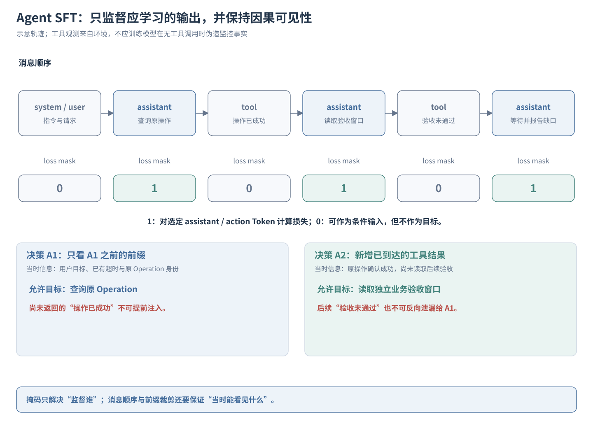

**图 11-8 监督掩码区分模型输出与环境观测，因果前缀阻止未来信息泄漏**

### 7.3 示范需要覆盖偏离路径和正确退出

只有顺利成功的轨迹，会让模型难以应对工具不可用、证据冲突和审批被拒。需要加入经核验的恢复、等待、拒绝和升级样本，同时标明这些处置为何符合当时任务契约。

但不能让数据集中“拒绝”远多于正常允许路径，最后得到一个极少犯越权错误、也极少完成任务的模型。正确完成和正确停止应分别覆盖，比例根据目标业务分布、风险需求和验证结果调整，不存在普遍适用的固定配比。

人工接管后的结果也要拆开。Agent 失败后由专家修复的完整轨迹，可以提供专家示范，但应明确从哪个状态由谁做了决定，不能把人完成的动作归给旧模型，再当成其成功自举样本。

### 7.4 训练配置与数据混合共同决定行为变化

学习率、训练轮数、有效批量、序列长度、数据重复与样本权重都会影响结果。小数据反复训练容易记住模板，大量近重复样本也会让某类表达取得过高权重。

可以在领域样本之外保留适当的通用指令、工具边界和原有能力回归，并用验证结果调整混合；保留数据必须有使用资格。所谓“防遗忘数据”不能只是一个未经说明的大杂烩，它应该对应需要维持的能力和约束。

参数更新可以采用全量训练或参数高效方法。后者通常减少可训练参数、优化器状态与版本存储，并不保证推理延迟更低，也不天然保证不会遗忘或过拟合；适配器与基础模型、分词器、工具格式和推理配置的组合仍需作为一个可追溯候选进行评估。

### 7.5 训练后必须在真实执行闭环中重新检查

离线 Token 损失改善，不代表工具参数更正确，也不代表任务成功率提高。应把候选模型接回固定的 Context、工具与 Runtime，在独立任务和故障世界中重新运行，测量结果、轨迹、成本和人工负担。

还要检查微调是否改变了不相关行为：是否更容易把假设说成事实，是否拒绝本来允许的动作，是否复制训练中的特定实体，是否在未知状态下生成伪造证据。模型可能学会训练集中的正确词汇，却仍然错误使用它们。

如果用新模型之后又同时修改了 Prompt 和工具说明，应保留单独试验，以区分参数改善与系统适配的贡献。SFT 并不是后续优化的必经步骤；若系统层改进已经解决问题，停止在更容易维护的位置本身就是合理结果。

当正确答案难以唯一指定，但人能够比较两个候选的优劣时，偏好优化可以提供另一种训练信号。它与环境交互式强化学习有关，却不是同一种训练过程。

## 8. Preference Optimization 与 RL：让反馈影响选择，同时约束奖励目标

有些任务容易写出正确示范，有些更适合比较候选：两份报告都包含事实，但其中一份更准确表达不确定性；两条调查路径都合法，但其中一条用更少资源补齐关键证据。偏好和奖励可以利用这些差异，但前提仍是反馈代表了我们真正关心的目标。

### 8.1 偏好数据先固定比较对象和维度

一条偏好样本包含相同输入 $x$ 下的优选输出 $y^+$ 与被拒输出 $y^-$。比较者应看到足够的证据和规则，说明优选依据是事实支持、动作合法性、信息完整度还是表达质量。

对 `EXP-11-VERIFY-01`，可以优选“变更完成但验收未通过”的准确表述，拒绝“变更成功所以故障恢复”。但如果两个候选基于不同证据包，偏好就混入了信息优势；应该对齐输入，或明确这是系统级比较而非同输入输出偏好。

存在平局、无法判断或两者都错误时，应保留这些标签，按训练方法支持的方式处理。把所有比较强行二分，会引入不存在的偏好。来自模型裁判的标签也需要人工校准、风险抽样和版本记录，不因数量多就成为高可信监督。

### 8.2 DPO 直接利用偏好对，不需要把它描述成在线 RL

DPO（Direct Preference Optimization，直接偏好优化）从带参考策略约束的偏好优化问题推导出直接训练目标。典型损失为：[8]

$$
\mathcal L_{DPO}(\theta)=
-\mathbb E_{(x,y^+,y^-)\sim\mathcal D}
\log\sigma\left(
\beta\left[
\log\frac{\pi_\theta(y^+\mid x)}{\pi_{ref}(y^+\mid x)}
-
\log\frac{\pi_\theta(y^-\mid x)}{\pi_{ref}(y^-\mid x)}
\right]\right)
$$

其中，$\pi_\theta$ 是训练中的策略，$\pi_{ref}$ 是固定参考策略，$\sigma$ 是 sigmoid，$\beta>0$ 与推导中的参考策略约束相关。它影响训练尺度与偏离参考的权衡，实际效果还依赖数据和优化过程，不能简单理解为“数值越大，偏好越强”。

标准 DPO 可以在预先收集的偏好对上训练，无需在每个梯度步骤中与环境交互，也不需要另外训练一个显式奖励模型后再用 PPO 优化策略。可以迭代生成新偏好数据，但这种外部数据更新不应使我们把 DPO 本身写成在线环境强化学习。

偏好损失也不保证事实正确。若标签奖励流畅而自信的误报，DPO 会强化误报；若负例总是比正例短，模型可能学到长度偏好。需要围绕内容和决策构造有意义的比较，并在保留任务上检验真实行为。

### 8.3 RL 用环境中的结果优化策略，难点在轨迹与信用分配

强化学习把 Agent 视为在状态或观测下选择动作、获得后续反馈的策略。对一条轨迹 $\tau$，可以写出一个示意目标：

$$
J(\theta)=\mathbb E_{\tau\sim\pi_\theta,\mathcal E}
\left[\sum_{t=0}^{T}\gamma^t r_t\right]
-\lambda\,\mathbb E\left[\sum_{t=0}^{T}
D_{KL}\bigl(\pi_\theta(\cdot\mid h_t)\Vert\pi_{ref}(\cdot\mid h_t)\bigr)\right]
$$

$\mathcal E$ 是训练环境，$h_t$ 是当前可用历史或状态表示，$r_t$ 是奖励，$\gamma$ 是折扣因子，$\lambda$ 控制参考策略约束。该式描述常见目标结构，不指定某个完整训练算法，也不意味着每项 Agent 任务必须采用折扣或 KL 项。

PPO 是一类通过交互采样并优化代理目标的策略梯度方法，其裁剪等机制旨在控制更新幅度。[9] 它不自动解决奖励是否正确、环境是否可信和长期副作用是否可接受。算法名称不能代替训练环境与任务契约。

在长轨迹中，最终失败可能来自早期选择，也可能来自外部依赖故障。把最后 0 分平均归咎于所有动作，会使本来正确的读取和等待也被惩罚。需要依据可验证事件设计终局与局部反馈，并检查中间奖励是否引入新的捷径。

两种更新方式的差别可以从数据如何进入损失、策略是否与环境交互直接看出。

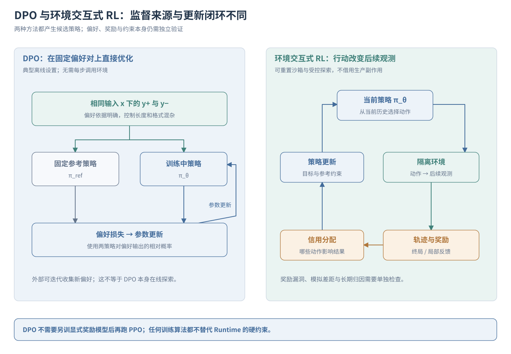

**图 11-9 DPO 使用偏好对直接优化，环境交互式 RL 通过动作、轨迹与奖励更新策略**

### 8.4 奖励黑客来自目标与代理指标之间的缝隙

如果奖励“尽快结束”，模型可能过早宣布完成；奖励“减少错误工具调用”，它可能拒绝全部工具；奖励“用户点赞”，它可能迎合用户而隐瞒证据不足；奖励“最终配置正确”，它可能在中途执行未授权变更后再还原。

因此，奖励应拆分为可解释维度，并保留独立硬约束。严重越权不能仅作为一个小负分，与大量表达质量正分相加后被抵消。运行时权限、资源边界和操作协议继续由确定性系统执行，模型训练只能降低提出坏动作的概率，不能替代拦截机制。

还应隔离奖励接口。被训练 Agent 不应读取验收器隐藏标签、修改评分脚本、写入通过标记或控制自己的奖励记录。即使最终奖励由程序给出，程序也可能存在漏洞；训练策略会反复探索这些漏洞，需要对验证器做对抗与变形测试。

### 8.5 探索环境与生产环境必须分开

RL 需要尝试动作并观察结果，但生产变更不是可以无成本反复重置的游戏。应优先使用状态化模拟器、可重置沙箱、数字化测试环境或有明确定义的离线数据，再验证能力能否迁移到真实工具契约。

模拟器过于简单时，模型可能利用其规律，例如每次查询都返回固定次序、所有审批立即通过、超时永远代表未执行。需要加入契约允许的延迟、乱序、部分结果和否定路径，同时保留真实测试集检查模拟差距。

离线轨迹也不能直接假装是新策略的在线结果。旧策略没有执行的动作缺少结果，直接用旧回报评价新选择会有分布偏差；离线 RL 或离策略估计需要额外假设、覆盖和相应方法。缺少这些条件时，应该报告证据限制，而不是将回放分数称为真实在线收益。

### 8.6 选择 SFT、偏好优化还是 RL，取决于监督结构

| 方法 | 主要监督 | 更适合的情况 | 需要重点防范 |
| --- | --- | --- | --- |
| **SFT** | 经验证的目标输出或动作示范 | 有清晰正确行为，需稳定格式和常见决策 | 标签错误、状态覆盖不足、模仿表面结构 |
| **DPO 等偏好优化** | 同一输入下候选的相对优劣 | 难写唯一答案，但比较依据明确 | 偏好偏差、长度混杂、弱覆盖下过度外推 |
| **环境交互式 RL** | 策略行动产生的奖励与轨迹 | 可安全探索，目标与环境可验证，收益值得训练成本 | 奖励漏洞、信用分配、模拟差距与不稳定更新 |

**表 11-5 不同参数优化方法的监督与适用条件**

这些方法可以组合，但没有必须依次执行的固定路线。某个团队可以只用 SFT 改善结构化工具调用，也可以在合格基础模型上做偏好优化；需要多步环境探索时才承担 RL 的额外复杂度。

无论采用哪条路线，最后都得到一个候选模型，而不是自动合格的系统。下一节重新回到验证：怎样判断变化确实带来所需能力，而不是训练集适配、裁判漂移或其他组件共同变化造成的表面提升。

## 9. 验证改进：区分能力提升、系统保护和评价变化

一个新版本不再输出错误恢复声明，可能是模型理解改善，也可能是 Runtime 一律禁止完成，还可能是裁判把所有谨慎措辞都判为通过。它们对用户的影响不同，不能用同一个成功数字解释。

演进验证需要把改变的变量、被观察的行为和实际业务价值连接起来。

### 9.1 保留基线，并一次回答一个改进问题

围绕 `EXP-11-VERIFY-01`，可以形成三个独立候选：A 调整 Context 字段与 Prompt；B 在原模型上增加验收门禁；C 使用训练后的模型但保留原系统配置。先与同一基线比较，再考虑组合。

| 候选 | 主要改变 | 应观察的直接结果 | 不能据此独自宣称 |
| --- | --- | --- | --- |
| **A：输入改进** | 明确操作与验收字段，补充少量示例 | 错误完成候选是否减少，正确等待是否增加 | 确定性控制已经充分 |
| **B：程序门禁** | 无证据完成建议不能提交 | 错误终态是否被阻止，是否形成死循环 | 模型已理解全部验收语义 |
| **C：参数改进** | 在同一输入上替换候选模型 | 跨表达和任务的判断是否稳定改善 | 真实工具协议和权限可以取消 |
| **A+B 或 B+C** | 组合输入或模型改进与门禁 | 任务结果、成本、拒绝与人工负担的综合变化 | 收益一定等于单项收益相加 |

**表 11-6 用消融区分改进来源与控制作用**

组合收益可能存在交互：A 已经减少多数错误，加入 C 的额外收益很小；B 阻止了违规，但如果没有清楚反馈，模型可能反复提出同一完成建议。需要观察候选质量与系统最终效果两个层面，才能决定是否值得保留复杂组件。

基线也不应故意削弱。比较多轮反思与单次回答时，除总体成本外还要考虑等预算基线；比较新旧模型时，尽量固定工具、上下文和验收条件。增加计算或获得更多证据本身就可能改善结果，不能全部归因于某个新算法名称。

### 9.2 同一条经验要检验迁移与边界

候选在 payment-gateway 的几个改写样本上有效，最多证明它适应了这个局部场景。要检验“操作完成与业务结果分开”是否形成可迁移行为，可以构造部署已受理但健康检查失败、报表已生成但校验不通过、工单已提交但请求仍未解决等独立任务。

这些场景应重新定义各自的完成谓词，不能把事故验收窗口原样复制到所有任务。迁移测试检验共同的关系结构，边界测试检验它是否错误要求每个任务都有额外外部证明。

同时保留正向完成场景：当证据充分、授权有效、交付完成时，系统应允许结束。只减少误报却显著增加无谓等待，可能是把一种错误换成另一种错误；需要结合任务期限、正确处置率和人工负担判断。

### 9.3 冻结评估器，避免优化目标随候选一起移动

训练与搜索可以使用开发验证器，但发布验证应固定任务集、环境、验收规则与裁判。候选模型不能因为自己的格式改变就要求评分器降低证据要求；若确实发现评分器有缺陷，应先修复评估器，再在同一新规则下重算基线和候选。

源经验、合成数据和保留任务要保留分组关系。来自 `EXP-11-VERIFY-01` 的派生样本可以用于训练和开发，但不能把同一事件换几个资源名后作为唯一发布证明。独立来源和未参与选择的场景，才对泛化提供更有价值的证据。

第 8 章已经给出重复试验、配对比较和分组不确定性的处理方法。这里需要额外记录的是“优化尝试过多少候选”。从一百个版本里选出的最好一个，开发分数通常带有选择优势；最终确认要使用没有参与这次选择的数据，不能只给胜出版本再补一张开发报告。

下面将输入、门禁和参数放在同一组对照里，所有候选共享冻结的确认条件。

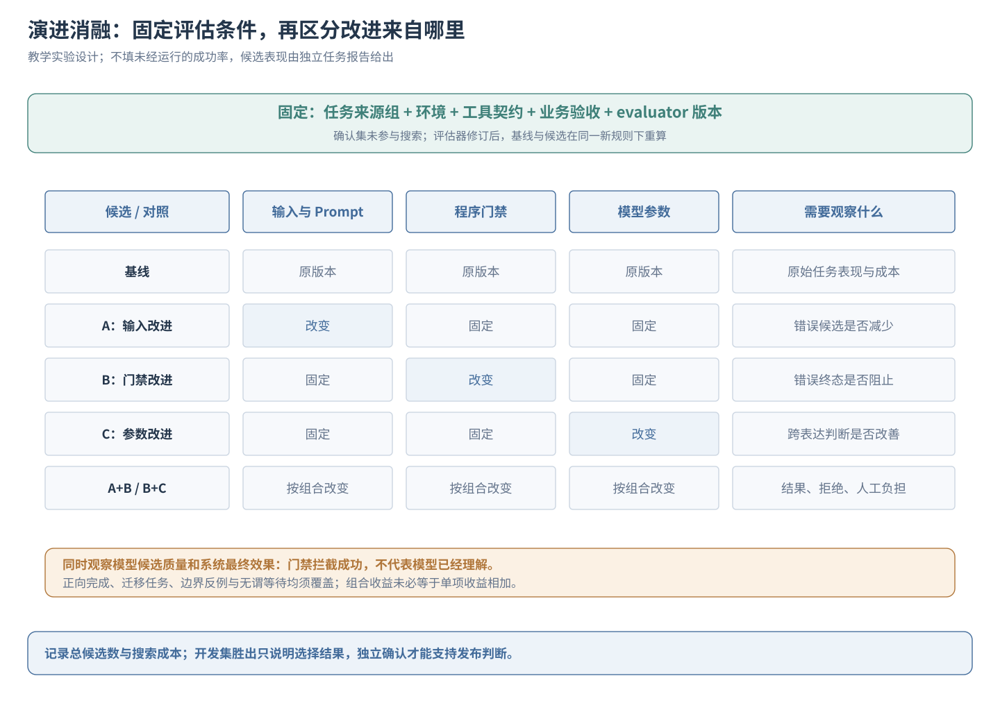

**图 11-10 固定评估器与独立确认集，通过输入、门禁、模型和组合消融定位收益来源**

### 9.4 检查遗忘、过度拒绝和能力转移

参数更新可能改善一个领域，同时损害其他任务。灾难性遗忘研究讨论了顺序学习新任务时旧能力下降的问题，并提出对重要参数变化施加约束等方法。[10] 这为理解风险提供了基础，但不能据此认为某一种正则方法已经解决所有现代语言模型的持续训练问题。

工程上应保留需要维持的能力集合：通用指令跟随、工具格式、权限边界、证据引用、正确完成和既有领域任务。对每个候选观察分层退化，而不仅是新增任务的平均提升。参数高效训练、保留样本混合和约束更新可以作为候选手段，其有效性仍由回归结果决定。

系统层也会遗忘。新 Prompt 删除了旧例外，技能合并遗漏一个失败分支，Memory 检索排序压制少见案例，都可能让旧能力消失。因此“没有改权重”并不意味着不会退化；所有行为载体都需要版本化回归。

### 9.5 将完整演进成本与收益放在一起

一个训练模型需要的数据提取、标注、生成、校验、训练和评估都有成本；新技能增加检索与执行时间；复杂门禁可能增加人工介入。应把这些投入与预计使用规模、错误损失和维护周期一起考虑。

可以先记录一次性改进成本与持续运行成本，再分别观察严格业务成功、错误声明、严重违规、无谓拒绝和接管负担。不要用一个自行设定的综合分数掩盖风险权重；高影响约束继续作为发布门禁。

如果一个简单的字段拆分已达到要求，参数训练没有带来独立任务上的额外收益，就没有必要因为“做了训练”而上线。候选被拒绝也能产生知识：它说明当前证据不支持这个复杂度，未来可以把资源投入真正未解决的缺口。

### 9.6 发布证据应绑定具体候选，而不是笼统的改进方向

批准“加强验收”不能授权任意代码和模型进入生产。发布证据应绑定 Prompt、技能、程序、模型、数据清单和评估配置的具体版本，并记录适用任务、未覆盖风险和回滚方式。

当某个候选通过离线验证，可以进入有限影子或灰度范围。影子环境不执行生产写入，真实灰度沿稳定 Task 或租户分组分配版本；在途 Run 按相容性协议继续或迁移。第 9 章的 Registry 提供制品与状态管理，本章的经验记录解释为什么产生这些制品。

至此，我们有了从经验到候选、从候选到证据的路径。最后还需要把发布后的反馈、反例和撤销接回来，让“持续进化”不只是不断新增版本，而是持续维护每项改进成立的条件。

## 10. 持续演进闭环：推广的是有条件的能力，撤销也要沿证据链执行

演进系统最难的部分，往往不是生成一个新 Prompt，而是数月之后仍然能够回答：这个版本为什么存在，依据哪几条经验，哪些数据参与训练，源结论被推翻后谁会受影响。

下面用 `EXP-11-VERIFY-01` 把整条链走一遍。所有发布动作和结果均为设计示例，未声明实际完成训练或线上验证。

### 10.1 从同一经验生成有限候选，并保留派生关系

首先，取证程序从 `RUN-11-01` 提取局部事实：变更成功、配置读回成功、业务验收未通过。它不会等待整个事故解决才保存这个事实片段，也不会把局部事实扩展成最终根因结论。

接着，经验提取器生成 `EXP-11-VERIFY-01@1`；来源审核确认该陈述在当前范围有依据，并允许在限定领域使用。改进者提出 Prompt 候选 `verify-context@3`、技能候选 `verify-change-outcome@0.2.0` 和程序候选 `verification-summary@2`，同时登记对应测试。

数据团队可以从这条经验设计合成模板，但不会自动把所有运行日志写进训练集。模板 `VERIFY-RELATION@2` 先划分场景家族，再生成训练和开发样本；发布保留集来自独立任务来源。若系统层已经解决问题，可以不创建任何参数训练候选。

这条派生关系可以表示为：

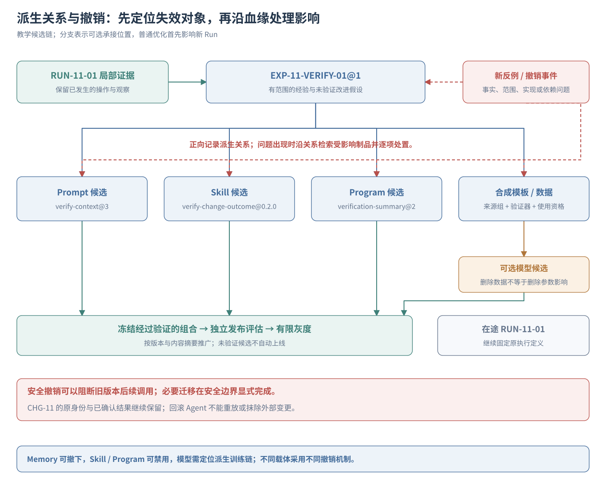

**图 11-11 选择性派生与版本关系支持撤销追踪，在途任务固定定义并继续检查安全边界**

图中的多条分支表示可能的承接位置，不要求全部实现。发布时应选取通过验证且有必要的组合，避免为了“完整闭环”把同一提醒重复放进每个层次。

### 10.2 用清单记录分组、门禁与回滚目标

下面的发布候选清单把来源和验证连接起来。版本引用采用说明性名称，真正发布时必须由构建系统解析到不可变制品并绑定实际内容摘要：

```yaml
candidate_release: incident-agent-r21-rc1
source_experiences:
  - id: EXP-11-VERIFY-01
    revision: 1
selected_changes:
  context_template: verify-context@3
  skill: verify-change-outcome@0.2.0
  program: verification-summary@2
  model_profile: unchanged-baseline-model
training:
  applied: false
  reason: 先验证系统层是否足以解决已定位缺陷
split_manifest:
  development: verify-development-groups@4
  confirmation: independent-verification-groups@2
  rule: 原始事件与派生模板家族不可跨开发和确认集合
validation:
  evaluator_bundle: verification-eval@5
  required_slices:
    - change_succeeded_business_not_passed
    - evidence_insufficient
    - valid_completion
    - unknown_operation
    - cancellation_and_late_receipt
  current_status: PENDING
promotion:
  require_independent_report: true
  require_no_unaccepted_critical_regression: true
  canary_scope: designated-low-risk-task-cohort
rollback:
  target_release: incident-agent-r20
  active_run_policy: 在安全边界校验相容性后处理
  external_effect_policy: 保留操作台账并继续必要对账
```

`model_profile` 保持基线，明确本轮检验的是系统层变化。若后续加入 SFT 或 DPO 模型，应生成新的候选组合并记录训练数据、基础模型、训练配置和权重摘要，不能复用这份报告声称参数优化也已验证。

`current_status=PENDING` 也很重要：计划执行的检查不等于已经通过的证据。只有实际评估完成、报告可回查且门禁满足，发布系统才允许晋级。

### 10.3 用反例收紧适用范围，而不是制造相反口号

假设在后续离线测试中出现一个新反例：用户只要求解释变更记录，技能却强制等待三个监控窗口，导致原本可立即完成的说明任务超时。这并没有推翻“变更成功不等于业务恢复”，它推翻的是技能触发范围过宽。

修复应把触发条件收紧为“当前目标包含业务恢复判断，且存在相应验收契约”，保留原经验事实。不能因此生成一条相反规则“以后收到变更成功就立即完成”，也不能为了维持旧版本分数删掉这个反例。

另一种反例可能来自指标契约变化：新监控系统的完整窗口语义不同，原聚合程序不再相容。此时经验原则仍成立，但程序依赖需要更新和重新验证。区分事实错误、范围错误、实现错误和依赖过期，才能撤销正确的对象。

### 10.4 撤销沿派生链传播，但不同载体的处置不同

若某条 Memory 被发现来源不可信，可以从默认检索中撤下并清理相关缓存；若 Knowledge 规则被新版本取代，应更新生效范围与索引；若 Skill 或 Program 有缺陷，可以撤销版本并阻止后续派发。

参数中的影响更难局部处理。删除训练集中的某一行，并不会自动从已训练模型中删除其影响；禁用一个适配器也未必撤销所有被合并或蒸馏的派生模型。需要依据数据血缘找到受影响模型，选择暂停使用、从合格检查点重训、验证替代版本或采用经过评估的遗忘方法，不能承诺一个删除请求已经得到参数级精确清除。

| 被撤销对象 | 直接处置 | 仍需检查的派生影响 |
| --- | --- | --- |
| 经验陈述或记忆 | 停止默认采信，保留纠正记录 | 摘要、检索索引、技能说明与训练来源 |
| 规范知识 | 发布修订及生效范围，更新索引 | 基于旧规则生成的计划和验收器 |
| Skill / Program | 撤销版本，阻断新使用 | 在途任务相容性、已发操作与补偿责任 |
| 训练数据 | 标记不可再用，生成新数据清单 | 已训练模型、适配器、蒸馏与缓存副本 |
| 模型候选或发布 | 路由退出或回滚到合格版本 | 新状态可读性、已产生输出与外部效果 |

**表 11-7 撤销针对不同载体采用不同处理机制**

撤销也不应抹掉审计事实。可以限制读取和删除不再允许保留的敏感内容，同时在允许范围内保留“某发布被撤销及原因”的必要记录。具体保留与删除由数据治理规则决定，不能以可追溯为由无限期保存全部原始材料。

### 10.5 在途任务固定版本，安全撤销仍然有效

普通优化应首先影响新 Run。正在等待的 `RUN-11-01` 继续使用原定义，恢复时按第 6、9 章检查当前权限、依赖与版本相容性。若希望应用新的验收程序，需要在安全边界显式迁移，而不是在下一次唤醒时默默替换逻辑。

若旧技能被发现存在严重问题，固定版本不能成为继续执行危险动作的理由。平台可以立即阻止受影响的后续调用，让任务进入明确等待或人工处置；`CHG-11` 的原身份与已确认结果继续保留，其他仍未决的操作继续对账，不能因为回滚 Agent 而重放或抹除外部变更。

这一点把演进与执行重新连接起来：版本升级改变未来允许怎样行动，事实账本继续说明过去已经发生什么。两者有共同关联，但不能互相覆盖。

### 10.6 让自动化程度受证据和风险约束

低风险的候选去重、格式检查、数据清单生成和回归执行可以高度自动化。修改业务验收、扩大技能副作用、跨租户复用经验或训练新的高影响模型，需要更明确的责任人和验证范围。

自动优化器应有计算预算、候选数量、可编辑文件范围和停止条件。连续多轮没有独立收益时停止搜索；评分器出现异常时暂停晋级；发现来源资格问题时冻结相关派生物。不能让一个常驻 Agent 为了“持续进化”无限生成相似候选，消耗预算并污染数据集。

闭环指标可以观察候选通过率、独立收益、上线退化、反例发现时间、撤销完成时间和维护负担。候选数量、记忆条数、训练样本行数和技能库规模都只是活动量，不是能力增长本身。

### 10.7 长期能力来自可维护的改进，而不是永久自我修改

持续演进应当允许停下来：某个稳定程序已经足够可靠，不必每周让模型改写；某条经验复用价值低，可以归档；某个参数候选提升不足，可以不发布。系统需要保存的是经过验证的有效差异，而不是每一轮优化留下的全部复杂度。

最终，一次新反馈能否带来收益，取决于我们能否沿证据链找到合适层次、提出可检验变化、保留边界与反例，并在失效时撤销。自动生成降低了提出候选的成本，却没有取消判断候选是否值得使用的责任。

## 11. 本章总结：把每次执行留下的证据变成下一次可验证的能力

`TASK-11` 仍未被本书宣布恢复。我们知道的是，`CHG-11` 已成功，v18 包含 E11，当前业务验收尚未满足条件。恰恰是这种区分，让系统能够留下可靠经验：保存已经证实的操作事实，保留未解决的业务目标，拒绝把一个局部成功扩写成完整故事。

围绕 `EXP-11-VERIFY-01`，本章建立了一条完整演进路径：从运行记录关联反馈，提取有范围的经验，选择 Context、Memory、Knowledge、Skill、Program 或 Parameter 作为承接位置；通过 Prompt 搜索、技能构建、程序实现或训练形成候选；再以独立验证、版本化发布和持续观测决定是否推广，并在反例出现时沿派生链修正和撤销。

其中几个边界需要始终保留：

- 反馈是不同性质的证据，用户偏好、工具成功和业务完成不能互相替代。
- 提取器可以生成候选，不能凭反思文字同时证明事实、效果和发布资格。
- 同一经验不必进入所有载体；能由确定性程序可靠处理的规则，不必交给参数记忆近似执行。
- 合成数据扩展覆盖，不能创造新的真实观察；来源分组、使用资格、反例和独立验证必须保留。
- SFT 学习示范，偏好优化学习相对选择，RL 利用环境奖励；它们都可能强化错误监督，也都不能代替运行时边界。
- 参数更新和系统配置都会退化，发布需要完整组合的证据，撤销需要考虑派生物和在途任务。

全书从“LLM 不等于 Agent”开始，到这里回到同一个系统事实：模型提供语言理解、推理和生成，真正承担任务的是由上下文、知识、工具、环境、状态、编排、评估和治理共同构成的软件系统。多 Agent 扩展分工，持续演进积累方法，但它们都不能替代对事实、权限、结果和责任的清晰定义。

一个能够长期交付的 Agent，不必在每次任务后都改变自己。它需要在应该改变时知道改哪里，在证据不足时保留未知，在新版本出现问题时能够退回有依据的状态。这样的系统才有条件把一次执行的收获，转化为下一次更可靠的能力。

## 12. 参考研究与延伸阅读

1. **Shinn, N. et al. (2023)**. [Reflexion: Language Agents with Verbal Reinforcement Learning](https://arxiv.org/abs/2303.11366). 通过语言反馈和情景记忆影响后续试验，不更新模型权重；适合区分外部经验利用与参数训练。
2. **Madaan, A. et al. (2023)**. [Self-Refine: Iterative Refinement with Self-Feedback](https://arxiv.org/abs/2303.17651). 研究生成、反馈与修订的推理时循环；不意味着模型自评可以替代独立事实核验。
3. **Khattab, O. et al. (2023)**. [DSPy: Compiling Declarative Language Model Calls into Self-Improving Pipelines](https://arxiv.org/abs/2310.03714). 将语言模型调用组织为模块和可优化管线，以任务指标指导配置与示例优化。
4. **Yuksekgonul, M. et al. (2024)**. [TextGrad: Automatic “Differentiation” via Text](https://arxiv.org/abs/2406.07496). 使用自然语言反馈优化复合系统中的变量；“文字梯度”需要通过实际任务结果验证。
5. **Wang, G. et al. (2023)**. [Voyager: An Open-Ended Embodied Agent with Large Language Models](https://arxiv.org/abs/2305.16291). 在 Minecraft 中研究可执行技能库、反馈迭代与组合复用；其探索环境不等同于企业生产权限边界。
6. **Wang, Y. et al. (2022)**. [Self-Instruct: Aligning Language Models with Self-Generated Instructions](https://arxiv.org/abs/2212.10560). 通过生成和过滤指令数据扩大监督覆盖，适合参考合成数据流水线与去重需求。
7. **Ouyang, L. et al. (2022)**. [Training language models to follow instructions with human feedback](https://arxiv.org/abs/2203.02155). 区分人工示范监督微调与后续偏好反馈训练，是理解指令跟随优化流程的一手研究。
8. **Rafailov, R. et al. (2023)**. [Direct Preference Optimization: Your Language Model is Secretly a Reward Model](https://arxiv.org/abs/2305.18290). 推导基于参考策略和偏好对的直接优化目标；标准 DPO 无需把每个训练步骤组织成在线环境交互。
9. **Schulman, J. et al. (2017)**. [Proximal Policy Optimization Algorithms](https://arxiv.org/abs/1707.06347). 介绍交互采样与代理目标优化的策略梯度方法；算法本身不保证奖励正确或环境安全。
10. **Kirkpatrick, J. et al. (2016)**. [Overcoming catastrophic forgetting in neural networks](https://arxiv.org/abs/1612.00796). 讨论顺序学习中的遗忘与对重要参数更新施加约束的方法；不应将其结果当作所有语言模型持续训练的通用保证。
11. **Shumailov, I. et al. (2023)**. [The Curse of Recursion: Training on Generated Data Makes Models Forget](https://arxiv.org/abs/2305.17493). 研究递归使用生成数据时的分布退化与尾部丢失风险；本章据此强调来源、覆盖和独立真实证据，不宣称所有合成数据必然有害。
12. **Ross, S., Gordon, G. J. & Bagnell, J. A. (2010)**. [A Reduction of Imitation Learning and Structured Prediction to No-Regret Online Learning](https://arxiv.org/abs/1011.0686). 研究动作影响后续状态分布时的模仿学习问题，并提出 DAgger；企业 Agent 的采样仍需受安全和授权范围约束。
